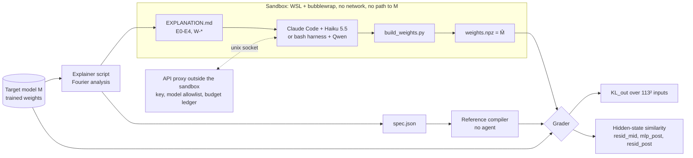

# Verifiable mechanistic interpretability by grading explanations using simulations

**Authors:** Libor "Burny" Burian, [Victor Levoso](https://scholar.google.com/citations?user=BBGcEigAAAAJ&hl=en).
Developed in a mechanistic interpretability hackathon on **automatically evaluating mechanistic interpretability
explanations**, which the authors co-organized in their mechanistic interpretability community and its Discord
server, [mechinterp.com](https://mechinterp.com/).

> **Status (2026-11-21): round 1 of 3 running (N = 1 run per condition — not yet N = 3 or N = 10).** Hypotheses,
> metrics and analyses were preregistered and pushed before any result
> ([reports/preregistration.md](reports/preregistration.md)); every number below is regenerated from `results/` by
> `vmi analyse 1`. Paper draft: [reports/paper.pdf](reports/paper.pdf). Progress: [reports/progress.md](reports/progress.md).
> **Interactive results explorer:** [burnycoder.github.io/…](https://burnycoder.github.io/verifiable-mechanistic-interpretability-by-grading-explanations-using-simulations/).
> Self-review: [reports/reviews/round1-review.md](reports/reviews/round1-review.md).
> Replacement networks, agent transcripts and trained models: [Hugging Face](https://huggingface.co/BurnyCoder/grading-explanations-by-simulation)
> ([collection](https://huggingface.co/collections/BurnyCoder/grading-mechanistic-explanations-by-simulation-6b01ab93022d76813a8b5c02)).

## In one paragraph

**Plain language.** People (and now AI agents) write explanations of how neural networks work. How do we check an
explanation automatically? We hand it to a second AI agent that has *never seen the network* and has *no internet*,
and ask it to build the network from scratch using only the explanation. If the rebuilt network behaves like the
original **and** computes the same intermediate quantities, the explanation captured the mechanism. If it only gets
the answers right, the explanation was incomplete or wrong — there are many ways to get the right answers.

**Expert version.** We test whether *weights-blind simulation* is a valid score for mechanistic explanations. Target:
the one-layer modular-addition transformer of [Nanda et al. 2023](https://arxiv.org/abs/2301.05217) (p = 113).
A script with weights access renders explanations at five levels of true detail (task only → Fourier algorithm → key
frequencies → per-frequency quantities → per-neuron table) plus length-matched wrong explanations (wrong frequencies,
the Pizza algorithm of [Zhong et al. 2023](https://arxiv.org/abs/2306.17844), misattributed components, scrambled
neurons). **Claude Haiku 5.5 in Claude Code**, offline in a bubblewrap sandbox with no path to the weights, writes
`weights.npz` for a replacement of the same architecture; local Qwen models in a bash-only harness are the
simulator-capability ablation. The score is **output KL** over all 113² inputs and **hidden-state similarity (HS)**:
cross-validated ridge-regression variance explained in both directions at three sites — linear because the
no-LayerNorm residual stream is defined only up to an invertible linear map, and no wider because non-linear
alignment makes any network match any algorithm ([Sutter et al. 2025](https://arxiv.org/abs/2507.08802)).

## Key results so far

<!-- BEGIN key-results -->
*Round 1, N = 1 run(s) per condition — not yet N=3 or N=10*

- **Model-specific detail raises hidden-state similarity:** HS on T0 is 0.05 (E1, algorithm only), 0.90 (E2), 0.94 (E3) and 0.91 (E4); with no explanation (E0) it is 0.00. Not monotone: E4 < E3.
- **Correct behaviour, wrong mechanism is caught by HS, not by output KL:** the wrong-frequency replacement reaches KL 9.31e-04 nats (true E3: 0.023) but HS 0.06.
- **Copying behaviour does not copy the mechanism:** independent retrains (HS 0.12) and logit-distilled students (HS 0.23, KL 2.38e-06) stay at the random-initialisation floor (HS 0.24).
- **Negative result:** the primary HS does not separate the Pizza explanation (W-alg, HS 0.89) or the scrambled neuron table (W-scramble, HS 0.92) from the true explanations; the secondary matched-neuron correlation separates W-scramble (0.62) from E4 (0.89).
- **Cost:** all Claude Haiku 5.5 runs so far cost $0.42 in total.
<!-- END key-results -->


**Where the method works and where it does not, in plain words.**
- **Better than output KL:** a network trained with the same recipe from another seed, a network trained to copy the
  target's outputs exactly, and a network built from a *wrong-frequency* explanation all give the right answers —
  output KL rates them as good as or better than true explanations; HS rates them at the bottom, where they belong.
- **Better than chance and than explanation-free baselines:** naming the key frequencies (E2) lifts HS from the
  floor to near the agent-free compiler's value; without model-specific information (E0, E1) the agent builds a
  working adder with none of the target's internals.
- **Worse than hoped (negative result):** HS cannot tell the true Clock explanation from a Pizza explanation with the
  same frequencies, nor a correct per-neuron table from a scrambled one; both keep every frequency subspace intact.
  The secondary matched-neuron correlation catches the scrambled table.
- **Not yet decided:** with one run per condition most preregistered tests cannot reach significance; they are
  reported as "cannot tell at this N" until rounds 2 and 3.

### Scores on the main target T0 (agent vs. agent-free reference compiler)

<!-- BEGIN scoreboard-T0 -->
| Explanation | role | chars | N | agent accuracy | agent KL_out ↓ | agent HS ↑ | agent matched-neuron corr ↑ | compiler KL_out ↓ | compiler HS ↑ |
|---|---|---|---|---|---|---|---|---|---|
| E0 | control: no mechanism | 279 | 1 | 1.000 | 0.009 | 0.004 | 0.020 | 1.64e-04 | 0.051 |
| E1 | method | 1556 | 1 | 1.000 | 1.05e-04 | 0.048 | 0.028 | 1.64e-04 | 0.051 |
| E2 | method | 1788 | 1 | 1.000 | 1.20e-05 | 0.899 | 0.666 | 1.30e-05 | 0.895 |
| E3 | method | 3712 | 1 | 1.000 | 0.023 | 0.939 | 0.828 | 4.25e-04 | 0.927 |
| E4 | method | 51329 | 1 | 0.979 | 0.087 | 0.912 | 0.888 | 0.010 | 0.952 |
| W-freq | control: wrong frequencies | 3724 | 1 | 1.000 | 9.31e-04 | 0.055 | 0.030 | 0.001 | 0.095 |
| W-alg | control: wrong algorithm (Pizza) | 2224 | 1 | 1.000 | 0.015 | 0.889 | 0.666 | 0.040 | 0.921 |
| W-role | control: wrong component roles | 3777 | 1 | 1.000 | 1.09e-04 | 0.168 | 0.015 | 4.727 | 0.500 |
| W-scramble | control: scrambled neurons | 51590 | 1 | 1.000 | 0.003 | 0.918 | 0.621 | 2.02e-05 | 0.859 |
<!-- END scoreboard-T0 -->

### Explanation-free baselines on T0 (no agent)

<!-- BEGIN baselines-T0 -->
| Reference point | what it has | n | task accuracy | KL_out ↓ | HS ↑ |
|---|---|---|---|---|---|
| Random initialisation | nothing (floor) | 5 | 0.009 ± 0.001 | 4.766 ± 0.006 | 0.236 ± 0.006 |
| Independent retrains | same recipe, other seeds | 9 | 1.000 ± 0.000 | 6.90e-06 ± 3.96e-06 | 0.119 ± 0.097 |
| Logit-distilled students | M's full output logits, no explanation | 3 | 1.000 ± 0.000 | 2.38e-06 ± 8.25e-07 | 0.233 ± 0.058 |
| Fourier-restricted M | M's weights, key frequencies only in W_E/W_U | 1 | 1.000 | 0.002 | 0.992 |
| Weights dump | all 226,816 weights | 1 | 1.000 | 0.000 | 1.000 |
<!-- END baselines-T0 -->

### Preregistered hypotheses

<!-- BEGIN hypotheses -->
| Hypothesis | Verdict | Evidence size |
|---|---|---|
| H1 | not supported | at N=1 — not yet N=3 or N=10 |
| H2 | E3>W-freq: cannot tell at this N; E3>W-alg: cannot tell at this N; E3>W-role: cannot tell at this N; E4>W-scramble: not supported | at N=1 — not yet N=3 or N=10 |
| H3 | supported | at N=1 — not yet N=3 or N=10 |
| H4 | E3: cannot tell at this N; E4: cannot tell at this N | at N=1 — not yet N=3 or N=10 |
| H4b | not supported | deterministic |
| H5 | not evaluated yet | – |
| H6 | not evaluated yet | – |
| H7 | cannot tell at this N | 2 E3/E4 replacements (at N=1 — not yet N=3 or N=10) |
| H8 | supported | one replacement, all checkpoints |
<!-- END hypotheses -->

H1 scores improve with true detail · H2 true beat length-matched false explanations · H3 a correct-behaviour,
wrong-frequency explanation fools output KL but not HS · H4 explanations beat independent retrains (and, open
question, logit-distilled students) · H4b the grader is calibrated on a planted mechanism · H5 the agent does not
beat the agent-free reference compiler and the gap shrinks with simulator capability · H6 different simulators rank
explanations the same way · H7 an explanation of one model does not fit another · H8 the score tracks circuit
formation over training. Details and falsifiers: [reports/preregistration.md](reports/preregistration.md).

## How it works




**What happens when you run it.** (1) Target runs are downloaded at pinned revisions. (2) The explainer computes the
target's key frequencies, neuron clusters, attention fits and per-neuron fits and renders every explanation level
from one parameter dict, which also feeds the reference compiler. (3) For each agent run a fresh folder gets the
task files and one explanation. (4) The agent runs offline inside bubblewrap; its only way out is a unix socket to a
proxy (Claude) or relay (llama-server) outside the sandbox, which logs every request and response in full. (5) The
build script is audited for training loops; the grader runs both networks on all 12,769 inputs and computes the
metrics. (6) `vmi analyse` evaluates every preregistered hypothesis and regenerates every table and figure in this
README, the reports and the paper from `results/`.

## Run matrix

Stage 0 (tooling, dev target only), then three rounds — **N = 1 of everything, then N = 3, then N = 10** — each running
main method → controls → baselines → ablations → hyperparameter sensitivity → seed sensitivity. 44 agent conditions
per round: main (T0 × E1–E4), controls (E0, W-freq, W-alg, W-role, W-scramble), ablations (3 Qwen simulators ×
{E2, E3, E4, W-freq}; math and code formats; no self-test), hyperparameter (effort low/high × {E3, W-freq}), seed
sensitivity (T1, T2 × 4; T-new × 3; T-paper × 5 incl. the published explanation). Full table:
[reports/planned-runs.md](reports/planned-runs.md); all runs so far: [reports/experiments/experiments.md](reports/experiments/experiments.md).

## Novelty and related work

Closest work: [iWSP (Mehta et al. 2026)](https://arxiv.org/abs/2611.18114) has Claude Code write and rebuild small
transformers, but only agent-written ones and without output-KL or hidden-state comparison;
[Gao (2026)](https://www.lesswrong.com/posts/Dkh7pXKjoNWkkxQDz/neural-networks-are-not-already-clean) proposes scoring
by substituting simulated activations and measuring downstream KL; [Cammarata et al. 2021](https://distill.pub/2020/circuits/curve-circuits/)
hand-built one circuit and compared activations. New here is the combination: an SGD-trained target, a weights-blind
offline agent that writes the full network, output KL plus a symmetry-aware hidden-state metric, explanation-length
accounting, and no-explanation, wrong-explanation, wrong-target and planted-mechanism controls
([literature review](reports/literature-review.md), [state of the art](reports/state-of-the-art-review.md)).

## Features

- Scripted explanation ladder and wrong-explanation controls rendered from measured quantities (no hand-typed numbers).
- Agent-free reference compiler for every explanation (what the explanation contains, separated from agent skill).
- Weights-blind offline sandbox (bubblewrap: no network, cleared environment, no Windows drives or home, AF_VSOCK
  blocked by seccomp) with an isolation self-check; full, untruncated request/response logs.
- Claude Code mode: API key and workspace id injected by a proxy outside the sandbox, model allowlist, server-side
  web tools refused, per-run and total budget ledger, pre-push secret scan.
- Custom bash-only harness for local models (mini-SWE-agent design), llama-server manager.
- Grader in float64: output KL, cross-validated HS, matched-neuron correlation, CKA, Procrustes, centred-logit FVU,
  calibrated KL, stitching KL.
- No-agent controls and baselines: random init, wrong targets, planted calibration (trained), training trajectory,
  independent retrains, logit-distilled students (trained), Fourier-restricted model, weights dump.
- Preregistered statistics with power-aware verdicts ("cannot tell at this N"); one command regenerates all tables,
  figures, README blocks and the paper.

## Technologies

Python 3.12, PyTorch 2.14 (CUDA 13.0), numpy/scipy, matplotlib, [grokviz](https://github.com/BurnyCoder/visualizing-grokking-modular-addition-in-transformer)
(paper-faithful model, training and Fourier analysis), Claude Code 2.1.330 with Claude Haiku 5.5, llama.cpp b12600
with Qwen3.6-35B-A3B / Qwen3.5-9B / Qwen3.5-4B GGUFs, bubblewrap 0.9 in WSL2 Ubuntu 24.04, pandoc + XeLaTeX, uv,
Hugging Face Hub.

## Setup

Requirements: Windows 11 with an NVIDIA GPU (tested on an RTX 5070 Laptop, 8 GB), WSL2 Ubuntu with bubblewrap,
[uv](https://docs.astral.sh/uv/), llama.cpp b12600 (local models), Claude Code in WSL (Claude runs), pandoc and a
XeLaTeX distribution (paper). Full instructions: [docs/usage.md](docs/usage.md).

```powershell
uv sync
```

```powershell
copy .env.example .env
```

For Claude runs, add `ANTHROPIC_API_KEY` and `ANTHROPIC_WORKSPACE_ID` to `.env` (never committed). Inside WSL, once:

```powershell
wsl bash scripts/setup_wsl.sh
```

## Usage

```powershell
uv run vmi explain T0
```

```powershell
uv run vmi compile T0
```

```powershell
uv run vmi run T0 E3 0 --stage dev --harness claudecode --model claude-haiku-5-5
```

```powershell
uv run vmi queue results/manifests/round1_main.jsonl
```

```powershell
uv run vmi analyse 1
```

```powershell
uv run vmi paper
```

All commands and what they write: [docs/usage.md](docs/usage.md). Module map and design choices:
[docs/architecture.md](docs/architecture.md).

## Repository layout

```
src/vmi/            pipeline package (targets, explainer, reference compiler, simulator, grader, analysis, report)
sandbox_template/   files copied into every agent sandbox (TASK.md, ARCHITECTURE.md, forward.py, selftest.py, starter)
scripts/            WSL-side run, setup and isolation-check scripts; pre-push secret scan
tests/              unit and integration tests (pytest)
results/            raw results (one JSON per graded run, compiler, controls, baselines) — the source of every number
reports/            literature and SOTA reviews, preregistration, plan, progress, experiments, reviews, paper, figures
docs/               usage and architecture
```

## To do

- [x] Literature and state-of-the-art review; preregistration (pushed before any result)
- [x] Targets, explainer, reference compiler, grader, offline sandbox, harnesses (test-first)
- [x] Stage 0 on the dev target; protocol freeze (amendment 2: Claude Haiku 5.5 main simulator)
- [ ] Round 1 (N = 1): main, controls, baselines, Haiku ablations done; local Qwen ablations, hyperparameter and seed
      stages running
- [ ] Rounds 2 (N = 3) and 3 (N = 10)
- [x] Hugging Face repo and collection with replacement weights, transcripts and trained models (updated after each stage)
- [x] Interactive results explorer on GitHub Pages (regenerated by `vmi analyse`)
- [ ] A neuron-level or causal second metric for what HS cannot see (Clock vs Pizza, per-neuron assignment)
- [ ] Other toy models (Clock/Pizza p = 59, the paper's 2-layer and LayerNorm variants, ARENA monthly problems)

## License

MIT ([LICENSE](LICENSE)). Third-party models and code keep their own terms (see the literature review, §6).
