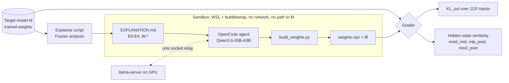

# Verifiable mechanistic interpretability by grading explanations using simulations

**Authors:** Libor "Burny" Burian, [Victor Levoso](https://scholar.google.com/citations?user=BBGcEigAAAAJ&hl=en).
Developed in a mechanistic interpretability hackathon on **automatically evaluating mechanistic interpretability
explanations**, which the authors co-organized in their mechanistic interpretability community and its Discord
server, [mechinterp.com](https://mechinterp.com/).

> **Status (2026-11-21): preregistered, no results yet.** The hypotheses, metrics, analysis plan and falsification
> criteria were written and pushed before any experiment ran: [reports/preregistration.md](reports/preregistration.md).

## In one paragraph

**Plain language.** People (and now AI agents) write explanations of how neural networks work. How do we check an
explanation automatically? We hand it to a second AI agent that has *never seen the network* and has *no internet*,
and ask it to build the network from scratch using only the explanation. If the rebuilt network behaves like the
original **and** computes the same intermediate quantities, the explanation captured the mechanism. If it only gets
the answers right, or not even that, the explanation was incomplete or wrong.

**Expert version.** We test whether *weights-blind simulation* is a valid score for mechanistic explanations. Target:
the one-layer modular-addition transformer of [Nanda et al. 2023](https://arxiv.org/abs/2301.05217) (p = 113).
A scripted explainer with weights access renders explanations at five levels of true detail (task only → Fourier
algorithm → key frequencies → per-frequency quantities → per-neuron table) plus length-matched false explanations
(wrong frequencies, Pizza instead of Clock algorithm, misattributed components, scrambled neurons). A local LLM agent
(OpenCode + Qwen3.6-35B-A3B, offline, in a bubblewrap sandbox with no path to the weights) writes `weights.npz` for a
replacement of the same architecture. The score is **output KL** over all 113² inputs and **hidden-state similarity**:
cross-validated linear-regression variance explained in both directions at three sites — linear because the
no-LayerNorm residual stream is defined only up to an invertible linear map, and no wider because non-linear alignment
makes any network match any algorithm ([Sutter et al. 2025](https://arxiv.org/abs/2507.08802)).

## Why

Agents can now hill-climb interpretability metrics by running known methods and mutating them, so the bottleneck is
moving from *producing* explanations to *verifying* them. The usual ladder of evidence is correlation → steering →
ablation → counterfactual swapping → **simulation** (rebuild the mechanism well enough to reproduce the model). Existing
automated scores simulate single features' activations with an LLM ([Bills et al. 2023](https://openaipublic.blob.core.windows.net/neuron-explainer/paper/index.html);
[Paulo et al. 2024](https://arxiv.org/abs/2410.13928)) and are known to be gameable or blind to mechanism
([Huang et al. 2023](https://arxiv.org/abs/2309.10312); [Poché et al. 2026](https://arxiv.org/abs/2609.08585)).
[Leo Gao](https://www.lesswrong.com/posts/Dkh7pXKjoNWkkxQDz/neural-networks-are-not-already-clean) proposes scoring by
substituting simulated activations and measuring downstream KL. We go one step further: the simulator writes the
**whole network's weights**, and we test whether the resulting score actually tracks explanation quality.

## How it works



What happens when you run it: (1) target runs are downloaded at pinned revisions; (2) the explainer computes the
target's key frequencies, neuron clusters, attention fits and per-neuron fits, and renders each explanation level;
(3) for each run, a fresh sandbox folder is created with the task files and one explanation; (4) the agent runs offline
inside bubblewrap, writing and testing `build_weights.py`; (5) the grader loads `weights.npz`, runs both models on all
12,769 inputs and computes the metrics; (6) analysis scripts evaluate the preregistered hypotheses and regenerate every
table and figure from `results/`.

## Hypotheses (preregistered)

H1 scores improve with true detail · H2 true beat length-matched false explanations · H3 a correct-behaviour,
wrong-frequency explanation fools output KL but not hidden-state similarity · H4 explanations beat independent retrains
(and, open question, logit-distilled students) · H4b the grader is calibrated on a planted mechanism · H5 the agent
does not beat an agent-free reference compiler and the gap shrinks with model size · H6 different simulators rank
explanations the same way · H7 an explanation of one model does not fit another · H8 the score tracks circuit
formation over training. Details and falsifiers: [reports/preregistration.md](reports/preregistration.md).

## Run matrix

Stage 0 (tooling, dev target), then three rounds — **N = 1 of everything, then N = 3, then N = 10** — each running
main method → controls → baselines → ablations → hyperparameter sensitivity → seed sensitivity. 40 agent conditions,
400 agent runs in total; every hypothesis is evaluated after every round and labelled with its N.
Full table: [reports/planned-runs.md](reports/planned-runs.md).

## Repository layout

```
src/vmi/            pipeline package (targets, explainer, reference compiler, simulator, grader, analysis)
sandbox_template/   files copied into every agent sandbox
scripts/            WSL-side run and isolation-check scripts
tests/              unit and integration tests
reports/            literature and SOTA reviews, preregistration, plan, progress, experiments, reviews, paper
results/            raw results (one JSON per graded run) — the source of every number
docs/               documentation
```

## Setup

Requirements: Windows 11 with an NVIDIA GPU (tested on an RTX 5070 Laptop, 8 GB), WSL2 Ubuntu with bubblewrap,
[uv](https://docs.astral.sh/uv/), [OpenCode](https://opencode.ai) 2.3.2 (Linux binary in WSL), llama.cpp b12600.

```powershell
uv sync
```

```powershell
copy .env.example .env
```

The pipeline entry point (`uv run vmi ...`) is documented in [docs/](docs/) as it is implemented.

## Technologies

Python 3.12, PyTorch 2.14 (CUDA 13.0), numpy/scipy, [grokviz](https://github.com/BurnyCoder/visualizing-grokking-modular-addition-in-transformer)
(paper-faithful model, training and Fourier analysis), llama.cpp, OpenCode, bubblewrap, Hugging Face Hub.

## Reused resources

Target models: [BurnyCoder/grokking-modular-addition-runs](https://huggingface.co/BurnyCoder/grokking-modular-addition-runs)
(MIT) and the paper's checkpoint ([mirror](https://huggingface.co/callummcdougall/grokking_full_run_data), not
redistributed). Background and the full list: [reports/literature-review.md](reports/literature-review.md),
[reports/state-of-the-art-review.md](reports/state-of-the-art-review.md).

## To do

- [x] Literature and state-of-the-art review; preregistration
- [ ] Implement targets, explainer, reference compiler, grader, offline sandbox runner (test-first)
- [ ] Stage 0 smoke test; protocol freeze
- [ ] Rounds 1–3 (N = 1, 3, 10)
- [ ] Paper, interactive site, Hugging Face collection
- [ ] Later: Claude Haiku/Opus as simulators in Claude Code (postponed); other toy models (Clock/Pizza p = 59,
      the paper's 2-layer and LayerNorm variants, ARENA monthly-problem models)

## License

MIT ([LICENSE](LICENSE)). Third-party models and code keep their own terms (see the literature review, §6).
