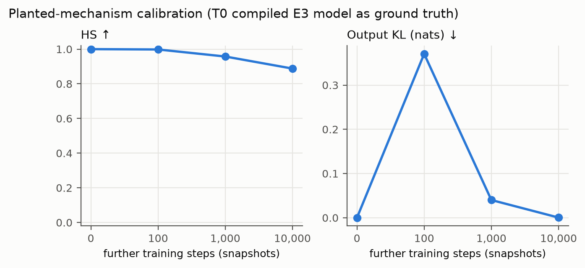
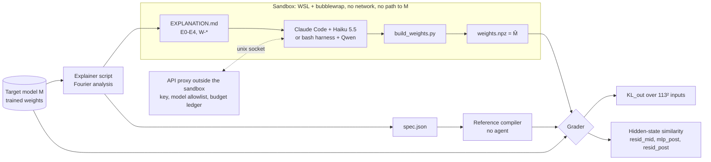

# Verifiable mechanistic interpretability by grading explanations using simulations

**Authors:** Libor "Burny" Burian, [Victor Levoso](https://scholar.google.com/citations?user=BBGcEigAAAAJ&hl=en).
Developed in a mechanistic interpretability hackathon on **automatically evaluating mechanistic interpretability
explanations**, which the authors co-organized in their mechanistic interpretability community and its Discord
server, [mechinterp.com](https://mechinterp.com/).

> **Status (2026-11-21): round 1 (N = 1) complete; round 2 (N = 3) running; round 3 (N = 10) postponed to a later
> day.** Results below are round 1 until round 2's analysis replaces them. Hypotheses,
> metrics and analyses were preregistered and pushed before any result
> ([reports/preregistration.md](reports/preregistration.md)); every number below is regenerated from `results/` by
> `vmi analyse 1`. Paper draft: [reports/paper.pdf](reports/paper.pdf). Progress: [reports/progress.md](reports/progress.md).
> **Interactive results explorer:** [burnycoder.github.io/…](https://burnycoder.github.io/verifiable-mechanistic-interpretability-by-grading-explanations-using-simulations/).
> Self-review: [reports/reviews/round1-review.md](reports/reviews/round1-review.md).
> Replacement networks, agent transcripts and trained models: [Hugging Face](https://huggingface.co/BurnyCoder/grading-explanations-by-simulation)
> ([collection](https://huggingface.co/collections/BurnyCoder/grading-mechanistic-explanations-by-simulation-6b01ab93022d76813a8b5c02)).

## In one paragraph

**Plain language.** People (and now AI agents) write explanations of how neural networks work. How do we check an
explanation automatically? We hand it to a second AI agent that has *never seen the network* and has *no internet*,
and ask it to build the network from scratch using only the explanation. If the rebuilt network behaves like the
original **and** computes the same intermediate quantities, the explanation captured the mechanism. If it only gets
the answers right, the explanation was incomplete or wrong — there are many ways to get the right answers.
*Why it matters:* AI agents can now produce explanations far faster than people can check them, so the checking has to
be automatic too, and an automatic check is only useful if it rewards true explanations and catches wrong ones. This
project tests exactly that, on a small network whose mechanism is well understood.

**Expert version.** We test whether *weights-blind simulation* is a valid score for mechanistic explanations. Target:
the one-layer modular-addition transformer of [Nanda et al. 2023](https://arxiv.org/abs/2301.05217) (p = 113).
A script with weights access renders explanations at five levels of true detail (task only → Fourier algorithm → key
frequencies → per-frequency quantities → per-neuron table) plus length-matched wrong explanations (wrong frequencies,
the Pizza algorithm of [Zhong et al. 2023](https://arxiv.org/abs/2306.17844), misattributed components, scrambled
neurons). **Claude Haiku 5.5 in Claude Code**, offline in a bubblewrap sandbox with no path to the weights, writes
`weights.npz` for a replacement of the same architecture. Local Qwen models in a bash-only harness were tried as a
simulator-capability ablation; every one of their runs built a constant-output network (chance), so they were stopped
after round 1's first five runs. The score is **output KL** over all 113² inputs and **hidden-state similarity (HS)**:
cross-validated ridge-regression variance explained in both directions at three sites — linear because the
no-LayerNorm residual stream is defined only up to an invertible linear map, and no wider because non-linear
alignment makes any network match any algorithm ([Sutter et al. 2025](https://arxiv.org/abs/2507.08802)).
*Motivation:* existing simulation scores predict a neuron's activations from its explanation
([Bills et al. 2023](https://openaipublic.blob.core.windows.net/neuron-explainer/paper/index.html)), and such scores
can fail to separate trained from random networks or be passed without using the explanation
([Heap et al. 2025](https://arxiv.org/abs/2501.17727); [Poché et al. 2026](https://arxiv.org/abs/2609.08585)); we
test the strongest form, rebuilding the whole network, and validate the score itself with preregistered controls.
*Novelty:* to our knowledge the first validation of full-weight, weights-blind simulation on an SGD-trained network,
with output KL plus a symmetry-aware hidden-state metric, an agent-free reference compiler, explanation-length
accounting, and no-, wrong-explanation, wrong-target and planted-mechanism controls (details in
[Novelty and related work](#novelty-and-related-work)). *Stack:* Python 3.12, PyTorch, Claude Code with Claude Haiku
5.5, bubblewrap in WSL2, uv, Hugging Face Hub, GitHub Pages ([Features](#features), [Technologies](#technologies)).

## Predicted vs. measured with Claude Haiku

Before any experiment we wrote down, and pushed to GitHub, what a valid grader should show
([preregistration](reports/preregistration.md) §5). The table puts each prediction next to what Claude Haiku 5.5 and
the grader actually produced; it is regenerated from `results/` after every round, and the last column says how many
runs per condition each verdict rests on.

**In plain words.** We expected the score to reward every bit of true detail and to punish every wrong explanation.
It does reward and punish, but only at the level of *which frequencies* an explanation names, the handful of numbers
the network uses to do the arithmetic (H3, H4, H7, H8 came out as predicted). Three expectations failed: detail
beyond the frequencies did not make the rebuild more faithful (H1); the score cannot tell two algorithms that use
the same frequencies apart, or a correct list of neurons from a shuffled one (H2); and the AI sometimes beat our own
AI-free compiler (H5). Whether stronger AIs do better (H5, H6) could not be tested, because the small local models
never built a working network. "Direction matches" only says whether the numbers went the predicted way; the formal
verdict adds the preregistered statistical test, which needs several runs per condition, so many verdicts still read
"cannot tell at this N".

<!-- BEGIN predictions-plain -->
| Hypothesis | Expected, in plain words | Predicted (preregistration §5) | Measured with the main simulator (T0) | Direction matches? | Formal verdict |
|---|-------|-------|---------|-----|------|
| H1 | The more true detail an explanation gives, the more faithfully the rebuilt network should match the original. | HS rises and output KL falls from E1 to E4 on T0; E0 lies below E1 | HS E0 0.004, E1 0.048, E2 0.899, E3 0.939, E4 0.912; KL E1 1.05e-04, E2 1.20e-05, E3 0.023, E4 0.087 | partly (HS not monotone E1→E4; KL does not fall E1→E4) | not supported · at N=1 — not yet N=3 or N=10 |
| H2 | A true explanation should beat a wrong explanation of the same length. | true explanations beat length-matched false ones on HS: E3 > W-freq, W-alg, W-role; E4 > W-scramble | HS difference E3>W-freq +0.884; E3>W-alg +0.051; E3>W-role +0.771; E4>W-scramble -0.006 | partly (E4>W-scramble reversed) | E3>W-freq: cannot tell at this N; E3>W-alg: cannot tell at this N; E3>W-role: cannot tell at this N; E4>W-scramble: not supported · at N=1 — not yet N=3 or N=10 |
| H3 | A wrong explanation can still give all the right answers; checking only the answers is fooled, checking the insides (HS) should not be. | W-freq: argmax agreement ≥ 0.99, KL not above the true E2–E4 range, HS below each of E2–E4 | W-freq: agreement 1.000, KL 9.31e-04 (true 1.20e-05–0.087), HS 0.055 (true 0.899–0.939) | yes | supported · at N=1 — not yet N=3 or N=10 |
| H4 | Rebuilding from an explanation should match the original's insides better than training a fresh network the same way does. | E3 and E4 beat independent retrains on HS (vs. distilled students: open question, no direction) | E3 0.939, E4 0.912; 9 retrains mean 0.119 (max 0.329); 3 students mean 0.233 (max 0.282) | yes | E3: cannot tell at this N; E4: cannot tell at this N · at N=1 — not yet N=3 or N=10 |
| H4b | On a network whose mechanism we planted ourselves, the score should start perfect and drop as further training moves the network away from it. | planted model: HS = 1 and KL = 0 at step 0, then HS strictly falls and KL strictly rises | HS 1.000 → 0.998 → 0.957 → 0.888; KL 0.000 → 0.371 → 0.040 → 4.25e-04 | partly (KL not strictly rising) | not supported · deterministic |
| H5 | The AI should not beat our automatic, AI-free compiler, and stronger AIs should come closer to it. | agent ≤ reference compiler on every explanation; the gap shrinks with simulator capability | agent − compiler on T0: E2 +0.005, E3 +0.013, E4 -0.040, W-freq -0.039; agent above compiler in 7 of 15 target–explanation pairs (largest +0.161, T2 E3); 5 local runs, 0 above chance | no (agent above compiler somewhere; capability trend not testable) | not evaluable (local simulators stopped at chance, deviation 5) · 5 local runs, qwen3.5-4b: 0/4 above chance, qwen3.5-9b: 0/1 above chance |
| H6 | Different AIs should put the explanations in the same order. | the local simulators rank E2, E3, E4, W-freq the same way | 5 local runs, 0 above chance: nothing to rank | not testable | not evaluable (local simulators stopped at chance, deviation 5) · 5 local runs, qwen3.5-4b: 0/4 above chance, qwen3.5-9b: 0/1 above chance |
| H7 | An explanation of one network should not fit a different network. | a T0 replacement fits T0 better than any other trained or no-mechanism model (HS) | E3: HS 0.939 vs best other 0.274 (T2); E4: HS 0.912 vs best other 0.226 (T2) | yes | cannot tell at this N · 2 E3/E4 replacements (at N=1 — not yet N=3 or N=10) |
| H8 | The score should rise while the original network learns its mechanism during training. | HS against T0's checkpoints rises as restricted loss falls (circuit formation) | Spearman ρ(HS, −log restricted loss) = 0.842 | yes | supported · one replacement, all checkpoints |
<!-- END predictions-plain -->

*Labels.* **T0**: the main target network (unpublished). **E0–E4**: true explanations with increasing detail (E0 task only, E1 algorithm only, E2 + the key frequencies, E3 + per-frequency quantities, E4 + a per-neuron table). **W-freq, W-alg, W-role, W-scramble**: wrong explanations of the same length (wrong frequencies, the Pizza algorithm, wrong component roles, shuffled neurons). **HS**: hidden-state similarity, 0–1, higher means the rebuilt network computes the same intermediate quantities. **KL**: output divergence in nats, lower means the same answers with the same confidence. **Compiler**: our script that turns an explanation into weights without any AI.

**In expert terms.** Where a prediction concerns the frequency level, the main simulator's results go the predicted way (H3, H4, H7, H8, and H2 for W-freq and W-role). The predictions fail where they assumed that every added level of detail helps (H1: HS gains nothing after E2 and output KL rises), that HS sees below the frequency level (H2: W-alg nearly ties, W-scramble is reversed), that the reference compiler is a ceiling (H5), or that output KL grows smoothly as a planted model drifts (H4b: KL spikes after the first optimiser steps, then falls). "Direction matches" compares directions and preregistered thresholds only; the formal verdict adds the preregistered test, which at small N mostly cannot reach significance. On the seed-sensitivity targets the gap between E3 and the wrong-frequency explanation replicates on every target and H1's monotone rise does not; where H3 fails there, the wrong-frequency replacement itself is broken (argmax agreement below the preregistered 0.99), an implementation error of the simulator rather than a property of the explanation. *Kind of evidence:* H1–H3 are
interventions on the explanation with everything else fixed; H4 compares with explanation-free baselines; H7 and the
memorisation target swap are counterfactual swaps of the target network; the format, self-test, effort and simulator
variants are ablations; H8 is a correlation over training checkpoints. *Strength:* with one run per condition each
contrast is an existence proof; the wrong-frequency gap, seen on all five targets, is the only pattern that is
systematic so far.

Replications on the seed-sensitivity targets (preregistration §5: H1–H3 re-tested per target with the same rules):

<!-- BEGIN replications -->
| Target | HS per true explanation | H1: HS rises E2→E4? | H2: HS(E3) − HS(W-freq) | H3 observed (W-freq) | H3 holds? |
|-----|------|---|---|-------|-----|
| T1 | E2 0.955, E3 0.917, E4 0.955 | no | +0.883 | agreement 0.806, KL 0.669 (true max 0.773), HS 0.034 | partly (agreement < 0.99) |
| T2 | E2 0.949, E3 0.944, E4 0.934 | no | +0.855 | agreement 1.000, KL 0.005 (true max 0.112), HS 0.089 | yes |
| T-new | E3 0.846, E4 0.984 | yes | +0.759 | agreement 0.897, KL 0.378 (true max 0.344), HS 0.087 | partly (agreement < 0.99; KL above the true range) |
| T-paper (flagged: memorisation) | E1 0.925, E3 0.944, E4 0.929 | no | +0.852 | agreement 1.000, KL 9.56e-05 (true max 0.518), HS 0.091 | yes |
<!-- END replications -->

## Key results so far

<!-- BEGIN key-results -->
*Round 1, N = 1 run(s) per condition — not yet N=3 or N=10*

- **Model-specific detail raises hidden-state similarity:** HS on T0 is 0.05 (E1, algorithm only), 0.90 (E2), 0.94 (E3) and 0.91 (E4); with no explanation (E0) it is 0.00. Not monotone: E4 < E3.
- **Correct behaviour, wrong mechanism is caught by HS, not by output KL:** the wrong-frequency replacement reaches KL 9.31e-04 nats (true E3: 0.023) but HS 0.06.
- **Copying behaviour does not copy the mechanism:** independent retrains (HS 0.12) and logit-distilled students (HS 0.23, KL 2.38e-06) stay at the random-initialisation floor (HS 0.24).
- **Negative result:** the primary HS does not separate the Pizza explanation (W-alg, HS 0.89) or the scrambled neuron table (W-scramble, HS 0.92) from the true explanations; the secondary matched-neuron correlation separates W-scramble (0.62) from E4 (0.89).
- **Memorisation (post hoc):** when the explanation gives no frequencies (E0, E1), the simulator's 2 replacement(s) on unpublished targets use the paper's published frequencies (mean overlap 0.80 with {14, 35, 41, 42, 52}, 0.00 with the target's own). Grading the same weights against the published checkpoint (target swap): E0: HS 0.00 against T0, 0.63 against the published checkpoint; E1: HS 0.05 against T0, 0.95 against the published checkpoint. A separate algorithm-only run on the published checkpoint scores HS 0.92: scores on published models measure memory, not the explanation.
- **Cost:** all Claude Haiku 5.5 runs so far cost $1.13 in total.
<!-- END key-results -->


**Output examples: which frequencies each network actually built**, against the target's own spectrum (the ground
truth). The true-explanation replacement (E3) builds the target's frequencies; the algorithm-only replacement (E1)
builds the *published paper's* frequencies from memory; the wrong-frequency replacement builds the wrong ones; the
Pizza replacement (W-alg) builds the *same* frequencies as the true ones, which is why HS cannot separate it; an
independent retrain picks other frequencies; a random network has no structure.


| Calibration on a planted mechanism (H4b): HS falls steadily, output KL does not | Score against the target's training checkpoints (H8) |
|---|---|
|  |  |
| **Score against explanation length:** the jump comes with the key frequencies (E2), not with length | **Simulator ablation (negative):** local Qwen models at chance, Haiku near the compiler |
|  |  |

The same results, explorable run by run (hover for each run's numbers; switch target, metric and simulator):
[interactive results explorer](https://burnycoder.github.io/verifiable-mechanistic-interpretability-by-grading-explanations-using-simulations/).
GitHub READMEs cannot run scripts, so the interactive views live there; there is no video.

**Better or worse than the baselines, controls and ablations, in plain words.**
- **Better than output KL:** a network trained with the same recipe from another seed, a network trained to copy the
  target's outputs exactly, and a network built from a *wrong-frequency* explanation all give the right answers —
  output KL rates them as good as or better than true explanations; HS rates them at the bottom, where they belong.
- **Better than chance and than explanation-free baselines:** naming the key frequencies (E2) lifts HS from the
  floor to near the agent-free compiler's value; without model-specific information (E0, E1) the agent builds a
  working adder with none of the target's internals.
- **Worse than hoped (negative result):** HS cannot tell the true Clock explanation from a Pizza explanation with the
  same frequencies, nor a correct per-neuron table from a scrambled one; both keep every frequency subspace intact.
  The secondary matched-neuron correlation catches the scrambled table.
- **A trap the design caught (post hoc):** when an explanation leaves the frequencies open, the agent fills them in
  with the *published paper's* frequencies from memory. On the paper's own checkpoint even an algorithm-only
  explanation then scores like a full one; on our unpublished targets it scores at the floor. The very same
  replacement weights score near the floor against our target and high against the published checkpoint. Scores on published
  models measure memory, so the study's conclusions rest on the unpublished targets.
- **Ablations:** writing the explanation as maths or as code instead of prose, or removing the self-test,
  barely changed HS. Low effort broke the answers but not HS (the frequencies were right, the details wrong). The small local
  models never built a working network from any explanation.
- **Not yet decided:** with one run per condition most preregistered tests cannot reach significance; they are
  reported as "cannot tell at this N" until round 2 (N = 3) completes; round 3 (N = 10) is postponed.

### Scores on the main target T0 (agent vs. agent-free reference compiler)

<!-- BEGIN scoreboard-T0 -->
| Explanation | role | chars | N | agent accuracy | agent KL_out ↓ | agent HS ↑ | agent matched-neuron corr ↑ | compiler KL_out ↓ | compiler HS ↑ |
|---|---|---|---|---|---|---|---|---|---|
| E0 | control: no mechanism | 279 | 1 | 1.000 | 0.009 | 0.004 | 0.020 | 1.64e-04 | 0.051 |
| E1 | method | 1556 | 1 | 1.000 | 1.05e-04 | 0.048 | 0.028 | 1.64e-04 | 0.051 |
| E2 | method | 1788 | 1 | 1.000 | 1.20e-05 | 0.899 | 0.666 | 1.30e-05 | 0.895 |
| E3 | method | 3712 | 1 | 1.000 | 0.023 | 0.939 | 0.828 | 4.25e-04 | 0.927 |
| E4 | method | 51329 | 1 | 0.979 | 0.087 | 0.912 | 0.888 | 0.010 | 0.952 |
| W-freq | control: wrong frequencies | 3724 | 1 | 1.000 | 9.31e-04 | 0.055 | 0.030 | 0.001 | 0.095 |
| W-alg | control: wrong algorithm (Pizza) | 2224 | 1 | 1.000 | 0.015 | 0.889 | 0.666 | 0.040 | 0.921 |
| W-role | control: wrong component roles | 3777 | 1 | 1.000 | 1.09e-04 | 0.168 | 0.015 | 4.727 | 0.500 |
| W-scramble | control: scrambled neurons | 51590 | 1 | 1.000 | 0.003 | 0.918 | 0.621 | 2.02e-05 | 0.859 |
<!-- END scoreboard-T0 -->

### Explanation-free baselines on T0 (no agent)

<!-- BEGIN baselines-T0 -->
| Reference point | what it has | n | task accuracy | KL_out ↓ | HS ↑ |
|---|---|---|---|---|---|
| Random initialisation | nothing (floor) | 5 | 0.009 ± 0.001 | 4.766 ± 0.006 | 0.236 ± 0.006 |
| Independent retrains | same recipe, other seeds | 9 | 1.000 ± 0.000 | 6.90e-06 ± 3.96e-06 | 0.119 ± 0.097 |
| Logit-distilled students | M's full output logits, no explanation | 3 | 1.000 ± 0.000 | 2.38e-06 ± 8.25e-07 | 0.233 ± 0.058 |
| Fourier-restricted M | M's weights, key frequencies only in W_E/W_U | 1 | 1.000 | 0.002 | 0.992 |
| Weights dump | all 226,816 weights | 1 | 1.000 | 0.000 | 1.000 |
<!-- END baselines-T0 -->

### Ablations and hyperparameter variants on T0

<!-- BEGIN ablations-T0 -->
| Change | Explanation | Simulator | N | task accuracy | KL_out ↓ | HS ↑ | matched-neuron corr ↑ |
|---|---|---|---|---|---|---|---|
| none (main condition) | E3 | claude-haiku-5-5 | 1 | 1.000 | 0.023 | 0.939 | 0.828 |
| explanation as maths | E3 | claude-haiku-5-5 | 1 | 1.000 | 7.16e-04 | 0.911 | 0.791 |
| explanation as code | E3 | claude-haiku-5-5 | 1 | 1.000 | 0.002 | 0.918 | 0.805 |
| self-test removed | E3 | claude-haiku-5-5 | 1 | 1.000 | 0.001 | 0.964 | 0.805 |
| effort low | E3 | claude-haiku-5-5 | 1 | 0.562 | 1.974 | 0.922 | 0.720 |
| effort high | E3 | claude-haiku-5-5 | 1 | 1.000 | 0.002 | 0.923 | 0.805 |
| none (main condition) | W-freq | claude-haiku-5-5 | 1 | 1.000 | 9.31e-04 | 0.055 | 0.030 |
| effort low | W-freq | claude-haiku-5-5 | 1 | 0.770 | 1.030 | 0.114 | 0.095 |
| effort high | W-freq | claude-haiku-5-5 | 1 | 1.000 | 0.002 | 0.098 | 0.030 |
| simulator qwen3.5-4b | E2 | qwen3.5-4b | 1 | 0.009 | 4.727 | 0.000 | 0.000 |
| simulator qwen3.5-4b | E3 | qwen3.5-4b | 1 | 0.009 | 4.727 | 0.000 | 0.000 |
| simulator qwen3.5-4b | E4 | qwen3.5-4b | 1 | 0.009 | 4.727 | 0.000 | 0.000 |
| simulator qwen3.5-4b | W-freq | qwen3.5-4b | 1 | 0.009 | 6.066 | 0.000 | 1.41e-16 |
| simulator qwen3.5-9b | E2 | qwen3.5-9b | 1 | 0.009 | 7.628 | 0.000 | 0.000 |
<!-- END ablations-T0 -->

### Preregistered hypotheses

Predicted vs. measured for every hypothesis, in plain words and in expert terms: [top of this README](#predicted-vs-measured-with-claude-haiku). Exact tests and falsification criteria: [reports/preregistration.md](reports/preregistration.md) §5.

## How it works




**What happens when you run it.** (1) Target runs are downloaded at pinned revisions. (2) The explainer computes the
target's key frequencies, neuron clusters, attention fits and per-neuron fits and renders every explanation level
from one parameter dict, which also feeds the reference compiler. (3) For each agent run a fresh folder gets the
task files and one explanation. (4) The agent runs offline inside bubblewrap; its only way out is a unix socket to a
proxy (Claude) or relay (llama-server) outside the sandbox, which logs every request and response in full. (5) The
build script is audited for training loops; the grader runs both networks on all 12,769 inputs and computes the
metrics. (6) `vmi analyse` evaluates every preregistered hypothesis and regenerates every table and figure in this
README, the reports and the paper from `results/`.

## Run matrix

Stage 0 (tooling, dev target only), then three rounds — **N = 1 of everything, then N = 3, then N = 10** (round 3
postponed to a later day, deviation 6) — each running
main method → controls → baselines → ablations → hyperparameter sensitivity → seed sensitivity. 32 Claude Haiku
conditions per round: main (T0 × E1–E4), controls (E0, W-freq, W-alg, W-role, W-scramble), ablations (math and code
formats; no self-test), hyperparameter (effort low/high × {E3, W-freq}), seed sensitivity (T1, T2 × 4; T-new × 3;
T-paper × 5 incl. the published explanation). Round 1 also planned 12 local Qwen conditions (3 simulators ×
{E2, E3, E4, W-freq}); after five runs at chance they were stopped and dropped from rounds 2–3 (preregistration,
deviation 5). Full table:
[reports/planned-runs.md](reports/planned-runs.md); all runs so far: [reports/experiments/experiments.md](reports/experiments/experiments.md).

## Novelty and related work

Closest work: [iWSP (Mehta et al. 2026)](https://arxiv.org/abs/2611.18114) has Claude Code write and rebuild small
transformers, but only agent-written ones and without output-KL or hidden-state comparison;
[Gao (2026)](https://www.lesswrong.com/posts/Dkh7pXKjoNWkkxQDz/neural-networks-are-not-already-clean) proposes scoring
by substituting simulated activations and measuring downstream KL; [Cammarata et al. 2021](https://distill.pub/2020/circuits/curve-circuits/)
hand-built one circuit and compared activations. New here is the combination: an SGD-trained target, a weights-blind
offline agent that writes the full network, output KL plus a symmetry-aware hidden-state metric, explanation-length
accounting, and no-explanation, wrong-explanation, wrong-target and planted-mechanism controls
([literature review](reports/literature-review.md), [state of the art](reports/state-of-the-art-review.md)).

## Features

- Scripted explanation ladder and wrong-explanation controls rendered from measured quantities (no hand-typed numbers).
- Agent-free reference compiler for every explanation (what the explanation contains, separated from agent skill).
- Weights-blind offline sandbox (bubblewrap: no network, cleared environment, no Windows drives or home, AF_VSOCK
  blocked by seccomp) with an isolation self-check; full, untruncated request/response logs.
- Claude Code mode: API key and workspace id injected by a proxy outside the sandbox, model allowlist, server-side
  web tools refused, per-run and total budget ledger, pre-push secret scan.
- Custom bash-only harness for local models ([mini-SWE-agent](https://github.com/SWE-agent/mini-swe-agent) design), llama-server manager.
- Grader in float64: output KL, cross-validated HS, matched-neuron correlation, CKA, Procrustes, centred-logit FVU,
  calibrated KL, stitching KL.
- No-agent controls and baselines: random init, wrong targets, planted calibration (trained), training trajectory,
  independent retrains, logit-distilled students (trained), Fourier-restricted model, weights dump.
- Preregistered statistics with power-aware verdicts ("cannot tell at this N"); one command regenerates all tables,
  figures, README blocks and the paper.

## Technologies

Python 3.12, PyTorch 2.14 (CUDA 13.0), numpy/scipy, matplotlib, [grokviz](https://github.com/BurnyCoder/visualizing-grokking-modular-addition-in-transformer)
(paper-faithful model, training and Fourier analysis), Claude Code 2.1.330 with Claude Haiku 5.5, llama.cpp b12600
with Qwen3.6-35B-A3B / Qwen3.5-9B / Qwen3.5-4B GGUFs (tried; stopped at chance), bubblewrap 0.9 in WSL2 Ubuntu 24.04, pandoc + XeLaTeX, uv,
Hugging Face Hub.

## Setup

Requirements: Windows 11 with an NVIDIA GPU (tested on an RTX 5070 Laptop, 8 GB), WSL2 Ubuntu with bubblewrap,
[uv](https://docs.astral.sh/uv/), llama.cpp b12600 (local models), Claude Code in WSL (Claude runs), pandoc and a
XeLaTeX distribution (paper). Full instructions: [docs/usage.md](docs/usage.md).

```powershell
uv sync
```

```powershell
copy .env.example .env
```

For Claude runs, add `ANTHROPIC_API_KEY` and `ANTHROPIC_WORKSPACE_ID` to `.env` (never committed). Inside WSL, once:

```powershell
wsl bash scripts/setup_wsl.sh
```

## Usage

```powershell
uv run vmi explain T0
```

```powershell
uv run vmi compile T0
```

```powershell
uv run vmi run T0 E3 0 --stage dev --harness claudecode --model claude-haiku-5-5
```

```powershell
uv run vmi queue results/manifests/round1_main.jsonl
```

```powershell
uv run vmi analyse 1
```

```powershell
uv run vmi paper
```

All commands and what they write: [docs/usage.md](docs/usage.md). Module map and design choices:
[docs/architecture.md](docs/architecture.md).

## Repository layout

```
src/vmi/            pipeline package (targets, explainer, reference compiler, simulator, grader, analysis, report)
sandbox_template/   files copied into every agent sandbox (TASK.md, ARCHITECTURE.md, forward.py, selftest.py, starter)
scripts/            WSL-side run, setup and isolation-check scripts; pre-push secret scan
tests/              unit and integration tests (pytest)
results/            raw results (one JSON per graded run, compiler, controls, baselines) — the source of every number
reports/            literature and SOTA reviews, preregistration, plan, progress, experiments, reviews, paper, figures
docs/               usage and architecture
```

## To do

- [x] Literature and state-of-the-art review; preregistration (pushed before any result)
- [x] Targets, explainer, reference compiler, grader, offline sandbox, harnesses (test-first)
- [x] Stage 0 on the dev target; protocol freeze (amendment 2: Claude Haiku 5.5 main simulator)
- [x] Round 1 (N = 1): all 32 Claude Haiku conditions, all no-agent stages; local Qwen ablation stopped at chance
      (5 of 12 runs, deviation 5)
- [ ] Round 2 (N = 3) — running
- [ ] Round 3 (N = 10) — postponed to a later day (user decision; preregistration deviation 6)
- [x] Hugging Face repo and collection with replacement weights, transcripts and trained models (updated after each stage)
- [x] Interactive results explorer on GitHub Pages (regenerated by `vmi analyse`)
- [ ] A neuron-level or causal second metric for what HS cannot see (Clock vs Pizza, per-neuron assignment)
- [ ] Other toy models (Clock/Pizza p = 59, the paper's 2-layer and LayerNorm variants, ARENA monthly problems)

## License

MIT ([LICENSE](LICENSE)). Third-party models and code keep their own terms (see the literature review, §6).
