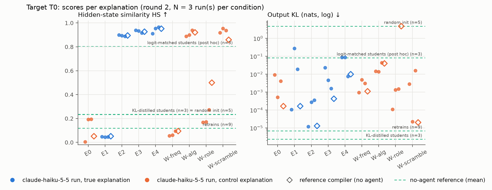
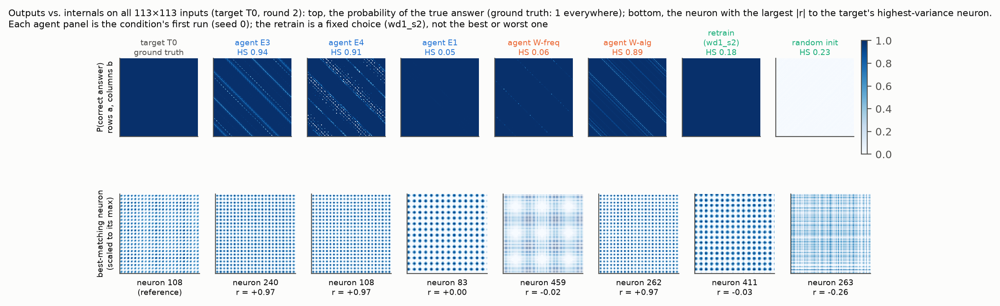
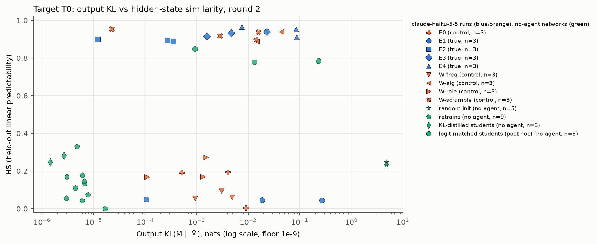
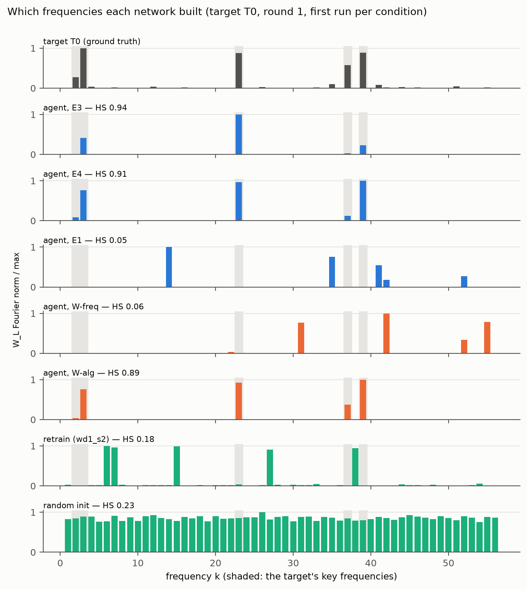
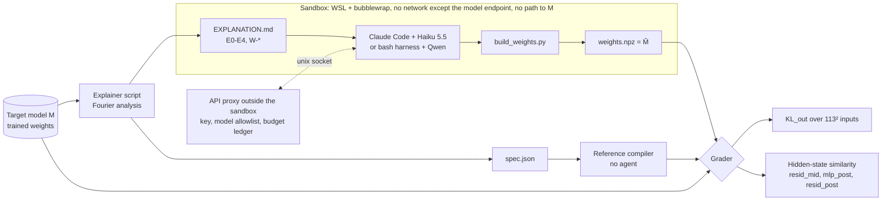
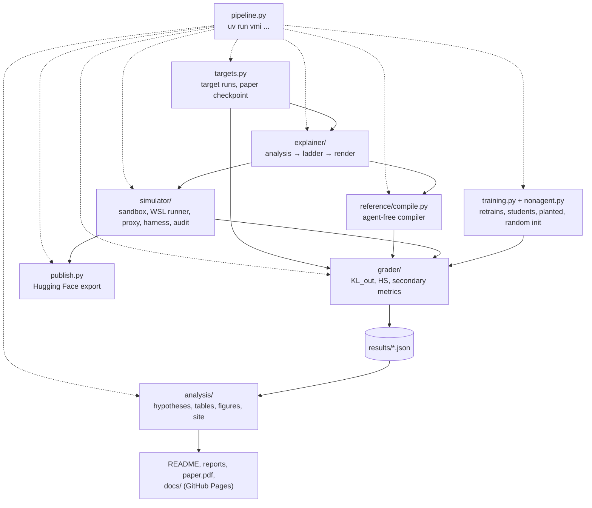
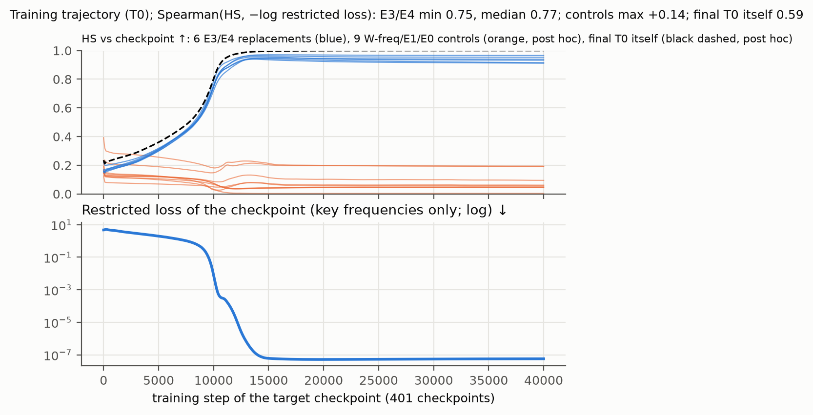
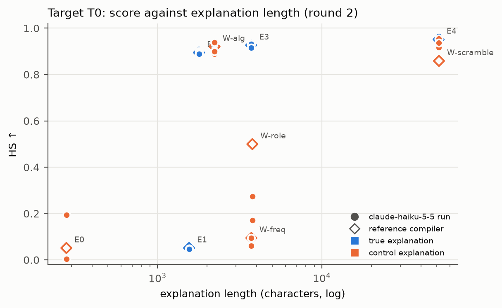

# Verifiable mechanistic interpretability by grading explanations using simulations

**Authors:** Libor "Burny" Burian, [Victor Levoso](https://scholar.google.com/citations?user=BBGcEigAAAAJ&hl=en).
Developed in a mechanistic interpretability hackathon on **automatically evaluating mechanistic interpretability
explanations**, which the authors co-organized in their mechanistic interpretability community and its Discord
server, [mechinterp.com](https://mechinterp.com/).

> **Status (2026-11-23): rounds 1 and 2 complete (N = 3 runs per condition); round 3 (N = 10) postponed to a later
> day.** Results below are at N = 3 — not yet N = 10. Hypotheses, metrics and analyses were preregistered and pushed
> before any result ([reports/preregistration.md](reports/preregistration.md)); every result number below is
> regenerated from `results/` by `vmi analyse 2`. Paper draft: [reports/paper.pdf](reports/paper.pdf). Progress:
> [reports/progress.md](reports/progress.md).
> **Interactive results explorer:** [burnycoder.github.io/…](https://burnycoder.github.io/verifiable-mechanistic-interpretability-by-grading-explanations-using-simulations/).
> Round reviews, independent audits and a citation check: [reports/reviews/](reports/reviews/).
> Replacement networks, agent transcripts and trained models: [Hugging Face](https://huggingface.co/BurnyCoder/grading-explanations-by-simulation)
> ([collection](https://huggingface.co/collections/BurnyCoder/grading-mechanistic-explanations-by-simulation-6b01ab93022d76813a8b5c02)).

**Contents:** [In one paragraph](#in-one-paragraph) · [Highlights](#highlights-what-works-and-what-doesnt) · [Visual overview](#visual-overview) · [In the agent's own words](#in-the-agents-own-words) · [Methodology](#methodology) · [Architecture](#architecture) · [Results](#results) · [Run matrix](#run-matrix) · [Novelty and related work](#novelty-and-related-work) · [Features](#features) · [Technologies](#technologies) · [Install, set up and use](#install-set-up-and-use) · [Repository layout](#repository-layout) · [To do](#to-do)

**Independent scientific audit · 26 November 2026.** The T0 hidden-state trend survives reconstruction from the saved grades. The output-KL trend fails, and the published checkpoint lacks a complete H3 replication. The report gives both rounds, each target, the post-hoc logit result, and the limits of the grading split. [Audit and claim ledger](reports/reviews/scientific-audit-2026-11-26.md) · [Reconstruction](results/scientific-audit/reconstruction.json).

## In one paragraph

**Plain language.** We gave a second AI agent a description of a modular-addition network, its architecture, task and arithmetic self-test. The agent could write and test its own replacement weights inside a sandbox. The target weights were withheld. We checked whether the replacement gave similar answers and whether its internal activity could predict the original's. The hidden-state score rose as descriptions supplied more detail on the main target. Giving the wrong frequencies could still produce accurate answers.
*Why it matters:* AI agents can now produce explanations far faster than people can check them, so the checking has to
be automatic too, and an automatic check is only useful if it rewards true explanations and catches wrong ones. This
project tests exactly that, on a small network whose mechanism is well understood.

**Expert version.** We test whether *weights-blind simulation* is a valid score for mechanistic explanations. Target:
the one-layer modular-addition transformer of [Nanda et al. 2023](https://arxiv.org/abs/2301.05217) (p = 113).
A script with weights access renders explanations at five levels of true detail (task, architecture and training outline → Fourier algorithm → key
frequencies → per-frequency quantities → per-neuron table) plus wrong explanations (wrong frequencies, the Pizza
algorithm of [Zhong et al. 2023](https://arxiv.org/abs/2306.17844), misattributed components, scrambled neurons),
length-matched to their true counterparts except the Pizza one, which is about <!-- v:walg-shorter -->40<!-- /v --> % shorter. **Claude Haiku 5.5 in Claude Code**, in a bubblewrap sandbox with no network except its model endpoint and no path to the weights, writes
`weights.npz` for a replacement of the same architecture. Local Qwen models in a bash-only harness were tried as a
simulator-capability ablation; every one of their finished round-1 runs built a constant-output network (chance), so they were stopped
after <!-- v:n-local -->five<!-- /v --> finished runs in round 1 (a sixth was interrupted). The score is **output KL (output divergence, 0 = identical class probabilities)** over all 113² inputs and **hidden-state similarity (HS)**:
cross-validated ridge-regression variance explained in both directions at three sites — linear because the
no-LayerNorm residual stream is defined only up to an invertible linear map, and no wider, motivated by [Sutter et al. 2025](https://arxiv.org/abs/2507.08802) (under their
assumptions, unrestricted alignment maps make any algorithm an input-restricted distributed abstraction of any network,
their Theorem 1; they themselves advise restricting alignment maps to linear ones if representations are linear,
their §8, which is the assumption made here)
(at the MLP site the linear fit is wider than the neurons' own symmetry, permutation and scaling; see the paper §3.4).
*Motivation:* existing simulation scores predict a neuron's activations from its explanation
([Bills et al. 2023](https://openaipublic.blob.core.windows.net/neuron-explainer/paper/index.html)); related
per-feature scores (fuzzing, detection) often fail to separate trained from randomised models
([Heap et al. 2025](https://arxiv.org/abs/2501.17727)), and LLM simulators predicting a text classifier's outputs
gain little from concept explanations over no-explanation baselines (significant but small gains; in an extension with four simulators, attributions improve significantly only with Qwen, and with Llama attributions and rationales fall significantly below the no-explanation baseline) when class names are meaningful, which the authors explain by a "shortcut hypothesis": predictions rest mainly on task priors, so the
simulator can solve the task directly ([Poché et al. 2026](https://arxiv.org/abs/2609.08585)); we
test the strongest form, rebuilding the whole network, and validate the score itself with preregistered controls.
*Novelty:* to our knowledge the first validation of full-weight, weights-blind simulation on an SGD-trained network,
with output KL plus a symmetry-aware hidden-state metric, an agent-free reference compiler, explanation-length
accounting, and no-, wrong-explanation, wrong-target and planted-mechanism controls (details in
[Novelty and related work](#novelty-and-related-work)). *Stack:* Python 3.12, PyTorch, Claude Code with Claude Haiku
5.5, bubblewrap in WSL2, uv, Hugging Face Hub, GitHub Pages ([Features](#features), [Technologies](#technologies)).

## Highlights: what works and what doesn't

Each row is one concrete comparison from the experiments, with its numbers read from `results/` (✅ the grader does
what a valid grader should; ❌ it fails, or a trap the experiments exposed). HS = hidden-state similarity (0–1, higher
= the rebuilt network computes the same intermediate quantities); KL = output divergence (lower = same answers).

<!-- BEGIN highlights -->
*Main simulator Claude Haiku 5.5, target T0 (main target network) unless stated; means over 3 run(s) per condition (round 2).*

| | Example | Measured | What it means |
|---|---|---|---|
| ✅ | **Naming the key frequencies is what raises HS (hidden-state similarity by linear prediction)** | HS 0.046 with the algorithm only (E1) → 0.894 once the frequencies are named (E2 (+ key frequencies)); the AI-free compiler gets 0.895 from E2 | The score rewards the part of the explanation that pins down which frequencies this network uses. |
| ✅ | **Right answers from the wrong key frequencies: caught by HS (hidden-state similarity by linear prediction), missed by output KL (output divergence, 0 = identical class probabilities)** | wrong-frequency explanation: accuracy 1.000, output KL 0.003 (true E3 (+ per-frequency details): 0.010), but HS 0.070 (true E3: 0.929) | Checking only the answers would rate a wrong explanation as good as a true one. The output logits do show it (post hoc): after one fitted scale, their centred-logit FVU is 1.00 for W-freq (wrong frequencies) against 0.12–0.21 for E3. |
| ✅ | **Probability-distilled students achieved small output KL (output divergence, 0 = identical class probabilities) with low HS (hidden-state similarity by linear prediction)** | networks trained to copy the target's output probabilities: KL 2.38e-06 (true explanations E2–E4: mean 0.023), HS 0.233; random networks: HS 0.236; networks trained on the task from other seeds: HS 0.119; networks trained to copy its centred logits (post hoc): HS 0.803 | Mean HS for these students was close to the random-initialisation mean. HS measures cross-validated linear predictability. Random networks had positive scores. Matching the logits (pre-specified reading): mean HS 0.849 lies between those ranges (below 0.85, above 0.35), which the pre-specified reading calls partial (1 of 3 met the training criterion; the others are not interpreted). |
| ✅ | **T0 (main target network) replacements scored higher against T0 than against every tested wrong target** | T0's E3 (+ per-frequency details) and E4 (+ per-neuron table) rebuilds: HS (hidden-state similarity by linear prediction) 0.936 against T0, at most 0.290 against 12 other trained networks (other seeds, the published model, no-mechanism controls) | The score was specific to the network that was explained, against networks with other key frequencies (each trained wrong target shares at most one with T0); same-frequency networks were not among them. |
| ✅ | **The gap to the wrong-frequency explanation also appears on a network trained after the protocol was frozen** | T-new (target trained after the freeze): HS (hidden-state similarity by linear prediction) 0.910 (E3 (+ per-frequency details)) and 0.984 (E4 (+ per-neuron table)) vs 0.094 (wrong frequencies) | Prompts and templates were frozen before this network was trained, so they cannot have been tuned to it. Descriptive: with three runs per condition its preregistered replication tests cannot reach significance. |
| ❌ | **Did not separate the Clock algorithm from the Pizza algorithm** | Pizza explanation (W-alg (wrong algorithm: Pizza)): HS (hidden-state similarity by linear prediction) 0.909; true explanation (E3 (+ per-frequency details)): HS 0.929 | Both builds use the same frequency features; HS, a linear fit over whole layers, did not separate what is computed from them (difference within noise at N = 3). Post hoc, Zhong et al.'s output diagnostic finds T0 (main target network) Clock-like but most true-explanation rebuilds Pizza-like too, and the rebuilds that are on the Clock side score no higher HS than the Pizza-side ones (paper §5). |
| ❌ | **The HS (hidden-state similarity by linear prediction) comparison with a redrawn neuron table was inconclusive** | redrawn table (W-scramble (redrawn neuron frequencies and phases)): HS 0.936; true table (E4 (+ per-neuron table)): HS 0.943; matched-neuron correlation 0.653 vs 0.913 does separate them | Neuron-level detail needs a neuron-level metric. The agents' builds did not follow the shuffled table into a lower HS; the AI-free compiler's literal build of it does score 0.09 lower on this target (not on the other targets; audit 5). |
| ❌ | **Output KL (output divergence, 0 = identical class probabilities) rises from E2 (+ key frequencies) to E4 (post hoc)** | E2 → E3 (+ per-frequency details) → E4: output KL 2.12e-04 → 0.010 → 0.060, while HS (hidden-state similarity by linear prediction) 0.894 → 0.929 → 0.943 | Grading by output KL alone would have ranked the most detailed true explanation lowest of these three (a post hoc reading, untested; the preregistered KL trend over E1–E4 is not supported, and E1's KL is the highest). |
| ❌ | **Build scripts listed published frequencies that the prompt omitted** | algorithm-only rebuilds (6 runs on T0 (main target network) and the published checkpoint; same input text): 5 build scripts list at least four of the paper's five frequencies; HS (hidden-state similarity by linear prediction) 0.078 against T0 but 0.704 against the published checkpoint (same weights) | On a published network, a high score can come from the AI's memory instead of the explanation (one simulator, one published model). |
| ❌ | **Small local AI models cannot do the task at all** | 5 local runs (Qwen3.5-4B, 9B): task accuracy 0.009 (chance = 1/113), HS (hidden-state similarity by linear prediction) 0.000 | In this harness, with 4-bit weights and a 60-step, 60-minute budget, the small local models never built a working network; model size, quantisation and harness are not separated. |
<!-- END highlights -->

## Visual overview

Four figures for the main target T0 (main target network), round 2, drawn from `results/` by `vmi analyse`. Blue:
runs of the main simulator on true explanations; orange: on wrong (control) explanations; green: networks built
without an agent; diamonds: the AI-free reference compiler. The ground truth is the target network itself and the true
answer (a + b) mod 113. ✅ marks what a valid grader should show, ❌ where it fails.

**Score per explanation**



HS (left) and output KL (right, log scale) per explanation; dots are single runs, diamonds the AI-free compiler, dashed lines the no-agent references. ✅ HS jumps once the explanation names the key frequencies (E1 → E2) and stays low for the wrong frequencies (W-freq). ❌ W-alg (Pizza) and W-scramble score as high as E3 and E4, and output KL does not fall with detail (lowest at E2).

**Answers vs. insides, against the ground truth**



Top: probability of the true answer on all 113 × 113 inputs (the target, left, is the ground truth). Bottom: each network's neuron that best matches one of the target's (correlation r printed). ✅ The E3 and E4 rebuilds match both the answers and a target neuron; E1, W-freq and an independent retrain answer just as well with unrelated neurons; random initialisation fails both. ❌ The Pizza build (W-alg) also matches the neuron.

| **How output KL compares with internal similarity** | **Which frequencies each network built** |
|---|---|
|  |  |
| Lower KL indicates closer output distributions. The wrong-frequency builds and independent retrains can achieve small KL with low HS. HS is the average bidirectional predictability of three activation sites. | The bars show the Fourier spectrum of the neuron-to-logit map. The target frequencies are shaded. The illustrated E1 build used published frequencies that its explanation omitted. Both W-alg and the true explanations specify T0's frequencies. |

The same results, explorable run by run (hover for each run's numbers; switch target, metric and simulator):
[interactive results explorer](https://burnycoder.github.io/verifiable-mechanistic-interpretability-by-grading-explanations-using-simulations/).
GitHub READMEs cannot run scripts, so the interactive views live there; there is no video.

## In the agent's own words

What the simulator actually wrote while building a network: the messages it wrote between its tool calls in the
example runs of [What the agent did](#what-the-agent-did-successes-and-failure-modes-from-its-own-transcripts)
(one run per case, chosen by a fixed rule, not by reading transcripts first; each run and its full transcript is
linked there): its plan, its reaction to the first self-test result, and its closing line, with the self-test
accuracy after each self-test it ran. Each case says *why* the result is right or wrong. (By default the API returns no thinking text, and these runs did not request thinking summaries; these are the
visible messages, quoted verbatim.)

<!-- BEGIN agent-words -->
**✅ success** (T0 (main target network) · E3 (+ per-frequency details) · claude-haiku-5-5; self-test accuracy over the run: 0.9961 → 0.9961 → 0.9908 → 0.9995; final HS (hidden-state similarity by linear prediction) 0.94)

*Why:* Right: its script uses exactly the frequencies the explanation names, {2, 3, 23, 37, 39}, which are T0's own, so both the answers (accuracy 0.9995) and the internals (HS (hidden-state similarity by linear prediction) 0.94; compiler 0.93) match the target.

> *Plan:* “The task is to hand-construct a 1-layer transformer's weights from the explanation, with no training. I'll build it in stages: embeddings and attention first, then the MLP, then the readout fitted in closed form, checking the self-test after each stage.”  
> *After the first self-test:* “The first build is already at 99.6% accuracy. Before tuning, I'll check whether the errors come from the missing k=2 neurons or from the attention and ReLU approximations, by trying a few bias and amplitude settings in scratch copies.”  
> *Closing:* “`build_weights.py` builds `weights.npz` in a few seconds, and `selftest.py` passes with 99.95% accuracy (12,765 of 12,769 inputs) and mean probability 0.980 on the correct answer.”  

**✅ beats the compiler** (T2 (target from another seed) · E3 (+ per-frequency details) · claude-haiku-5-5; self-test accuracy over the run: 0.5068 → 1.0000 → 1.0000; final HS (hidden-state similarity by linear prediction) 0.97)

*Why:* Right, and better than the AI-free compiler: its script uses T2's frequencies {37, 44, 45, 46, 47, 51} and it debugged its way from a first self-test at 0.5068 to 1.0000 (“The first build runs but gets only 50.7% accuracy.”). HS (hidden-state similarity by linear prediction) 0.97 against the compiler's 0.78, which follows the rendered explanation literally.

> *Plan:* “I'll check the folder for any extra files, such as the CSV table the explanation mentions, before building anything.”  
> *After the first self-test:* “The first build runs but gets only 50.7% accuracy. I'll check the fit quality and the attention pattern to see which stage is failing.”  
> *Closing:* “`build_weights.py` now builds `weights.npz` in about 3 seconds, and `selftest.py` passes: shapes are OK, accuracy is 1.0000 on all 12,769 inputs, and the mean probability of the correct answer is 1.0000.”  

**✅ faithful to a wrong explanation** (T0 (main target network) · W-freq (wrong frequencies) · claude-haiku-5-5; self-test accuracy over the run: 0.9992 → 0.9992 → 1.0000; final HS (hidden-state similarity by linear prediction) 0.06)

*Why:* Right behaviour of the agent, and the grader catches the explanation: its script uses exactly the wrong frequencies it was told, {22, 31, 42, 52, 55}, not T0's {2, 3, 23, 37, 39}. The answers are still right (accuracy 1.0000), but the internals do not match (HS (hidden-state similarity by linear prediction) 0.06), so HS exposes the wrong explanation that output-only grading would pass.

> *Plan:* “I've read the task. The plan: build the embedding, attention, MLP, and unembedding directly from the Fourier mechanism in EXPLANATION.md, and fit only the MLP output projection with closed-form least squares. Starting with the embedding, attention, and readout directions.”  
> *After the first self-test:* “The self-test passes at 99.92% accuracy. The mean correct-answer probability is 0.995, below the original's near-1 confidence, so I'll try a small sweep over the neuron bias range and attention offset.”  
> *Closing:* “`build_weights.py` builds `weights.npz` in about 3 seconds, and `selftest.py` passes: 100% accuracy on all 12,769 inputs, with mean correct-answer probability 0.9991.”  

**❌ uses published frequencies** (T0 (main target network) · E1 (algorithm only) · claude-haiku-5-5; self-test accuracy over the run: 1.0000 → 1.0000; final HS (hidden-state similarity by linear prediction) 0.05)

*Why:* The explanation gave no frequencies. The agent chose the published values (“I'll pick five standard ones (14, 35, 41, 42, 52) and build the network in closed form: a head that copies the cos/sin …”). Its build script hard-codes {14, 35, 41, 42, 52}, the published paper's frequencies, instead of T0's {2, 3, 23, 37, 39}, so its answers are right (accuracy 1.0000) but its internals do not match (HS (hidden-state similarity by linear prediction) 0.05).

> *Plan:* “The folder has no CSV, so the key frequencies are unspecified. I'll pick five standard ones (14, 35, 41, 42, 52) and build the network in closed form: a head that copies the cos/sin features of a and b into the "=" position, MLP neurons with phase-shifted ReLU, and a least-squares readout of the sum-frequency features.”  
> *After the first self-test:* “The self-test passes on the first build. I'll confirm the run time limit and re-run the self-test from a clean state.”  
> *Closing:* “`build_weights.py` now builds `weights.npz` in about 3.5 seconds, and `selftest.py` passes: shapes are correct, accuracy is 1.0000 on all 12,769 inputs, and the mean probability of the correct answer is 0.9999.”  

**❌ broken answers** (T0 (main target network) · E3 (+ per-frequency details) · effort-low · claude-haiku-5-5; self-test accuracy over the run: 0.6790 → 0.4047 → 0.2905 → 0.5627 → 0.5805 → 0.7846 → 0.5624; final HS (hidden-state similarity by linear prediction) 0.92)

*Why:* Low accuracy and high HS (hidden-state similarity by linear prediction): its script uses the target's frequencies {2, 3, 23, 37, 39}, and the measured states align (HS 0.92), but the answers are wrong (accuracy 0.5624). The wrong detail is a layout bug, not the explanation: its constants line `SEP, BIAS, P0, P1, P2, P3, RO = 10, 11, 12, 22, 42, 52, 52` gives head 3's output (P3) and the readout (RO) the same residual dimensions 52–61, although its own docstring puts heads 2/3 at 42–51, so head 3's attention output is added onto the answer the unembedding reads. Re-running its own script with that one fix gives accuracy 1.0000 at HS 0.91 (other changes tested: head 3 moved to unused dimensions (P3 = 62), nothing else changed: accuracy 1.0000; neurons split in the explanation's proportions, scaled to all 512 (k=2: 0 neurons): accuracy 0.5719; its own accuracy-best '=' penalty (1 instead of 10): accuracy 0.7846). The slip is Haiku's own: nothing the agent was given suggests a layout (the starter script defines only the array shapes, and TASK.md and ARCHITECTURE.md name no dimensions). Its own docstring puts heads 2 and 3 together at dimensions 42–51 and the readout at 52–61, so the constants line should read P3 = 42; it reads 52, the readout's first dimension. It stopped by its own choice after 22 tool calls and 6.4 minutes, well within the 60-minute, $2 per-run budget (no turn cap was set: Claude Code's --max-turns was not used). Its 2 replicates were identical in everything checked — the same files given to the agent (identical SHA-256 hashes), prompt, model (claude-haiku-5-5), Claude Code 2.1.330, effort and grading — so nothing the agent could see differed except the unseedable sampling (outside its view, the runs ran at different times and the server-side model behind the name cannot be verified); they reached accuracy 0.9994 and 0.9986. So the bug occurred in 1 of 3 identical runs: a chance slip that the setup does not force, whose frequency so few runs barely constrain (95 % Clopper–Pearson interval 1%–91%). The agent never found the bug: it blamed the neurons (“Bias-free ReLU neurons don't span cos(w(a+b)) well.”), tuned constants around the bug (self-test peak 0.7846) and then kept the setting it judged more faithful to the explanation (“I'll keep the faithful setting (penalty 10, slope 0.707, κ=0), which gives 0.56, and report the trade-off.”).

> *Plan:* “I've read the task and the explanation. The plan is to build the embedding, attention, and MLP weights directly from the explanation, then fit only the MLP-to-readout map with closed-form least squares. I'll write the script in one go and then run it.”  
> *After the first self-test:* “The self-test runs but accuracy is only 0.679. I'll check which readout frequencies the fit gets wrong.”  
> *Closing:* “`build_weights.py` builds `weights.npz`, and `selftest.py` passes, but accuracy is only **56.2%** (mean correct-answer probability 0.548).”  

**❌ small local model** (T0 (main target network) · E3 (+ per-frequency details) · qwen3.5-4b; self-test accuracy over the run: 0.0088 → 0.0088 → 0.0088; final HS (hidden-state similarity by linear prediction) 0.00)

*Why:* Wrong: it never built a working network. Its self-test stayed at chance (0.0088) every time; 2 of its replies were cut off at the output limit before anything ran, and the run ended with exit status: TimeExceeded. Its script even had the target's frequencies {2, 3, 23, 37, 39}. Its last words were still debugging: “I see the issue - the attention mechanism in forward.py uses the same key vector for both positions, which means the attention weights will be identical.”

> *Plan:* “I need to first read the files in the current folder to understand the task requirements. Let me start by reading TASK.md, ARCHITECTURE.md, and EXPLANATION.md to understand what needs to be done.”  
> *After the first self-test:* “Now I understand the task. I need to implement the Fourier-based addition mechanism described in EXPLANATION.md. Let me create a working implementation step by step. First, let me create the embedding layer with Fourier components for the key frequencies.”  
> *Closing:* “I see the issue - the attention mechanism in forward.py uses the same key vector for both positions, which means the attention weights will be identical.”
<!-- END agent-words -->

## Methodology

The full protocol, frozen before any result, is in the [preregistration](reports/preregistration.md) §2–§5; the
[paper](reports/paper.pdf) §3 gives the details. The study varies the explanation and holds everything else fixed.

### Model: the target networks

Every target is the one-layer modular-addition transformer of [Nanda et al. 2023](https://arxiv.org/abs/2301.05217):
input `a b =` with p = 113, d_model 128, 4 attention heads of size 32, an MLP of 512 ReLU neurons, no LayerNorm, and
the answer read at the "=" position (the paper's parameter layout, via the paper-faithful
[grokviz](https://github.com/BurnyCoder/visualizing-grokking-modular-addition-in-transformer) `GrokTransformer`). Each
was trained with the paper's recipe (full-batch AdamW, lr 10⁻³, betas (0.9, 0.98), weight decay 1, 30 % of the 113²
pairs as the training split, 40,000 steps) and reaches 100 % test accuracy. The targets were chosen by preregistered
rules (§2); their key frequencies as measured by the explainer:

<!-- BEGIN targets -->
| Target | run | role | key frequencies | neurons per key frequency | unclustered neurons | logit fit FVE | loss (all 113² inputs) |
|---|---|---|---|---|---|---|---|
| T0 (main target network) | `wd1_s1` | main target | 2, 3, 23, 37, 39 | 0, 197, 49, 42, 99 | 125 | 0.933 | 2.06e-07 |
| T1 (target from another seed) | `wd1_s4` | seed sensitivity (fewest frequencies) | 11, 25, 49 | 154, 111, 156 | 91 | 0.984 | 1.36e-07 |
| T2 (target from another seed) | `wd1_s8` | seed sensitivity (most frequencies) | 37, 44, 45, 46, 47, 51 | 58, 63, 81, 78, 88, 79 | 65 | 0.949 | 8.42e-07 |
| T-new (target trained after the freeze) | `new_s11` | held-out, trained after the protocol freeze | 22, 37, 41, 51 | 138, 77, 79, 130 | 88 | 0.954 | 2.41e-07 |
| T-paper (the published checkpoint) | `paper` | published checkpoint (contamination-flagged) | 14, 35, 41, 42, 52 | 44, 93, 145, 87, 64 | 79 | 0.961 | 2.41e-07 |
| dev | `wd1_s10` | development builds excluded; wrong target for H7 | 19, 31, 45, 47 | 80, 81, 189, 79 | 83 | 0.970 | 1.77e-07 |
<!-- END targets -->

### Data

The task is (a + b) mod 113. Every score uses all 113² = 12,769 input pairs, so no score depends on a sample of
inputs. The targets were trained on a 30 % split of these pairs. The simulator gets the target only through the
explanation: its `selftest.py` checks accuracy against the task labels, never against the target.

### Explanations: what is varied

A script with weights access measures each target's mechanism (key frequencies, neuron clusters, attention fits,
per-neuron fits) and renders every explanation from one parameter dict. No number in an explanation is typed by hand,
and each explanation's length is recorded.

*Labels.* **T0**: the main target network (it differs from the published checkpoint; its weights and key frequencies were uploaded to Hugging Face on 2026-10-21, after the simulator's June 2026 training-data cutoff and its 2026-10-07 release, and the sandbox has no internet). **E0–E4**: true explanations with increasing detail (E0 task, architecture and training outline only, E1 algorithm only, E2 + the key frequencies, E3 + per-frequency quantities, E4 + a per-neuron table); "true" at the level of frequencies and component roles, except that T0's describe frequency <!-- v:a5-weak-k -->2<!-- /v -->, which T0 uses only in its read-out, as used everywhere (paper §3.2). **W-freq, W-alg, W-role, W-scramble**: wrong explanations (wrong frequencies, the Pizza algorithm, wrong component roles, redrawn neuron frequencies and phases), length-matched except W-alg (about <!-- v:walg-shorter -->40<!-- /v --> % shorter). **HS**: hidden-state similarity, 0–1; 1 means each network's intermediate states are a linear function of the other's, and unrelated networks do not score 0 (random networks score above working networks that use other frequencies). **KL**: output divergence in nats, lower means the same answers with the same confidence. **Compiler**: our script that turns an explanation into weights without any AI.

### Simulator: how a replacement is built, without training

The main simulator is Claude Haiku 5.5 in Claude Code 2.1.330 (default sampling, effort `medium`; `low` and `high` are
hyperparameter variants). It runs in a bubblewrap sandbox in WSL2 with no network except its model endpoint: a proxy
outside the sandbox holds the API key, allows only the run's model and enforces per-run and total budgets. The
sandbox has no path to the target's weights, and a run gets at most 60 minutes and $2. The agent gets `TASK.md`,
`ARCHITECTURE.md`, `EXPLANATION.md` (plus `neurons.csv` for E4 and W-scramble), a numpy `forward.py`, `selftest.py`
(shapes and accuracy against the task labels) and a starter `build_weights.py`. It must write a `build_weights.py`
that produces `weights.npz` without training: gradient descent, optimisers and any loop that updates weights to
reduce a loss are forbidden. A static audit checks every script, and audit 7 also read every script and found small
searches over constants (see the agent examples below). Local Qwen3.6-35B-A3B, Qwen3.5-9B and Qwen3.5-4B models in a
bash-only harness were the preregistered simulator-capability ablation (only the two smaller ones ran on T0).

### Baselines and controls without an agent

- The reference compiler: a fixed script that turns an explanation's parameters into weights, with no AI.
- Independent retrains: the 9 `wd1` seeds other than T0 and the dev target, trained with the same recipe.
- Distilled students: 3 networks, trained in this project on all inputs to match T0's output probabilities (KL at
  temperature 1; T0's softmax is nearly one-hot, so they copy its answers, not its logits — audit 9). Post hoc, 3
  more students trained to match T0's centred logits (design and reading fixed before training, deviation 16).
- The planted-mechanism series: the compiled E3 network trained further, with snapshots at 0, 100, 1,000 and 10,000
  steps.
- Random initialisations: 5.
- Wrong targets: other trained networks and no-mechanism networks (H7).
- T0's 401 training checkpoints (H8).
- Upper references: the Fourier-restricted T0 and the full weights dump.

### Evaluation

**Primary metrics** (§4):

- **Output KL**: the mean over all 12,769 inputs of KL(P_target ‖ P_replacement) over the 113 answer logits, in
  nats, float64.
- **HS**: measured at three sites at the "=" position (`resid_mid`, 128-d; `mlp_post`, 512-d; `resid_post`, 128-d).
  At each site, 5-fold cross-validated ridge-regression R² is computed in both directions (replacement → target and
  target → replacement) and combined by their harmonic mean; HS is the mean over the three sites. Why linear:
  [In one paragraph](#in-one-paragraph).

**Secondary metrics:** task accuracy, argmax agreement, matched-neuron correlation (Hungarian matching), linear CKA,
Procrustes distance, stitching KL and others. Failed runs are scored as the all-zero model.

**Preregistered tests** (§5): a Jonckheere–Terpstra trend test (H1), one-sided Mann–Whitney U with Holm correction
(H2, H4), Wilcoxon signed-rank (H7), Spearman ρ (H8) and percentile-bootstrap intervals (10,000 resamples). Every
verdict is labelled with its N.

**Rounds:** each condition runs in rounds of N = 1, 3 and 10 runs (round 3 postponed). Each round runs main method →
controls → baselines → ablations → hyperparameter sensitivity → seed sensitivity.

## Architecture

### Pipeline




### Code modules

The `src/vmi/` package, one module per phase (module table and design choices:
[docs/architecture.md](docs/architecture.md)):



### What happens when you run it

(1) Target runs are downloaded at pinned revisions. (2) The explainer computes the
target's key frequencies, neuron clusters, attention fits and per-neuron fits and renders every explanation level
from one parameter dict, which also feeds the reference compiler. (3) For each agent run a fresh folder gets the
task files and one explanation. (4) The agent runs offline inside bubblewrap; its only way out is a unix socket to a
proxy (Claude) or relay (llama-server) outside the sandbox, which logs every request and response body in full (headers excluded). (5) The
build script is audited for gradient-descent and optimiser patterns (small searches over a constant pass it; audit 7
found them by reading every script); the grader runs both networks on all 12,769 inputs and computes the
metrics. (6) `vmi analyse ROUND` evaluates every preregistered hypothesis, redraws the figures and refills every
generated table and inline number in this README, `reports/summary.md`, `reports/experiments/experiments.md`, the
paper, the stage-0 report and the round's own report, plus the site's `docs/data.json`, from `results/` (`vmi paper`
then builds the PDF). Progress, plan and learnings files are written by hand.

## Results

### Key results

<!-- BEGIN key-results -->
*Round 2, N = 3 run(s) per condition — not yet N=10*

- **Model-specific detail raises hidden-state similarity:** HS on T0 (main target network) is 0.05 (E1, algorithm only), 0.89 (E2 (+ key frequencies)), 0.93 (E3 (+ per-frequency details)) and 0.94 (E4 (+ per-neuron table)); with no explanation (E0) it is 0.13. Monotone from E1 to E4; E0 lies above E1, against the preregistered prediction.
- **Correct behaviour from the wrong key frequencies is caught by HS (hidden-state similarity by linear prediction), not by output KL (output divergence, 0 = identical class probabilities):** the wrong-frequency replacement reaches KL 0.003 nats (true E3 (+ per-frequency details): 0.010) but HS 0.07. The output logits do show it (post hoc, audit 9): after one fitted scale, the centred-logit FVU is 1.00 for W-freq (wrong frequencies) against 0.12–0.21 for E3; KL misses it because a grokked model's output probabilities are nearly one-hot.
- **Small output KL (output divergence, 0 = identical class probabilities) coexists with low hidden-state similarity:** independent retrains (HS (hidden-state similarity by linear prediction) 0.12) and students trained to match T0's output probabilities (KL at temperature 1; HS 0.23, KL 2.38e-06) score no higher than randomly initialised networks (HS 0.24). HS's scale is therefore not anchored at 0 for unrelated networks: it measures overlap of internal features, and working networks built on other frequencies score below random ones. Neither copies T0's logits (centred-logit FVU: students 0.94–1.37, retrains 1.38–5.39; E3 (+ per-frequency details) replacements 0.12–0.21; post hoc, audit 9); students trained to match T0's centred logits (post hoc, pre-specified; FVU 0.023–0.165) reach HS 0.778–0.849: mean HS 0.849 lies between those ranges (below 0.85, above 0.35), which the pre-specified reading calls partial (1 of 3 met the training criterion; the others are not interpreted).
- **Negative result:** at N = 3 the primary HS (hidden-state similarity by linear prediction) does not separate the Pizza explanation (W-alg (wrong algorithm: Pizza), HS 0.91; E3 (+ per-frequency details) − W-alg +0.020, bootstrap CI [-0.008, +0.045]) or the scrambled neuron table (W-scramble (redrawn neuron frequencies and phases), HS 0.94; E4 (+ per-neuron table) − W-scramble +0.007, CI [-0.025, +0.037]) from the true explanations (a failure to separate, not a demonstrated equivalence); the secondary matched-neuron correlation separates W-scramble (0.65) from E4 (0.91). The agent-free compiler's literal build of the scrambled table does score 0.09 below its E4 build on T0 (main target network), mostly at resid_post: 0.69 vs 0.95; elsewhere the gap is within ±0.007 on T1 (target from another seed), T-new (target trained after the freeze), T-paper (the published checkpoint); on T2 (target from another seed) the scrambled build scores 0.05 higher. Post hoc, T0's distance irrelevance is in Zhong et al.'s Clock-typical range (0.75) and the literal Pizza build is in the Pizza-typical range (0.003); the agents' replacements from the true E1–E3 are Pizza-like too (means 0.13–0.18), and E4's are split (mean 0.41). Among the builds that carry T0's frequencies, the Clock-side ones (two of three E4 builds, q 0.46, and all three W-scramble builds, q 0.50–0.66) score HS 0.91–0.95 and the Pizza-side ones (E2 (+ key frequencies), E3, E4, W-alg) 0.89–0.97: at this N, HS did not separate Clock-side from Pizza-side builds that share the key frequencies (descriptive; side and explanation are confounded).
- **Memorisation (post hoc):** E0 (no explanation) and E1 (algorithm only) contain nothing target-specific (identical text on every target, and the sandbox does not reveal the target), so their runs on T0 (main target network) and on the published checkpoint are replicates of one condition. When the explanation gives no frequencies, the simulator often builds most of the published paper's frequencies {14, 35, 41, 42, 52} into its replacement (possible cues include the sandbox description of the paper's architecture and, for E1, the paper's own algorithm; only E0's text also outlines the training setup; no sandbox file names a frequency or the paper; audit 8). E1 (6 runs on T0 and T-paper (the published checkpoint)): 5 of 6 build scripts list at least four of the paper's five frequencies (3 of 6 replacements build at least four by the key-frequency rule, a lower bound); on average 68% of the replacements' W_L spectrum lies on those five frequencies (chance 9%); mean HS (hidden-state similarity by linear prediction) 0.08 against T0 but 0.70 against the published checkpoint (target swap: same weights, other target; range 0.24–0.95); E0 (3 runs on T0): 1 of 3 build scripts list at least four of the paper's five frequencies (1 of 3 replacements build at least four by the key-frequency rule, a lower bound); on average 36% of the replacements' W_L spectrum lies on those five frequencies (chance 9%); mean HS 0.13 against T0 but 0.28 against the published checkpoint (target swap: same weights, other target; range 0.03–0.63). On a published model, a high score can therefore come from the simulator's memory rather than the explanation. The origin of the simulator's prior knowledge is unknown (one published model and one simulator tested).
- **Exploratory logit comparison:** all 3 E3 (+ per-frequency details) builds had lower scale-adjusted logit error (0.123–0.210) than all 3 W-alg (wrong algorithm: Pizza) builds (0.232–0.232). E4 (+ per-neuron table) and W-scramble (redrawn neuron frequencies and phases) overlapped. These within-sample ranges add a descriptive result alongside the inconclusive registered HS (hidden-state similarity by linear prediction) comparisons.
- **Cost:** the 96 reported Claude Haiku 5.5 runs cost $2.20 ($2.33 including development runs and plumbing checks).
<!-- END key-results -->

| Calibration on a planted mechanism (H4b, falsified by its preregistered criterion): HS (hidden-state similarity, held-out bidirectional linear predictability) falls steadily as predicted; output KL (output divergence, 0 = identical class probabilities) follows the planted model's dip and recovery in accuracy instead of rising | Score against the target's training checkpoints (H8) |
|---|---|
|  |  |
| **Score against explanation length:** the jump comes with the key frequencies (E2 (+ key frequencies)), not with length | **Simulator ablation (negative):** local Qwen models at chance, Haiku near the compiler |
|  |  |

### Eval scores: method, controls, baselines and ablations

Three tables, every number read from `results/` (± is the sample standard deviation over runs):

- the agent and the AI-free compiler on each explanation (the method, E1–E4, and the controls);
- the no-agent baselines;
- the ablations and hyperparameter variants.

#### Scores on the main target T0 (agent vs. agent-free reference compiler)

<!-- BEGIN scoreboard-T0 -->
| Explanation | role | chars | N | agent accuracy | agent KL_out (output divergence, 0 = identical class probabilities) ↓ | agent HS (hidden-state similarity by linear prediction) ↑ | agent matched-neuron corr ↑ | compiler KL_out ↓ | compiler HS ↑ |
|---|---|---|---|---|---|---|---|---|---|
| E0 (no explanation) | control: no mechanism | 279 | 3 | 1.000 ± 0.000 | 0.005 ± 0.004 | 0.130 ± 0.109 | 0.056 ± 0.031 | 1.64e-04 | 0.051 |
| E1 (algorithm only) | method | 1556 | 3 | 1.000 ± 0.000 | 0.097 ± 0.152 | 0.046 ± 0.002 | 0.028 ± 1.59e-04 | 1.64e-04 | 0.051 |
| E2 (+ key frequencies) | method | 1788 | 3 | 1.000 ± 0.000 | 2.12e-04 ± 1.78e-04 | 0.894 ± 0.005 | 0.669 ± 0.005 | 1.30e-05 | 0.895 |
| E3 (+ per-frequency details) | method | 3712 | 3 | 1.000 ± 4.70e-04 | 0.010 ± 0.012 | 0.929 ± 0.012 | 0.759 ± 0.060 | 4.25e-04 | 0.927 |
| E4 (+ per-neuron table) | method | 51329 | 3 | 0.986 ± 0.012 | 0.060 ± 0.045 | 0.943 ± 0.028 | 0.913 ± 0.044 | 0.010 | 0.952 |
| W-freq | control: wrong frequencies | 3724 | 3 | 1.000 ± 9.04e-05 | 0.003 ± 0.002 | 0.070 ± 0.021 | 0.030 ± 1.64e-04 | 0.001 | 0.095 |
| W-alg (wrong algorithm: Pizza) | control: wrong algorithm (Pizza) | 2224 | 3 | 1.000 ± 0.000 | 0.024 ± 0.017 | 0.909 ± 0.027 | 0.737 ± 0.061 | 0.040 | 0.921 |
| W-role | control: wrong component roles | 3777 | 3 | 1.000 ± 2.71e-04 | 9.80e-04 ± 7.60e-04 | 0.204 ± 0.060 | 0.013 ± 0.002 | 4.727 | 0.500 |
| W-scramble (redrawn neuron frequencies and phases) | control: scrambled neurons | 51590 | 3 | 0.998 ± 0.004 | 0.006 ± 0.008 | 0.936 ± 0.018 | 0.653 ± 0.027 | 2.02e-05 | 0.859 |
<!-- END scoreboard-T0 -->

#### Explanation-free baselines on T0 (no agent)

<!-- BEGIN baselines-T0 -->
| Reference point | what it has | n | task accuracy | KL_out (output divergence, 0 = identical class probabilities) ↓ | HS (hidden-state similarity by linear prediction) ↑ |
|---|---|---|---|---|---|
| Random initialisation | untrained reference | 5 | 0.009 ± 0.001 | 4.766 ± 0.006 | 0.236 ± 0.006 |
| Independent retrains | same recipe, other seeds | 9 | 1.000 ± 0.000 | 6.90e-06 ± 3.96e-06 | 0.119 ± 0.097 |
| Distilled students | M's output probabilities (KL (output divergence, 0 = identical class probabilities) at temperature 1), no explanation | 3 | 1.000 ± 0.000 | 2.38e-06 ± 8.25e-07 | 0.233 ± 0.058 |
| Logit-matched students (post hoc; 1 of 3 met the training criterion) | M's centred logits (squared error), no explanation | 3 | 0.970 ± 0.049 | 0.082 ± 0.130 | 0.803 ± 0.040 |
| Fourier-restricted M | M's weights, key frequencies only in W_E/W_U | 1 | 1.000 | 0.002 | 0.992 |
| Weights dump | all 226,816 weights | 1 | 1.000 | 0.000 | 1.000 |
<!-- END baselines-T0 -->

#### Ablations and hyperparameter variants on T0

<!-- BEGIN ablations-T0 -->
| Change | Explanation | Simulator | N | task accuracy | KL_out (output divergence, 0 = identical class probabilities) ↓ | HS (hidden-state similarity by linear prediction) ↑ | matched-neuron corr ↑ |
|---|---|---|---|---|---|---|---|
| none (main condition) | E3 (+ per-frequency details) | claude-haiku-5-5 | 3 | 1.000 ± 4.70e-04 | 0.010 ± 0.012 | 0.929 ± 0.012 | 0.759 ± 0.060 |
| explanation as maths | E3 (+ per-frequency details) | claude-haiku-5-5 | 3 | 0.999 ± 0.002 | 0.003 ± 0.004 | 0.915 ± 0.003 | 0.771 ± 0.036 |
| explanation as code | E3 (+ per-frequency details) | claude-haiku-5-5 | 3 | 1.000 ± 9.04e-05 | 0.002 ± 3.96e-04 | 0.897 ± 0.030 | 0.805 ± 2.48e-04 |
| self-test removed | E3 (+ per-frequency details) | claude-haiku-5-5 | 3 | 1.000 ± 3.62e-04 | 0.004 ± 0.002 | 0.942 ± 0.025 | 0.765 ± 0.043 |
| effort low | E3 (+ per-frequency details) | claude-haiku-5-5 | 3 | 0.853 ± 0.252 | 0.661 ± 1.137 | 0.921 ± 0.003 | 0.751 ± 0.027 |
| effort high | E3 (+ per-frequency details) | claude-haiku-5-5 | 3 | 1.000 ± 0.000 | 0.001 ± 7.17e-04 | 0.936 ± 0.034 | 0.791 ± 0.025 |
| none (main condition) | W-freq (wrong frequencies) | claude-haiku-5-5 | 3 | 1.000 ± 9.04e-05 | 0.003 ± 0.002 | 0.070 ± 0.021 | 0.030 ± 1.64e-04 |
| effort low | W-freq (wrong frequencies) | claude-haiku-5-5 | 3 | 0.923 ± 0.133 | 0.344 ± 0.594 | 0.088 ± 0.025 | 0.061 ± 0.031 |
| effort high | W-freq (wrong frequencies) | claude-haiku-5-5 | 3 | 1.000 ± 0.000 | 0.001 ± 6.05e-04 | 0.093 ± 0.005 | 0.032 ± 0.003 |
| simulator qwen3.5-4b | E2 (+ key frequencies) | qwen3.5-4b | 1 | 0.009 | 4.727 | 0.000 | 0.000 |
| simulator qwen3.5-4b | E3 (+ per-frequency details) | qwen3.5-4b | 1 | 0.009 | 4.727 | 0.000 | 0.000 |
| simulator qwen3.5-4b | E4 (+ per-neuron table) | qwen3.5-4b | 1 | 0.009 | 4.727 | 0.000 | 0.000 |
| simulator qwen3.5-4b | W-freq (wrong frequencies) | qwen3.5-4b | 1 | 0.009 | 6.066 | 0.000 | 1.41e-16 |
| simulator qwen3.5-9b | E2 (+ key frequencies) | qwen3.5-9b | 1 | 0.009 | 7.628 | 0.000 | 0.000 |
<!-- END ablations-T0 -->

### Predicted vs. measured with Claude Haiku

Before any experiment we wrote down, and pushed to GitHub, what a valid grader should show
([preregistration](reports/preregistration.md) §5). The table puts each prediction next to what Claude Haiku 5.5 and
the grader actually produced; it is regenerated from `results/` after every round, and the last column says how many
runs per condition each verdict rests on.

**In plain words.** We expected the score to reward every bit of true detail and to punish every wrong explanation.
With three runs per condition, five predictions pass their preregistered tests: the score rises with true detail,
mostly once the explanation names *which frequencies* the network uses (the handful of numbers it does the arithmetic
with), although giving no explanation at all scored slightly above giving only the algorithm, against H1's prediction; it punishes a wrong explanation even when that explanation gives all the right answers; it rates networks rebuilt
from the detailed explanations (E3, E4) above freshly trained ones; it does not fit one network's explanation to another network; and against the original's training checkpoints it rises while the
original forms its mechanism — but the original's own final weights do that too, so this shows shared structure, not a
separate ability (H1, H3, H4, H7, H8). These expectations failed: grading by the answers alone (output
KL (output divergence, 0 = identical class probabilities)) does not improve with more detail — it is best for E2 and worse for E3 and E4, and worst for the algorithm alone (H1's second part); with three runs, the score did not separate two algorithms that use the same
frequencies, or the AI's rebuild of a correct list of neurons from its rebuild of a shuffled one (H2); on the main network the AI stayed at the
level of our own AI-free compiler, but on other networks it sometimes beat it, so the compiler is not a ceiling (H5);
and on a network whose mechanism we planted, further training first disturbed and then restored its answers, so
output KL rose and fell again instead of rising steadily (H4b; post hoc, this says more about the planted series than
about the grader). Whether stronger AIs do better (H5, H6) could not be tested, because the small local models never built
a working network. "Direction matches" only says whether the numbers went the predicted way; the formal verdict adds
the preregistered statistical test, which for H2 needs more than three runs per condition.

**Changes after the protocol freeze.** Every change after the freeze is a dated deviation in the
[preregistration](reports/preregistration.md) ("Post-freeze deviations"), and every one was made after some per-run
scores had been seen.

- Deviations 1–4, during round 1, aligned the analysis code with the amended protocol (deviation 1 also added the
  post-hoc "cannot tell at this N" rule), reordered stages, re-ran an infrastructure failure and repaired a secondary
  metric.
- Twelve came after round-level results or because of them:
  - the local runs were stopped because of their results (deviation 5);
  - round 3 was postponed (deviation 6, scheduling only);
  - two analysis-code errors were corrected when the N = 3 verdicts were first read (deviation 7; neither made a
    verdict "supported");
  - deviations 8–16 record nine audits.
- From deviation 8 on, each deviation records an independent audit made after every round-2 number had been seen
  ([reports/reviews/](reports/reviews/)). The audits re-derived the verdicts and re-graded the stored scores with
  independent code. For example, in audit 5 <!-- v:a5-hyp -->88 of 88<!-- /v --> stored statistics, verdicts and published
  values reproduce, and <!-- v:a5-regrade -->306 gradings, largest differences 1.3e-10 in HS and 4.4e-12 in KL<!-- /v -->. They also corrected errata, scope and citations, and added
  post-hoc checks, labelled as such. None of them made a verdict "supported". Audit 8
  ([reports/reviews/audit-8-2026-11-23.md](reports/reviews/audit-8-2026-11-23.md)) found that the tables led with a
  post-hoc verdict reading: by the preregistration's own §5, H2 at N = 3 is "not supported" (the 3-vs-3 tests cannot
  reach α), with deviation 1's "cannot tell at this N" second; the tables now show it that way (deviation 15).

The labels used below (T0, E0–E4, W-*, HS, KL, compiler) are defined under
[Methodology](#explanations-what-is-varied).

<!-- BEGIN predictions-plain -->
| Hypothesis | Expected, in plain words | Predicted (preregistration §5) | Measured with the main simulator (T0 (main target network)) | Direction matches? | Formal verdict |
|---|-------|-------|---------|-----|------|
| H1 | The more true detail an explanation gives, the more faithfully the rebuilt network should match the original. | HS (hidden-state similarity by linear prediction) rises and output KL (output divergence, 0 = identical class probabilities) falls from E1 (algorithm only) to E4 (+ per-neuron table) on T0 (main target network); E0 (no explanation) lies below E1 | HS E0 0.130, E1 0.046, E2 (+ key frequencies) 0.894, E3 (+ per-frequency details) 0.929, E4 0.943; KL E1 0.097, E2 2.12e-04, E3 0.010, E4 0.060 | partly (KL does not fall E1 → E4; E0 not below E1) | HS trend E1 → E4: supported; E0 below E1: not observed (E0 above E1; direction only, no test preregistered); KL_out (output divergence, 0 = identical class probabilities): not supported · at N=3 — not yet N=10 |
| H2 | A true explanation should beat a wrong explanation of the same length. | true explanations beat length-matched false ones on HS (hidden-state similarity by linear prediction): E3 (+ per-frequency details) > W-freq (wrong frequencies), W-alg (wrong algorithm: Pizza), W-role (wrong component roles); E4 (+ per-neuron table) > W-scramble (redrawn neuron frequencies and phases) | HS difference E3 > W-freq +0.859 [+0.835, +0.880]; E3 > W-alg +0.020 [-0.008, +0.045]; E3 > W-role +0.725 [+0.661, +0.768]; E4 > W-scramble +0.007 [-0.025, +0.037] | partly (E3 > W-alg direction uncertain (CI includes 0); E4 > W-scramble direction uncertain (CI includes 0)) | E3 > W-freq: not supported (Holm p 0.20); E3 > W-alg: not supported (Holm p 0.70); E3 > W-role: not supported (Holm p 0.20); E4 > W-scramble: not supported (Holm p 0.70) — preregistered §5 criterion; at N = 3 even complete separation gives Holm p 0.20, so these tests could not reach α. Post-hoc rule of deviation 1 (applied at this N by deviation 7): all read "cannot tell at this N" · at N=3 — not yet N=10 |
| H3 | A wrong explanation can still give all the right answers; checking only the answers is fooled, checking the insides (HS (hidden-state similarity by linear prediction)) should not be. | W-freq (wrong frequencies): argmax agreement ≥ 0.99, KL (output divergence, 0 = identical class probabilities) within the E2–E4 mean range, HS below each true mean; the falsifier tests only the upper KL bound | W-freq: agreement 1.000, KL 0.003 (true 2.12e-04–0.060), HS 0.070 (true 0.894–0.943); HS − E2 (+ key frequencies) -0.824 [-0.840, -0.801], E3 (+ per-frequency details) -0.859 [-0.880, -0.835], E4 (+ per-neuron table) -0.873 [-0.904, -0.841] | yes | supported · at N=3 — not yet N=10 |
| H4 | Rebuilding from an explanation should match the original's insides better than training a fresh network the same way does. | E3 (+ per-frequency details) and E4 (+ per-neuron table) beat independent retrains on HS (vs. distilled students: open question, no direction) | E3 0.929, E4 0.943; 9 retrains mean 0.119 (max 0.329); 3 students mean 0.233 (max 0.282); vs students, two-sided: E3 not significant (Holm p 0.20; smallest attainable p 0.10; every agent run above every student; post-hoc rule: cannot tell at this N), E4 not significant (Holm p 0.20; smallest attainable p 0.10; every agent run above every student; post-hoc rule: cannot tell at this N) | yes | E3: supported; E4: supported · at N=3 — not yet N=10 |
| H4b | On a network whose mechanism we planted ourselves, the score should start perfect and drop as further training moves the network away from it. | planted model: HS (hidden-state similarity by linear prediction) = 1 and KL (output divergence, 0 = identical class probabilities) = 0 at step 0, then HS strictly falls and KL strictly rises | HS 1.000 → 0.998 → 0.957 → 0.888 (step 0 unrounded: 0.999999966590); KL 0.000 → 0.371 → 0.040 → 4.25e-04 | partly (step-zero HS differs from exact identity; KL not strictly rising) | not supported · deterministic |
| H5 | The AI should not beat our automatic, AI-free compiler, and stronger AIs should come closer to it. | agent ≤ reference compiler on every explanation; the gap shrinks with simulator capability | T0 (preregistered): agent − compiler E2 (+ key frequencies) -0.001, E3 (+ per-frequency details) +0.002, E4 (+ per-neuron table) -0.009, W-freq (wrong frequencies) -0.024, none of the four explanations beyond the bootstrap CI; seed targets T1 (target from another seed), T2 (target from another seed), T-new (extension, post hoc): agent above compiler in six of eleven pairs by sign, four of eleven target–explanation pairs on three targets beyond the bootstrap CI (T1 E2, T2 E3, T2 E4, T-new E4; largest +0.179 (T2 E3); margins under 0.01: T1 E2 +0.007, T-new E4 +0.001); T-paper (memorisation-flagged, not counted): E3 +0.073 beyond the CI, E4 -0.046, W-freq -0.004; 5 local runs, 0 above chance | partly (seed targets: agent above compiler beyond its CI; capability trend not testable) | not evaluable (local simulators stopped at chance, deviation 5) · 5 local runs, qwen3.5-4b: 0/4 above chance, qwen3.5-9b: 0/1 above chance |
| H6 | Different AIs should put the explanations in the same order. | the local simulators rank E2 (+ key frequencies), E3 (+ per-frequency details), E4 (+ per-neuron table), W-freq (wrong frequencies) the same way | 5 local runs, 0 above uniform-guess accuracy. The three-model ranking matrix is incomplete | not testable | not evaluable (local simulators stopped at chance, deviation 5) · 5 local runs, qwen3.5-4b: 0/4 above chance, qwen3.5-9b: 0/1 above chance |
| H7 | An explanation of one network should not fit a different network. | a T0 (main target network) replacement fits T0 better than any other trained or no-mechanism model (HS (hidden-state similarity by linear prediction)) | E3 (+ per-frequency details): HS 0.939 vs best other 0.274 (T2 (target from another seed)); E3: HS 0.932 vs best other 0.240 (T2); E3: HS 0.915 vs best other 0.290 (T2); E4 (+ per-neuron table): HS 0.912 vs best other 0.226 (T2); E4: HS 0.953 vs best other 0.227 (T2); E4: HS 0.965 vs best other 0.258 (T2) | yes | supported · 6 E3 and E4 replacements (at N=3 — not yet N=10) |
| H8 | The score should rise while the original network learns its mechanism during training. | HS (hidden-state similarity by linear prediction) against T0's checkpoints rises as restricted loss falls (circuit formation) | Historical round 2: one selected replacement, 41 checkpoints, ρ 0.856. Retrospective full-checkpoint analysis: Spearman ρ(HS, −log restricted loss) per replacement: median 0.774, min 0.751 (6 E3 (+ per-frequency details) and E4 (+ per-neuron table) replacements × 401 checkpoints); negative controls (post hoc), ρ per replacement: E0 (no explanation) -0.83, -0.45, +0.14; W-freq (wrong frequencies) -0.40, -0.24, -0.38; E1 (algorithm only) -0.58, -0.58, -0.57; reference networks (post hoc, audit 4): final T0 (main target network) itself +0.59, Fourier-restricted T0 +0.99, compiler E3 +0.88, a retrain -0.53; during circuit formation (steps ≤ 14,900) every network with T0's frequencies has ρ ≥ 0.996 | yes | supported · 6 E3 and E4 replacements × 401 checkpoints |
<!-- END predictions-plain -->

**In expert terms.** On T0 the registered HS trend passed and the decreasing-KL trend failed. E0 exceeded E1 on HS (<!-- v:e0-vs-e1 -->E0 0.130 vs E1 0.046<!-- /v -->). All four H2 comparisons missed the Holm criterion. For E3 versus W-alg and E4 versus W-scramble the mean-difference intervals span zero, leaving their directions uncertain. H3 met both KL readings on T0. H4 passed against retrains and H7 passed against the fixed wrong-target panel. H4b failed the joint monotonicity check. The stopped simulator grid leaves H5 and H6 unresolved. H8 met its descriptive correlation criterion on a single training trajectory. [Independent verdicts and effect sizes](reports/reviews/scientific-audit-2026-11-26.md).
interventions on the explanation with everything else fixed; H4 compares with explanation-free baselines; H7 and the
memorisation target swap are counterfactual swaps of the target network; the format, self-test, effort and simulator
variants are ablations; H8 is a correlation over training checkpoints. *Strength:* the supported hypotheses rest on three runs
per condition (H1: a one-sided trend test; H4 and H7: one-sided rank tests at α = 0.05, Holm-corrected where
preregistered; H3: a comparison of condition means; H8: descriptive); the wrong-frequency
gap holds on <!-- v:wfreq-gap-targets -->all five targets<!-- /v -->; nothing here has reached the preregistered N = 10.

Replications on the seed-sensitivity targets (preregistration §5: H1–H3 re-tested per target with the preregistered
tests, which earlier versions only checked by direction; deviation 8):

<!-- BEGIN replications -->
| Target | Mean HS (hidden-state similarity by linear prediction) by true level | H1 increasing HS (p, ρ) | H1 decreasing KL (p, ρ) | H2 E3 (+ per-frequency details) − W-freq (Δ HS, p) |
|----------|-------------------------|--------------------|--------------------|--------------------|
| T0 (main target network) | E2 (+ key frequencies) 0.894, E3 (+ per-frequency details) 0.929, E4 (+ per-neuron table) 0.943 | 0.011, +0.79 (supported) | 0.999, -0.90 | +0.859, 0.050 |
| T1 (target from another seed) | E2 (+ key frequencies) 0.957, E3 (+ per-frequency details) 0.936, E4 (+ per-neuron table) 0.960 | 0.500, +0.05 | 0.995, -0.79 | +0.885, 0.050 |
| T2 (target from another seed) | E2 (+ key frequencies) 0.900, E3 (+ per-frequency details) 0.962, E4 (+ per-neuron table) 0.951 | 0.500, +0.05 | 1.000, -0.95 | +0.864, 0.050 |
| T-new (target trained after the freeze) | E3 (+ per-frequency details) 0.910, E4 (+ per-neuron table) 0.984 | 0.050, +0.88 | 0.050, +0.88 | +0.816, 0.050 |
| T-paper (the published checkpoint) | E1 (algorithm only) 0.590, E3 (+ per-frequency details) 0.940, E4 (+ per-neuron table) 0.937 | 0.061, +0.63 | 0.666, -0.11 | +0.823, 0.050 |

H1 uses the available levels. The T0 (main target network) row restricts the ladder to E2–E4 as a post-hoc comparison. Unmarked H1 cells miss the registered criterion. H2 uses the single displayed contrast on seed targets. The main T0 H2 verdict uses all four contrasts with Holm correction. T-paper (the published checkpoint) is contamination-flagged.

| Target | H3 wrong-frequency agreement, KL (output divergence, 0 = identical class probabilities), HS (hidden-state similarity by linear prediction) | H3 interval and upper-bound readings |
|----------|------------------------------------|-------------------------------------------|
| T0 (main target network) | agreement 1.000, KL (output divergence, 0 = identical class probabilities) 0.003 (true 2.12e-04–0.060), HS (hidden-state similarity by linear prediction) 0.070 | interval passes, upper-bound reading passes |
| T1 (target from another seed) | agreement 0.854, KL (output divergence, 0 = identical class probabilities) 0.537 (true 0.001–0.498), HS (hidden-state similarity by linear prediction) 0.051 | interval fails, upper-bound reading fails |
| T2 (target from another seed) | agreement 0.999, KL (output divergence, 0 = identical class probabilities) 0.006 (true 3.41e-05–0.049), HS (hidden-state similarity by linear prediction) 0.098 | interval passes, upper-bound reading passes |
| T-new (target trained after the freeze) | agreement 0.907, KL (output divergence, 0 = identical class probabilities) 0.432 (true 0.012–0.328), HS (hidden-state similarity by linear prediction) 0.094 | interval fails, upper-bound reading fails (E2 (+ key frequencies) missing; full comparison unavailable) |
| T-paper (the published checkpoint) | agreement 0.998, KL (output divergence, 0 = identical class probabilities) 0.007 (true 0.141–0.413), HS (hidden-state similarity by linear prediction) 0.117 | interval fails, upper-bound reading passes (E2 (+ key frequencies) missing; full comparison unavailable) |
<!-- END replications -->

### Better or worse than the baselines, controls and ablations, in plain words

- **Better than output KL (output divergence, 0 = identical class probabilities):** a network trained with the same recipe from another seed, a network trained to copy the
  target's outputs exactly, and a network built from a *wrong-frequency* explanation all give the right answers —
  output KL rates them as good as the true explanations (the wrong-frequency one above E3 and E4, below E2); HS (hidden-state similarity, held-out bidirectional linear predictability) rates them at the bottom, where they belong.
- **Better than chance and than explanation-free baselines:** naming the key frequencies (E2 (+ key frequencies)) lifts HS (hidden-state similarity, held-out bidirectional linear predictability) from the
  floor to near the agent-free compiler's value; without model-specific information (E0 (no explanation), E1 (algorithm only)) the agent builds a
  working adder with none of the target's internals.
- **Worse than hoped (negative result):** with three runs, HS (hidden-state similarity, held-out bidirectional linear predictability) did not separate the AI's rebuilds of the true explanation (E3) from its rebuilds of a Pizza explanation with the
  same frequencies, nor of a correct per-neuron table from a scrambled one; both keep every frequency subspace intact.
  The secondary matched-neuron correlation catches the scrambled table, and so does HS when our AI-free compiler
  builds the scrambled table literally on T0 (<!-- v:a5-scr-t0 -->0.09<!-- /v --> lower), though not on the other targets. Post hoc, by the Clock/Pizza diagnostic of
  Zhong et al., T0 has Clock-typical distance irrelevance (<!-- v:cp-t0 -->0.75<!-- /v -->) but the networks rebuilt from the *true* explanations are
  Pizza-like too (<!-- v:cp-e13 -->0.13–0.18<!-- /v --> for E1–E3), and HS still rates them high: the true explanations, as
  written, do not reliably say what makes T0 a Clock, and HS does not notice. The rebuilds that did land on the Clock
  side (<!-- v:a9-cp-clock-builds -->two of three E4 builds, q 0.46, and all three W-scramble builds, q 0.50–0.66<!-- /v -->)
  score HS <!-- v:a9-cp-clock-hs -->0.91–0.95<!-- /v -->, no higher than the Pizza-side ones (<!-- v:a9-cp-pizza-hs -->0.89–0.97<!-- /v -->; post hoc, audit 9).
- **A trap the design caught (post hoc):** when an explanation describes the algorithm but leaves the frequencies
  open, the agent often supplies most of the *published paper's* frequencies, consistent with prior knowledge. The algorithm-only
  explanation is the same text for every target, so its runs on our main target and on the paper's checkpoint are
  replicates: <!-- v:e1-mem -->five of six<!-- /v --> of their build scripts list at least <!-- v:e1-k -->four<!-- /v --> of the paper's five frequencies (with no explanation
  at all, <!-- v:e0-mem-in -->one run in three<!-- /v -->). The same weights score <!-- v:e1-hs-t0 -->0.08<!-- /v --> on average against our target but <!-- v:e1-hs-paper -->0.70<!-- /v --> against the
  published checkpoint. On a published model a high score can therefore come from memory, so the study's conclusions
  rest on targets whose mechanism the simulator cannot have seen.
- **Ablations:** writing the explanation as maths or as code instead of prose, or removing the self-test,
  barely changed HS (hidden-state similarity, held-out bidirectional linear predictability). Removing the self-test did
  not remove the feedback, though: <!-- v:noselftest-own -->all three<!-- /v --> agents without it measured accuracy with
  their own code, so this ablation says nothing about how much accuracy-driven repair shapes the score. Low effort broke the answers in <!-- v:lowfx-e3 -->one of three<!-- /v --> E3 (+ per-frequency details) runs and <!-- v:lowfx-wfreq -->one of three<!-- /v --> W-freq (wrong frequencies) runs, without
  changing HS. The E3 failure was a bug in that run's own script, not in the explanation: it placed one attention
  head's output on the dimensions the network reads its answer from, and changing that one number gives full accuracy
  (see [In the agent's own words](#in-the-agents-own-words)). The <!-- v:lowfx-e3-n -->three<!-- /v --> low-effort E3 runs were identical in everything the agent could see except the
  unseedable sampling (same files, prompt, model, Claude Code version, settings and grading, checked), so the bug was a
  chance slip of the model that the setup does not force, and one failure in three runs says little about how often it
  happens (interval in [In the agent's own words](#in-the-agents-own-words)). The W-freq failure was not tested further; the agent blamed its MLP features. The small local
  models never built a working network from any explanation.
- **Not supported at N = 3, by design of the sample size:** H2's comparisons cannot reach significance with three
  runs per condition (3 vs 3 runs: smallest attainable p = 0.05, 0.20 after Holm), so by the preregistered criterion
  they read "not supported"; deviation 1's post-hoc rule reads "cannot tell at this N". The effect sizes differ: every E3
  run scores above every W-freq and W-role run, while the W-alg and W-scramble difference intervals include zero. Round 3 (N = 10) is postponed.

### Output examples next to the ground truth: method, controls, baselines and ablations

The method (E3, E4 and the other true explanations), the controls (wrong explanations), the baselines (retrain,
random initialisation) and the ablations (low effort and the local-model simulator, in the agent examples) on concrete
inputs, next to the true answer.

#### Concrete outputs, next to the ground truth

What the networks answer on a few inputs (answer ✓/✗ and the probability it gives that answer; ground truth =
(a + b) mod 113). The three fixed sums are ordinary, wrap-around and the largest input; the other rows are the first
inputs on which an explanation-built network answers wrongly. All working networks give almost the same answers, so
the answers alone cannot tell a faithful rebuild from an unfaithful one; the last row (HS (hidden-state similarity, held-out bidirectional linear predictability)) can.

<!-- BEGIN outputs-T0 -->
| Input | True answer | target T0 (main target network) | agent E3 (+ per-frequency details) | agent E4 (+ per-neuron table) | agent E1 (algorithm only) | agent W-freq (wrong frequencies) | agent W-alg (wrong algorithm: Pizza) | retrain (wd1_s2) | random init |
|---|---|---|---|---|---|---|---|---|---|
| 5 + 7 | 12 | 12 ✓ (1.00) | 12 ✓ (0.98) | 12 ✓ (1.00) | 12 ✓ (1.00) | 12 ✓ (1.00) | 12 ✓ (1.00) | 12 ✓ (1.00) | 68 ✗ (0.01) |
| 60 + 80 | 27 | 27 ✓ (1.00) | 27 ✓ (0.96) | 27 ✓ (1.00) | 27 ✓ (1.00) | 27 ✓ (1.00) | 27 ✓ (1.00) | 27 ✓ (1.00) | 66 ✗ (0.02) |
| 112 + 112 | 111 | 111 ✓ (1.00) | 111 ✓ (1.00) | 111 ✓ (1.00) | 111 ✓ (1.00) | 111 ✓ (1.00) | 111 ✓ (1.00) | 111 ✓ (1.00) | 66 ✗ (0.02) |
| 4 + 90 | 94 | 94 ✓ (1.00) | 97 ✗ (0.49) | 94 ✓ (0.98) | 94 ✓ (1.00) | 94 ✓ (1.00) | 94 ✓ (0.83) | 94 ✓ (1.00) | 68 ✗ (0.02) |
| 0 + 27 | 27 | 27 ✓ (1.00) | 27 ✓ (0.96) | 30 ✗ (0.73) | 27 ✓ (1.00) | 27 ✓ (1.00) | 27 ✓ (0.83) | 27 ✓ (1.00) | 68 ✗ (0.02) |
| **accuracy, all 12,769 inputs** | 1.000 | 1.000 | 1.000 | 0.979 | 1.000 | 1.000 | 1.000 | 1.000 | 0.010 |
| **HS (insides vs. target)** | – | 1 (itself) | 0.94 | 0.91 | 0.05 | 0.06 | 0.89 | 0.18 | 0.23 |

*Archived seed-zero top-1 answers and probabilities at the published precision. The last two rows summarize the full input grid.*
<!-- END outputs-T0 -->

The same on all 12,769 inputs is the second figure of the [visual overview](#visual-overview), outputs on top and insides below. Top: probability of the true answer (dark = 1, the
ground truth). Bottom: for each network, the neuron that best matches one of the target's neurons. The faithful
rebuilds (E3 (+ per-frequency details), E4 (+ per-neuron table)) and the Pizza rebuild (W-alg (wrong algorithm: Pizza)) contain a neuron that closely tracks the target's (correlation
printed in each panel); the wrong-frequency, algorithm-only and independently trained networks do not, although their
answers are just as correct.

#### What the agent did: successes and failure modes, from its own transcripts

One run per case, chosen by a fixed rule (listed in [reports/agent-examples.md](reports/agent-examples.md); not by
reading transcripts first). The line shown is from
the `build_weights.py` the agent wrote; the quote is the first sentence of its closing message. Below the table, each
case says *why* it is right or wrong, comparing the frequencies the agent built with the ones it was told and the
ones the target network really uses, and quoting what the agent said. Where a run failed, the cause was tested by
re-running the agent's own script with one change at a time (`vmi diagnose`, results in `results/diagnoses/`); the
agent's own diagnosis can be wrong. Longer excerpts:
[reports/agent-examples.md](reports/agent-examples.md); every run's full transcript is linked.

**The agent is not a literal compiler.** It may not train weights, but it tries constants in scratch copies and judges
them by self-test accuracy or a least-squares fit: in <!-- v:tune-said -->44 of 96<!-- /v --> runs its narration announces such a search
(every candidate sentence read, audit 6), and <!-- v:a7-search -->7 of 96<!-- /v --> final build scripts contain one themselves, which the
static audit (gradient-descent and optimiser patterns only) did not flag (every script read, audit 7; none in a
hypothesis test; median
<!-- v:selftest-median -->3<!-- /v --> self-test runs per run, and <!-- v:own-check -->27 of 96<!-- /v --> runs also score accuracy with their own code;
post hoc counts, paper Appendix D). Given the self-inconsistent W-role explanation,
which our literal compiler builds into a network with accuracy <!-- v:wrole-comp-acc -->0.007<!-- /v -->, every agent build is a working adder
(accuracy <!-- v:wrole-agent-acc -->1.000<!-- /v -->). Only task labels are involved, never the target, but a score measures the explanation
together with the agent's repair.

<!-- BEGIN agent-examples -->
| | Case (run chosen by rule) | What the agent did (its log) | A line it wrote | In its own words (closing message) | Result | Why it is right or wrong |
|---|---|---|---|---|---|---|
| ✅ | **success**<br>[T0 · E3 · claude-haiku-5-5](https://huggingface.co/BurnyCoder/grading-explanations-by-simulation/tree/main/replacements/main__T0__E3__claudehaiku55-claudecode__tdef__s0) | 7 tool calls, 4 self-tests, 0 errors, 3.8 min | `KF = [2, 3, 23, 37, 39]` | `build_weights.py` builds `weights.npz` in a few seconds, and `selftest.py` passes with 99.95% accuracy (12,765 of 12,769 inputs) and mean probability 0.980 on the correct answer. | accuracy 0.9995, HS (hidden-state similarity by linear prediction) 0.94 (compiler 0.93) | Script uses T0's frequencies {2, 3, 23, 37, 39}, as the explanation says: answers and internals match |
| ✅ | **beats the compiler**<br>[T2 · E3 · claude-haiku-5-5](https://huggingface.co/BurnyCoder/grading-explanations-by-simulation/tree/main/replacements/seed__T2__E3__claudehaiku55-claudecode__tdef__s1) | 12 tool calls, 3 self-tests, 0 errors, 2.6 min | `KS = [37, 44, 45, 46, 47, 51]` | `build_weights.py` now builds `weights.npz` in about 3 seconds, and `selftest.py` passes: shapes are OK, accuracy is 1.0000 on all 12,769 inputs, and the mean probability of the correct answer is 1.0000. | accuracy 1.0000, HS (hidden-state similarity by linear prediction) 0.97 (compiler 0.78) | Script uses T2's frequencies; debugged from 0.5068 to 1.0000; beats the literal compiler (HS 0.97 vs 0.78) |
| ✅ | **faithful to a wrong explanation**<br>[T0 · W-freq · claude-haiku-5-5](https://huggingface.co/BurnyCoder/grading-explanations-by-simulation/tree/main/replacements/controls__T0__W-freq__claudehaiku55-claudecode__tdef__s0) | 11 tool calls, 3 self-tests, 0 errors, 2.4 min | `KEYS = [22, 31, 42, 52, 55]` | `build_weights.py` builds `weights.npz` in about 3 seconds, and `selftest.py` passes: 100% accuracy on all 12,769 inputs, with mean correct-answer probability 0.9991. | accuracy 1.0000, HS (hidden-state similarity by linear prediction) 0.06 (compiler 0.09) | Its script uses the wrong frequencies it was told, {22, 31, 42, 52, 55}, not T0's: right answers, wrong internals, so HS catches the wrong explanation |
| ❌ | **uses published frequencies**<br>[T0 · E1 · claude-haiku-5-5](https://huggingface.co/BurnyCoder/grading-explanations-by-simulation/tree/main/replacements/main__T0__E1__claudehaiku55-claudecode__tdef__s0) | 9 tool calls, 2 self-tests, 0 errors, 1.2 min | `KEY_FREQS = [14, 35, 41, 42, 52] # key frequencies (choice: not specified by EXPLANATION.…` | `build_weights.py` now builds `weights.npz` in about 3.5 seconds, and `selftest.py` passes: shapes are correct, accuracy is 1.0000 on all 12,769 inputs, and the mean probability of the correct answer is 0.9999. | accuracy 1.0000, HS (hidden-state similarity by linear prediction) 0.05 (compiler 0.05) | No frequencies given, so it hard-coded the paper's {14, 35, 41, 42, 52} instead of T0's {2, 3, 23, 37, 39}: high accuracy, low HS |
| ❌ | **broken answers**<br>[T0 · E3 · effort-low · claude-haiku-5-5](https://huggingface.co/BurnyCoder/grading-explanations-by-simulation/tree/main/replacements/hyper__T0__E3-effort-low__claudehaiku55-claudecode__tdef__s0) | 22 tool calls, 8 self-tests, 0 errors, 6.4 min | `F = [2, 3, 23, 37, 39]` | `build_weights.py` builds `weights.npz`, and `selftest.py` passes, but accuracy is only **56.2%** (mean correct-answer probability 0.548). | accuracy 0.5624, HS (hidden-state similarity by linear prediction) 0.92 (compiler 0.93) | Right frequencies, wrong answers: a layout bug in Haiku's own script: head 3 wrote into the answer dimensions (P3 = RO = 52); fixing it gives accuracy 1.0000. The agent blamed the neurons and never found it (bug in 1 of 3 identical runs) |
| ❌ | **small local model**<br>[T0 · E3 · qwen3.5-4b](https://huggingface.co/BurnyCoder/grading-explanations-by-simulation/tree/main/replacements/ablations__T0__E3__qwen354b-mini__t0.6__s0) | 24 tool calls, 3 self-tests, 6 errors, 64.8 min; harness: output-limit, exit status: TimeExceeded | `K = [2, 3, 23, 37, 39]` | I see the issue - the attention mechanism in forward.py uses the same key vector for both positions, which means the attention weights will be identical. | accuracy 0.0088, HS (hidden-state similarity by linear prediction) 0.00 (compiler 0.93) | Never built a working network: self-test at chance (0.0088), 2 replies cut off at the output limit, out of time |
<!-- END agent-examples -->

The agent's own messages in these runs: [In the agent's own words](#in-the-agents-own-words).

**Output examples: which frequencies each network actually built** (the fourth figure of the [visual overview](#visual-overview)), against the target's own spectrum (the ground
truth). The true-explanation replacement (E3 (+ per-frequency details)) builds the target's frequencies; the algorithm-only replacement (E1 (algorithm only))
builds most of the *published paper's* frequencies despite their omission; the wrong-frequency replacement builds the wrong ones; the
W-alg and the true explanations specify the same frequencies. Their registered HS comparison missed its criterion. The archived spectra show which frequencies each displayed build emphasized.

## Run matrix

Stage 0 (tooling, dev target only), then three rounds — **N = 1 of everything, then N = 3, then N = 10** (round 3
postponed to a later day, deviation 6) — each running
main method → controls → baselines → ablations → hyperparameter sensitivity → seed sensitivity. 32 Claude Haiku
conditions per round: main (T0 (main target network) × E1–E4), controls (E0 (no explanation), W-freq (wrong frequencies), W-alg (wrong algorithm: Pizza), W-role (wrong component roles), W-scramble (shuffled neuron table)), ablations (math and code
formats; no self-test), hyperparameter (effort low/high × {E3 (+ per-frequency details), W-freq}), seed sensitivity (T1 (target from another seed), T2 (target from another seed) × 4; T-new (target trained after the freeze) × 3;
T-paper (the published checkpoint) × 5 incl. the published explanation). Round 1 also planned 12 local Qwen conditions (3 simulators ×
{E2 (+ key frequencies), E3, E4 (+ per-neuron table), W-freq}); after <!-- v:n-local -->five<!-- /v --> runs at chance they were stopped and dropped from rounds 2–3 (preregistration,
deviation 5). Full table:
[reports/planned-runs.md](reports/planned-runs.md); all runs so far: [reports/experiments/experiments.md](reports/experiments/experiments.md).

## Novelty and related work

Closest work: [iWSP (Mehta et al. 2026)](https://arxiv.org/abs/2611.18114) has an LLM agent (Claude Code with Claude
5.5 models on its benchmark tasks) write small models in code and rebuild them in fresh sessions from a ≤ 200-word description, with a no-description control; it rebuilds only
agent-written models, scores by accuracy and prediction correlation (feature CKA for one model) and uses no output KL;
[Gao (2026)](https://www.lesswrong.com/posts/Dkh7pXKjoNWkkxQDz/neural-networks-are-not-already-clean) proposes scoring
by substituting simulated activations and measuring downstream KL (output divergence, 0 = identical class probabilities) (cf. the ablation score of Bills et al. 2023, which uses Jensen–Shannon divergence); [Cammarata et al. 2021](https://distill.pub/2020/circuits/curve-circuits/)
hand-built one circuit and compared activations. New here is the combination: an SGD-trained target, a weights-blind
agent (offline except for its model endpoint) that writes the full network, output KL plus a symmetry-aware hidden-state metric, explanation-length
accounting, and no-explanation, wrong-explanation, wrong-target and planted-mechanism controls
([literature review](reports/literature-review.md), [state of the art](reports/state-of-the-art-review.md)).

## Features

- Scripted explanation ladder and wrong-explanation controls rendered from measured quantities (no hand-typed numbers).
- Agent-free reference compiler for every explanation (what the explanation's parameters determine, with fixed
  defaults where it is silent, separated from agent skill).
- Weights-blind sandbox (bubblewrap: no network except the model endpoint through a unix socket, cleared environment, no Windows drives or home, AF_VSOCK
  blocked by seccomp) with an isolation self-check; full, untruncated request/response logs.
- Claude Code mode: API key and workspace id injected by a proxy outside the sandbox, model allowlist, server-side
  web tools refused, per-run and total budget ledger, pre-push secret scan.
- Custom bash-only harness for local models ([mini-SWE-agent](https://github.com/SWE-agent/mini-swe-agent) design), llama-server manager.
- Grader in float64: output KL (output divergence, 0 = identical class probabilities), cross-validated HS (hidden-state similarity, held-out bidirectional linear predictability), matched-neuron correlation, CKA, Procrustes, centred-logit FVU,
  calibrated KL, stitching KL.
- No-agent controls and baselines: random init, wrong targets, planted calibration (trained), training trajectory,
  independent retrains, students distilled on the target's output probabilities (trained), logit-matched students
  (trained; post hoc, audit 9), Fourier-restricted model, weights dump; post-hoc logit-level comparison (`vmi logitfit`).
- Post-hoc Clock/Pizza diagnostics of Zhong et al. 2023 (distance irrelevance, gradient symmetricity) for targets and
  replacements (`vmi clockpizza`).
- Preregistered statistics with the preregistered verdict first and a post-hoc power-aware reading ("cannot tell at this N") beside it; one command regenerates all tables,
  figures, README blocks and the paper's text (`vmi paper` builds the PDF).

## Technologies

Python 3.12, PyTorch 2.14 (CUDA 13.0), numpy/scipy (versions recorded in `results/environment.json`), matplotlib, [grokviz](https://github.com/BurnyCoder/visualizing-grokking-modular-addition-in-transformer)
(paper-faithful model, training and Fourier analysis), Claude Code 2.1.330 with Claude Haiku 5.5, llama.cpp b12600
with Qwen3.6-35B-A3B / Qwen3.5-9B / Qwen3.5-4B GGUFs (tried; stopped at chance), bubblewrap 0.9 in WSL2 Ubuntu 24.04, pandoc + XeLaTeX, uv,
Hugging Face Hub.

## Install, set up and use

### Setup

Requirements: Windows 11 with an NVIDIA GPU (tested on an RTX 5070 Laptop, 8 GB), WSL2 Ubuntu with bubblewrap,
[uv](https://docs.astral.sh/uv/), llama.cpp b12600 (local models), Claude Code in WSL (Claude runs), pandoc and a
XeLaTeX distribution (paper). Full instructions: [docs/usage.md](docs/usage.md).

```powershell
uv sync
```

```powershell
copy .env.example .env
```

For Claude runs, add `ANTHROPIC_API_KEY` and `ANTHROPIC_WORKSPACE_ID` to `.env` (never committed). Inside WSL, once:

```powershell
wsl bash scripts/setup_wsl.sh
```

Download the target runs at the pinned revision (the paper's checkpoint is downloaded and sha256-checked on first
use):

```powershell
hf download BurnyCoder/grokking-modular-addition-runs --revision 98c61de0c6e6219be70bb7eef60390ab510164f2 --local-dir D:/AI/vmi-sim/data/grokking-runs
```

### Usage

```powershell
uv run vmi explain T0
```

```powershell
uv run vmi compile T0
```

```powershell
uv run vmi run dev E3 0 --stage dev --harness claudecode --model claude-haiku-5-5
```

```powershell
uv run vmi queue results/manifests/round1_main.jsonl
```

```powershell
uv run vmi analyse 2
```

```powershell
uv run vmi paper
```

All commands and what they write: [docs/usage.md](docs/usage.md). Module map and design choices:
[docs/architecture.md](docs/architecture.md).

### Reproduce

Unit and integration tests:

```powershell
uv run pytest -q
```

Re-derive every preregistered verdict from the committed raw results. The script uses numpy and the standard library
only and needs no targets, run folders or API key. It prints how many checks agree with
`results/hypotheses_round2.json`:

```powershell
uv run python scripts/audit7/verdicts.py
```

To regenerate every table, figure, README block and the paper's text, run `uv run vmi analyse 2`, then `uv run vmi
paper` for the PDF. This needs the target runs (see Setup) and the agent run folders in `VMI_RUNS_DIR` (weights, event
logs, transcripts). Those folders are not in git. Without them, `vmi analyse` would replace the agent-example blocks
with a placeholder and draw the example figures without the agents' networks, so run it only where the folders
exist. The same replacement weights, build scripts and transcripts are on
[Hugging Face](https://huggingface.co/BurnyCoder/grading-explanations-by-simulation) under `replacements/<run_id>/`.
That is a flat layout, not the run-folder layout the pipeline reads.

To re-run the experiments (needs the Claude API key in `.env` and the WSL setup; costs are in [Key results](#key-results)),
write a round's manifests and queue each stage (`main`, `controls`, `ablations`, `hyper`, `seed`). The no-agent
stages run with `vmi controls 2` and `vmi baselines T0`:

```powershell
uv run vmi manifests 2
```

```powershell
uv run vmi queue results/manifests/round2_main.jsonl
```

## Repository layout

```
src/vmi/            pipeline package (targets, explainer, reference compiler, simulator, grader, analysis, report)
sandbox_template/   files copied into every agent sandbox (TASK.md, ARCHITECTURE.md, forward.py, selftest.py, starter)
scripts/            WSL-side run, setup and isolation-check scripts; pre-push secret scan
tests/              unit and integration tests (pytest)
results/            raw results (one JSON per graded run, compiler, controls, baselines) — the source of every number
reports/            literature and SOTA reviews, preregistration, plan, progress, experiments, reviews, paper, figures
docs/               usage and architecture
```

## To do

- [x] Literature and state-of-the-art review; preregistration (pushed before any result)
- [x] Targets, explainer, reference compiler, grader, offline sandbox, harnesses (test-first)
- [x] Stage 0 on the dev target; protocol freeze (amendment 2: Claude Haiku 5.5 main simulator)
- [x] Round 1 (N = 1): all 32 Claude Haiku conditions, all no-agent stages; local Qwen ablation stopped at chance
      (<!-- v:n-local -->five<!-- /v --> of 12 planned runs, deviation 5)
- [x] Round 2 (N = 3): <!-- v:round2-runs -->64<!-- /v --> more Claude Haiku runs, <!-- v:round2-failed -->no failures<!-- /v -->; hypotheses evaluated at N = 3
- [ ] Round 3 (N = 10) — postponed to a later day (user decision; preregistration deviation 6)
- [x] Hugging Face repo and collection with replacement weights, transcripts and trained models (updated after each stage)
- [x] Interactive results explorer on GitHub Pages (regenerated by `vmi analyse`)
- [ ] A neuron-level or causal second metric for what HS (hidden-state similarity, held-out bidirectional linear predictability) did not separate (Clock vs Pizza, per-neuron assignment)
- [ ] Other toy models (Clock/Pizza p = 59, the paper's 2-layer and LayerNorm variants, ARENA monthly problems), and
      LLMs from millions to trillions of parameters ([next steps G2–G3](reports/next-steps.md#g-simulators-and-targets))
- [x] Independent audits after round 2 (preregistration deviations 8 onward): verdicts re-derived and scores
      re-graded with independent code, errata, scope and citation fixes ([reports/reviews/](reports/reviews/))
- [ ] Extend the static audit to flag selection loops (a variable that keeps the best candidate, fixed-count
      calibration loops) before round 3, and review flagged scripts by hand as §2 prescribes
- [ ] Render the embedding's own frequency set separately from the read-out's (T0's frequency 2, embedding harmonics)
      in a future explanation version, and test whether the compiler's T0 HS rises as the τ = 0.35 check suggests
- [ ] Separate explanation from agent repair: the labels cannot be hidden (the task is (a + b) mod 113), so compare a
      "follow the explanation literally, do not test accuracy" instruction with the agent-free compiler, and log
      every accuracy check (removing `selftest.py` did not stop agents from measuring accuracy)
- [ ] A Clock-specific explanation level (what T0's attention and MLP do to cancel the |cos(w(a − b)/2)| factor),
      checked with Zhong et al.'s distance irrelevance, since the current true explanations yield Pizza-like rebuilds
- [ ] A group-matched hidden-state metric at `mlp_post` (permutation and positive scaling only) as a primary score
- [ ] A second simulator family (and a capable open-weight model in the same harness) to separate capability from harness
- [ ] Report a weights-only frequency statistic (the embedding-spectrum cosine) next to HS as a baseline metric, since
      on T0 it already orders most builds as HS does (audit 6)

### Next iteration (added 2026-11-23; not scheduled; designs and sources in [reports/next-steps.md](reports/next-steps.md))

- [ ] Existing results examined further: more ❌ results, direct checks of the built networks (spectra, frequency
      ablations, Clock/Pizza diagnostics), an agent as similarity judge ([A](reports/next-steps.md#a-existing-results-examined-further))
- [ ] Grader metrics: rotation-aware HS (identity → permutation → orthogonal → linear), weight-space cosine and mean
      difference after symmetry alignment, a noise ceiling from the key-frequency-projected target ([B](reports/next-steps.md#b-grader-metrics))
- [ ] Simulation granularity: layer by layer, activations instead of weights, next-layer prediction from the previous
      layer's activations ([C](reports/next-steps.md#c-simulation-granularity))
- [ ] Explanation quality beyond fidelity: length-weighted score, LLM-as-judge simplicity and understandability,
      code-AST / math-tree / Lean-tree complexity, how little an explanation changes across related networks ([D](reports/next-steps.md#d-explanation-quality-beyond-fidelity))
- [ ] One score across the ladder of evidence (correlation, interventions, simulation at each granularity), and
      explanations of training dynamics ([E](reports/next-steps.md#e-the-ladder-of-evidence-and-training-time))
- [ ] Explanation units: steering vectors, SAE features, manifolds, crosscoders and attribution graphs, block-sparse
      featurizers; SAEs trained on T0 ([F](reports/next-steps.md#f-explanation-units))
- [ ] Claude Sonnet 5.5 and Opus 5.5 on the conditions where Haiku failed ([G1](reports/next-steps.md#g-simulators-and-targets))
- [ ] Red-team the grader: wrong explanations that score high ([H](reports/next-steps.md#h-red-teaming))
- [ ] Protocol fixes from audit 8: a self-test ablation with no leftover cue, and a same-frequency specificity control
      for H7 ([I](reports/next-steps.md#i-protocol-fixes-found-by-audit-8-for-a-next-protocol-version-the-current-one-stays-frozen))
- [ ] From audit 9: logit-matched students that meet their training criterion, and a target whose logits do not
      expose the mechanism, to test whether HS adds anything beyond a logit-level output comparison ([J](reports/next-steps.md#j-found-by-audit-9))

## License

MIT ([LICENSE](LICENSE)). Third-party models and code keep their own terms (see the literature review, §6).
