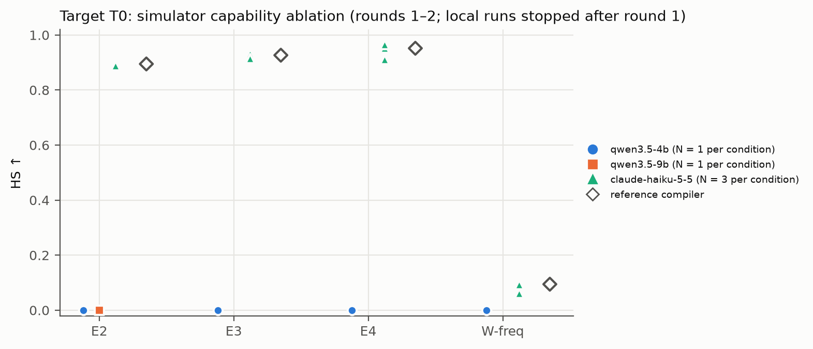
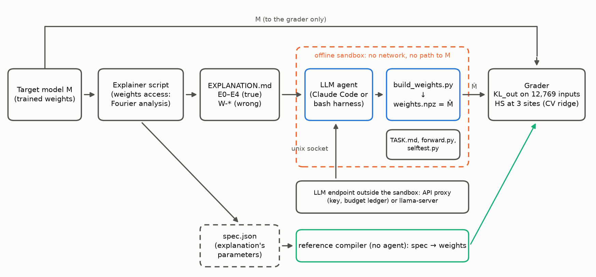
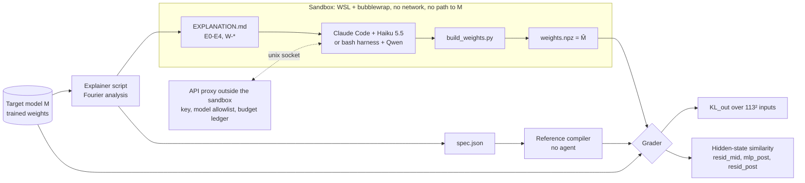

# Verifiable mechanistic interpretability by grading explanations using simulations

**Authors:** Libor "Burny" Burian, [Victor Levoso](https://scholar.google.com/citations?user=BBGcEigAAAAJ&hl=en).
Developed in a mechanistic interpretability hackathon on **automatically evaluating mechanistic interpretability
explanations**, which the authors co-organized in their mechanistic interpretability community and its Discord
server, [mechinterp.com](https://mechinterp.com/).

> **Status (2026-11-22): rounds 1 and 2 complete (N = 3 runs per condition); round 3 (N = 10) postponed to a later
> day.** Results below are at N = 3 — not yet N = 10. Hypotheses,
> metrics and analyses were preregistered and pushed before any result
> ([reports/preregistration.md](reports/preregistration.md)); every number below is regenerated from `results/` by
> `vmi analyse 2`. Paper draft: [reports/paper.pdf](reports/paper.pdf). Progress: [reports/progress.md](reports/progress.md).
> **Interactive results explorer:** [burnycoder.github.io/…](https://burnycoder.github.io/verifiable-mechanistic-interpretability-by-grading-explanations-using-simulations/).
> Reviews: [round 1](reports/reviews/round1-review.md), [round 2](reports/reviews/round2-review.md),
> [independent audit (2026-11-22)](reports/reviews/independent-audit-2026-11-22.md).
> Replacement networks, agent transcripts and trained models: [Hugging Face](https://huggingface.co/BurnyCoder/grading-explanations-by-simulation)
> ([collection](https://huggingface.co/collections/BurnyCoder/grading-mechanistic-explanations-by-simulation-6b01ab93022d76813a8b5c02)).

## In one paragraph

**Plain language.** People (and now AI agents) write explanations of how neural networks work. How do we check an
explanation automatically? We hand it to a second AI agent that has *never seen the network* and has *no internet*,
and ask it to build the network from scratch using only the explanation. If the rebuilt network behaves like the
original **and** computes the same intermediate quantities, the explanation captured the mechanism. If it only gets
the answers right, the explanation was incomplete or wrong — there are many ways to get the right answers.
*Why it matters:* AI agents can now produce explanations far faster than people can check them, so the checking has to
be automatic too, and an automatic check is only useful if it rewards true explanations and catches wrong ones. This
project tests exactly that, on a small network whose mechanism is well understood.

**Expert version.** We test whether *weights-blind simulation* is a valid score for mechanistic explanations. Target:
the one-layer modular-addition transformer of [Nanda et al. 2023](https://arxiv.org/abs/2301.05217) (p = 113).
A script with weights access renders explanations at five levels of true detail (task only → Fourier algorithm → key
frequencies → per-frequency quantities → per-neuron table) plus wrong explanations (wrong frequencies, the Pizza
algorithm of [Zhong et al. 2023](https://arxiv.org/abs/2306.17844), misattributed components, scrambled neurons),
length-matched to their true counterparts except the Pizza one, which is about 40 % shorter. **Claude Haiku 5.5 in Claude Code**, in a bubblewrap sandbox with no network except its model endpoint and no path to the weights, writes
`weights.npz` for a replacement of the same architecture. Local Qwen models in a bash-only harness were tried as a
simulator-capability ablation; every one of their runs built a constant-output network (chance), so they were stopped
after round 1's first five runs. The score is **output KL (output divergence, 0 = same answers)** over all 113² inputs and **hidden-state similarity (HS)**:
cross-validated ridge-regression variance explained in both directions at three sites — linear because the
no-LayerNorm residual stream is defined only up to an invertible linear map, and no wider because non-linear
alignment makes any network match any algorithm ([Sutter et al. 2025](https://arxiv.org/abs/2507.08802)).
*Motivation:* existing simulation scores predict a neuron's activations from its explanation
([Bills et al. 2023](https://openaipublic.blob.core.windows.net/neuron-explainer/paper/index.html)); related
per-feature scores (fuzzing, detection) often fail to separate trained from randomised models
([Heap et al. 2025](https://arxiv.org/abs/2501.17727)), and simulators can pass output-simulatability tests without
using the explanation ([Poché et al. 2026](https://arxiv.org/abs/2609.08585)); we
test the strongest form, rebuilding the whole network, and validate the score itself with preregistered controls.
*Novelty:* to our knowledge the first validation of full-weight, weights-blind simulation on an SGD-trained network,
with output KL plus a symmetry-aware hidden-state metric, an agent-free reference compiler, explanation-length
accounting, and no-, wrong-explanation, wrong-target and planted-mechanism controls (details in
[Novelty and related work](#novelty-and-related-work)). *Stack:* Python 3.12, PyTorch, Claude Code with Claude Haiku
5.5, bubblewrap in WSL2, uv, Hugging Face Hub, GitHub Pages ([Features](#features), [Technologies](#technologies)).

## What works and what doesn't: highlighted examples

Each row is one concrete comparison from the experiments, with its numbers read from `results/` (✅ the grader does
what a valid grader should; ❌ it fails, or a trap the experiments exposed). HS = hidden-state similarity (0–1, higher
= the rebuilt network computes the same intermediate quantities); KL = output divergence (lower = same answers).

<!-- BEGIN highlights -->
*Main simulator Claude Haiku 5.5, target T0 (main target network) unless stated; means over 3 run(s) per condition (round 2).*

| | Example | Measured | What it means |
|---|---|---|---|
| ✅ | **Naming the key frequencies is what makes the rebuild faithful** | HS (hidden-state similarity, 1 = internals match up to a linear map) 0.046 with the algorithm only (E1) → 0.894 once the frequencies are named (E2 (+ key frequencies)); the AI-free compiler gets 0.895 from E2 | The score rewards the part of the explanation that pins down this network's mechanism. |
| ✅ | **Right answers, wrong mechanism: caught by HS (hidden-state similarity, 1 = internals match up to a linear map), missed by output KL (output divergence, 0 = same answers)** | wrong-frequency explanation: accuracy 1.000, output KL 0.003 (true E3 (+ per-frequency details): 0.010), but HS 0.070 (true E3: 0.929) | Checking only the answers would rate a wrong explanation as good as a true one. |
| ✅ | **Copying the outputs does not copy the mechanism** | networks trained to copy the target's outputs: KL (output divergence, 0 = same answers) 2.38e-06 (best explanation-built network: 9.76e-06), HS (hidden-state similarity, 1 = internals match up to a linear map) 0.233; random networks: HS 0.236; networks trained on the task from other seeds: HS 0.119 | Matching the answers does not raise HS. HS measures overlap of internal features, and its scale is not anchored at 0: random networks score above working networks that use other frequencies. |
| ✅ | **An explanation of one network does not fit another** | T0's E3 (+ per-frequency details) and E4 (+ per-neuron table) rebuilds: HS (hidden-state similarity, 1 = internals match up to a linear map) 0.936 against T0 (main target network), at most 0.290 against 12 other trained networks (other seeds, the published model, no-mechanism controls) | The score was specific to the network that was explained. |
| ✅ | **Holds on a network trained after the protocol was frozen** | T-new (target trained after the freeze): HS (hidden-state similarity, 1 = internals match up to a linear map) 0.984 (E4 (+ per-neuron table)) vs 0.094 (wrong frequencies) | Prompts and templates were frozen before this network was trained, so they cannot have been tuned to it. |
| ❌ | **Cannot tell the Clock algorithm from the Pizza algorithm** | Pizza explanation (W-alg (wrong algorithm: Pizza)): HS (hidden-state similarity, 1 = internals match up to a linear map) 0.909; true explanation (E3 (+ per-frequency details)): HS 0.929 | Both builds use the same frequency features; HS, a linear fit over whole layers, did not separate what is computed from them (difference within noise at N = 3). |
| ❌ | **Cannot tell a correct neuron table from a shuffled one** | shuffled table (W-scramble (shuffled neuron table)): HS (hidden-state similarity, 1 = internals match up to a linear map) 0.936; true table (E4 (+ per-neuron table)): HS 0.943; matched-neuron correlation 0.653 vs 0.913 does separate them | Neuron-level detail needs a neuron-level metric. |
| ❌ | **Output KL (output divergence, 0 = same answers) ranks the explanations backwards** | E2 (+ key frequencies) → E3 (+ per-frequency details) → E4 (+ per-neuron table): output KL 2.12e-04 → 0.010 → 0.060, while HS (hidden-state similarity, 1 = internals match up to a linear map) 0.894 → 0.929 → 0.943 | Grading by output KL alone would have ranked the most detailed true explanation lowest of the three (trend not significant at N = 3; why KL rises with detail was not tested). |
| ❌ | **The AI fills gaps from memory of the published paper** | algorithm-only rebuilds of T0 (main target network): HS (hidden-state similarity, 1 = internals match up to a linear map) 0.046 against T0 but 0.819 against the published checkpoint (same weights) | On a published network, a high score can come from the AI's memory instead of the explanation (one simulator, one published model). |
| ❌ | **Small local AI models cannot do the task at all** | 5 local runs (Qwen3.5-4B, 9B): task accuracy 0.009 (chance = 1/113), HS (hidden-state similarity, 1 = internals match up to a linear map) 0.000 | In this harness and time budget the small local models never built a working network; the task needed a more capable coding agent here. |
<!-- END highlights -->

### Concrete outputs, next to the ground truth

What the networks answer on a few inputs (answer ✓/✗ and the probability it gives that answer; ground truth =
(a + b) mod 113). The three fixed sums are ordinary, wrap-around and the largest input; the other rows are the first
inputs on which an explanation-built network answers wrongly. All working networks give almost the same answers, so
the answers alone cannot tell a faithful rebuild from an unfaithful one; the last row (HS (hidden-state similarity, 1 = internals match up to a linear map)) can.

<!-- BEGIN outputs-T0 -->
| Input | True answer | target T0 (main target network) | agent E3 (+ per-frequency details) | agent E4 (+ per-neuron table) | agent E1 (algorithm only) | agent W-freq (wrong frequencies) | agent W-alg (wrong algorithm: Pizza) | retrain (wd1_s2) | random init |
|---|---|---|---|---|---|---|---|---|---|
| 5 + 7 | 12 | 12 ✓ (1.00) | 12 ✓ (0.98) | 12 ✓ (1.00) | 12 ✓ (1.00) | 12 ✓ (1.00) | 12 ✓ (1.00) | 12 ✓ (1.00) | 68 ✗ (0.01) |
| 60 + 80 | 27 | 27 ✓ (1.00) | 27 ✓ (0.96) | 27 ✓ (1.00) | 27 ✓ (1.00) | 27 ✓ (1.00) | 27 ✓ (1.00) | 27 ✓ (1.00) | 66 ✗ (0.02) |
| 112 + 112 | 111 | 111 ✓ (1.00) | 111 ✓ (1.00) | 111 ✓ (1.00) | 111 ✓ (1.00) | 111 ✓ (1.00) | 111 ✓ (1.00) | 111 ✓ (1.00) | 66 ✗ (0.02) |
| 4 + 90 | 94 | 94 ✓ (1.00) | 97 ✗ (0.49) | 94 ✓ (0.98) | 94 ✓ (1.00) | 94 ✓ (1.00) | 94 ✓ (0.83) | 94 ✓ (1.00) | 68 ✗ (0.02) |
| 0 + 27 | 27 | 27 ✓ (1.00) | 27 ✓ (0.96) | 30 ✗ (0.73) | 27 ✓ (1.00) | 27 ✓ (1.00) | 27 ✓ (0.83) | 27 ✓ (1.00) | 68 ✗ (0.02) |
| **accuracy, all 12,769 inputs** | 1.000 | 1.000 | 1.000 | 0.979 | 1.000 | 1.000 | 1.000 | 1.000 | 0.010 |
| **HS (insides vs. target)** | – | 1 (itself) | 0.94 | 0.91 | 0.05 | 0.06 | 0.89 | 0.18 | 0.23 |
<!-- END outputs-T0 -->

The same on all 12,769 inputs, outputs on top and insides below. Top: probability of the true answer (dark = 1, the
ground truth). Bottom: for each network, the neuron that best matches one of the target's neurons. The faithful
rebuilds (E3 (+ per-frequency details), E4 (+ per-neuron table)) and the Pizza rebuild (W-alg (wrong algorithm: Pizza)) contain a neuron that closely tracks the target's (correlation
printed in each panel); the wrong-frequency, algorithm-only and independently trained networks do not, although their
answers are just as correct.


### What the agent did: successes and failure modes, from its own transcripts

One run per case, chosen by a fixed rule (listed in [reports/agent-examples.md](reports/agent-examples.md); not by
reading transcripts first). The line shown is from
the `build_weights.py` the agent wrote; the quote is the first sentence of its closing message. Below the table, each
case says *why* it is right or wrong, comparing the frequencies the agent built with the ones it was told and the
ones the target network really uses, and quoting what the agent said. Where a run failed, the cause was tested by
re-running the agent's own script with one change at a time (`vmi diagnose`, results in `results/diagnoses/`); the
agent's own diagnosis can be wrong. Longer excerpts:
[reports/agent-examples.md](reports/agent-examples.md); every run's full transcript is linked.

<!-- BEGIN agent-examples -->
| | Case (run chosen by rule) | What the agent did (its log) | A line it wrote | In its own words (closing message) | Result | Why it is right or wrong |
|---|---|---|---|---|---|---|
| ✅ | **success**<br>[T0 · E3 · claude-haiku-5-5](https://huggingface.co/BurnyCoder/grading-explanations-by-simulation/tree/main/replacements/main__T0__E3__claudehaiku55-claudecode__tdef__s0) | 7 tool calls, 4 self-tests, 0 errors, 3.8 min | `KF = [2, 3, 23, 37, 39]` | `build_weights.py` builds `weights.npz` in a few seconds, and `selftest.py` passes with 99.95% accuracy (12,765 of 12,769 inputs) and mean probability 0.980 on the correct answer. | accuracy 0.9995, HS (hidden-state similarity, 1 = internals match up to a linear map) 0.94 (compiler 0.93) | Script uses T0's frequencies {2, 3, 23, 37, 39}, as the explanation says: answers and internals match |
| ✅ | **beats the compiler**<br>[T2 · E3 · claude-haiku-5-5](https://huggingface.co/BurnyCoder/grading-explanations-by-simulation/tree/main/replacements/seed__T2__E3__claudehaiku55-claudecode__tdef__s1) | 12 tool calls, 3 self-tests, 0 errors, 2.6 min | `KS = [37, 44, 45, 46, 47, 51]` | `build_weights.py` now builds `weights.npz` in about 3 seconds, and `selftest.py` passes: shapes are OK, accuracy is 1.0000 on all 12,769 inputs, and the mean probability of the correct answer is 1.0000. | accuracy 1.0000, HS (hidden-state similarity, 1 = internals match up to a linear map) 0.97 (compiler 0.78) | Script uses T2's frequencies; debugged from 0.5068 to 1.0000; beats the literal compiler (HS 0.97 vs 0.78) |
| ✅ | **faithful to a wrong explanation**<br>[T0 · W-freq · claude-haiku-5-5](https://huggingface.co/BurnyCoder/grading-explanations-by-simulation/tree/main/replacements/controls__T0__W-freq__claudehaiku55-claudecode__tdef__s0) | 11 tool calls, 3 self-tests, 0 errors, 2.4 min | `KEYS = [22, 31, 42, 52, 55]` | `build_weights.py` builds `weights.npz` in about 3 seconds, and `selftest.py` passes: 100% accuracy on all 12,769 inputs, with mean correct-answer probability 0.9991. | accuracy 1.0000, HS (hidden-state similarity, 1 = internals match up to a linear map) 0.06 (compiler 0.09) | Its script uses the wrong frequencies it was told, {22, 31, 42, 52, 55}, not T0's: right answers, wrong internals, so HS catches the wrong explanation |
| ❌ | **fills gaps from memory**<br>[T0 · E1 · claude-haiku-5-5](https://huggingface.co/BurnyCoder/grading-explanations-by-simulation/tree/main/replacements/main__T0__E1__claudehaiku55-claudecode__tdef__s0) | 9 tool calls, 2 self-tests, 0 errors, 1.2 min | `KEY_FREQS = [14, 35, 41, 42, 52] # key frequencies (choice: not specified by EXPLANATION.…` | `build_weights.py` now builds `weights.npz` in about 3.5 seconds, and `selftest.py` passes: shapes are correct, accuracy is 1.0000 on all 12,769 inputs, and the mean probability of the correct answer is 0.9999. | accuracy 1.0000, HS (hidden-state similarity, 1 = internals match up to a linear map) 0.05 (compiler 0.05) | No frequencies given, so it hard-coded the paper's {14, 35, 41, 42, 52} from memory instead of T0's {2, 3, 23, 37, 39}: right answers, wrong internals |
| ❌ | **broken answers**<br>[T0 · E3 · effort-low · claude-haiku-5-5](https://huggingface.co/BurnyCoder/grading-explanations-by-simulation/tree/main/replacements/hyper__T0__E3-effort-low__claudehaiku55-claudecode__tdef__s0) | 22 tool calls, 8 self-tests, 0 errors, 6.4 min | `F = [2, 3, 23, 37, 39]` | `build_weights.py` builds `weights.npz`, and `selftest.py` passes, but accuracy is only **56.2%** (mean correct-answer probability 0.548). | accuracy 0.5624, HS (hidden-state similarity, 1 = internals match up to a linear map) 0.92 (compiler 0.93) | Right frequencies, wrong answers: a layout bug in Haiku's own script: head 3 wrote into the answer dimensions (P3 = RO = 52); fixing it gives accuracy 1.0000. The agent blamed the neurons and never found it (bug in 1 of 3 identical runs) |
| ❌ | **small local model**<br>[T0 · E3 · qwen3.5-4b](https://huggingface.co/BurnyCoder/grading-explanations-by-simulation/tree/main/replacements/ablations__T0__E3__qwen354b-mini__t0.6__s0) | 24 tool calls, 3 self-tests, 6 errors, 64.8 min; harness: output-limit, exit status: TimeExceeded | `K = [2, 3, 23, 37, 39]` | I see the issue - the attention mechanism in forward.py uses the same key vector for both positions, which means the attention weights will be identical. | accuracy 0.0088, HS (hidden-state similarity, 1 = internals match up to a linear map) 0.00 (compiler 0.93) | Never built a working network: self-test at chance (0.0088), 2 replies cut off at the output limit, out of time |
<!-- END agent-examples -->

**In the agent's own words.** The messages each agent wrote between its tool calls in the same runs: its plan, its
reaction to the first self-test result, and its closing line, with the self-test accuracy after each self-test it
ran. (By default the API returns no thinking text, and these runs did not request thinking summaries; these are the
visible messages, quoted verbatim.)

<!-- BEGIN agent-words -->
**✅ success** (T0 (main target network) · E3 (+ per-frequency details) · claude-haiku-5-5; self-test accuracy over the run: 0.9961 → 0.9961 → 0.9908 → 0.9995; final HS (hidden-state similarity, 1 = internals match up to a linear map) 0.94)

*Why:* Right: its script uses exactly the frequencies the explanation names, {2, 3, 23, 37, 39}, which are T0's own, so both the answers (accuracy 0.9995) and the internals (HS (hidden-state similarity, 1 = internals match up to a linear map) 0.94; compiler 0.93) match the target.

> *Plan:* “The task is to hand-construct a 1-layer transformer's weights from the explanation, with no training. I'll build it in stages: embeddings and attention first, then the MLP, then the readout fitted in closed form, checking the self-test after each stage.”  
> *After the first self-test:* “The first build is already at 99.6% accuracy. Before tuning, I'll check whether the errors come from the missing k=2 neurons or from the attention and ReLU approximations, by trying a few bias and amplitude settings in scratch copies.”  
> *Closing:* “`build_weights.py` builds `weights.npz` in a few seconds, and `selftest.py` passes with 99.95% accuracy (12,765 of 12,769 inputs) and mean probability 0.980 on the correct answer.”  

**✅ beats the compiler** (T2 (target from another seed) · E3 (+ per-frequency details) · claude-haiku-5-5; self-test accuracy over the run: 0.5068 → 1.0000 → 1.0000; final HS (hidden-state similarity, 1 = internals match up to a linear map) 0.97)

*Why:* Right, and better than the AI-free compiler: its script uses T2's frequencies {37, 44, 45, 46, 47, 51} and it debugged its way from a first self-test at 0.5068 to 1.0000 (“The first build runs but gets only 50.7% accuracy.”). HS (hidden-state similarity, 1 = internals match up to a linear map) 0.97 against the compiler's 0.78, which follows the rendered explanation literally.

> *Plan:* “I'll check the folder for any extra files, such as the CSV table the explanation mentions, before building anything.”  
> *After the first self-test:* “The first build runs but gets only 50.7% accuracy. I'll check the fit quality and the attention pattern to see which stage is failing.”  
> *Closing:* “`build_weights.py` now builds `weights.npz` in about 3 seconds, and `selftest.py` passes: shapes are OK, accuracy is 1.0000 on all 12,769 inputs, and the mean probability of the correct answer is 1.0000.”  

**✅ faithful to a wrong explanation** (T0 (main target network) · W-freq (wrong frequencies) · claude-haiku-5-5; self-test accuracy over the run: 0.9992 → 0.9992 → 1.0000; final HS (hidden-state similarity, 1 = internals match up to a linear map) 0.06)

*Why:* Right behaviour of the agent, and the grader catches the explanation: its script uses exactly the wrong frequencies it was told, {22, 31, 42, 52, 55}, not T0's {2, 3, 23, 37, 39}. The answers are still right (accuracy 1.0000), but the internals do not match (HS (hidden-state similarity, 1 = internals match up to a linear map) 0.06), so HS exposes the wrong explanation that output-only grading would pass.

> *Plan:* “I've read the task. The plan: build the embedding, attention, MLP, and unembedding directly from the Fourier mechanism in EXPLANATION.md, and fit only the MLP output projection with closed-form least squares. Starting with the embedding, attention, and readout directions.”  
> *After the first self-test:* “The self-test passes at 99.92% accuracy. The mean correct-answer probability is 0.995, below the original's near-1 confidence, so I'll try a small sweep over the neuron bias range and attention offset.”  
> *Closing:* “`build_weights.py` builds `weights.npz` in about 3 seconds, and `selftest.py` passes: 100% accuracy on all 12,769 inputs, with mean correct-answer probability 0.9991.”  

**❌ fills gaps from memory** (T0 (main target network) · E1 (algorithm only) · claude-haiku-5-5; self-test accuracy over the run: 1.0000 → 1.0000; final HS (hidden-state similarity, 1 = internals match up to a linear map) 0.05)

*Why:* Wrong mechanism, right answers: the explanation gave no frequencies, and the agent filled them in from memory (“I'll pick five standard ones (14, 35, 41, 42, 52) and build the network in closed form: a head that copies the cos/sin …”). Its build script hard-codes {14, 35, 41, 42, 52}, the published paper's frequencies, instead of T0's {2, 3, 23, 37, 39}, so its answers are right (accuracy 1.0000) but its internals do not match (HS (hidden-state similarity, 1 = internals match up to a linear map) 0.05).

> *Plan:* “The folder has no CSV, so the key frequencies are unspecified. I'll pick five standard ones (14, 35, 41, 42, 52) and build the network in closed form: a head that copies the cos/sin features of a and b into the "=" position, MLP neurons with phase-shifted ReLU, and a least-squares readout of the sum-frequency features.”  
> *After the first self-test:* “The self-test passes on the first build. I'll confirm the run time limit and re-run the self-test from a clean state.”  
> *Closing:* “`build_weights.py` now builds `weights.npz` in about 3.5 seconds, and `selftest.py` passes: shapes are correct, accuracy is 1.0000 on all 12,769 inputs, and the mean probability of the correct answer is 0.9999.”  

**❌ broken answers** (T0 (main target network) · E3 (+ per-frequency details) · effort-low · claude-haiku-5-5; self-test accuracy over the run: 0.6790 → 0.4047 → 0.2905 → 0.5627 → 0.5805 → 0.7846 → 0.5624; final HS (hidden-state similarity, 1 = internals match up to a linear map) 0.92)

*Why:* Wrong answers, right mechanism: its script uses the target's frequencies {2, 3, 23, 37, 39}, and the internals match (HS (hidden-state similarity, 1 = internals match up to a linear map) 0.92), but the answers are wrong (accuracy 0.5624). The wrong detail is a layout bug, not the explanation: its constants line `SEP, BIAS, P0, P1, P2, P3, RO = 10, 11, 12, 22, 42, 52, 52` gives head 3's output (P3) and the readout (RO) the same residual dimensions 52–61, although its own docstring puts heads 2/3 at 42–51, so head 3's attention output is added onto the answer the unembedding reads. Re-running its own script with that one fix gives accuracy 1.0000 at HS 0.91 (other changes tested: head 3 moved to unused dimensions (P3 = 62), nothing else changed: accuracy 1.0000; neurons split in the explanation's proportions, scaled to all 512 (k=2: 0 neurons): accuracy 0.5719; its own accuracy-best '=' penalty (1 instead of 10): accuracy 0.7846). The slip is Haiku's own: nothing the agent was given suggests a layout (the starter script defines only the array shapes, and TASK.md and ARCHITECTURE.md name no dimensions). Its own docstring puts heads 2 and 3 together at dimensions 42–51 and the readout at 52–61, so the constants line should read P3 = 42; it reads 52, the readout's first dimension. It stopped by its own choice after 22 tool calls and 6.4 minutes, well within the 60-minute, $2 per-run budget (Claude Code has no step cap). Its 2 replicates were identical in everything checked — the same files given to the agent (identical SHA-256 hashes), prompt, model (claude-haiku-5-5), Claude Code 2.1.330, effort and grading — so nothing the agent could see differed except the unseedable sampling (outside its view, the runs ran at different times and the server-side model behind the name cannot be verified); they reached accuracy 0.9994 and 0.9986. So the bug occurred in 1 of 3 identical runs: a chance slip that the setup does not force, whose frequency so few runs barely constrain (95 % Clopper–Pearson interval 1%–91%). The agent never found the bug: it blamed the neurons (“Bias-free ReLU neurons don't span cos(w(a+b)) well.”), tuned constants around the bug (self-test peak 0.7846) and then kept the setting it judged more faithful to the explanation (“I'll keep the faithful setting (penalty 10, slope 0.707, κ=0), which gives 0.56, and report the trade-off.”).

> *Plan:* “I've read the task and the explanation. The plan is to build the embedding, attention, and MLP weights directly from the explanation, then fit only the MLP-to-readout map with closed-form least squares. I'll write the script in one go and then run it.”  
> *After the first self-test:* “The self-test runs but accuracy is only 0.679. I'll check which readout frequencies the fit gets wrong.”  
> *Closing:* “`build_weights.py` builds `weights.npz`, and `selftest.py` passes, but accuracy is only **56.2%** (mean correct-answer probability 0.548).”  

**❌ small local model** (T0 (main target network) · E3 (+ per-frequency details) · qwen3.5-4b; self-test accuracy over the run: 0.0088 → 0.0088 → 0.0088; final HS (hidden-state similarity, 1 = internals match up to a linear map) 0.00)

*Why:* Wrong: it never built a working network. Its self-test stayed at chance (0.0088) every time; 2 of its replies were cut off at the output limit before anything ran, and the run ended with exit status: TimeExceeded. Its script even had the target's frequencies {2, 3, 23, 37, 39}. Its last words were still debugging: “I see the issue - the attention mechanism in forward.py uses the same key vector for both positions, which means the attention weights will be identical.”

> *Plan:* “I need to first read the files in the current folder to understand the task requirements. Let me start by reading TASK.md, ARCHITECTURE.md, and EXPLANATION.md to understand what needs to be done.”  
> *After the first self-test:* “Now I understand the task. I need to implement the Fourier-based addition mechanism described in EXPLANATION.md. Let me create a working implementation step by step. First, let me create the embedding layer with Fourier components for the key frequencies.”  
> *Closing:* “I see the issue - the attention mechanism in forward.py uses the same key vector for both positions, which means the attention weights will be identical.”
<!-- END agent-words -->


**Output examples: which frequencies each network actually built**, against the target's own spectrum (the ground
truth). The true-explanation replacement (E3 (+ per-frequency details)) builds the target's frequencies; the algorithm-only replacement (E1 (algorithm only))
builds most of the *published paper's* frequencies from memory; the wrong-frequency replacement builds the wrong ones; the
Pizza replacement (W-alg (wrong algorithm: Pizza)) builds the *same* frequencies as the true ones, which is why HS (hidden-state similarity, 1 = internals match up to a linear map) cannot separate it; an
independent retrain picks other frequencies; a random network has no structure.


## Predicted vs. measured with Claude Haiku

Before any experiment we wrote down, and pushed to GitHub, what a valid grader should show
([preregistration](reports/preregistration.md) §5). The table puts each prediction next to what Claude Haiku 5.5 and
the grader actually produced; it is regenerated from `results/` after every round, and the last column says how many
runs per condition each verdict rests on.

**In plain words.** We expected the score to reward every bit of true detail and to punish every wrong explanation.
With three runs per condition, five predictions pass their preregistered tests: the score rises with true detail,
mostly once the explanation names *which frequencies* the network uses (the handful of numbers it does the arithmetic
with); it punishes a wrong explanation even when that explanation gives all the right answers; it rates networks rebuilt
from the detailed explanations (E3, E4) above freshly trained ones; it does not fit one network's explanation to another network; and it tracks the
network learning its mechanism (H1, H3, H4, H7, H8). Four expectations failed: grading by the answers alone (output
KL (output divergence, 0 = same answers)) gets *worse* with more detail (H1's second part); the score cannot tell two algorithms that use the same
frequencies apart, or a correct list of neurons from a shuffled one (H2); the AI sometimes beat our own AI-free
compiler (H5); and on a network whose mechanism we planted, output KL did not rise steadily as it drifted (H4b). Whether stronger AIs do better (H5, H6) could not be tested, because the small local models never built
a working network. "Direction matches" only says whether the numbers went the predicted way; the formal verdict adds
the preregistered statistical test, which for H2 needs more than three runs per condition.

<!-- BEGIN predictions-plain -->
| Hypothesis | Expected, in plain words | Predicted (preregistration §5) | Measured with the main simulator (T0 (main target network)) | Direction matches? | Formal verdict |
|---|-------|-------|---------|-----|------|
| H1 | The more true detail an explanation gives, the more faithfully the rebuilt network should match the original. | HS (hidden-state similarity, 1 = internals match up to a linear map) rises and output KL (output divergence, 0 = same answers) falls from E1 (algorithm only) to E4 (+ per-neuron table) on T0 (main target network); E0 (no explanation) lies below E1 | HS E0 0.130, E1 0.046, E2 (+ key frequencies) 0.894, E3 (+ per-frequency details) 0.929, E4 0.943; KL E1 0.097, E2 2.12e-04, E3 0.010, E4 0.060 | partly (KL does not fall E1 → E4; E0 not below E1) | HS: supported; KL_out (output divergence, 0 = same answers): not supported · at N=3 — not yet N=10 |
| H2 | A true explanation should beat a wrong explanation of the same length. | true explanations beat length-matched false ones on HS (hidden-state similarity, 1 = internals match up to a linear map): E3 (+ per-frequency details) > W-freq (wrong frequencies), W-alg (wrong algorithm: Pizza), W-role (wrong component roles); E4 (+ per-neuron table) > W-scramble (shuffled neuron table) | HS difference E3 > W-freq +0.859 [+0.835, +0.880]; E3 > W-alg +0.020 [-0.008, +0.045]; E3 > W-role +0.725 [+0.661, +0.768]; E4 > W-scramble +0.007 [-0.025, +0.037] | partly (E3 > W-alg tie (CI includes 0); E4 > W-scramble tie (CI includes 0)) | E3 > W-freq: cannot tell at this N; E3 > W-alg: cannot tell at this N; E3 > W-role: cannot tell at this N; E4 > W-scramble: cannot tell at this N · at N=3 — not yet N=10 |
| H3 | A wrong explanation can still give all the right answers; checking only the answers is fooled, checking the insides (HS (hidden-state similarity, 1 = internals match up to a linear map)) should not be. | W-freq (wrong frequencies): argmax agreement ≥ 0.99, KL (output divergence, 0 = same answers) not above the true E2–E4 range, HS below each of E2–E4 | W-freq: agreement 1.000, KL 0.003 (true 2.12e-04–0.060), HS 0.070 (true 0.894–0.943); HS − E2 (+ key frequencies) -0.824 [-0.840, -0.801], E3 (+ per-frequency details) -0.859 [-0.880, -0.835], E4 (+ per-neuron table) -0.873 [-0.904, -0.841] | yes | supported · at N=3 — not yet N=10 |
| H4 | Rebuilding from an explanation should match the original's insides better than training a fresh network the same way does. | E3 (+ per-frequency details) and E4 (+ per-neuron table) beat independent retrains on HS (vs. distilled students: open question, no direction) | E3 0.929, E4 0.943; 9 retrains mean 0.119 (max 0.329); 3 students mean 0.233 (max 0.282); vs students, two-sided: E3 cannot tell at this N, E4 cannot tell at this N | yes | E3: supported; E4: supported · at N=3 — not yet N=10 |
| H4b | On a network whose mechanism we planted ourselves, the score should start perfect and drop as further training moves the network away from it. | planted model: HS (hidden-state similarity, 1 = internals match up to a linear map) = 1 and KL (output divergence, 0 = same answers) = 0 at step 0, then HS strictly falls and KL strictly rises | HS 1.000 → 0.998 → 0.957 → 0.888; KL 0.000 → 0.371 → 0.040 → 4.25e-04 | partly (KL not strictly rising) | not supported · deterministic |
| H5 | The AI should not beat our automatic, AI-free compiler, and stronger AIs should come closer to it. | agent ≤ reference compiler on every explanation; the gap shrinks with simulator capability | agent − compiler on T0 (main target network): E2 (+ key frequencies) -0.001, E3 (+ per-frequency details) +0.002, E4 (+ per-neuron table) -0.009, W-freq (wrong frequencies) -0.024; agent above compiler in 7 of 15 target–explanation pairs by sign, 4 beyond the bootstrap CI (T1 (target from another seed) E2, T2 (target from another seed) E3, T2 E4, T-new (target trained after the freeze) E4; largest +0.179, T2 E3); 5 local runs, 0 above chance | no (agent above compiler beyond its CI; capability trend not testable) | not evaluable (local simulators stopped at chance, deviation 5) · 5 local runs, qwen3.5-4b: 0/4 above chance, qwen3.5-9b: 0/1 above chance |
| H6 | Different AIs should put the explanations in the same order. | the local simulators rank E2 (+ key frequencies), E3 (+ per-frequency details), E4 (+ per-neuron table), W-freq (wrong frequencies) the same way | 5 local runs, 0 above chance: nothing to rank | not testable | not evaluable (local simulators stopped at chance, deviation 5) · 5 local runs, qwen3.5-4b: 0/4 above chance, qwen3.5-9b: 0/1 above chance |
| H7 | An explanation of one network should not fit a different network. | a T0 (main target network) replacement fits T0 better than any other trained or no-mechanism model (HS (hidden-state similarity, 1 = internals match up to a linear map)) | E3 (+ per-frequency details): HS 0.939 vs best other 0.274 (T2 (target from another seed)); E3: HS 0.932 vs best other 0.240 (T2); E3: HS 0.915 vs best other 0.290 (T2); E4 (+ per-neuron table): HS 0.912 vs best other 0.226 (T2); E4: HS 0.953 vs best other 0.227 (T2); E4: HS 0.965 vs best other 0.258 (T2) | yes | supported · 6 E3 and E4 replacements (at N=3 — not yet N=10) |
| H8 | The score should rise while the original network learns its mechanism during training. | HS (hidden-state similarity, 1 = internals match up to a linear map) against T0's checkpoints rises as restricted loss falls (circuit formation) | Spearman ρ(HS, −log restricted loss) per replacement: median 0.774, min 0.751 (6 E3 (+ per-frequency details) and E4 (+ per-neuron table) replacements × 401 checkpoints) | yes | supported · 6 E3 and E4 replacements × 401 checkpoints |
<!-- END predictions-plain -->

*Labels.* **T0**: the main target network (no published analysis; its weights have been public since October 2026, after the simulator's June 2026 training-data cutoff). **E0–E4**: true explanations with increasing detail (E0 task only, E1 algorithm only, E2 + the key frequencies, E3 + per-frequency quantities, E4 + a per-neuron table). **W-freq, W-alg, W-role, W-scramble**: wrong explanations (wrong frequencies, the Pizza algorithm, wrong component roles, shuffled neurons), length-matched except W-alg (about 40 % shorter). **HS**: hidden-state similarity, 0–1; 1 means each network's intermediate states are a linear function of the other's, and unrelated networks do not score 0 (random networks score above working networks that use other frequencies). **KL**: output divergence in nats, lower means the same answers with the same confidence. **Compiler**: our script that turns an explanation into weights without any AI.

**In expert terms.** At N = 3 the preregistered tests support H1's HS (hidden-state similarity, 1 = internals match up to a linear map) part, H3, H4, H7 and H8: HS rises with true detail (the big step is E1 (algorithm only) → E2 (+ key frequencies); every E3 (+ per-frequency details) run is above every E2 run under the preregistered HS, though E2 and E3 tie under the post-hoc whitened check; E3 → E4 (+ per-neuron table) is mixed), a wrong-frequency explanation keeps correct answers while its HS falls below every true explanation that names the frequencies (E2–E4), E3 and E4 replacements beat independent retrains and fit T0 (main target network) better than any other model, and HS tracks circuit formation. The predictions fail where they assumed that output KL (output divergence, 0 = same answers) improves with detail (H1's KL part: it is lowest at E2 and rises at E3 and E4), that HS sees below the frequency level (H2: W-alg (wrong algorithm: Pizza) and W-scramble (shuffled neuron table) tie with the true explanations, their bootstrap CIs include 0), that the reference compiler is a ceiling (H5: the agent beats it on T2 (target from another seed)), or that output KL grows smoothly as a planted model drifts (H4b). "Direction matches" compares directions and preregistered thresholds only (a difference whose bootstrap CI includes 0 counts as a tie; with three runs per group a percentile bootstrap has only ten distinct resamples per group, so these intervals are too narrow and a tie is the safe reading, an "ahead" is not significance); the formal verdict adds the preregistered test, and 3 vs 3 runs cannot reach significance for H2 (smallest attainable p = 0.05). On the seed-sensitivity targets the gap between E3 and the wrong-frequency explanation replicates on every target (its rank test cannot decide at N = 3), while HS's rise with detail does not replicate (its trend test is not supported on T1 and T2; on T-new, with only E3 and E4, the means rise but the test cannot decide at N = 3); where H3 fails there, argmax agreement is below the preregistered 0.99 for the wrong-frequency replacement and also for the true E3 and E4 replacements, so the explanation is not shown to be the cause (not diagnosed). *Kind of evidence:* H1–H3 are
interventions on the explanation with everything else fixed; H4 compares with explanation-free baselines; H7 and the
memorisation target swap are counterfactual swaps of the target network; the format, self-test, effort and simulator
variants are ablations; H8 is a correlation over training checkpoints. *Strength:* the supported hypotheses rest on three runs
per condition (preregistered one-sided rank tests at α = 0.05, Holm-corrected where preregistered); the wrong-frequency
gap holds on all five targets; nothing here has reached the preregistered N = 10.

Replications on the seed-sensitivity targets (preregistration §5: H1–H3 re-tested per target with the preregistered
tests, which earlier versions only checked by direction; deviation 8):

<!-- BEGIN replications -->
| Target | HS (hidden-state similarity, 1 = internals match up to a linear map) per true explanation | H1: HS rises with detail? (trend test) | H2: HS(E3 (+ per-frequency details)) − HS(W-freq (wrong frequencies)); Mann–Whitney | H3 observed (W-freq) | H3 holds? |
|-----|------|---|---|-------|-----|
| T1 (target from another seed) | E2 (+ key frequencies) 0.957, E3 (+ per-frequency details) 0.936, E4 (+ per-neuron table) 0.960 | means do not rise E2 → E3 → E4; not supported (JT p 0.502, ρ 0.05) | +0.885; cannot tell at this N (p 0.050) | agreement 0.854, KL (output divergence, 0 = same answers) 0.537 (true max 0.498), HS (hidden-state similarity, 1 = internals match up to a linear map) 0.051 | partly (agreement < 0.99; KL above the true range) |
| T2 (target from another seed) | E2 (+ key frequencies) 0.900, E3 (+ per-frequency details) 0.962, E4 (+ per-neuron table) 0.951 | means do not rise E2 → E3 → E4; not supported (JT p 0.500, ρ 0.05) | +0.864; cannot tell at this N (p 0.050) | agreement 0.999, KL (output divergence, 0 = same answers) 0.006 (true max 0.049), HS (hidden-state similarity, 1 = internals match up to a linear map) 0.098 | yes |
| T-new (target trained after the freeze) | E3 (+ per-frequency details) 0.910, E4 (+ per-neuron table) 0.984 | means rise E3 → E4; cannot tell at this N (JT p 0.050, ρ 0.88) | +0.816; cannot tell at this N (p 0.050) | agreement 0.907, KL (output divergence, 0 = same answers) 0.432 (true max 0.328), HS (hidden-state similarity, 1 = internals match up to a linear map) 0.094 | partly (agreement < 0.99; KL above the true range) |
| T-paper (flagged: memorisation) | E1 (algorithm only) 0.590, E3 (+ per-frequency details) 0.940, E4 (+ per-neuron table) 0.937 | means do not rise E3 → E4; cannot tell at this N (JT p 0.650, ρ -0.10) | +0.823; cannot tell at this N (p 0.050) | agreement 0.998, KL (output divergence, 0 = same answers) 0.007 (true max 0.413), HS (hidden-state similarity, 1 = internals match up to a linear map) 0.117 | yes |
<!-- END replications -->

## Key results so far

<!-- BEGIN key-results -->
*Round 2, N = 3 run(s) per condition — not yet N=10*

- **Model-specific detail raises hidden-state similarity:** HS on T0 (main target network) is 0.05 (E1, algorithm only), 0.89 (E2 (+ key frequencies)), 0.93 (E3 (+ per-frequency details)) and 0.94 (E4 (+ per-neuron table)); with no explanation (E0) it is 0.13. Monotone from E1 to E4; E0 lies above E1, against the preregistered prediction.
- **Correct behaviour, wrong mechanism is caught by HS (hidden-state similarity, 1 = internals match up to a linear map), not by output KL (output divergence, 0 = same answers):** the wrong-frequency replacement reaches KL 0.003 nats (true E3 (+ per-frequency details): 0.010) but HS 0.07.
- **Copying behaviour does not copy the mechanism:** independent retrains (HS (hidden-state similarity, 1 = internals match up to a linear map) 0.12) and logit-distilled students (HS 0.23, KL (output divergence, 0 = same answers) 2.38e-06) score no higher than randomly initialised networks (HS 0.24). HS's scale is therefore not anchored at 0 for unrelated networks: it measures overlap of internal features, and working networks built on other frequencies score below random ones.
- **Negative result:** the primary HS (hidden-state similarity, 1 = internals match up to a linear map) does not separate the Pizza explanation (W-alg (wrong algorithm: Pizza), HS 0.91) or the scrambled neuron table (W-scramble (shuffled neuron table), HS 0.94) from the true explanations; the secondary matched-neuron correlation separates W-scramble (0.65) from E4 (+ per-neuron table) (0.91).
- **Memorisation (post hoc):** when the explanation gives no frequencies, the simulator often builds most of the published paper's frequencies {14, 35, 41, 42, 52} into its replacement. E1 (algorithm only): 3 of 3 replacement(s) used at least four of the paper's five frequencies, and 3 of 3 used none of T0's; mean HS (hidden-state similarity, 1 = internals match up to a linear map) 0.05 against T0 (main target network) but 0.82 against the published checkpoint (target swap: same weights, other target); E0 (no explanation): 1 of 3 replacement(s) used at least four of the paper's five frequencies, and 2 of 3 used none of T0's; mean HS 0.13 against T0 but 0.28 against the published checkpoint (target swap: same weights, other target). The 3 algorithm-only run(s) on the published checkpoint itself score HS 0.59 on average (range 0.24–0.92): on a published model, a high score can come from the simulator's memory rather than the explanation (one published model and one simulator tested).
- **Cost:** all Claude Haiku 5.5 runs so far cost $2.33 in total.
<!-- END key-results -->


| Calibration on a planted mechanism (H4b): HS (hidden-state similarity, 1 = internals match up to a linear map) falls steadily, output KL (output divergence, 0 = same answers) does not | Score against the target's training checkpoints (H8) |
|---|---|
|  |  |
| **Score against explanation length:** the jump comes with the key frequencies (E2 (+ key frequencies)), not with length | **Simulator ablation (negative):** local Qwen models at chance, Haiku near the compiler |
|  |  |

The same results, explorable run by run (hover for each run's numbers; switch target, metric and simulator):
[interactive results explorer](https://burnycoder.github.io/verifiable-mechanistic-interpretability-by-grading-explanations-using-simulations/).
GitHub READMEs cannot run scripts, so the interactive views live there; there is no video.

**Better or worse than the baselines, controls and ablations, in plain words.**
- **Better than output KL (output divergence, 0 = same answers):** a network trained with the same recipe from another seed, a network trained to copy the
  target's outputs exactly, and a network built from a *wrong-frequency* explanation all give the right answers —
  output KL rates them as good as the true explanations (the wrong-frequency one above E3 and E4, below E2); HS (hidden-state similarity, 1 = internals match up to a linear map) rates them at the bottom, where they belong.
- **Better than chance and than explanation-free baselines:** naming the key frequencies (E2 (+ key frequencies)) lifts HS (hidden-state similarity, 1 = internals match up to a linear map) from the
  floor to near the agent-free compiler's value; without model-specific information (E0 (no explanation), E1 (algorithm only)) the agent builds a
  working adder with none of the target's internals.
- **Worse than hoped (negative result):** HS (hidden-state similarity, 1 = internals match up to a linear map) cannot tell the true Clock explanation from a Pizza explanation with the
  same frequencies, nor a correct per-neuron table from a scrambled one; both keep every frequency subspace intact.
  The secondary matched-neuron correlation catches the scrambled table.
- **A trap the design caught (post hoc):** when an explanation describes the algorithm but leaves the frequencies
  open, the agent fills them in with most of the *published paper's* frequencies from memory (in all three such runs
  on our main target it used four of the paper's five and none of the target's; with no explanation at all, one run in
  three). Those rebuilds score near the floor against our target and
  high against the published checkpoint, the very same weights. On the paper's own checkpoint, algorithm-only scores
  swing between the floor and a full explanation's level. On a published model a high score can therefore come from
  memory, so the study's conclusions rest on the targets with no published analysis.
- **Ablations:** writing the explanation as maths or as code instead of prose, or removing the self-test,
  barely changed HS (hidden-state similarity, 1 = internals match up to a linear map). Low effort broke the answers in one of three E3 (+ per-frequency details) runs and one of three W-freq (wrong frequencies) runs, without
  changing HS. The E3 failure was a bug in that run's own script, not in the explanation: it placed one attention
  head's output on the dimensions the network reads its answer from, and changing that one number gives full accuracy
  (examples above). The three low-effort E3 runs were identical in everything the agent could see except the
  unseedable sampling (same files, prompt, model, Claude Code version, settings and grading, checked), so the bug was a
  chance slip of the model that the setup does not force, and one failure in three runs says little about how often it
  happens (interval in the example above). The W-freq failure was not tested further; the agent blamed its MLP features. The small local
  models never built a working network from any explanation.
- **Not yet decided:** H2's comparisons cannot reach significance with three runs per condition (3 vs 3 runs:
  smallest attainable p = 0.05) and read "cannot tell at this N"; round 3 (N = 10) is postponed.

### Scores on the main target T0 (agent vs. agent-free reference compiler)

<!-- BEGIN scoreboard-T0 -->
| Explanation | role | chars | N | agent accuracy | agent KL_out (output divergence, 0 = same answers) ↓ | agent HS (hidden-state similarity, 1 = internals match up to a linear map) ↑ | agent matched-neuron corr ↑ | compiler KL_out ↓ | compiler HS ↑ |
|---|---|---|---|---|---|---|---|---|---|
| E0 (no explanation) | control: no mechanism | 279 | 3 | 1.000 ± 0.000 | 0.005 ± 0.004 | 0.130 ± 0.109 | 0.056 ± 0.031 | 1.64e-04 | 0.051 |
| E1 (algorithm only) | method | 1556 | 3 | 1.000 ± 0.000 | 0.097 ± 0.152 | 0.046 ± 0.002 | 0.028 ± 1.59e-04 | 1.64e-04 | 0.051 |
| E2 (+ key frequencies) | method | 1788 | 3 | 1.000 ± 0.000 | 2.12e-04 ± 1.78e-04 | 0.894 ± 0.005 | 0.669 ± 0.005 | 1.30e-05 | 0.895 |
| E3 (+ per-frequency details) | method | 3712 | 3 | 1.000 ± 4.70e-04 | 0.010 ± 0.012 | 0.929 ± 0.012 | 0.759 ± 0.060 | 4.25e-04 | 0.927 |
| E4 (+ per-neuron table) | method | 51329 | 3 | 0.986 ± 0.012 | 0.060 ± 0.045 | 0.943 ± 0.028 | 0.913 ± 0.044 | 0.010 | 0.952 |
| W-freq | control: wrong frequencies | 3724 | 3 | 1.000 ± 9.04e-05 | 0.003 ± 0.002 | 0.070 ± 0.021 | 0.030 ± 1.64e-04 | 0.001 | 0.095 |
| W-alg (wrong algorithm: Pizza) | control: wrong algorithm (Pizza) | 2224 | 3 | 1.000 ± 0.000 | 0.024 ± 0.017 | 0.909 ± 0.027 | 0.737 ± 0.061 | 0.040 | 0.921 |
| W-role | control: wrong component roles | 3777 | 3 | 1.000 ± 2.71e-04 | 9.80e-04 ± 7.60e-04 | 0.204 ± 0.060 | 0.013 ± 0.002 | 4.727 | 0.500 |
| W-scramble (shuffled neuron table) | control: scrambled neurons | 51590 | 3 | 0.998 ± 0.004 | 0.006 ± 0.008 | 0.936 ± 0.018 | 0.653 ± 0.027 | 2.02e-05 | 0.859 |
<!-- END scoreboard-T0 -->

### Explanation-free baselines on T0 (no agent)

<!-- BEGIN baselines-T0 -->
| Reference point | what it has | n | task accuracy | KL_out (output divergence, 0 = same answers) ↓ | HS (hidden-state similarity, 1 = internals match up to a linear map) ↑ |
|---|---|---|---|---|---|
| Random initialisation | nothing (floor) | 5 | 0.009 ± 0.001 | 4.766 ± 0.006 | 0.236 ± 0.006 |
| Independent retrains | same recipe, other seeds | 9 | 1.000 ± 0.000 | 6.90e-06 ± 3.96e-06 | 0.119 ± 0.097 |
| Logit-distilled students | M's full output logits, no explanation | 3 | 1.000 ± 0.000 | 2.38e-06 ± 8.25e-07 | 0.233 ± 0.058 |
| Fourier-restricted M | M's weights, key frequencies only in W_E/W_U | 1 | 1.000 | 0.002 | 0.992 |
| Weights dump | all 226,816 weights | 1 | 1.000 | 0.000 | 1.000 |
<!-- END baselines-T0 -->

### Ablations and hyperparameter variants on T0

<!-- BEGIN ablations-T0 -->
| Change | Explanation | Simulator | N | task accuracy | KL_out (output divergence, 0 = same answers) ↓ | HS (hidden-state similarity, 1 = internals match up to a linear map) ↑ | matched-neuron corr ↑ |
|---|---|---|---|---|---|---|---|
| none (main condition) | E3 (+ per-frequency details) | claude-haiku-5-5 | 3 | 1.000 ± 4.70e-04 | 0.010 ± 0.012 | 0.929 ± 0.012 | 0.759 ± 0.060 |
| explanation as maths | E3 (+ per-frequency details) | claude-haiku-5-5 | 3 | 0.999 ± 0.002 | 0.003 ± 0.004 | 0.915 ± 0.003 | 0.771 ± 0.036 |
| explanation as code | E3 (+ per-frequency details) | claude-haiku-5-5 | 3 | 1.000 ± 9.04e-05 | 0.002 ± 3.96e-04 | 0.897 ± 0.030 | 0.805 ± 2.48e-04 |
| self-test removed | E3 (+ per-frequency details) | claude-haiku-5-5 | 3 | 1.000 ± 3.62e-04 | 0.004 ± 0.002 | 0.942 ± 0.025 | 0.765 ± 0.043 |
| effort low | E3 (+ per-frequency details) | claude-haiku-5-5 | 3 | 0.853 ± 0.252 | 0.661 ± 1.137 | 0.921 ± 0.003 | 0.751 ± 0.027 |
| effort high | E3 (+ per-frequency details) | claude-haiku-5-5 | 3 | 1.000 ± 0.000 | 0.001 ± 7.17e-04 | 0.936 ± 0.034 | 0.791 ± 0.025 |
| none (main condition) | W-freq (wrong frequencies) | claude-haiku-5-5 | 3 | 1.000 ± 9.04e-05 | 0.003 ± 0.002 | 0.070 ± 0.021 | 0.030 ± 1.64e-04 |
| effort low | W-freq (wrong frequencies) | claude-haiku-5-5 | 3 | 0.923 ± 0.133 | 0.344 ± 0.594 | 0.088 ± 0.025 | 0.061 ± 0.031 |
| effort high | W-freq (wrong frequencies) | claude-haiku-5-5 | 3 | 1.000 ± 0.000 | 0.001 ± 6.05e-04 | 0.093 ± 0.005 | 0.032 ± 0.003 |
| simulator qwen3.5-4b | E2 (+ key frequencies) | qwen3.5-4b | 1 | 0.009 | 4.727 | 0.000 | 0.000 |
| simulator qwen3.5-4b | E3 (+ per-frequency details) | qwen3.5-4b | 1 | 0.009 | 4.727 | 0.000 | 0.000 |
| simulator qwen3.5-4b | E4 (+ per-neuron table) | qwen3.5-4b | 1 | 0.009 | 4.727 | 0.000 | 0.000 |
| simulator qwen3.5-4b | W-freq (wrong frequencies) | qwen3.5-4b | 1 | 0.009 | 6.066 | 0.000 | 1.41e-16 |
| simulator qwen3.5-9b | E2 (+ key frequencies) | qwen3.5-9b | 1 | 0.009 | 7.628 | 0.000 | 0.000 |
<!-- END ablations-T0 -->

### Preregistered hypotheses

Predicted vs. measured for every hypothesis, in plain words and in expert terms: [top of this README](#predicted-vs-measured-with-claude-haiku). Exact tests and falsification criteria: [reports/preregistration.md](reports/preregistration.md) §5.

## How it works





**What happens when you run it.** (1) Target runs are downloaded at pinned revisions. (2) The explainer computes the
target's key frequencies, neuron clusters, attention fits and per-neuron fits and renders every explanation level
from one parameter dict, which also feeds the reference compiler. (3) For each agent run a fresh folder gets the
task files and one explanation. (4) The agent runs offline inside bubblewrap; its only way out is a unix socket to a
proxy (Claude) or relay (llama-server) outside the sandbox, which logs every request and response body in full (headers excluded). (5) The
build script is audited for training loops; the grader runs both networks on all 12,769 inputs and computes the
metrics. (6) `vmi analyse` evaluates every preregistered hypothesis and regenerates every table and figure in this
README, the reports and the paper from `results/`.

## Run matrix

Stage 0 (tooling, dev target only), then three rounds — **N = 1 of everything, then N = 3, then N = 10** (round 3
postponed to a later day, deviation 6) — each running
main method → controls → baselines → ablations → hyperparameter sensitivity → seed sensitivity. 32 Claude Haiku
conditions per round: main (T0 (main target network) × E1–E4), controls (E0 (no explanation), W-freq (wrong frequencies), W-alg (wrong algorithm: Pizza), W-role (wrong component roles), W-scramble (shuffled neuron table)), ablations (math and code
formats; no self-test), hyperparameter (effort low/high × {E3 (+ per-frequency details), W-freq}), seed sensitivity (T1 (target from another seed), T2 (target from another seed) × 4; T-new (target trained after the freeze) × 3;
T-paper (the published checkpoint) × 5 incl. the published explanation). Round 1 also planned 12 local Qwen conditions (3 simulators ×
{E2 (+ key frequencies), E3, E4 (+ per-neuron table), W-freq}); after five runs at chance they were stopped and dropped from rounds 2–3 (preregistration,
deviation 5). Full table:
[reports/planned-runs.md](reports/planned-runs.md); all runs so far: [reports/experiments/experiments.md](reports/experiments/experiments.md).

## Novelty and related work

Closest work: [iWSP (Mehta et al. 2026)](https://arxiv.org/abs/2611.18114) has Claude Code write small models in
code and rebuild them in fresh sessions from a ≤ 200-word description, with a no-description control; it rebuilds only
agent-written models, scores by accuracy and prediction correlation (feature CKA for one model) and uses no output KL;
[Gao (2026)](https://www.lesswrong.com/posts/Dkh7pXKjoNWkkxQDz/neural-networks-are-not-already-clean) proposes scoring
by substituting simulated activations and measuring downstream KL (output divergence, 0 = same answers) (cf. the ablation scoring of Bills et al. 2023); [Cammarata et al. 2021](https://distill.pub/2020/circuits/curve-circuits/)
hand-built one circuit and compared activations. New here is the combination: an SGD-trained target, a weights-blind
agent (offline except for its model endpoint) that writes the full network, output KL plus a symmetry-aware hidden-state metric, explanation-length
accounting, and no-explanation, wrong-explanation, wrong-target and planted-mechanism controls
([literature review](reports/literature-review.md), [state of the art](reports/state-of-the-art-review.md)).

## Features

- Scripted explanation ladder and wrong-explanation controls rendered from measured quantities (no hand-typed numbers).
- Agent-free reference compiler for every explanation (what the explanation contains, separated from agent skill).
- Weights-blind sandbox (bubblewrap: no network except the model endpoint through a unix socket, cleared environment, no Windows drives or home, AF_VSOCK
  blocked by seccomp) with an isolation self-check; full, untruncated request/response logs.
- Claude Code mode: API key and workspace id injected by a proxy outside the sandbox, model allowlist, server-side
  web tools refused, per-run and total budget ledger, pre-push secret scan.
- Custom bash-only harness for local models ([mini-SWE-agent](https://github.com/SWE-agent/mini-swe-agent) design), llama-server manager.
- Grader in float64: output KL (output divergence, 0 = same answers), cross-validated HS (hidden-state similarity, 1 = internals match up to a linear map), matched-neuron correlation, CKA, Procrustes, centred-logit FVU,
  calibrated KL, stitching KL.
- No-agent controls and baselines: random init, wrong targets, planted calibration (trained), training trajectory,
  independent retrains, logit-distilled students (trained), Fourier-restricted model, weights dump.
- Preregistered statistics with power-aware verdicts ("cannot tell at this N"); one command regenerates all tables,
  figures, README blocks and the paper's text (`vmi paper` builds the PDF).

## Technologies

Python 3.12, PyTorch 2.14 (CUDA 13.0), numpy/scipy, matplotlib, [grokviz](https://github.com/BurnyCoder/visualizing-grokking-modular-addition-in-transformer)
(paper-faithful model, training and Fourier analysis), Claude Code 2.1.330 with Claude Haiku 5.5, llama.cpp b12600
with Qwen3.6-35B-A3B / Qwen3.5-9B / Qwen3.5-4B GGUFs (tried; stopped at chance), bubblewrap 0.9 in WSL2 Ubuntu 24.04, pandoc + XeLaTeX, uv,
Hugging Face Hub.

## Setup

Requirements: Windows 11 with an NVIDIA GPU (tested on an RTX 5070 Laptop, 8 GB), WSL2 Ubuntu with bubblewrap,
[uv](https://docs.astral.sh/uv/), llama.cpp b12600 (local models), Claude Code in WSL (Claude runs), pandoc and a
XeLaTeX distribution (paper). Full instructions: [docs/usage.md](docs/usage.md).

```powershell
uv sync
```

```powershell
copy .env.example .env
```

For Claude runs, add `ANTHROPIC_API_KEY` and `ANTHROPIC_WORKSPACE_ID` to `.env` (never committed). Inside WSL, once:

```powershell
wsl bash scripts/setup_wsl.sh
```

## Usage

```powershell
uv run vmi explain T0
```

```powershell
uv run vmi compile T0
```

```powershell
uv run vmi run T0 E3 0 --stage dev --harness claudecode --model claude-haiku-5-5
```

```powershell
uv run vmi queue results/manifests/round1_main.jsonl
```

```powershell
uv run vmi analyse 2
```

```powershell
uv run vmi paper
```

All commands and what they write: [docs/usage.md](docs/usage.md). Module map and design choices:
[docs/architecture.md](docs/architecture.md).

## Repository layout

```
src/vmi/            pipeline package (targets, explainer, reference compiler, simulator, grader, analysis, report)
sandbox_template/   files copied into every agent sandbox (TASK.md, ARCHITECTURE.md, forward.py, selftest.py, starter)
scripts/            WSL-side run, setup and isolation-check scripts; pre-push secret scan
tests/              unit and integration tests (pytest)
results/            raw results (one JSON per graded run, compiler, controls, baselines) — the source of every number
reports/            literature and SOTA reviews, preregistration, plan, progress, experiments, reviews, paper, figures
docs/               usage and architecture
```

## To do

- [x] Literature and state-of-the-art review; preregistration (pushed before any result)
- [x] Targets, explainer, reference compiler, grader, offline sandbox, harnesses (test-first)
- [x] Stage 0 on the dev target; protocol freeze (amendment 2: Claude Haiku 5.5 main simulator)
- [x] Round 1 (N = 1): all 32 Claude Haiku conditions, all no-agent stages; local Qwen ablation stopped at chance
      (5 of 12 runs, deviation 5)
- [x] Round 2 (N = 3): 64 more Claude Haiku runs, no failures; hypotheses evaluated at N = 3
- [ ] Round 3 (N = 10) — postponed to a later day (user decision; preregistration deviation 6)
- [x] Hugging Face repo and collection with replacement weights, transcripts and trained models (updated after each stage)
- [x] Interactive results explorer on GitHub Pages (regenerated by `vmi analyse`)
- [ ] A neuron-level or causal second metric for what HS (hidden-state similarity, 1 = internals match up to a linear map) cannot see (Clock vs Pizza, per-neuron assignment)
- [ ] Other toy models (Clock/Pizza p = 59, the paper's 2-layer and LayerNorm variants, ARENA monthly problems)

## License

MIT ([LICENSE](LICENSE)). Third-party models and code keep their own terms (see the literature review, §6).
