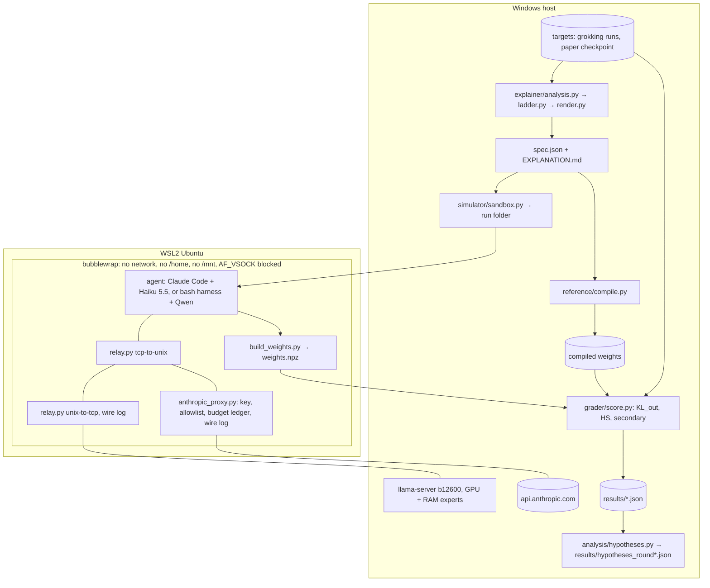

# Architecture

## Modules

| Module | Role |
|---|---|
| `config.py` | settings from `.env.example` ← `.env` ← environment; architecture constants |
| `targets.py` | preregistered target registry and loaders (grokviz RunStore; paper checkpoint with sha256 + `weights_only`) |
| `weights.py` | the 11-array weight-file schema, validation, conversion to/from `GrokTransformer` (float64) |
| `explainer/analysis.py` | key frequencies, logit fit, neuron clusters, attention fits, read-off, per-neuron fits |
| `explainer/ladder.py` | which measured quantities each level reveals; seeded corruptions for W-* |
| `explainer/render.py` | explanation text (Clock/Pizza templates), neurons.csv, format variants, length statistics |
| `explainer/paper.py` | the published explanation (E-paper) with the paper's own numbers |
| `reference/compile.py` | deterministic spec → weights construction (agent-free reference point, not a ceiling) |
| `grader/` | activations on all 113² inputs; KL_out; cross-validated ridge HS; CKA, Procrustes, neuron matching, stitching |
| `simulator/` | sandbox folder, WSL runner, unix-socket relay, Anthropic proxy (key injection, model allowlist, budget ledger), bash-only agent harness, llama-server manager, static audit |
| `training.py` | grokviz trainer for fresh runs; small loop for probability distillation (KL at temperature 1), logit matching (post hoc, audit 9) and continued training |
| `nonagent.py` | random init, wrong targets, trajectory, planted calibration, baselines, logit-matched students (post hoc) |
| `sensitivity.py` | grader and explainer sensitivity without new agent runs (`vmi sensitivity`) |
| `publish.py` | redacted, scanned export of artefacts and upload to the Hugging Face Hub (`vmi publish`) |
| `manifests.py` | the agent conditions (amendment 2: 44 in round 1; 32 Claude Haiku conditions in rounds 2–3 after deviation 5) and per-round manifests |
| `analysis/` | statistical tests, hypothesis verdicts labelled with N, tables, figures, post-hoc frequency/memorisation analysis (`frequencies.py`), agent process counts from transcripts incl. own label checks (`agent_behaviour.py`), Zhong et al. Clock/Pizza diagnostics (`clock_pizza.py`), the post-hoc logit-level comparison (`logit_fit.py`, `vmi logitfit`), interventions on agents' build scripts (`diagnose.py`, `vmi diagnose`), predicted-vs-measured and highlight rows (`predictions.py`), the site data (`site.py`, `docs/data.json`), agent transcript excerpts (`agent_examples.py`, `examples.py`), the glossary of terms (`glossary.py`), the recorded software environment (`environment.py`), and `report.py` (one command refills every marked block, including the paper's text; `vmi paper` builds the PDF) |
| `pipeline.py` | CLI wrapper (`uv run vmi ...`) |

## Why these design choices

- **Linear alignment for hidden states**: the LayerNorm-free residual stream is only defined up to GL(128). Regression
  R² is invariant to invertible linear maps of its predictor (Kornblith et al. 2019, Table 1), so completeness
  R²(M̂→M) is invariant to any change of the replacement's basis; soundness R²(M→M̂), pooled over the replacement's
  dimensions, only to orthogonal maps and uniform scaling; HS = 1 (up to the ridge term) under an affine equivalence. A post-hoc
  whitened soundness, invariant in both directions, is in the grader sensitivity analysis (audit 2026-11-22; see
  `reports/state-of-the-art-review.md`). The GL(128) argument covers the residual sites only: at `mlp_post` the MLP's
  symmetry is permutation and positive per-neuron scaling, so a linear map is wider than needed there, and the
  matched-neuron correlation is the group-matched secondary metric (audit 3, deviation 10).
- **float64 grading**: matches the agent's numpy self-test, so numerical cancellations cannot make a model pass the
  self-test and fail grading.
- **Spec as single source**: the explanation text and the compiler input come from the same dict, so the compiler
  builds what the explanation's parameters determine, plus fixed defaults where the explanation is silent (e.g. the
  ridge read-out, E-paper's equal split of unlisted neurons).
- **bubblewrap + unix-socket relay**: no Docker, no sudo, no firewall change; the only path out of the sandbox is the
  LLM endpoint, and every request and response body through it is logged (headers excluded).
- **Credentials outside the sandbox**: the API key is read by the pipeline and handed only to the proxy in WSL; the
  sandbox gets a placeholder key and a loopback URL, so the agent can call the model but cannot read or exfiltrate
  the key, and the budget is enforced per request before anything is forwarded.
- **Socket paths**: the endpoint socket lives at a 16-character hash of the run ID because Linux limits unix socket
  paths to 108 bytes including the terminating null, and Python refuses a path of 108 or more bytes with "AF_UNIX path too
  long" ([man 7 unix](https://man7.org/linux/man-pages/man7/unix.7.html): sun_path is 108 bytes on Linux).
