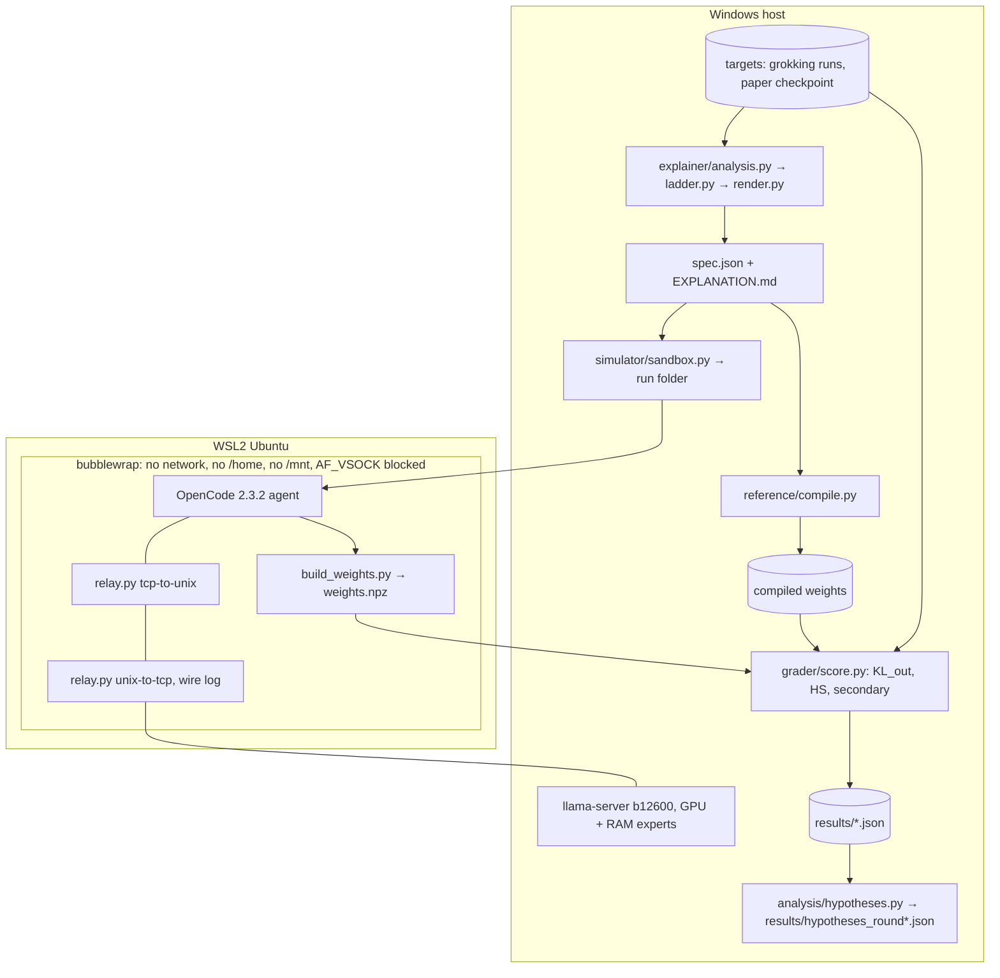

# Architecture

## Modules

| Module | Role |
|---|---|
| `config.py` | settings from `.env.example` ← `.env` ← environment; architecture constants |
| `targets.py` | preregistered target registry and loaders (grokviz RunStore; paper checkpoint with sha256 + `weights_only`) |
| `weights.py` | the 11-array weight-file schema, validation, conversion to/from `GrokTransformer` (float64) |
| `explainer/analysis.py` | key frequencies, logit fit, neuron clusters, attention fits, read-off, per-neuron fits |
| `explainer/ladder.py` | which measured quantities each level reveals; seeded corruptions for W-* |
| `explainer/render.py` | explanation text (Clock/Pizza templates), neurons.csv, format variants, length statistics |
| `explainer/paper.py` | the published explanation (E-paper) with the paper's own numbers |
| `reference/compile.py` | deterministic spec → weights construction (agent-free ceiling) |
| `grader/` | activations on all 113² inputs; KL_out; cross-validated ridge HS; CKA, Procrustes, neuron matching, stitching |
| `simulator/` | sandbox folder, WSL runner, unix-socket relay, llama-server manager, static audit |
| `training.py` | grokviz trainer for fresh runs; small loop for distillation and continued training |
| `nonagent.py` | random init, wrong targets, trajectory, planted calibration, baselines |
| `manifests.py` | the 40 preregistered agent conditions and per-round manifests |
| `analysis/` | statistical tests and hypothesis verdicts labelled with N |
| `pipeline.py` | CLI wrapper (`uv run vmi ...`) |

## Why these design choices

- **Linear alignment for hidden states**: the LayerNorm-free residual stream is only defined up to GL(128); linear
  regression is invariant to exactly that group (see `reports/state-of-the-art-review.md`).
- **float64 grading**: matches the agent's numpy self-test, so numerical cancellations cannot make a model pass the
  self-test and fail grading.
- **Spec as single source**: the explanation text and the compiler input come from the same dict, so the compiler
  measures exactly what the explanation determines.
- **bubblewrap + unix-socket relay**: no Docker, no sudo, no firewall change; the only path out of the sandbox is the
  LLM endpoint, and every byte through it is logged.
