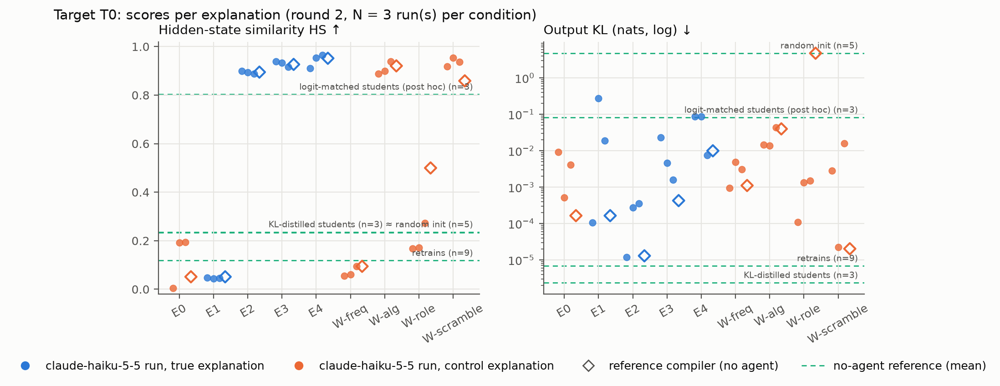
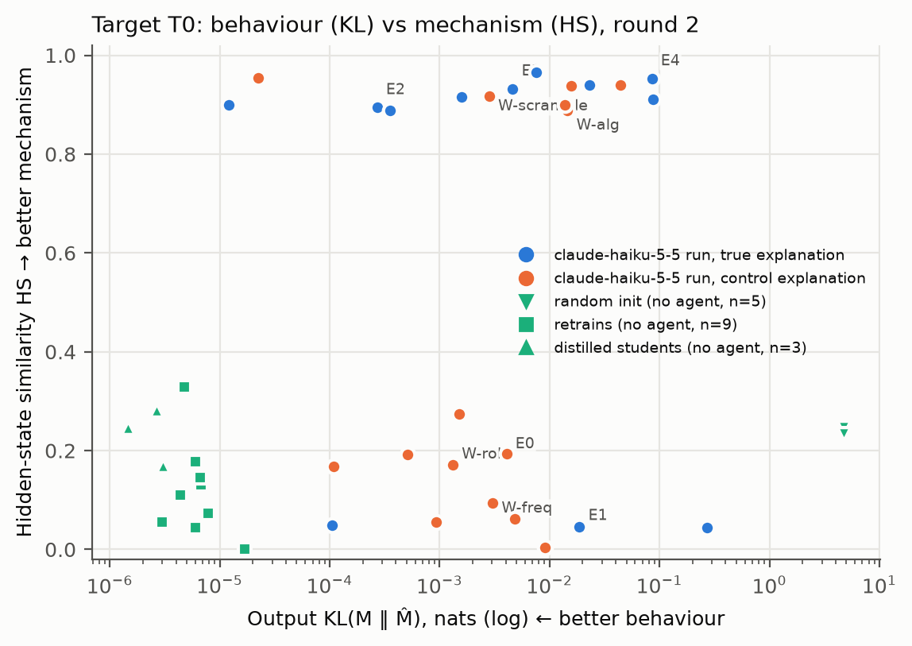
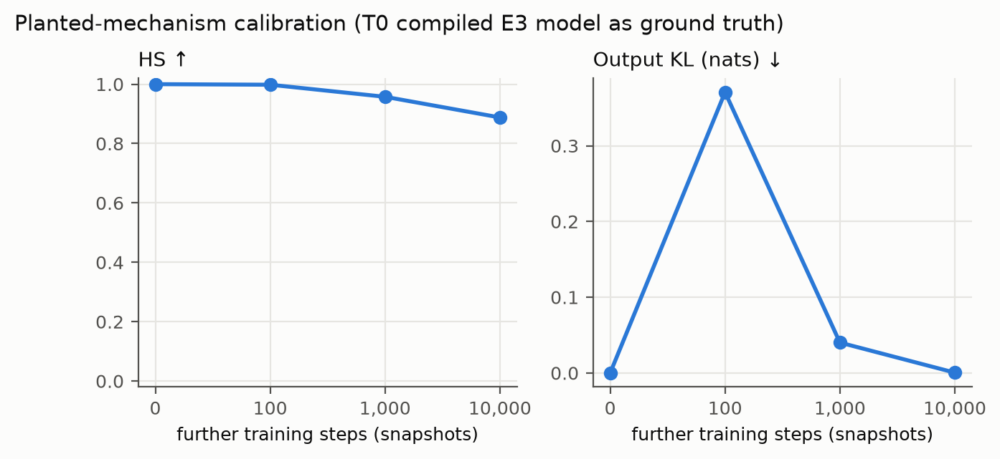
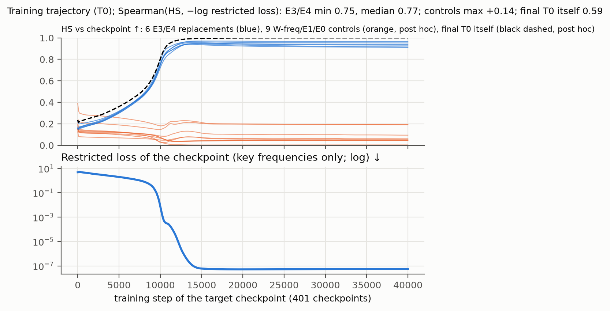

# Experiment 01 — Round 1 (N = 1 per condition)

*Status: done (round 2 continues in [02-round2](../02-round2/experiment.md)). Every table below is generated from `results/` by `vmi analyse 1` and shows round 1 only; the embedded figures are regenerated with the latest round. With N = 1 there is no
within-condition spread: verdicts rest on directions, on the trend across conditions and on the deterministic
no-agent arms, and every verdict is labelled "at N=1 — not yet N=3 or N=10". Protocol: preregistration with
amendments 1–2, frozen at tag `protocol-freeze`; post-freeze deviations are logged at the end of
[the preregistration](../../preregistration.md).*

## Setting

- **Simulator:** Claude Haiku 5.5 in Claude Code (offline sandbox, default sampling, effort `medium`, 60-minute cap).
- **Main target:** T0 (`wd1_s1`). Seed-sensitivity targets: T1, T2, T-new (held out), T-paper (published checkpoint).
- **Stages, in order:** main method (E1–E4) → controls (E0, W-freq, W-alg, W-role, W-scramble; random init, wrong
  targets, planted calibration, training trajectory) → baselines (independent retrains, distilled students, reference
  compiler, Fourier-restricted M, weights dump) → ablations (local Qwen simulators; explanation format; no self-test)
  → hyperparameter sensitivity (effort low/high) → seed sensitivity (other targets).

## Main method and agent controls on T0

<!-- BEGIN scoreboard-T0 -->
| Explanation | role | chars | N | agent accuracy | agent KL_out ↓ | agent HS ↑ | agent matched-neuron corr ↑ | compiler KL_out ↓ | compiler HS ↑ |
|---|---|---|---|---|---|---|---|---|---|
| E0 | control: no mechanism | 279 | 1 | 1.000 | 0.009 | 0.004 | 0.020 | 1.64e-04 | 0.051 |
| E1 | method | 1556 | 1 | 1.000 | 1.05e-04 | 0.048 | 0.028 | 1.64e-04 | 0.051 |
| E2 | method | 1788 | 1 | 1.000 | 1.20e-05 | 0.899 | 0.666 | 1.30e-05 | 0.895 |
| E3 | method | 3712 | 1 | 1.000 | 0.023 | 0.939 | 0.828 | 4.25e-04 | 0.927 |
| E4 | method | 51329 | 1 | 0.979 | 0.087 | 0.912 | 0.888 | 0.010 | 0.952 |
| W-freq | control: wrong frequencies | 3724 | 1 | 1.000 | 9.31e-04 | 0.055 | 0.030 | 0.001 | 0.095 |
| W-alg | control: wrong algorithm (Pizza) | 2224 | 1 | 1.000 | 0.015 | 0.889 | 0.666 | 0.040 | 0.921 |
| W-role | control: wrong component roles | 3777 | 1 | 1.000 | 1.09e-04 | 0.168 | 0.015 | 4.727 | 0.500 |
| W-scramble | control: scrambled neurons | 51590 | 1 | 1.000 | 0.003 | 0.918 | 0.621 | 2.02e-05 | 0.859 |
<!-- END scoreboard-T0 -->

**Reading.** The true ladder rises from E1 (no model-specific numbers) to E2–E4 on HS; E0 and E1 build working
adders whose internals share almost nothing with T0, i.e. the simulator's priors give the right behaviour but not
this model's mechanism. Among the controls, wrong frequencies (W-freq) and wrong component roles (W-role) give
correct behaviour with low HS. The Pizza explanation (W-alg) and the scrambled neuron table (W-scramble) are **not**
separated from the true explanations on primary HS: both keep T0's key frequencies, and HS (linear regression over
whole sites) sees frequency subspaces, not the per-neuron assignment or the Clock-vs-Pizza nonlinearity. The secondary
matched-neuron correlation does separate W-scramble from E4. Output KL does not rank the ladder: E2 has the smallest KL
and E4 the largest. For E3 most of the gap is the logit scale (fitting one logit temperature, the secondary
"calibrated KL" in `results/runs/`, lowers it by an order of magnitude); for E4 it is not (its replacement answers some
inputs wrongly). *Post hoc:* the secondary centred-logit FVU, which compares whole logit vectors instead of the
near-one-hot output distributions, puts E3, E4, W-alg and W-scramble below 1 and E0–E2, W-freq and W-role above 1, i.e.
it behaves like HS rather than like KL.

## Behaviour vs mechanism (H3)

Models that match T0's behaviour almost perfectly — independent retrains, logit-distilled students, the W-freq
replacement — sit at the bottom of the HS axis. Output KL alone cannot tell them from the true replacements; HS can.

## No-agent controls

<!-- BEGIN controls-T0 -->
| Planted model trained further (steps) | HS ↑ | KL_out | snapshot task accuracy |
|---|---|---|---|
| 0 | 1.000 | 0.000 | 1.0000 |
| 100 | 0.998 | 0.371 | 0.9774 |
| 1000 | 0.957 | 0.040 | 0.9958 |
| 10000 | 0.888 | 4.25e-04 | 1.0000 |

| Replacement | HS vs T0 | best wrong target (HS) | d = HS(T0) − max HS(wrong) |
|---|---|---|---|
| E3 | 0.939 | T2 (0.274) | 0.665 |
| E4 | 0.912 | T2 (0.226) | 0.685 |
<!-- END controls-T0 -->

**Reading.** On the planted mechanism (a model whose mechanism is known because it was compiled from E3), HS starts
at 1 and decreases monotonically as the model is trained away from it; output KL is not monotone (training first
disturbs, then re-sharpens the outputs), so H4b's KL half fails while its HS half holds. Replacements built from T0's
explanation fit T0 far better than any other target or no-mechanism model (H7 direction), and HS against T0's
checkpoints rises through circuit formation together with the fall of the restricted loss (H8). H8 here used one
replacement (`main__T0__E3…s0`, the highest-HS E3/E4 run of round 1) against every 10th checkpoint (41 of 401), not
every E3/E4 replacement × all 401 checkpoints as preregistered; the "all checkpoints" label in the H8 row below is
wrong. After round 2 it was re-run as preregistered with all six round-1–2 replacements (deviation 8; still supported, `results/controls/trajectory_T0.json`).

## Baselines (no agent)

<!-- BEGIN baselines-T0 -->
| Reference point | what it has | n | task accuracy | KL_out ↓ | HS ↑ |
|---|---|---|---|---|---|
| Random initialisation | nothing (floor) | 5 | 0.009 ± 0.001 | 4.766 ± 0.006 | 0.236 ± 0.006 |
| Independent retrains | same recipe, other seeds | 9 | 1.000 ± 0.000 | 6.90e-06 ± 3.96e-06 | 0.119 ± 0.097 |
| Logit-distilled students | M's full output logits, no explanation | 3 | 1.000 ± 0.000 | 2.38e-06 ± 8.25e-07 | 0.233 ± 0.058 |
| Fourier-restricted M | M's weights, key frequencies only in W_E/W_U | 1 | 1.000 | 0.002 | 0.992 |
| Weights dump | all 226,816 weights | 1 | 1.000 | 0.000 | 1.000 |
<!-- END baselines-T0 -->

**Reading.** The training recipe alone (independent retrains) and full behavioural access (logit-distilled students)
both reproduce T0's outputs, yet their HS stays at or below the random-initialisation floor. Explanations E2–E4 lift
HS far above both; keeping only T0's key-frequency Fourier components in the embedding and unembedding barely
changes HS, so the key frequencies carry nearly all of what HS measures.

## Reference compiler on every target

T0:

<!-- BEGIN compiler-T0 -->
| Explanation | chars | task accuracy | KL_out ↓ | HS ↑ | resid_mid | mlp_post | resid_post | matched neuron corr |
|---|---|---|---|---|---|---|---|---|
| E0 | 279 | 1.0000 | 1.64e-04 | 0.051 | 0.000 | 0.154 | 0.000 | 0.015 |
| E1 | 1556 | 1.0000 | 1.64e-04 | 0.051 | 0.000 | 0.154 | 0.000 | 0.015 |
| E2 | 1788 | 1.0000 | 1.30e-05 | 0.895 | 0.884 | 0.945 | 0.856 | 0.675 |
| E3 | 3712 | 1.0000 | 4.25e-04 | 0.927 | 0.913 | 0.973 | 0.895 | 0.715 |
| E4 | 51329 | 0.9998 | 0.010 | 0.952 | 0.913 | 0.992 | 0.951 | 0.962 |
| W-freq | 3724 | 1.0000 | 0.001 | 0.095 | 0.074 | 0.200 | 0.009 | 0.024 |
| W-alg | 2224 | 1.0000 | 0.040 | 0.921 | 0.884 | 0.973 | 0.906 | 0.715 |
| W-role | 3777 | 0.0065 | 4.727 | 0.500 | 0.913 | 0.000 | 0.587 | 0.000 |
| W-scramble | 51590 | 1.0000 | 2.02e-05 | 0.859 | 0.913 | 0.972 | 0.691 | 0.670 |
<!-- END compiler-T0 -->

T1:

<!-- BEGIN compiler-T1 -->
| Explanation | chars | task accuracy | KL_out ↓ | HS ↑ | resid_mid | mlp_post | resid_post | matched neuron corr |
|---|---|---|---|---|---|---|---|---|
| E0 | 279 | 1.0000 | 1.17e-04 | 0.059 | 0.009 | 0.169 | 0.000 | 0.054 |
| E1 | 1556 | 1.0000 | 1.17e-04 | 0.059 | 0.009 | 0.169 | 0.000 | 0.054 |
| E2 | 1782 | 1.0000 | 6.18e-06 | 0.950 | 0.939 | 0.976 | 0.935 | 0.834 |
| E3 | 3536 | 1.0000 | 1.25e-06 | 0.984 | 0.987 | 0.976 | 0.989 | 0.749 |
| E4 | 49805 | 1.0000 | 2.19e-07 | 0.992 | 0.987 | 0.997 | 0.993 | 0.958 |
| W-freq | 3536 | 1.0000 | 0.025 | 0.069 | 0.005 | 0.203 | 0.000 | 0.059 |
| W-alg | 2152 | 1.0000 | 0.061 | 0.936 | 0.939 | 0.976 | 0.893 | 0.749 |
| W-role | 3585 | 0.0131 | 4.727 | 0.571 | 0.987 | 0.000 | 0.725 | 0.000 |
| W-scramble | 50456 | 1.0000 | 2.51e-07 | 0.992 | 0.987 | 0.996 | 0.993 | 0.782 |
<!-- END compiler-T1 -->

T2:

<!-- BEGIN compiler-T2 -->
| Explanation | chars | task accuracy | KL_out ↓ | HS ↑ | resid_mid | mlp_post | resid_post | matched neuron corr |
|---|---|---|---|---|---|---|---|---|
| E0 | 279 | 1.0000 | 5.33e-04 | 0.304 | 0.290 | 0.396 | 0.228 | 0.173 |
| E1 | 1556 | 1.0000 | 5.33e-04 | 0.304 | 0.290 | 0.396 | 0.228 | 0.173 |
| E2 | 1794 | 1.0000 | 1.62e-05 | 0.833 | 0.959 | 0.978 | 0.563 | 0.869 |
| E3 | 3826 | 1.0000 | 4.57e-06 | 0.783 | 0.986 | 0.977 | 0.387 | 0.830 |
| E4 | 51812 | 1.0000 | 6.98e-05 | 0.910 | 0.986 | 0.988 | 0.757 | 0.965 |
| W-freq | 3808 | 1.0000 | 1.52e-04 | 0.158 | 0.173 | 0.272 | 0.028 | 0.054 |
| W-alg | 2270 | 1.0000 | 0.009 | 0.948 | 0.959 | 0.977 | 0.909 | 0.830 |
| W-role | 3887 | 0.0063 | 4.727 | 0.541 | 0.986 | 0.000 | 0.638 | 0.000 |
| W-scramble | 52289 | 1.0000 | 2.83e-05 | 0.963 | 0.986 | 0.987 | 0.916 | 0.820 |
<!-- END compiler-T2 -->

T-new:

<!-- BEGIN compiler-T-new -->
| Explanation | chars | task accuracy | KL_out ↓ | HS ↑ | resid_mid | mlp_post | resid_post | matched neuron corr |
|---|---|---|---|---|---|---|---|---|
| E0 | 279 | 1.0000 | 1.60e-04 | 0.032 | 0.000 | 0.096 | 0.000 | 0.010 |
| E1 | 1556 | 1.0000 | 1.60e-04 | 0.032 | 0.000 | 0.096 | 0.000 | 0.010 |
| E2 | 1786 | 1.0000 | 7.69e-06 | 0.955 | 0.953 | 0.980 | 0.930 | 0.774 |
| E3 | 3635 | 1.0000 | 8.34e-06 | 0.970 | 0.987 | 0.980 | 0.941 | 0.751 |
| E4 | 51778 | 1.0000 | 2.54e-05 | 0.983 | 0.987 | 0.992 | 0.968 | 0.963 |
| W-freq | 3635 | 1.0000 | 1.87e-04 | 0.089 | 0.107 | 0.158 | 0.002 | 0.061 |
| W-alg | 2191 | 1.0000 | 0.040 | 0.946 | 0.953 | 0.980 | 0.904 | 0.751 |
| W-role | 3683 | 0.0242 | 4.728 | 0.538 | 0.987 | 0.000 | 0.628 | 0.000 |
| W-scramble | 52030 | 1.0000 | 5.54e-05 | 0.976 | 0.987 | 0.993 | 0.946 | 0.737 |
<!-- END compiler-T-new -->

T-paper:

<!-- BEGIN compiler-T-paper -->
| Explanation | chars | task accuracy | KL_out ↓ | HS ↑ | resid_mid | mlp_post | resid_post | matched neuron corr |
|---|---|---|---|---|---|---|---|---|
| E0 | 279 | 1.0000 | 2.01e-04 | 0.045 | 0.003 | 0.133 | 0.000 | 0.012 |
| E1 | 1556 | 1.0000 | 2.01e-04 | 0.045 | 0.003 | 0.133 | 0.000 | 0.012 |
| E2 | 1790 | 1.0000 | 8.00e-06 | 0.944 | 0.949 | 0.971 | 0.911 | 0.751 |
| E3 | 3731 | 1.0000 | 6.19e-06 | 0.867 | 0.990 | 0.973 | 0.637 | 0.774 |
| E4 | 51728 | 1.0000 | 7.58e-05 | 0.983 | 0.990 | 0.986 | 0.973 | 0.966 |
| W-freq | 3725 | 1.0000 | 6.67e-05 | 0.121 | 0.129 | 0.212 | 0.022 | 0.040 |
| W-alg | 2229 | 1.0000 | 0.033 | 0.926 | 0.949 | 0.974 | 0.855 | 0.774 |
| W-role | 3783 | 0.0085 | 4.727 | 0.550 | 0.990 | 0.000 | 0.658 | 0.000 |
| W-scramble | 52150 | 1.0000 | 3.11e-05 | 0.986 | 0.990 | 0.989 | 0.980 | 0.747 |
| E-paper | 3102 | 1.0000 | 1.60e-06 | 0.969 | 0.990 | 0.974 | 0.943 | 0.727 |
<!-- END compiler-T-paper -->

**Reading.** The compiler is not monotone in explanation detail on every target: on T2 and T-paper its E3 build
scores below E2, so the extra E3 quantities as rendered (amplitudes, attention fits) can mislead a literal
construction. This is a property of the explanations and the compiler, measured without any agent.

## Memorisation check: which frequencies do the replacements use? (post hoc)

The same key-frequency rule used for the targets (Fourier norm of W_L = W_U·W_out ≥ 0.25 of its maximum), applied to
each replacement built by the main simulator. Frequencies with small amplitude fall below the threshold, so the
"used" sets are lower bounds.

<!-- BEGIN frequencies -->
| Target | Explanation | frequencies used by the replacement | target's key frequencies | overlap with target (Jaccard) | overlap with paper's {14, 35, 41, 42, 52} | HS | same weights: HS against the published checkpoint |
|---|---|---|---|---|---|---|---|
| T0 | E0 | 14, 35, 41, 52 | 2, 3, 23, 37, 39 | 0.00 | 0.80 | 0.004 | 0.626 |
| T0 | E1 | 14, 35, 41, 52 | 2, 3, 23, 37, 39 | 0.00 | 0.80 | 0.048 | 0.951 |
| T0 | E2 | 3, 23, 39 | 2, 3, 23, 37, 39 | 0.60 | 0.00 | 0.899 | – |
| T0 | E3 | 3, 23 | 2, 3, 23, 37, 39 | 0.40 | 0.00 | 0.939 | – |
| T0 | E4 | 3, 23, 39 | 2, 3, 23, 37, 39 | 0.60 | 0.00 | 0.912 | – |
| T0 | W-freq | 31, 42, 52, 55 | 2, 3, 23, 37, 39 | 0.00 | 0.29 | 0.055 | – |
| T0 | W-alg | 3, 23, 37, 39 | 2, 3, 23, 37, 39 | 0.80 | 0.00 | 0.889 | – |
| T0 | W-role | 32, 34, 41, 54 | 2, 3, 23, 37, 39 | 0.00 | 0.12 | 0.168 | – |
| T0 | W-scramble | 3, 23, 39 | 2, 3, 23, 37, 39 | 0.60 | 0.00 | 0.918 | – |
| T1 | E2 | 11, 25, 49 | 11, 25, 49 | 1.00 | 0.00 | 0.955 | – |
| T1 | E3 | 11, 49 | 11, 25, 49 | 0.67 | 0.00 | 0.917 | – |
| T1 | E4 | 25, 49 | 11, 25, 49 | 0.67 | 0.00 | 0.955 | – |
| T1 | W-freq | 38, 52 | 11, 25, 49 | 0.00 | 0.17 | 0.034 | – |
| T2 | E2 | 37, 44, 45, 46, 47, 51 | 37, 44, 45, 46, 47, 51 | 1.00 | 0.00 | 0.949 | – |
| T2 | E3 | 37, 45, 47, 51 | 37, 44, 45, 46, 47, 51 | 0.67 | 0.00 | 0.944 | – |
| T2 | E4 | 37, 44, 45, 46, 47, 51 | 37, 44, 45, 46, 47, 51 | 1.00 | 0.00 | 0.934 | – |
| T2 | W-freq | 32 | 37, 44, 45, 46, 47, 51 | 0.00 | 0.00 | 0.089 | – |
| T-new | E3 | 22, 41 | 22, 37, 41, 51 | 0.50 | 0.17 | 0.846 | – |
| T-new | E4 | 37, 41 | 22, 37, 41, 51 | 0.50 | 0.17 | 0.984 | – |
| T-new | W-freq | 10 | 22, 37, 41, 51 | 0.00 | 0.00 | 0.087 | – |
| T-paper | E1 | 42, 52 | 14, 35, 41, 42, 52 | 0.40 | 0.40 | 0.925 | – |
| T-paper | E3 | 14, 35, 41, 42, 52 | 14, 35, 41, 42, 52 | 1.00 | 1.00 | 0.944 | – |
| T-paper | E4 | 14, 35, 41, 42, 52 | 14, 35, 41, 42, 52 | 1.00 | 1.00 | 0.929 | – |
| T-paper | W-freq | 8, 21, 39, 44, 49 | 14, 35, 41, 42, 52 | 0.00 | 0.00 | 0.091 | – |
| T-paper | E-paper | 14, 35, 41, 42, 52 | 14, 35, 41, 42, 52 | 1.00 | 1.00 | 0.984 | – |
<!-- END frequencies -->

**Reading.** With no frequencies in the explanation (E0, E1), Haiku builds four of the published paper's five
frequencies (14, 35, 41, 52 by the key-frequency rule) into the replacement; the T0 E1 build script hard-codes the
paper's set (`KEY_FREQS = [14, 35, 41, 42, 52]  # key frequencies (choice: not specified by EXPLANATION.md)`). On
targets analysed in no paper that yields a working adder with the wrong mechanism and near-zero HS; on the
published checkpoint (T-paper) the algorithm-only E1 scores like a full explanation. The last column is a target
swap, the most direct test: the *same* T0 E0/E1 weights, graded against the published checkpoint instead of T0, score
far higher there than against T0, so the simulator built the published mechanism, not the explained one. Scores on a published model
therefore measure what the simulator remembers, not what the explanation says; the targets analysed in no
paper (T0–T2, weights and key frequencies public on Hugging Face since 2026-10-21, after Claude Haiku 5.5's June 2026
training-data cutoff, with no internet in the sandbox; T-new, trained after the freeze), which the preregistration introduced for exactly this risk, are what make the
score interpretable. This is
an existence proof at N = 1, consistent with [Haklay et al. 2026](https://arxiv.org/abs/2603.20101) (the LLM behind an interpretability agent, Claude Opus 4.1, listed the published IOI circuit from memory when asked
directly; the authors add that memorisation alone does not explain all agent behaviour).

## Hyperparameter sensitivity without new runs (grader and explainer settings, preregistration §8)

Mean HS per explanation of the main simulator's T0 runs, re-scored under each preregistered grader setting; Kendall τ
compares the ordering of explanations with the preregistered settings (1 = same order).

<!-- BEGIN grader-sensitivity-T0 -->
| Grader setting | E0 | E1 | E2 | E3 | E4 | W-freq | W-alg | W-role | W-scramble | Kendall τ vs. preregistered |
|---|---|---|---|---|---|---|---|---|---|---|
| preregistered (λ 1e-6, 5 folds, seed 0, 3 sites, general linear) | 0.00 | 0.05 | 0.90 | 0.94 | 0.91 | 0.06 | 0.89 | 0.17 | 0.92 | 1.00 |
| ridge λ × 100 | 0.00 | 0.05 | 0.87 | 0.91 | 0.89 | 0.05 | 0.86 | 0.16 | 0.91 | 1.00 |
| ridge λ / 100 | 0.00 | 0.05 | 0.92 | 0.94 | 0.93 | 0.06 | 0.91 | 0.19 | 0.92 | 0.94 |
| 3 folds | 0.00 | 0.05 | 0.90 | 0.94 | 0.91 | 0.05 | 0.89 | 0.17 | 0.92 | 1.00 |
| 10 folds | 0.00 | 0.05 | 0.90 | 0.94 | 0.91 | 0.06 | 0.89 | 0.17 | 0.92 | 1.00 |
| fold seed 1 | 0.00 | 0.05 | 0.90 | 0.94 | 0.91 | 0.06 | 0.89 | 0.17 | 0.92 | 1.00 |
| fold seed 2 | 0.00 | 0.05 | 0.90 | 0.94 | 0.91 | 0.05 | 0.89 | 0.17 | 0.92 | 1.00 |
| resid_mid only | 0.01 | 0.01 | 0.88 | 0.91 | 0.88 | 0.00 | 0.88 | 0.32 | 0.94 | 0.83 |
| mlp_post only | 0.00 | 0.13 | 0.94 | 0.98 | 0.99 | 0.17 | 0.94 | 0.10 | 0.97 | 0.78 |
| resid_post only | 0.00 | 0.00 | 0.87 | 0.93 | 0.87 | 0.00 | 0.84 | 0.09 | 0.84 | 0.78 |
| orthogonal alignment (with scale) | 0.00 | 0.00 | 0.62 | 0.79 | 0.68 | 0.00 | 0.58 | 0.06 | 0.76 | 0.96 |
<!-- END grader-sensitivity-T0 -->

The same for the reference compiler's builds:

<!-- BEGIN grader-sensitivity-compiler-T0 -->
| Grader setting | E0 | E1 | E2 | E3 | E4 | W-freq | W-alg | W-role | W-scramble | Kendall τ vs. preregistered |
|---|---|---|---|---|---|---|---|---|---|---|
| preregistered (λ 1e-6, 5 folds, seed 0, 3 sites, general linear) | 0.05 | 0.05 | 0.89 | 0.93 | 0.95 | 0.09 | 0.92 | 0.50 | 0.86 | 1.00 |
| ridge λ × 100 | 0.04 | 0.04 | 0.87 | 0.79 | 0.87 | 0.08 | 0.90 | 0.46 | 0.75 | 0.77 |
| ridge λ / 100 | 0.05 | 0.05 | 0.91 | 0.96 | 0.96 | 0.10 | 0.92 | 0.51 | 0.93 | 0.89 |
| 3 folds | 0.05 | 0.05 | 0.89 | 0.93 | 0.95 | 0.09 | 0.92 | 0.50 | 0.86 | 1.00 |
| 10 folds | 0.05 | 0.05 | 0.89 | 0.93 | 0.95 | 0.10 | 0.92 | 0.50 | 0.86 | 1.00 |
| fold seed 1 | 0.05 | 0.05 | 0.89 | 0.93 | 0.95 | 0.09 | 0.92 | 0.50 | 0.86 | 1.00 |
| fold seed 2 | 0.05 | 0.05 | 0.89 | 0.93 | 0.95 | 0.09 | 0.92 | 0.50 | 0.86 | 1.00 |
| resid_mid only | 0.00 | 0.00 | 0.88 | 0.91 | 0.91 | 0.07 | 0.88 | 0.91 | 0.91 | 0.64 |
| mlp_post only | 0.15 | 0.15 | 0.94 | 0.97 | 0.99 | 0.20 | 0.97 | 0.00 | 0.97 | 0.71 |
| resid_post only | 0.00 | 0.00 | 0.86 | 0.89 | 0.95 | 0.01 | 0.91 | 0.59 | 0.69 | 0.94 |
| orthogonal alignment (with scale) | 0.00 | 0.00 | 0.71 | 0.52 | 0.57 | 0.00 | 0.77 | 0.26 | 0.49 | 0.74 |
<!-- END grader-sensitivity-compiler-T0 -->

Explainer thresholds varied (E2–E4 re-rendered and re-compiled, no agent):

<!-- BEGIN explainer-sensitivity-T0 -->
| key-frequency τ | neuron FVE threshold | key frequencies found | compiler HS E2 | E3 | E4 |
|---|---|---|---|---|---|
| 0.25 | 0.85 | 2, 3, 23, 37, 39 | 0.895 | 0.927 | 0.952 |
| 0.15 | 0.85 | 2, 3, 23, 37, 39 | 0.895 | 0.927 | 0.952 |
| 0.35 | 0.85 | 3, 23, 37, 39 | 0.949 | 0.948 | 0.974 |
| 0.25 | 0.75 | 2, 3, 23, 37, 39 | 0.895 | 0.900 | 0.952 |
| 0.25 | 0.9 | 2, 3, 23, 37, 39 | 0.895 | 0.898 | 0.952 |
<!-- END explainer-sensitivity-T0 -->

**Reading.** The ordering of explanations by the agent runs' HS is unchanged by the number of folds, the fold seed and
a hundredfold stronger ridge, and nearly unchanged by a hundredfold weaker one; the conclusions do not hinge on these
settings. Single sites reorder some neighbours (the MLP site alone gives E1 (and W-freq) a small non-zero floor and
puts E4 first), and orthogonal alignment lowers every value while keeping the pattern: the
wrong-frequency, no-explanation and wrong-role replacements stay at the bottom, and the Pizza and scrambled-neuron
replacements stay among the true ones, so neither blind spot is an artefact of allowing general linear maps. The
compiler's builds are more sensitive to the ridge strength. In the explainer, the stricter key-frequency threshold
(τ = 0.35) drops frequency 2 — a frequency with no neurons in T0, present only in its neuron-to-logit map (audit 5) — and the compiler's HS rises for E2–E4: the
preregistered threshold admits a weak frequency that a literal construction then builds in. *Post hoc observation;
the preregistered threshold stays the analysis default.*

## All round-1 agent runs (incl. ablations, hyperparameter and seed sensitivity)

<!-- BEGIN runs -->
| Stage | Target | Explanation | Simulator | T | Variant | N | failed | accuracy | KL_out ↓ (mean ± sd) | HS ↑ (mean ± sd) |
|---|---|---|---|---|---|---|---|---|---|---|
| ablations | T0 | E2 | qwen3.5-4b | 0.6 | – | 1 | 0 | 0.009 | 4.73 | 0.000 |
| ablations | T0 | E2 | qwen3.5-9b | 0.6 | – | 1 | 0 | 0.009 | 7.63 | 0.000 |
| ablations | T0 | E3 | claude-haiku-5-5 | default | fmt-code | 1 | 0 | 1.000 | 0.00212 | 0.918 |
| ablations | T0 | E3 | claude-haiku-5-5 | default | fmt-math | 1 | 0 | 1.000 | 0.000716 | 0.911 |
| ablations | T0 | E3 | claude-haiku-5-5 | default | noselftest | 1 | 0 | 1.000 | 0.00134 | 0.964 |
| ablations | T0 | E3 | qwen3.5-4b | 0.6 | – | 1 | 0 | 0.009 | 4.73 | 0.000 |
| ablations | T0 | E4 | qwen3.5-4b | 0.6 | – | 1 | 0 | 0.009 | 4.73 | 0.000 |
| ablations | T0 | W-freq | qwen3.5-4b | 0.6 | – | 1 | 0 | 0.009 | 6.07 | 0.000 |
| controls | T0 | E0 | claude-haiku-5-5 | default | – | 1 | 0 | 1.000 | 0.00908 | 0.004 |
| controls | T0 | W-freq | claude-haiku-5-5 | default | – | 1 | 0 | 1.000 | 0.000931 | 0.055 |
| controls | T0 | W-alg | claude-haiku-5-5 | default | – | 1 | 0 | 1.000 | 0.0146 | 0.889 |
| controls | T0 | W-role | claude-haiku-5-5 | default | – | 1 | 0 | 1.000 | 0.000109 | 0.168 |
| controls | T0 | W-scramble | claude-haiku-5-5 | default | – | 1 | 0 | 1.000 | 0.00283 | 0.918 |
| hyper | T0 | E3 | claude-haiku-5-5 | default | effort-high | 1 | 0 | 1.000 | 0.00152 | 0.923 |
| hyper | T0 | E3 | claude-haiku-5-5 | default | effort-low | 1 | 0 | 0.562 | 1.97 | 0.922 |
| hyper | T0 | W-freq | claude-haiku-5-5 | default | effort-high | 1 | 0 | 1.000 | 0.00169 | 0.098 |
| hyper | T0 | W-freq | claude-haiku-5-5 | default | effort-low | 1 | 0 | 0.770 | 1.03 | 0.114 |
| main | T0 | E1 | claude-haiku-5-5 | default | – | 1 | 0 | 1.000 | 0.000105 | 0.048 |
| main | T0 | E2 | claude-haiku-5-5 | default | – | 1 | 0 | 1.000 | 1.2e-05 | 0.899 |
| main | T0 | E3 | claude-haiku-5-5 | default | – | 1 | 0 | 1.000 | 0.0229 | 0.939 |
| main | T0 | E4 | claude-haiku-5-5 | default | – | 1 | 0 | 0.979 | 0.0872 | 0.912 |
| seed | T-new | E3 | claude-haiku-5-5 | default | – | 1 | 0 | 0.910 | 0.344 | 0.846 |
| seed | T-new | E4 | claude-haiku-5-5 | default | – | 1 | 0 | 1.000 | 2.15e-05 | 0.984 |
| seed | T-new | W-freq | claude-haiku-5-5 | default | – | 1 | 0 | 0.897 | 0.378 | 0.087 |
| seed | T-paper | E1 | claude-haiku-5-5 | default | – | 1 | 0 | 0.994 | 1.43 | 0.925 |
| seed | T-paper | E3 | claude-haiku-5-5 | default | – | 1 | 0 | 0.989 | 0.0321 | 0.944 |
| seed | T-paper | E4 | claude-haiku-5-5 | default | – | 1 | 0 | 0.867 | 0.518 | 0.929 |
| seed | T-paper | W-freq | claude-haiku-5-5 | default | – | 1 | 0 | 1.000 | 9.56e-05 | 0.091 |
| seed | T-paper | E-paper | claude-haiku-5-5 | default | – | 1 | 0 | 1.000 | 0.00342 | 0.984 |
| seed | T1 | E2 | claude-haiku-5-5 | default | – | 1 | 0 | 1.000 | 0.00308 | 0.955 |
| seed | T1 | E3 | claude-haiku-5-5 | default | – | 1 | 0 | 0.922 | 0.296 | 0.917 |
| seed | T1 | E4 | claude-haiku-5-5 | default | – | 1 | 0 | 0.837 | 0.773 | 0.955 |
| seed | T1 | W-freq | claude-haiku-5-5 | default | – | 1 | 0 | 0.806 | 0.669 | 0.034 |
| seed | T2 | E2 | claude-haiku-5-5 | default | – | 1 | 0 | 1.000 | 4.69e-05 | 0.949 |
| seed | T2 | E3 | claude-haiku-5-5 | default | – | 1 | 0 | 1.000 | 7.41e-05 | 0.944 |
| seed | T2 | E4 | claude-haiku-5-5 | default | – | 1 | 0 | 0.980 | 0.112 | 0.934 |
| seed | T2 | W-freq | claude-haiku-5-5 | default | – | 1 | 0 | 1.000 | 0.00478 | 0.089 |
<!-- END runs -->

**Reading.** Presenting E3 as math or as code, or removing the self-test, does not lower the simulator's HS in these
single runs (audit 3: the run without the self-test still measured accuracy with its own code, so this ablation does
not remove label feedback). Low effort lowers task accuracy while E3's HS stays high: the replacement has the right frequency
structure but wrong details (behaviour and mechanism dissociate in this direction too). On the seed-sensitivity targets
T1, T2 and T-new, E2–E4 reach HS in the range of the reference compiler's builds and W-freq stays low, like the
compiler's W-freq build (compiler tables above); random, retrain and student baselines exist only for T0, so there is
no no-agent floor on these targets. By sign, the agent's HS is above the compiler's in 7 of 15 target–explanation
pairs, largest on T2 (H5 row below; on T2 the compiler is misled by the rendered E3, the agent is not); whether a
difference lies beyond its bootstrap CI was not computed in round 1 (added at N = 3; see the round-2 report). Every finished local Qwen run (Qwen3.5-4B on E2, E3,
E4 and W-freq; Qwen3.5-9B on E2) built a network with constant output: task accuracy 1/113 and HS 0, whatever the
explanation. Each run used up its 60 steps or its 60 minutes without reaching a working build. The local runs were
then stopped (deviation 5), so H5's capability trend and H6's cross-simulator ranking cannot be tested.

## Hypotheses: predicted vs. observed (N = 1)

<!-- BEGIN predictions -->
| Hypothesis | Predicted (preregistration §5) | Measured with the main simulator (T0) | Direction matches? | Formal verdict |
|---|-------|---------|-----|------|
| H1 | HS rises and output KL falls from E1 to E4 on T0; E0 lies below E1 | HS E0 0.004, E1 0.048, E2 0.899, E3 0.939, E4 0.912; KL E1 1.05e-04, E2 1.20e-05, E3 0.023, E4 0.087 | partly (HS not monotone E1→E4; KL does not fall E1→E4) | not supported · at N=1 — not yet N=3 or N=10 |
| H2 | true explanations beat length-matched false ones on HS: E3 > W-freq, W-alg, W-role; E4 > W-scramble | HS difference E3>W-freq +0.884; E3>W-alg +0.051; E3>W-role +0.771; E4>W-scramble -0.006 | partly (E4>W-scramble reversed) | E3>W-freq: cannot tell at this N; E3>W-alg: cannot tell at this N; E3>W-role: cannot tell at this N; E4>W-scramble: not supported · at N=1 — not yet N=3 or N=10 |
| H3 | W-freq: argmax agreement ≥ 0.99, KL not above the true E2–E4 range, HS below each of E2–E4 | W-freq: agreement 1.000, KL 9.31e-04 (true 1.20e-05–0.087), HS 0.055 (true 0.899–0.939) | yes | supported · at N=1 — not yet N=3 or N=10 |
| H4 | E3 and E4 beat independent retrains on HS (vs. distilled students: open question, no direction) | E3 0.939, E4 0.912; 9 retrains mean 0.119 (max 0.329); 3 students mean 0.233 (max 0.282) | yes | E3: cannot tell at this N; E4: cannot tell at this N · at N=1 — not yet N=3 or N=10 |
| H4b | planted model: HS = 1 and KL = 0 at step 0, then HS strictly falls and KL strictly rises | HS 1.000 → 0.998 → 0.957 → 0.888; KL 0.000 → 0.371 → 0.040 → 4.25e-04 | partly (KL not strictly rising) | not supported · deterministic |
| H5 | agent ≤ reference compiler on every explanation; the gap shrinks with simulator capability | agent − compiler on T0: E2 +0.005, E3 +0.013, E4 -0.040, W-freq -0.039; agent above compiler in 7 of 15 target–explanation pairs (largest +0.161, T2 E3); 5 local runs, 0 above chance | no (agent above compiler somewhere; capability trend not testable) | not evaluable (local simulators stopped at chance, deviation 5) · 5 local runs, qwen3.5-4b: 0/4 above chance, qwen3.5-9b: 0/1 above chance |
| H6 | the local simulators rank E2, E3, E4, W-freq the same way | 5 local runs, 0 above chance: nothing to rank | not testable | not evaluable (local simulators stopped at chance, deviation 5) · 5 local runs, qwen3.5-4b: 0/4 above chance, qwen3.5-9b: 0/1 above chance |
| H7 | a T0 replacement fits T0 better than any other trained or no-mechanism model (HS) | E3: HS 0.939 vs best other 0.274 (T2); E4: HS 0.912 vs best other 0.226 (T2) | yes | cannot tell at this N · 2 E3/E4 replacements (at N=1 — not yet N=3 or N=10) |
| H8 | HS against T0's checkpoints rises as restricted loss falls (circuit formation) | Spearman ρ(HS, −log restricted loss) = 0.842 | yes | supported · one replacement, all checkpoints |
<!-- END predictions -->

Replications on the seed-sensitivity targets (preregistration §5: H1–H3 re-tested per target with the same rules):

<!-- BEGIN replications -->
| Target | HS per true explanation | H1: HS rises E2→E4? | H2: HS(E3) − HS(W-freq) | H3 observed (W-freq) | H3 holds? |
|-----|------|---|---|-------|-----|
| T1 | E2 0.955, E3 0.917, E4 0.955 | no | +0.883 | agreement 0.806, KL 0.669 (true max 0.773), HS 0.034 | partly (agreement < 0.99) |
| T2 | E2 0.949, E3 0.944, E4 0.934 | no | +0.855 | agreement 1.000, KL 0.005 (true max 0.112), HS 0.089 | yes |
| T-new | E3 0.846, E4 0.984 | yes | +0.759 | agreement 0.897, KL 0.378 (true max 0.344), HS 0.087 | partly (agreement < 0.99; KL above the true range) |
| T-paper (flagged: memorisation) | E1 0.925, E3 0.944, E4 0.929 | no | +0.852 | agreement 1.000, KL 9.56e-05 (true max 0.518), HS 0.091 | yes |
<!-- END replications -->

**Reading.** Where a prediction concerns the frequency level, the main simulator's results go the predicted way (H3, H4, H7, H8, and H2 for W-freq and W-role). The predictions fail where they assumed that every added level of detail helps (H1: HS gains are small and non-monotone after E2, and output KL rises), that HS sees below the frequency level (H2: W-alg nearly ties, W-scramble is reversed; W-alg is not length-matched, about 60 % of E3's characters, `results/explanations/*/W-alg/length.json`), that the reference compiler is a ceiling (H5: by sign the agent is above it in 7 of 15 pairs), or that output KL grows smoothly as a planted model drifts (H4b: KL spikes after the first optimiser steps, then falls). "Direction matches" compares directions and preregistered thresholds only; the formal verdict adds the preregistered test, which at small N mostly cannot reach significance. On the seed-sensitivity targets the gap between E3 and the wrong-frequency explanation replicates on every target and H1's monotone rise does not; where H3 fails there (T1, T-new), the wrong-frequency replacement's argmax agreement is below the preregistered 0.99. Whether that is an implementation error of the simulator or a property of the explanation is untested; the true E3/E4 replacements on T1 (and E3 on T-new) also have agreement below 0.99.

Full statistics: `results/hypotheses_round1.json`.

## Deviations from the plan in this round

See the post-freeze deviations at the end of the preregistration: the analysis code was brought in line with
amendment 2 before any analysis; the local Qwen ablation runs proceeded in parallel with later Haiku stages; one
infrastructure failure (a unix socket path over the length limit) was archived and re-run; a NaN secondary metric was
repaired; and the local Qwen runs were stopped after five runs at chance (user decision, results-driven, deviation 5).
