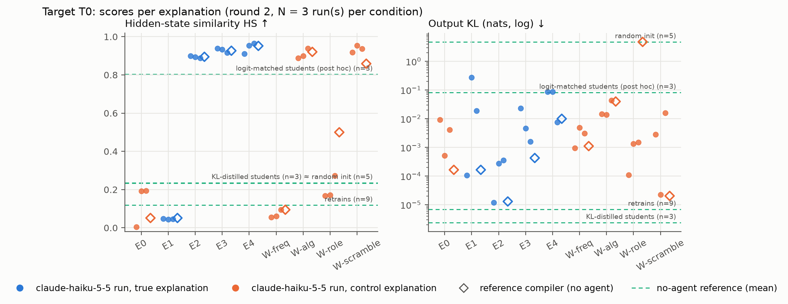
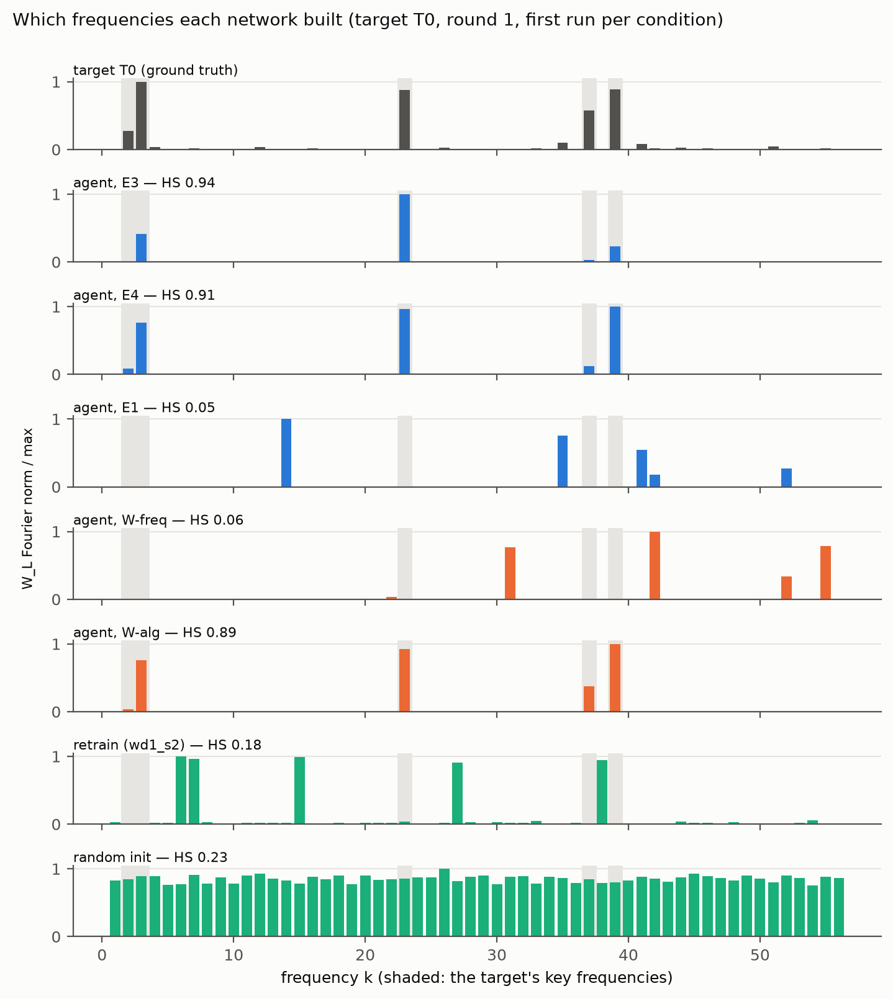

## Abstract

Interpretability agents can now produce mechanistic explanations faster than people can check them. We test one
automatic check: give the explanation, and nothing else, to an LLM agent that has never seen the network and has no
network access except its model endpoint, ask it to write every weight of a replacement network, and score the replacement against the
original by output KL divergence and by cross-validated hidden-state similarity (HS). The target is the one-layer
modular-addition transformer of Nanda et al. (2023). A script with weights access renders explanations at five levels
of true detail plus wrong explanations (length-matched except the Pizza one); Claude Haiku 5.5 in Claude Code, inside a
sandbox whose only connection is the model endpoint, builds the replacements; an agent-free reference compiler, independent retrains, logit-distilled students, random
initialisations, wrong targets and a planted-mechanism model calibrate the score. Hypotheses, metrics and analyses were
preregistered before any result. Results after two rounds (three runs per condition — not yet the preregistered ten):

<!-- BEGIN key-results -->
*Round 2, N = 3 run(s) per condition — not yet N=10*

- **Model-specific detail raises hidden-state similarity:** HS on T0 is 0.05 (E1, algorithm only), 0.89 (E2), 0.93 (E3) and 0.94 (E4); with no explanation (E0) it is 0.13. Monotone from E1 to E4; E0 lies above E1, against the preregistered prediction.
- **Correct behaviour, wrong mechanism is caught by HS, not by output KL:** the wrong-frequency replacement reaches KL 0.003 nats (true E3: 0.010) but HS 0.07.
- **Copying behaviour does not copy the mechanism:** independent retrains (HS 0.12) and logit-distilled students (HS 0.23, KL 2.38e-06) score no higher than randomly initialised networks (HS 0.24). HS's scale is therefore not anchored at 0 for unrelated networks: it measures overlap of internal features, and working networks built on other frequencies score below random ones.
- **Negative result:** the primary HS does not separate the Pizza explanation (W-alg, HS 0.91) or the scrambled neuron table (W-scramble, HS 0.94) from the true explanations; the secondary matched-neuron correlation separates W-scramble (0.65) from E4 (0.91).
- **Memorisation (post hoc):** when the explanation gives no frequencies, the simulator often builds most of the published paper's frequencies {14, 35, 41, 42, 52} into its replacement. E1: 3 of 3 replacement(s) used at least four of the paper's five frequencies, and 3 of 3 used none of T0's; mean HS 0.05 against T0 but 0.82 against the published checkpoint (target swap: same weights, other target); E0: 1 of 3 replacement(s) used at least four of the paper's five frequencies, and 2 of 3 used none of T0's; mean HS 0.13 against T0 but 0.28 against the published checkpoint (target swap: same weights, other target). The 3 algorithm-only run(s) on the published checkpoint itself score HS 0.59 on average (range 0.24–0.92): on a published model, a high score can come from the simulator's memory rather than the explanation (one published model and one simulator tested).
- **Cost:** all Claude Haiku 5.5 runs so far cost $2.33 in total.
<!-- END key-results -->

Output KL alone ranks a wrong-frequency explanation, independent retrains and distilled students as good as the true
explanations (the wrong-frequency one above E3 and E4); HS does not. HS is blind to the per-neuron frequency assignment and to the Clock-versus-Pizza
distinction, both of which keep the key frequencies. When an explanation leaves the frequencies open, the simulator fills them in with
most of the published paper's frequencies from memory (a target swap shows the same weights fit the published
checkpoint), so targets with no published analysis are needed for interpretable scores.
At N = 3 the preregistered tests support the HS trend over the explanation ladder, the behaviour-mechanism dissociation,
the advantage over independent retrains, specificity to the explained network and tracking of circuit formation; output
KL's trend over the ladder is not supported, the true-versus-wrong comparisons cannot reach significance with
three runs per arm, output KL does not behave as a calibrated distance on the planted mechanism (H4b not supported),
and the agent beat the agent-free compiler on one target (H5's first half fails).

## 1 Introduction

Mechanistic interpretability explains a network by naming the algorithm its weights implement. In our view the evidence for
such an explanation forms a ladder: correlation, then steering, ablation and counterfactual swapping, and at the top
*simulation* — rebuilding the mechanism well enough to reproduce the model. As agents begin to generate explanations
at scale, grading them becomes the bottleneck, and the top rung is the one hardest to automate.

Existing automated scores simulate single features' activations with an LLM and correlate them with the real ones
([Bills et al. 2023](https://openaipublic.blob.core.windows.net/neuron-explainer/paper/index.html)), or replace
simulation with cheaper classification-based scorers ([Paulo et al. 2024](https://arxiv.org/abs/2410.13928)).
Explanations with high simulation scores show little causal efficacy ([Huang et al. 2023](https://arxiv.org/abs/2309.10312));
in output-simulatability settings a simulator can match no-explanation baselines by solving the task directly
([Poché et al. 2026](https://arxiv.org/abs/2609.08585)); and per-feature fuzzing and detection scores often fail to
separate trained from randomised models ([Heap et al. 2025](https://arxiv.org/abs/2501.17727)). [Gao (2026)](https://www.lesswrong.com/posts/Dkh7pXKjoNWkkxQDz/neural-networks-are-not-already-clean)
proposes substituting simulated activations and scoring downstream KL (cf. the ablation scoring of Bills et al.). We go one step further and let the simulator
write the *whole network's weights*, then ask the question that has to come first: **is the resulting score a valid
measure of explanation quality?** Concretely: does it rise with true detail, fall for wrong explanations, beat what
the training recipe or behavioural cloning give for free, and catch a wrong mechanism that still behaves correctly?

**Contributions.** (i) A weights-blind, sandboxed simulation grader for mechanistic explanations of an SGD-trained
transformer, with an output metric and a symmetry-aware hidden-state metric. (ii) A preregistered validation with a
scripted ladder of true explanations, wrong explanations, explanation-free baselines, wrong-target,
planted-mechanism and training-trajectory controls, and an agent-free reference compiler that separates what an
explanation contains from what the agent makes of it. (iii) Evidence (N = 3, one task family, one simulator) that output KL is
not a valid score on this task and that HS is, for frequency-level content, with two documented blind spots. (iv)
Evidence (post hoc; all three algorithm-only runs on the main target used four of the paper's five frequencies) that a
weights-blind simulator fills gaps in an explanation with a memorised published mechanism, which can inflate scores on
published models.

This project was developed in a mechanistic interpretability hackathon on automatically evaluating mechanistic
interpretability explanations, which the authors co-organized in their mechanistic interpretability community and
its Discord server, [mechinterp.com](https://mechinterp.com/).

## 2 Background and related work

**The target.** [Nanda et al. (2023)](https://arxiv.org/abs/2301.05217) reverse-engineered a one-layer transformer
(p = 113, d_model 128, four heads, 512 ReLU neurons, no LayerNorm) trained on (a + b) mod 113: it embeds a and b as
cos/sin(w_k a), cos/sin(w_k b) for a few key frequencies w_k = 2πk/113, forms cos/sin(w_k(a + b)) with attention and
the MLP, and reads out logit(c) ≈ Σ_k α_k cos(w_k(a + b − c)). The published explanation leaves per-neuron phases and
gains, the allocation of neurons to frequencies and the logit scale unspecified. [Zhong et al. (2023)](https://arxiv.org/abs/2306.17844)
showed that a second algorithm ("Pizza") solves the same task with the same accuracy; its logits differ by a factor
|cos(w_k(a − b)/2)|, so full output distributions can still tell the two apart. [Yip et al. (2024)](https://arxiv.org/abs/2412.03773) and
[Gromov (2023)](https://arxiv.org/abs/2301.02679) give closed-form constructions for related networks.

**Explanations checked against weights.** Tracr ([Lindner et al. 2023](https://arxiv.org/abs/2301.05062)) compiles
programs to weights; causal abstraction ([Geiger et al. 2025, v1 2023](https://arxiv.org/abs/2301.04709)) and causal scrubbing
([Chan et al. 2022](https://www.alignmentforum.org/posts/JvZhhzycHu2Yd57RN/causal-scrubbing-a-method-for-rigorously-testing-interpretability-hypotheses))
test faithfulness by interventions, and [Sutter et al. (2025)](https://arxiv.org/abs/2507.08802) show that, under mild
assumptions, unrestricted non-linear alignment maps make any network a causal abstraction of any algorithm, so the
alignment class must be justified.
[Cammarata et al. (2021)](https://distill.pub/2020/circuits/curve-circuits/) hand-built one curve-detector circuit and
compared its activations with the natural one — our idea, done by hand for one circuit. Compact proofs
([Gross et al. 2024](https://arxiv.org/abs/2406.11779)) make explanation length explicit, with brute-force evaluation on every input
as the longest proof.

**Agents that write weights.** The closest work, iWSP ([Mehta et al. 2026](https://arxiv.org/abs/2611.18114)), has
Claude Code write small models' weights in code and rebuild them in fresh sessions from a ≤ 200-word description, with
a no-description control; it rebuilds only agent-written models, scores by accuracy and prediction correlation
(feature CKA for one model) and uses no output KL. The LLM behind an interpretability agent can recall a published
circuit from memory ([Haklay et al. 2026](https://arxiv.org/abs/2603.20101)), which is why our main targets have no
published analysis.

**What is new here** is the combination: an SGD-trained target, a weights-blind agent that compiles a
mechanistic explanation into a full replacement, output KL plus a symmetry-aware hidden-state metric, explanation-length
accounting, and no-explanation, wrong-explanation, wrong-target and planted-mechanism controls. Each ingredient has
precedent (full review: `reports/literature-review.md`).

## 3 Method

### 3.1 Targets

All targets share the architecture and training recipe of Nanda et al. (full-batch AdamW, lr 10⁻³, weight decay 1,
30 % training split, 40,000 steps) and reach 100 % test accuracy. T0 is the main target; T1 and T2 have the fewest and
most key frequencies among the published seeds; T-new was trained after the protocol freeze, so no development choice
could be tuned to it; T-paper is the paper's own checkpoint (contamination-flagged: its explanation is published); the
dev target was used for all development, and no dev-target agent result is reported (it serves only as one of the
wrong targets in H7). T0–T2 have no published analysis; their weights have been public on Hugging Face since
October 2026, after Claude Haiku 5.5's June 2026 training-data cutoff. Targets come from
[BurnyCoder/grokking-modular-addition-runs](https://huggingface.co/BurnyCoder/grokking-modular-addition-runs).

<!-- BEGIN targets -->
| Target | run | role | key frequencies | neurons per key frequency | unclustered neurons | logit fit FVE | loss (all 113² inputs) |
|---|---|---|---|---|---|---|---|
| T0 | `wd1_s1` | main target | 2, 3, 23, 37, 39 | 0, 197, 49, 42, 99 | 125 | 0.933 | 2.06e-07 |
| T1 | `wd1_s4` | seed sensitivity (fewest frequencies) | 11, 25, 49 | 154, 111, 156 | 91 | 0.984 | 1.36e-07 |
| T2 | `wd1_s8` | seed sensitivity (most frequencies) | 37, 44, 45, 46, 47, 51 | 58, 63, 81, 78, 88, 79 | 65 | 0.949 | 8.42e-07 |
| T-new | `new_s11` | held-out, trained after the protocol freeze | 22, 37, 41, 51 | 138, 77, 79, 130 | 88 | 0.954 | 2.41e-07 |
| T-paper | `paper` | published checkpoint (contamination-flagged) | 14, 35, 41, 42, 52 | 44, 93, 145, 87, 64 | 79 | 0.961 | 2.41e-07 |
| dev | `wd1_s10` | development only (never reported) | 19, 31, 45, 47 | 80, 81, 189, 79 | 83 | 0.970 | 1.77e-07 |
<!-- END targets -->

### 3.2 Explanations

A script reads each target's weights, runs the paper's Fourier analysis (via the paper-faithful
[grokviz](https://github.com/BurnyCoder/visualizing-grokking-modular-addition-in-transformer) package) and renders:
**E0** the task and architecture only; **E1** the Fourier-multiplication algorithm, including the precise neuron function (amendment 2.3), without
model-specific numbers; **E2** the key frequencies and each component's role; **E3** adds per-frequency amplitudes,
neurons per frequency, attention-pattern fits and the logit scale; **E4** adds a per-neuron table (frequency, phase,
gain). Wrong controls: **W-freq** is E3 with the key frequencies swapped for other valid ones (a working adder with a
different mechanism), **W-alg** describes the Pizza algorithm (preregistered as E3-length, it is about 40 % shorter than E3 on every target, so the E3 > W-alg comparison is not length-controlled; deviation 8), **W-role** misattributes component roles,
**W-scramble** reassigns each E4 neuron's frequency at random among the key frequencies and redraws its phases. **E-paper** paraphrases the
published explanation with the paper's numbers (T-paper only). No number in an explanation is typed by hand; every
explanation's length is recorded.

### 3.3 Simulator and sandbox

The simulator is Claude Haiku 5.5 in Claude Code 2.1.330 (`--bare`, permissions bypassed inside the sandbox, web
tools disallowed, default sampling, effort `medium`). It runs in a bubblewrap sandbox in WSL2 in its own empty network
namespace (no interface but loopback), with a cleared environment, no Windows drives or home directory, and AF_VSOCK blocked by seccomp; it
reaches the model only through a unix socket to a proxy outside the sandbox that injects the API key, allows only the
Messages endpoint and the run's models, rejects server-side tools with internet access, and enforces per-run and total
budgets. The sandbox holds `TASK.md`, `EXPLANATION.md`, `ARCHITECTURE.md`, a numpy `forward.py`, a `selftest.py`
that checks shapes and accuracy against the task labels (never against M), and a starter `build_weights.py`. Training
loops and iterative optimisation are forbidden; build scripts are audited and flagged ones reviewed by hand. Runs are
capped at 60 minutes and $2 (Claude Code has no step cap). Local Qwen models (Qwen3.6-35B-A3B, Qwen3.5-9B, Qwen3.5-4B) in a bash-only harness modelled on
[mini-SWE-agent](https://github.com/SWE-agent/mini-swe-agent) were planned as the simulator-capability ablation: in
development none of them exceeded 5 % task accuracy, which made Haiku the main simulator by a rule fixed before any
Claude run (preregistration amendment 2). In round 1 all five local runs that finished (Qwen3.5-4B × 4, Qwen3.5-9B × 1)
built constant-output networks, and the remaining local runs were stopped by the first author's decision after seeing
these results (preregistration deviation 5, a results-driven stop disclosed as such).

### 3.4 Grader

**Output KL:** mean KL(P_M ‖ P_M̂) over all 12,769 inputs and 113 classes, in nats, float64. **Hidden-state
similarity (HS):** at three final-position sites (residual stream after attention, MLP activations, final residual
stream), 5-fold cross-validated ridge-regression R² in both directions (M̂ → M and M → M̂), combined by harmonic mean
per site and averaged over sites. Linear maps are the alignment class because, without LayerNorm, the residual stream
is defined only up to an invertible linear map; unrestricted non-linear maps can make every network match every
algorithm ([Sutter et al. 2025](https://arxiv.org/abs/2507.08802)), so we restrict to linear maps (our assumption,
motivated by theirs). Completeness R²(M̂ → M) is invariant to any invertible linear map of M̂'s basis; soundness
R²(M → M̂), pooled over M̂'s dimensions, only to orthogonal maps and uniform scaling of M̂'s basis (regression R² is
invariant only in its predictor; [Kornblith et al. 2019](https://arxiv.org/abs/1905.00414), Table 1), and HS = 1
exactly when each model's states are an affine function of the other's. A whitened soundness, invariant in both
directions, is reported as a post-hoc check (Appendix B). HS's scale is not anchored at 0 for unrelated networks. Secondary metrics include matched-neuron correlation (optimal one-to-one assignment), centred-logit FVU and temperature-calibrated KL. A run without valid weights is scored as a failure.

### 3.5 Controls, baselines and statistics

Controls: E0 and the W-* explanations through the agent; random initialisations; every T0 E3/E4 replacement graded against
the other targets and against models trained without a clean mechanism (H7); the reference-compiled E3 model trained
further and graded against its own snapshots (planted mechanism, H4b); every T0 E3/E4 replacement graded against each of T0's 401
training checkpoints next to the paper's restricted loss (H8; deviation 8 — rounds 1–2 had used one replacement and
every 10th checkpoint). Baselines: independent retrains (other seeds of the same
recipe), three students distilled on M's full logits, the reference compiler for every explanation, M with only its
key-frequency Fourier components kept in the embedding and unembedding, and the weights themselves. Every condition
is planned in three rounds (N = 1, 3, 10 replicate runs; local Qwen conditions ran only in round 1, and round 3 is
postponed; Claude's sampling cannot be seeded, so a run's seed index labels a replicate, while for the local models it is the sampling seed); every hypothesis is evaluated after every round with Jonckheere–Terpstra
and Spearman trend tests (H1), one-sided Mann–Whitney tests with Holm correction (H2, H4), Kendall's W (H6) and
Wilcoxon signed-rank tests (H7). A test whose smallest attainable p-value at the current N is ≥ 0.05 returns
"cannot tell at this N". The preregistration, two dated amendments and every post-freeze deviation are in
`reports/preregistration.md`.

## 4 Results (rounds 1–2, N = 3 per condition)

### 4.1 Explanation ladder and controls on T0

<!-- BEGIN scoreboard-T0 -->
| Explanation | role | chars | N | agent accuracy | agent KL_out ↓ | agent HS ↑ | agent matched-neuron corr ↑ | compiler KL_out ↓ | compiler HS ↑ |
|---|---|---|---|---|---|---|---|---|---|
| E0 | control: no mechanism | 279 | 3 | 1.000 ± 0.000 | 0.005 ± 0.004 | 0.130 ± 0.109 | 0.056 ± 0.031 | 1.64e-04 | 0.051 |
| E1 | method | 1556 | 3 | 1.000 ± 0.000 | 0.097 ± 0.152 | 0.046 ± 0.002 | 0.028 ± 1.59e-04 | 1.64e-04 | 0.051 |
| E2 | method | 1788 | 3 | 1.000 ± 0.000 | 2.12e-04 ± 1.78e-04 | 0.894 ± 0.005 | 0.669 ± 0.005 | 1.30e-05 | 0.895 |
| E3 | method | 3712 | 3 | 1.000 ± 4.70e-04 | 0.010 ± 0.012 | 0.929 ± 0.012 | 0.759 ± 0.060 | 4.25e-04 | 0.927 |
| E4 | method | 51329 | 3 | 0.986 ± 0.012 | 0.060 ± 0.045 | 0.943 ± 0.028 | 0.913 ± 0.044 | 0.010 | 0.952 |
| W-freq | control: wrong frequencies | 3724 | 3 | 1.000 ± 9.04e-05 | 0.003 ± 0.002 | 0.070 ± 0.021 | 0.030 ± 1.64e-04 | 0.001 | 0.095 |
| W-alg | control: wrong algorithm (Pizza) | 2224 | 3 | 1.000 ± 0.000 | 0.024 ± 0.017 | 0.909 ± 0.027 | 0.737 ± 0.061 | 0.040 | 0.921 |
| W-role | control: wrong component roles | 3777 | 3 | 1.000 ± 2.71e-04 | 9.80e-04 ± 7.60e-04 | 0.204 ± 0.060 | 0.013 ± 0.002 | 4.727 | 0.500 |
| W-scramble | control: scrambled neurons | 51590 | 3 | 0.998 ± 0.004 | 0.006 ± 0.008 | 0.936 ± 0.018 | 0.653 ± 0.027 | 2.02e-05 | 0.859 |
<!-- END scoreboard-T0 -->

E0 and E1 produce working adders (task accuracy near 100 %) whose hidden states share almost nothing with T0: the
simulator's priors supply *an* algorithm, not *this model's* mechanism. Naming the key frequencies (E2) lifts HS close
to the reference compiler's value; E3 adds a few hundredths in every run (under the preregistered HS; E2 and E3 tie under the post-hoc whitened check, Appendix B) and E3 → E4 is mixed. Wrong frequencies
and wrong component roles give working adders with low HS. The Pizza description and the scrambled neuron table score
like true explanations on HS; the matched-neuron correlation separates the scrambled table from E4.

### 4.2 Behaviour is not mechanism

<!-- BEGIN baselines-T0 -->
| Reference point | what it has | n | task accuracy | KL_out ↓ | HS ↑ |
|---|---|---|---|---|---|
| Random initialisation | nothing (floor) | 5 | 0.009 ± 0.001 | 4.766 ± 0.006 | 0.236 ± 0.006 |
| Independent retrains | same recipe, other seeds | 9 | 1.000 ± 0.000 | 6.90e-06 ± 3.96e-06 | 0.119 ± 0.097 |
| Logit-distilled students | M's full output logits, no explanation | 3 | 1.000 ± 0.000 | 2.38e-06 ± 8.25e-07 | 0.233 ± 0.058 |
| Fourier-restricted M | M's weights, key frequencies only in W_E/W_U | 1 | 1.000 | 0.002 | 0.992 |
| Weights dump | all 226,816 weights | 1 | 1.000 | 0.000 | 1.000 |
<!-- END baselines-T0 -->

Independent retrains and logit-distilled students reproduce T0's outputs more closely than the explanation-built
replacements on average, yet their HS is at or below the random-initialisation floor. The W-freq replacement likewise has small
output KL and low HS. Output KL alone would rank all of these about as high as the true explanations; HS ranks them at the
bottom. Keeping only T0's key-frequency components in its embedding and unembedding leaves HS almost unchanged: the
key frequencies carry nearly all of what HS measures.

The output examples show what the scores summarise. The E3 replacement builds the target's frequencies; the E1
replacement builds most of the published checkpoint's frequencies (Section 4.6); W-freq builds other frequencies; the Pizza
replacement (W-alg) builds the same frequencies as the target, which is why HS cannot separate it; an independent
retrain converges to a different frequency set; a random network has a flat spectrum.

### 4.3 Calibration, specificity and training dynamics

<!-- BEGIN controls-T0 -->
| Planted model trained further (steps) | HS ↑ | KL_out | snapshot task accuracy |
|---|---|---|---|
| 0 | 1.000 | 0.000 | 1.0000 |
| 100 | 0.998 | 0.371 | 0.9774 |
| 1000 | 0.957 | 0.040 | 0.9958 |
| 10000 | 0.888 | 4.25e-04 | 1.0000 |

| Replacement | HS vs T0 | best wrong target (HS) | d = HS(T0) − max HS(wrong) |
|---|---|---|---|
| E3 | 0.939 | T2 (0.274) | 0.665 |
| E3 | 0.932 | T2 (0.240) | 0.693 |
| E3 | 0.915 | T2 (0.290) | 0.626 |
| E4 | 0.912 | T2 (0.226) | 0.685 |
| E4 | 0.953 | T2 (0.227) | 0.726 |
| E4 | 0.965 | T2 (0.258) | 0.708 |
<!-- END controls-T0 -->

On the planted mechanism, HS is 1 at step 0 and falls monotonically as training moves the model away from the
planted construction; output KL first rises and then falls again: the planted model does not drift monotonically in
function (its accuracy dips most after 100 steps), KL tracks that, and HS barely moves there. The preregistered
monotone-drift assumption, not necessarily the grader, is what fails. T0's E3/E4 replacements fit T0 much better
than any other target. Against
T0's checkpoints, HS rises during circuit formation in step with the fall of the restricted loss.

### 4.4 Explanation length

### 4.5 Ablations, sensitivity and other targets

Ablations and hyperparameter variants on T0, next to the unablated condition:

<!-- BEGIN ablations-T0 -->
| Change | Explanation | Simulator | N | task accuracy | KL_out ↓ | HS ↑ | matched-neuron corr ↑ |
|---|---|---|---|---|---|---|---|
| none (main condition) | E3 | claude-haiku-5-5 | 3 | 1.000 ± 4.70e-04 | 0.010 ± 0.012 | 0.929 ± 0.012 | 0.759 ± 0.060 |
| explanation as maths | E3 | claude-haiku-5-5 | 3 | 0.999 ± 0.002 | 0.003 ± 0.004 | 0.915 ± 0.003 | 0.771 ± 0.036 |
| explanation as code | E3 | claude-haiku-5-5 | 3 | 1.000 ± 9.04e-05 | 0.002 ± 3.96e-04 | 0.897 ± 0.030 | 0.805 ± 2.48e-04 |
| self-test removed | E3 | claude-haiku-5-5 | 3 | 1.000 ± 3.62e-04 | 0.004 ± 0.002 | 0.942 ± 0.025 | 0.765 ± 0.043 |
| effort low | E3 | claude-haiku-5-5 | 3 | 0.853 ± 0.252 | 0.661 ± 1.137 | 0.921 ± 0.003 | 0.751 ± 0.027 |
| effort high | E3 | claude-haiku-5-5 | 3 | 1.000 ± 0.000 | 0.001 ± 7.17e-04 | 0.936 ± 0.034 | 0.791 ± 0.025 |
| none (main condition) | W-freq | claude-haiku-5-5 | 3 | 1.000 ± 9.04e-05 | 0.003 ± 0.002 | 0.070 ± 0.021 | 0.030 ± 1.64e-04 |
| effort low | W-freq | claude-haiku-5-5 | 3 | 0.923 ± 0.133 | 0.344 ± 0.594 | 0.088 ± 0.025 | 0.061 ± 0.031 |
| effort high | W-freq | claude-haiku-5-5 | 3 | 1.000 ± 0.000 | 0.001 ± 6.05e-04 | 0.093 ± 0.005 | 0.032 ± 0.003 |
| simulator qwen3.5-4b | E2 | qwen3.5-4b | 1 | 0.009 | 4.727 | 0.000 | 0.000 |
| simulator qwen3.5-4b | E3 | qwen3.5-4b | 1 | 0.009 | 4.727 | 0.000 | 0.000 |
| simulator qwen3.5-4b | E4 | qwen3.5-4b | 1 | 0.009 | 4.727 | 0.000 | 0.000 |
| simulator qwen3.5-4b | W-freq | qwen3.5-4b | 1 | 0.009 | 6.066 | 0.000 | 1.41e-16 |
| simulator qwen3.5-9b | E2 | qwen3.5-9b | 1 | 0.009 | 7.628 | 0.000 | 0.000 |
<!-- END ablations-T0 -->

All agent runs of the round:

<!-- BEGIN runs -->
| Stage | Target | Explanation | Simulator | T | Variant | N | failed | accuracy | KL_out ↓ (mean ± sd) | HS ↑ (mean ± sd) |
|---|---|---|---|---|---|---|---|---|---|---|
| ablations | T0 | E2 | qwen3.5-4b | 0.6 | – | 1 | 0 | 0.009 | 4.73 | 0.000 |
| ablations | T0 | E2 | qwen3.5-9b | 0.6 | – | 1 | 0 | 0.009 | 7.63 | 0.000 |
| ablations | T0 | E3 | claude-haiku-5-5 | default | fmt-code | 3 | 0 | 1.000 | 0.00175 ± 0.000396 | 0.897 ± 0.0301 |
| ablations | T0 | E3 | claude-haiku-5-5 | default | fmt-math | 3 | 0 | 0.999 | 0.00322 ± 0.00379 | 0.915 ± 0.00311 |
| ablations | T0 | E3 | claude-haiku-5-5 | default | noselftest | 3 | 0 | 1.000 | 0.00376 ± 0.00218 | 0.942 ± 0.0253 |
| ablations | T0 | E3 | qwen3.5-4b | 0.6 | – | 1 | 0 | 0.009 | 4.73 | 0.000 |
| ablations | T0 | E4 | qwen3.5-4b | 0.6 | – | 1 | 0 | 0.009 | 4.73 | 0.000 |
| ablations | T0 | W-freq | qwen3.5-4b | 0.6 | – | 1 | 0 | 0.009 | 6.07 | 0.000 |
| controls | T0 | E0 | claude-haiku-5-5 | default | – | 3 | 0 | 1.000 | 0.00455 ± 0.00431 | 0.130 ± 0.109 |
| controls | T0 | W-freq | claude-haiku-5-5 | default | – | 3 | 0 | 1.000 | 0.00293 ± 0.00195 | 0.070 ± 0.0211 |
| controls | T0 | W-alg | claude-haiku-5-5 | default | – | 3 | 0 | 1.000 | 0.024 ± 0.0171 | 0.909 ± 0.0268 |
| controls | T0 | W-role | claude-haiku-5-5 | default | – | 3 | 0 | 1.000 | 0.00098 ± 0.00076 | 0.204 ± 0.06 |
| controls | T0 | W-scramble | claude-haiku-5-5 | default | – | 3 | 0 | 0.998 | 0.0062 ± 0.00838 | 0.936 ± 0.0183 |
| hyper | T0 | E3 | claude-haiku-5-5 | default | effort-high | 3 | 0 | 1.000 | 0.00102 ± 0.000717 | 0.936 ± 0.0344 |
| hyper | T0 | E3 | claude-haiku-5-5 | default | effort-low | 3 | 0 | 0.853 | 0.661 ± 1.14 | 0.921 ± 0.0033 |
| hyper | T0 | W-freq | claude-haiku-5-5 | default | effort-high | 3 | 0 | 1.000 | 0.00143 ± 0.000605 | 0.093 ± 0.00464 |
| hyper | T0 | W-freq | claude-haiku-5-5 | default | effort-low | 3 | 0 | 0.923 | 0.344 ± 0.594 | 0.088 ± 0.0252 |
| main | T0 | E1 | claude-haiku-5-5 | default | – | 3 | 0 | 1.000 | 0.0969 ± 0.152 | 0.046 ± 0.00177 |
| main | T0 | E2 | claude-haiku-5-5 | default | – | 3 | 0 | 1.000 | 0.000212 ± 0.000178 | 0.894 ± 0.00542 |
| main | T0 | E3 | claude-haiku-5-5 | default | – | 3 | 0 | 1.000 | 0.00972 ± 0.0115 | 0.929 ± 0.0124 |
| main | T0 | E4 | claude-haiku-5-5 | default | – | 3 | 0 | 0.986 | 0.06 ± 0.0455 | 0.943 ± 0.0282 |
| seed | T-new | E3 | claude-haiku-5-5 | default | – | 3 | 0 | 0.910 | 0.328 ± 0.237 | 0.910 ± 0.0613 |
| seed | T-new | E4 | claude-haiku-5-5 | default | – | 3 | 0 | 0.997 | 0.0124 ± 0.0214 | 0.984 ± 0.000181 |
| seed | T-new | W-freq | claude-haiku-5-5 | default | – | 3 | 0 | 0.907 | 0.432 ± 0.461 | 0.094 ± 0.0689 |
| seed | T-paper | E1 | claude-haiku-5-5 | default | – | 3 | 0 | 0.998 | 0.621 ± 0.725 | 0.590 ± 0.34 |
| seed | T-paper | E3 | claude-haiku-5-5 | default | – | 3 | 0 | 0.962 | 0.141 ± 0.207 | 0.940 ± 0.0251 |
| seed | T-paper | E4 | claude-haiku-5-5 | default | – | 3 | 0 | 0.894 | 0.413 ± 0.18 | 0.937 ± 0.00801 |
| seed | T-paper | W-freq | claude-haiku-5-5 | default | – | 3 | 0 | 0.998 | 0.00677 ± 0.0116 | 0.117 ± 0.0384 |
| seed | T-paper | E-paper | claude-haiku-5-5 | default | – | 3 | 0 | 1.000 | 0.00115 ± 0.00196 | 0.950 ± 0.041 |
| seed | T1 | E2 | claude-haiku-5-5 | default | – | 3 | 0 | 1.000 | 0.00127 ± 0.00161 | 0.957 ± 0.00305 |
| seed | T1 | E3 | claude-haiku-5-5 | default | – | 3 | 0 | 0.908 | 0.384 ± 0.143 | 0.936 ± 0.0167 |
| seed | T1 | E4 | claude-haiku-5-5 | default | – | 3 | 0 | 0.901 | 0.498 ± 0.245 | 0.960 ± 0.00558 |
| seed | T1 | W-freq | claude-haiku-5-5 | default | – | 3 | 0 | 0.854 | 0.537 ± 0.136 | 0.051 ± 0.0247 |
| seed | T2 | E2 | claude-haiku-5-5 | default | – | 3 | 0 | 1.000 | 3.41e-05 ± 1.17e-05 | 0.900 ± 0.0969 |
| seed | T2 | E3 | claude-haiku-5-5 | default | – | 3 | 0 | 1.000 | 5.84e-05 ± 1.37e-05 | 0.962 ± 0.015 |
| seed | T2 | E4 | claude-haiku-5-5 | default | – | 3 | 0 | 0.990 | 0.0487 ± 0.0548 | 0.951 ± 0.0146 |
| seed | T2 | W-freq | claude-haiku-5-5 | default | – | 3 | 0 | 0.999 | 0.00563 ± 0.00588 | 0.098 ± 0.0113 |
<!-- END runs -->

**Reading.** Presenting E3 as math or as code, or removing the self-test, moves the simulator's HS by a few
hundredths at most. Low effort lowered task accuracy in one E3 run of three while its HS stayed high: the replacement has
the right frequency structure, and the wrong answers come from a layout bug in the agent's own script (one head's
output written onto the readout dimensions); re-running the script with that one number changed restores full accuracy
at the same HS (`vmi diagnose`). Behaviour and mechanism dissociate in this direction too. On the seed-sensitivity targets
T1, T2 and T-new the T0 pattern repeats against the compiler — E2–E4 close to the compiler's builds, W-freq at the
floor (no-agent baselines exist only for T0). On T2 the
simulator's E3 build beats the reference compiler's (the compiler is misled by the rendered E3 there, the agent is
not), so H5's "agent ≤ compiler" fails (the predictions table counts the pairs by sign and beyond the bootstrap CI). Every finished local Qwen run (Qwen3.5-4B on E2, E3,
E4 and W-freq; Qwen3.5-9B on E2) built a network with constant output: task accuracy 1/113 and HS 0, whatever the
explanation. Each run used up its harness's 60 steps or 60 minutes without reaching a working build. The local runs were
then stopped (deviation 5), so H5's capability trend and H6's cross-simulator ranking cannot be tested; with the two local
simulators that ran on T0 at chance (the third, Qwen3.6-35B-A3B, never ran on T0 and stayed below the 5 % rule in
development) they would have had nothing to rank.

### 4.6 Memorisation on the published checkpoint (post hoc)

The same key-frequency rule used for the targets (Fourier norm of W_L = W_U·W_out ≥ 0.25 of its maximum), applied to
each main-condition replacement built by the main simulator. Frequencies with small amplitude fall below the threshold, so the
"used" sets are lower bounds.

<!-- BEGIN frequencies -->
| Target | Explanation | frequencies used by the replacement | target's key frequencies | overlap with target (Jaccard) | overlap with paper's {14, 35, 41, 42, 52} | HS | same weights: HS against the published checkpoint |
|---|---|---|---|---|---|---|---|
| T0 | E0 | 14, 35, 41, 52 | 2, 3, 23, 37, 39 | 0.00 | 0.80 | 0.004 | 0.626 |
| T0 | E0 | 9, 10, 11, 12, 13, 14, 15, 16 | 2, 3, 23, 37, 39 | 0.00 | 0.08 | 0.191 | 0.189 |
| T0 | E0 | 1, 2, 3, 4, 5, 6, 7, 8 | 2, 3, 23, 37, 39 | 0.18 | 0.00 | 0.194 | 0.027 |
| T0 | E1 | 14, 35, 41, 52 | 2, 3, 23, 37, 39 | 0.00 | 0.80 | 0.048 | 0.951 |
| T0 | E1 | 14, 35, 40, 41, 52 | 2, 3, 23, 37, 39 | 0.00 | 0.67 | 0.045 | 0.751 |
| T0 | E1 | 14, 35, 40, 41, 52 | 2, 3, 23, 37, 39 | 0.00 | 0.67 | 0.046 | 0.755 |
| T0 | E2 | 3, 23, 39 | 2, 3, 23, 37, 39 | 0.60 | 0.00 | 0.899 | – |
| T0 | E2 | 3, 23, 39 | 2, 3, 23, 37, 39 | 0.60 | 0.00 | 0.895 | – |
| T0 | E2 | 2, 3, 23, 37, 39 | 2, 3, 23, 37, 39 | 1.00 | 0.00 | 0.889 | – |
| T0 | E3 | 3, 23 | 2, 3, 23, 37, 39 | 0.40 | 0.00 | 0.939 | – |
| T0 | E3 | 3, 23, 39 | 2, 3, 23, 37, 39 | 0.60 | 0.00 | 0.932 | – |
| T0 | E3 | 3, 23 | 2, 3, 23, 37, 39 | 0.40 | 0.00 | 0.915 | – |
| T0 | E4 | 3, 23, 39 | 2, 3, 23, 37, 39 | 0.60 | 0.00 | 0.912 | – |
| T0 | E4 | 3, 23, 39 | 2, 3, 23, 37, 39 | 0.60 | 0.00 | 0.953 | – |
| T0 | E4 | 3, 23, 37, 39 | 2, 3, 23, 37, 39 | 0.80 | 0.00 | 0.965 | – |
| T0 | W-freq | 31, 42, 52, 55 | 2, 3, 23, 37, 39 | 0.00 | 0.29 | 0.055 | – |
| T0 | W-freq | 31, 42, 55 | 2, 3, 23, 37, 39 | 0.00 | 0.14 | 0.061 | – |
| T0 | W-freq | 31, 42, 55 | 2, 3, 23, 37, 39 | 0.00 | 0.14 | 0.094 | – |
| T0 | W-alg | 3, 23, 37, 39 | 2, 3, 23, 37, 39 | 0.80 | 0.00 | 0.889 | – |
| T0 | W-alg | 3, 23, 37, 39 | 2, 3, 23, 37, 39 | 0.80 | 0.00 | 0.899 | – |
| T0 | W-alg | 3, 23, 37, 39 | 2, 3, 23, 37, 39 | 0.80 | 0.00 | 0.940 | – |
| T0 | W-role | 32, 34, 41, 54 | 2, 3, 23, 37, 39 | 0.00 | 0.12 | 0.168 | – |
| T0 | W-role | 32, 34, 41, 54 | 2, 3, 23, 37, 39 | 0.00 | 0.12 | 0.171 | – |
| T0 | W-role | 32, 34, 41, 54 | 2, 3, 23, 37, 39 | 0.00 | 0.12 | 0.273 | – |
| T0 | W-scramble | 3, 23, 39 | 2, 3, 23, 37, 39 | 0.60 | 0.00 | 0.918 | – |
| T0 | W-scramble | 3, 23, 39 | 2, 3, 23, 37, 39 | 0.60 | 0.00 | 0.954 | – |
| T0 | W-scramble | 3, 23, 39 | 2, 3, 23, 37, 39 | 0.60 | 0.00 | 0.938 | – |
| T1 | E2 | 11, 25, 49 | 11, 25, 49 | 1.00 | 0.00 | 0.955 | – |
| T1 | E2 | 11, 25, 49 | 11, 25, 49 | 1.00 | 0.00 | 0.961 | – |
| T1 | E2 | 25, 49 | 11, 25, 49 | 0.67 | 0.00 | 0.956 | – |
| T1 | E3 | 11, 49 | 11, 25, 49 | 0.67 | 0.00 | 0.917 | – |
| T1 | E3 | 11, 25, 49 | 11, 25, 49 | 1.00 | 0.00 | 0.943 | – |
| T1 | E3 | 11, 49 | 11, 25, 49 | 0.67 | 0.00 | 0.948 | – |
| T1 | E4 | 25, 49 | 11, 25, 49 | 0.67 | 0.00 | 0.955 | – |
| T1 | E4 | 25, 49 | 11, 25, 49 | 0.67 | 0.00 | 0.966 | – |
| T1 | E4 | 11, 49 | 11, 25, 49 | 0.67 | 0.00 | 0.960 | – |
| T1 | W-freq | 38, 52 | 11, 25, 49 | 0.00 | 0.17 | 0.034 | – |
| T1 | W-freq | 15, 52 | 11, 25, 49 | 0.00 | 0.17 | 0.079 | – |
| T1 | W-freq | 15, 38, 52 | 11, 25, 49 | 0.00 | 0.14 | 0.039 | – |
| T2 | E2 | 37, 44, 45, 46, 47, 51 | 37, 44, 45, 46, 47, 51 | 1.00 | 0.00 | 0.949 | – |
| T2 | E2 | 37, 45, 46, 47, 51 | 37, 44, 45, 46, 47, 51 | 0.83 | 0.00 | 0.789 | – |
| T2 | E2 | 37, 44, 45, 46, 47, 51 | 37, 44, 45, 46, 47, 51 | 1.00 | 0.00 | 0.963 | – |
| T2 | E3 | 37, 45, 47, 51 | 37, 44, 45, 46, 47, 51 | 0.67 | 0.00 | 0.944 | – |
| T2 | E3 | 45, 47, 51 | 37, 44, 45, 46, 47, 51 | 0.50 | 0.00 | 0.970 | – |
| T2 | E3 | 45, 47, 51 | 37, 44, 45, 46, 47, 51 | 0.50 | 0.00 | 0.970 | – |
| T2 | E4 | 37, 44, 45, 46, 47, 51 | 37, 44, 45, 46, 47, 51 | 1.00 | 0.00 | 0.934 | – |
| T2 | E4 | 46, 47 | 37, 44, 45, 46, 47, 51 | 0.33 | 0.00 | 0.955 | – |
| T2 | E4 | 46 | 37, 44, 45, 46, 47, 51 | 0.17 | 0.00 | 0.962 | – |
| T2 | W-freq | 32 | 37, 44, 45, 46, 47, 51 | 0.00 | 0.00 | 0.089 | – |
| T2 | W-freq | 9, 34 | 37, 44, 45, 46, 47, 51 | 0.00 | 0.00 | 0.093 | – |
| T2 | W-freq | 9, 34 | 37, 44, 45, 46, 47, 51 | 0.00 | 0.00 | 0.111 | – |
| T-new | E3 | 22, 41 | 22, 37, 41, 51 | 0.50 | 0.17 | 0.846 | – |
| T-new | E3 | 22, 37, 41, 51 | 22, 37, 41, 51 | 1.00 | 0.12 | 0.916 | – |
| T-new | E3 | 22, 37, 41, 51 | 22, 37, 41, 51 | 1.00 | 0.12 | 0.968 | – |
| T-new | E4 | 37, 41 | 22, 37, 41, 51 | 0.50 | 0.17 | 0.984 | – |
| T-new | E4 | 22, 37, 41, 51 | 22, 37, 41, 51 | 1.00 | 0.12 | 0.984 | – |
| T-new | E4 | 37, 41 | 22, 37, 41, 51 | 0.50 | 0.17 | 0.984 | – |
| T-new | W-freq | 10 | 22, 37, 41, 51 | 0.00 | 0.00 | 0.087 | – |
| T-new | W-freq | 10, 25, 33 | 22, 37, 41, 51 | 0.00 | 0.00 | 0.029 | – |
| T-new | W-freq | 10, 25, 33 | 22, 37, 41, 51 | 0.00 | 0.00 | 0.166 | – |
| T-paper | E1 | 42, 52 | 14, 35, 41, 42, 52 | 0.40 | 0.40 | 0.925 | – |
| T-paper | E1 | 3, 14, 17, 25, 41, 46, 52 | 14, 35, 41, 42, 52 | 0.33 | 0.33 | 0.600 | – |
| T-paper | E1 | 30, 34, 44, 46 | 14, 35, 41, 42, 52 | 0.00 | 0.00 | 0.244 | – |
| T-paper | E3 | 14, 35, 41, 42, 52 | 14, 35, 41, 42, 52 | 1.00 | 1.00 | 0.944 | – |
| T-paper | E3 | 14, 35, 41, 42, 52 | 14, 35, 41, 42, 52 | 1.00 | 1.00 | 0.963 | – |
| T-paper | E3 | 14, 35, 41, 42, 52 | 14, 35, 41, 42, 52 | 1.00 | 1.00 | 0.913 | – |
| T-paper | E4 | 14, 35, 41, 42, 52 | 14, 35, 41, 42, 52 | 1.00 | 1.00 | 0.929 | – |
| T-paper | E4 | 14, 35, 41, 42, 52 | 14, 35, 41, 42, 52 | 1.00 | 1.00 | 0.945 | – |
| T-paper | E4 | 35, 41 | 14, 35, 41, 42, 52 | 0.40 | 0.40 | 0.938 | – |
| T-paper | W-freq | 8, 21, 39, 44, 49 | 14, 35, 41, 42, 52 | 0.00 | 0.00 | 0.091 | – |
| T-paper | W-freq | 8, 21, 39, 44, 49 | 14, 35, 41, 42, 52 | 0.00 | 0.00 | 0.099 | – |
| T-paper | W-freq | 8, 21, 39, 44, 49 | 14, 35, 41, 42, 52 | 0.00 | 0.00 | 0.161 | – |
| T-paper | E-paper | 14, 35, 41, 42, 52 | 14, 35, 41, 42, 52 | 1.00 | 1.00 | 0.984 | – |
| T-paper | E-paper | 14, 35, 41, 42, 52 | 14, 35, 41, 42, 52 | 1.00 | 1.00 | 0.904 | – |
| T-paper | E-paper | 14, 35, 41, 42, 52 | 14, 35, 41, 42, 52 | 1.00 | 1.00 | 0.961 | – |
<!-- END frequencies -->

**Reading.** With the algorithm but no frequencies in the explanation (E1), Haiku builds four of the published paper's
five frequencies (14, 35, 41, 52) and none of T0's into the replacement in all three T0 runs — one build script
hard-codes all five (`KEY_FREQS = [14, 35, 41, 42, 52]  # key frequencies (choice: not specified by EXPLANATION.md)`),
the other two `[14, 35, 41, 52, 73]` (73 ≡ −40 mod 113); with no explanation at all (E0) this happened in one run of
three, and the other two built blocks of consecutive frequencies. On T0 (E0 and E1 were run only there) the memorised choice yields a
working adder with the wrong mechanism and near-zero HS; on the published checkpoint (T-paper) the algorithm-only runs
range from the floor to a full explanation's level. The last column is a target swap, the most direct test (a
counterfactual on the target, not a comparison between runs): the *same* weights of the T0 E1 runs (and of the E0 run
that used the paper's frequencies), graded against the published checkpoint instead of T0, score far higher there
than against T0, so the simulator built the published mechanism, not the explained one. Scores on a published model
therefore measure what the simulator remembers, not what the explanation says; the targets with no published analysis
(T0–T2, T-new), which the preregistration introduced for exactly this risk, are what make the score interpretable. This is
post hoc evidence from three algorithm-only runs (all three) and three no-explanation runs (one of three), consistent with [Haklay et al. 2026](https://arxiv.org/abs/2603.20101) (an interpretability
agent's LLM recalled a published circuit from memory).

### 4.7 Hypotheses: predicted vs. observed (N = 3)

<!-- BEGIN predictions -->
| Hypothesis | Predicted (preregistration §5) | Measured with the main simulator (T0) | Direction matches? | Formal verdict |
|---|-------|---------|-----|------|
| H1 | HS rises and output KL falls from E1 to E4 on T0; E0 lies below E1 | HS E0 0.130, E1 0.046, E2 0.894, E3 0.929, E4 0.943; KL E1 0.097, E2 2.12e-04, E3 0.010, E4 0.060 | partly (KL does not fall E1→E4; E0 not below E1) | HS: supported; KL_out: not supported · at N=3 — not yet N=10 |
| H2 | true explanations beat length-matched false ones on HS: E3 > W-freq, W-alg, W-role; E4 > W-scramble | HS difference E3>W-freq +0.859 [+0.835, +0.880]; E3>W-alg +0.020 [-0.008, +0.045]; E3>W-role +0.725 [+0.661, +0.768]; E4>W-scramble +0.007 [-0.025, +0.037] | partly (E3>W-alg tie (CI includes 0); E4>W-scramble tie (CI includes 0)) | E3>W-freq: cannot tell at this N; E3>W-alg: cannot tell at this N; E3>W-role: cannot tell at this N; E4>W-scramble: cannot tell at this N · at N=3 — not yet N=10 |
| H3 | W-freq: argmax agreement ≥ 0.99, KL not above the true E2–E4 range, HS below each of E2–E4 | W-freq: agreement 1.000, KL 0.003 (true 2.12e-04–0.060), HS 0.070 (true 0.894–0.943); HS − E2 -0.824 [-0.840, -0.801], E3 -0.859 [-0.880, -0.835], E4 -0.873 [-0.904, -0.841] | yes | supported · at N=3 — not yet N=10 |
| H4 | E3 and E4 beat independent retrains on HS (vs. distilled students: open question, no direction) | E3 0.929, E4 0.943; 9 retrains mean 0.119 (max 0.329); 3 students mean 0.233 (max 0.282); vs students, two-sided: E3 cannot tell at this N, E4 cannot tell at this N | yes | E3: supported; E4: supported · at N=3 — not yet N=10 |
| H4b | planted model: HS = 1 and KL = 0 at step 0, then HS strictly falls and KL strictly rises | HS 1.000 → 0.998 → 0.957 → 0.888; KL 0.000 → 0.371 → 0.040 → 4.25e-04 | partly (KL not strictly rising) | not supported · deterministic |
| H5 | agent ≤ reference compiler on every explanation; the gap shrinks with simulator capability | agent − compiler on T0: E2 -0.001, E3 +0.002, E4 -0.009, W-freq -0.024; agent above compiler in 7 of 15 target–explanation pairs by sign, 4 beyond the bootstrap CI (T1 E2, T2 E3, T2 E4, T-new E4; largest +0.179, T2 E3); 5 local runs, 0 above chance | no (agent above compiler beyond its CI; capability trend not testable) | not evaluable (local simulators stopped at chance, deviation 5) · 5 local runs, qwen3.5-4b: 0/4 above chance, qwen3.5-9b: 0/1 above chance |
| H6 | the local simulators rank E2, E3, E4, W-freq the same way | 5 local runs, 0 above chance: nothing to rank | not testable | not evaluable (local simulators stopped at chance, deviation 5) · 5 local runs, qwen3.5-4b: 0/4 above chance, qwen3.5-9b: 0/1 above chance |
| H7 | a T0 replacement fits T0 better than any other trained or no-mechanism model (HS) | E3: HS 0.939 vs best other 0.274 (T2); E3: HS 0.932 vs best other 0.240 (T2); E3: HS 0.915 vs best other 0.290 (T2); E4: HS 0.912 vs best other 0.226 (T2); E4: HS 0.953 vs best other 0.227 (T2); E4: HS 0.965 vs best other 0.258 (T2) | yes | supported · 6 E3/E4 replacements (at N=3 — not yet N=10) |
| H8 | HS against T0's checkpoints rises as restricted loss falls (circuit formation) | Spearman ρ(HS, −log restricted loss) per replacement: median 0.774, min 0.751 (6 E3/E4 replacements × 401 checkpoints) | yes | supported · 6 E3/E4 replacements × 401 checkpoints |
<!-- END predictions -->

Replications on the seed-sensitivity targets (preregistration §5: H1–H3 re-tested per target with the preregistered
tests, which earlier versions only checked by direction; deviation 8):

<!-- BEGIN replications -->
| Target | HS per true explanation | H1: HS rises with detail? (trend test) | H2: HS(E3) − HS(W-freq); Mann–Whitney | H3 observed (W-freq) | H3 holds? |
|-----|------|---|---|-------|-----|
| T1 | E2 0.957, E3 0.936, E4 0.960 | means do not rise E2→E3→E4; not supported (JT p 0.502, ρ 0.05) | +0.885; cannot tell at this N (p 0.050) | agreement 0.854, KL 0.537 (true max 0.498), HS 0.051 | partly (agreement < 0.99; KL above the true range) |
| T2 | E2 0.900, E3 0.962, E4 0.951 | means do not rise E2→E3→E4; not supported (JT p 0.500, ρ 0.05) | +0.864; cannot tell at this N (p 0.050) | agreement 0.999, KL 0.006 (true max 0.049), HS 0.098 | yes |
| T-new | E3 0.910, E4 0.984 | means rise E3→E4; cannot tell at this N (JT p 0.050, ρ 0.88) | +0.816; cannot tell at this N (p 0.050) | agreement 0.907, KL 0.432 (true max 0.328), HS 0.094 | partly (agreement < 0.99; KL above the true range) |
| T-paper (flagged: memorisation) | E1 0.590, E3 0.940, E4 0.937 | means do not rise E3→E4; cannot tell at this N (JT p 0.650, ρ -0.10) | +0.823; cannot tell at this N (p 0.050) | agreement 0.998, KL 0.007 (true max 0.413), HS 0.117 | yes |
<!-- END replications -->

**Reading.** At N = 3 the preregistered tests support H1's HS part, H3, H4, H7 and H8: HS rises with true detail (the big step is E1 → E2; every E3 run is above every E2 run under the preregistered HS, though E2 and E3 tie under the post-hoc whitened check; E3 → E4 is mixed), a wrong-frequency explanation keeps correct answers while its HS falls below every true explanation that names the frequencies (E2–E4), E3 and E4 replacements beat independent retrains and fit T0 better than any other model, and HS tracks circuit formation. The predictions fail where they assumed that output KL improves with detail (H1's KL part: it is lowest at E2 and rises at E3 and E4), that HS sees below the frequency level (H2: W-alg and W-scramble tie with the true explanations, their bootstrap CIs include 0), that the reference compiler is a ceiling (H5: the agent beats it on T2), or that output KL grows smoothly as a planted model drifts (H4b). "Direction matches" compares directions and preregistered thresholds only (a difference whose bootstrap CI includes 0 counts as a tie; with three runs per group a percentile bootstrap has only ten distinct resamples per group, so these intervals are too narrow and a tie is the safe reading, an "ahead" is not significance); the formal verdict adds the preregistered test, and 3 vs 3 runs cannot reach significance for H2 (smallest attainable p = 0.05). On the seed-sensitivity targets the gap between E3 and the wrong-frequency explanation replicates on every target (its rank test cannot decide at N = 3), while HS's rise with detail does not replicate (its trend test is not supported on T1 and T2; on T-new, with only E3 and E4, the means rise but the test cannot decide at N = 3); where H3 fails there, argmax agreement is below the preregistered 0.99 for the wrong-frequency replacement and also for the true E3 and E4 replacements, so the explanation is not shown to be the cause (not diagnosed).

## 5 Discussion

**What the score measures.** On this task HS measures whether the replacement uses the target's key frequencies in the
same places. That is the level at which the paper's explanation is stated, and HS separates it sharply from correct
behaviour obtained any other way. It does not measure the per-neuron assignment (W-scramble) or the non-linearity that
distinguishes Clock from Pizza (W-alg): both preserve every frequency subspace, and a linear map over a whole site
cannot see what is inside them. A complete grader needs a second, neuron-level or causal metric; the matched-neuron
correlation is a candidate for the per-neuron blind spot only (it separates W-scramble from E4 but not W-alg from E3;
descriptive, post hoc). The secondary stitching test (map M̂'s residual state after attention linearly into M's,
fitted on training folds, then run M's MLP and unembedding and take the KL to M on held-out inputs; `stitching_kl` in
`results/runs/`) is not: a linear map's predictions depend only on the subspace M̂'s state spans, so replacements that
span the same subspace get the same stitching KL. In the table below, replacements of different explanations
(including W-alg and W-scramble) share one value, and the agent's and the compiler's builds of an explanation often
share it too. Like HS, stitching separates replacements built on the target's frequencies from those built on wrong
or no frequencies, but it misses the wrong-role replacements that HS catches; it adds no discrimination below the
frequency level (post hoc).

<!-- BEGIN stitching-T0 -->
| Explanation | HS (agent) | stitching KL (agent) | HS (compiler) | stitching KL (compiler) |
|---|---|---|---|---|
| E0 | 0.130 ± 0.109 | 11.4848 ± 1.8938 | 0.051 | 12.1970 |
| E1 | 0.046 ± 0.002 | 13.6609 ± 0.0039 | 0.051 | 12.1970 |
| E2 | 0.894 ± 0.005 | 1.4185 ± 2.46e-15 | 0.895 | 1.4185 |
| E3 | 0.929 ± 0.012 | 0.4872 ± 0.8063 | 0.927 | 0.0219 |
| E4 | 0.943 ± 0.028 | 0.9522 ± 0.8061 | 0.952 | 0.0219 |
| W-freq | 0.070 ± 0.021 | 12.1344 ± 0.1036 | 0.095 | 12.1164 |
| W-alg | 0.909 ± 0.027 | 1.4185 ± 2.68e-08 | 0.921 | 1.4185 |
| W-role | 0.204 ± 0.060 | 1.4860 ± 1.08e-04 | 0.500 | 0.0219 |
| W-scramble | 0.936 ± 0.018 | 0.9526 ± 0.8061 | 0.859 | 0.0219 |
<!-- END stitching-T0 -->

**Why output KL fails.** A grokked model's outputs are nearly one-hot, so output KL mostly measures the replacement's
logit scale and its few wrong answers. Many different mechanisms reach the same near-zero KL — the training recipe
alone does — while a faithful replacement with a slightly wrong logit scale gets a larger one.

**The agent versus the compiler.** On T0, Haiku's replacements reach HS close to the reference compiler's for E2–E4: there
the explanation, not the agent, is the limiting factor at this level of detail (on T1 and T-new the agent stays below
the compiler on E3). Below some capability the method does not
work at all: the local Qwen models (4B and 9B parameters, in our harness and with 4-bit weights) never built a working
replacement, even from the per-neuron table. The capability threshold between them and Haiku is not located.

## 6 Limitations

- **Sample size.** Three runs per condition. H1 (HS part), H3, H4, H7 and H8 pass their preregistered tests at
  N = 3; H2's 3-vs-3 comparisons cannot reach significance and read "cannot tell at this N". Round 3 (N = 10) is
  postponed (deviation 6).
- **One task, one architecture.** All targets are one-layer modular-addition transformers. Whether HS stays informative
  for deeper networks, where linear maps across layers are less constrained, is untested.
- **One simulator family in the main arm, and it knows the paper.** Claude Haiku 5.5 often builds most of the paper's
  frequencies into replacements when an explanation leaves them open (all three E1 and one of three E0 runs on T0;
  Section 4.6), so T-paper scores of underspecified explanations are not evidence about the explanation; T0–T2 and
  T-new have no published analysis and became public after the simulator's training-data cutoff, and E0/E1 measure
  what the simulator brings by itself.
- **Scripted explanations.** The explanations are rendered by our script, so they share its style and its errors; the
  compiler's non-monotonicity on T2 and T-paper (Appendix) shows that E3 as rendered can mislead a literal build.
- **HS blind spots and scale.** Per-neuron assignment and Clock-versus-Pizza (Section 5); HS is not anchored at 0 for
  unrelated networks, and its soundness direction depends on the replacement's basis (whitened check in Appendix B).
- **Preregistered analyses not run** (deviation 8): redrawn W-freq and W-scramble explanations (3 seeds) and the
  T-paper retrain baselines; W-alg is not length-matched.
- **No capability axis.** The planned local-simulator ablation was stopped after five runs at chance (deviation 5), so
  whether the agent–compiler gap shrinks with capability (H5) and whether simulators agree on rankings (H6) is untested.

## 7 Conclusion

Giving a weights-blind agent an explanation and grading the network it writes is feasible today at a cost of cents per
run. On the modular-addition transformer, with one simulator and three runs per condition, output KL is not a valid
score for explanations, while hidden-state similarity is valid for frequency-level content and blind below it. The method's main requirement is a hidden-state
metric whose invariances match the explanation's level of detail.

## Acknowledgements

We thank the participants of the mechanistic interpretability hackathon on automatically evaluating explanations held
in the [mechinterp.com](https://mechinterp.com/) community, where this project started.

## References

- Bills et al. 2023. Language models can explain neurons in language models. [link](https://openaipublic.blob.core.windows.net/neuron-explainer/paper/index.html)
- Cammarata et al. 2021. Curve Circuits. Distill. [link](https://distill.pub/2020/circuits/curve-circuits/)
- Gao 2026. Neural networks are not already clean. LessWrong. [link](https://www.lesswrong.com/posts/Dkh7pXKjoNWkkxQDz/neural-networks-are-not-already-clean)
- Geiger et al. Causal abstraction: a theoretical foundation for mechanistic interpretability. [arXiv:2301.04709](https://arxiv.org/abs/2301.04709)
- Gromov 2023. Grokking modular arithmetic. [arXiv:2301.02679](https://arxiv.org/abs/2301.02679)
- Gross et al. 2024. Compact proofs of model performance via mechanistic interpretability. [arXiv:2406.11779](https://arxiv.org/abs/2406.11779)
- Haklay et al. 2026. Pitfalls in evaluating interpretability agents. [arXiv:2603.20101](https://arxiv.org/abs/2603.20101)
- Heap et al. 2025. Automated interpretability metrics do not distinguish trained and random transformers. [arXiv:2501.17727](https://arxiv.org/abs/2501.17727)
- Huang et al. 2023. Rigorously assessing natural language explanations of neurons. [arXiv:2309.10312](https://arxiv.org/abs/2309.10312)
- Lindner et al. 2023. Tracr: compiled transformers as a laboratory for interpretability. [arXiv:2301.05062](https://arxiv.org/abs/2301.05062)
- Mehta et al. 2026. Interpretable weight-space programming builds transparent transformers and brain encoding models. [arXiv:2611.18114](https://arxiv.org/abs/2611.18114)
- Nanda et al. 2023. Progress measures for grokking via mechanistic interpretability. ICLR. [arXiv:2301.05217](https://arxiv.org/abs/2301.05217)
- Paulo et al. 2024. Automatically interpreting millions of features in large language models. [arXiv:2410.13928](https://arxiv.org/abs/2410.13928)
- Poché et al. 2026. Limitations of automated simulatability: LLM simulators can bypass explanations. [arXiv:2609.08585](https://arxiv.org/abs/2609.08585)
- Sutter et al. 2025. The non-linear representation dilemma: is causal abstraction enough for mechanistic interpretability? [arXiv:2507.08802](https://arxiv.org/abs/2507.08802)
- Yip et al. 2024. Modular addition without black-boxes: compressing explanations of MLPs that compute numerical integration. [arXiv:2412.03773](https://arxiv.org/abs/2412.03773)
- Zhong et al. 2023. The Clock and the Pizza: two stories in mechanistic explanation of neural networks. [arXiv:2306.17844](https://arxiv.org/abs/2306.17844)

## Appendix A — Reference compiler on every target

T0:

<!-- BEGIN compiler-T0 -->
| Explanation | chars | task accuracy | KL_out ↓ | HS ↑ | resid_mid | mlp_post | resid_post | matched neuron corr |
|---|---|---|---|---|---|---|---|---|
| E0 | 279 | 1.0000 | 1.64e-04 | 0.051 | 0.000 | 0.154 | 0.000 | 0.015 |
| E1 | 1556 | 1.0000 | 1.64e-04 | 0.051 | 0.000 | 0.154 | 0.000 | 0.015 |
| E2 | 1788 | 1.0000 | 1.30e-05 | 0.895 | 0.884 | 0.945 | 0.856 | 0.675 |
| E3 | 3712 | 1.0000 | 4.25e-04 | 0.927 | 0.913 | 0.973 | 0.895 | 0.715 |
| E4 | 51329 | 0.9998 | 0.010 | 0.952 | 0.913 | 0.992 | 0.951 | 0.962 |
| W-freq | 3724 | 1.0000 | 0.001 | 0.095 | 0.074 | 0.200 | 0.009 | 0.024 |
| W-alg | 2224 | 1.0000 | 0.040 | 0.921 | 0.884 | 0.973 | 0.906 | 0.715 |
| W-role | 3777 | 0.0065 | 4.727 | 0.500 | 0.913 | 0.000 | 0.587 | 0.000 |
| W-scramble | 51590 | 1.0000 | 2.02e-05 | 0.859 | 0.913 | 0.972 | 0.691 | 0.670 |
<!-- END compiler-T0 -->

T1:

<!-- BEGIN compiler-T1 -->
| Explanation | chars | task accuracy | KL_out ↓ | HS ↑ | resid_mid | mlp_post | resid_post | matched neuron corr |
|---|---|---|---|---|---|---|---|---|
| E0 | 279 | 1.0000 | 1.17e-04 | 0.059 | 0.009 | 0.169 | 0.000 | 0.054 |
| E1 | 1556 | 1.0000 | 1.17e-04 | 0.059 | 0.009 | 0.169 | 0.000 | 0.054 |
| E2 | 1782 | 1.0000 | 6.18e-06 | 0.950 | 0.939 | 0.976 | 0.935 | 0.834 |
| E3 | 3536 | 1.0000 | 1.25e-06 | 0.984 | 0.987 | 0.976 | 0.989 | 0.749 |
| E4 | 49805 | 1.0000 | 2.19e-07 | 0.992 | 0.987 | 0.997 | 0.993 | 0.958 |
| W-freq | 3536 | 1.0000 | 0.025 | 0.069 | 0.005 | 0.203 | 0.000 | 0.059 |
| W-alg | 2152 | 1.0000 | 0.061 | 0.936 | 0.939 | 0.976 | 0.893 | 0.749 |
| W-role | 3585 | 0.0131 | 4.727 | 0.571 | 0.987 | 0.000 | 0.725 | 0.000 |
| W-scramble | 50456 | 1.0000 | 2.51e-07 | 0.992 | 0.987 | 0.996 | 0.993 | 0.782 |
<!-- END compiler-T1 -->

T2:

<!-- BEGIN compiler-T2 -->
| Explanation | chars | task accuracy | KL_out ↓ | HS ↑ | resid_mid | mlp_post | resid_post | matched neuron corr |
|---|---|---|---|---|---|---|---|---|
| E0 | 279 | 1.0000 | 5.33e-04 | 0.304 | 0.290 | 0.396 | 0.228 | 0.173 |
| E1 | 1556 | 1.0000 | 5.33e-04 | 0.304 | 0.290 | 0.396 | 0.228 | 0.173 |
| E2 | 1794 | 1.0000 | 1.62e-05 | 0.833 | 0.959 | 0.978 | 0.563 | 0.869 |
| E3 | 3826 | 1.0000 | 4.57e-06 | 0.783 | 0.986 | 0.977 | 0.387 | 0.830 |
| E4 | 51812 | 1.0000 | 6.98e-05 | 0.910 | 0.986 | 0.988 | 0.757 | 0.965 |
| W-freq | 3808 | 1.0000 | 1.52e-04 | 0.158 | 0.173 | 0.272 | 0.028 | 0.054 |
| W-alg | 2270 | 1.0000 | 0.009 | 0.948 | 0.959 | 0.977 | 0.909 | 0.830 |
| W-role | 3887 | 0.0063 | 4.727 | 0.541 | 0.986 | 0.000 | 0.638 | 0.000 |
| W-scramble | 52289 | 1.0000 | 2.83e-05 | 0.963 | 0.986 | 0.987 | 0.916 | 0.820 |
<!-- END compiler-T2 -->

T-new:

<!-- BEGIN compiler-T-new -->
| Explanation | chars | task accuracy | KL_out ↓ | HS ↑ | resid_mid | mlp_post | resid_post | matched neuron corr |
|---|---|---|---|---|---|---|---|---|
| E0 | 279 | 1.0000 | 1.60e-04 | 0.032 | 0.000 | 0.096 | 0.000 | 0.010 |
| E1 | 1556 | 1.0000 | 1.60e-04 | 0.032 | 0.000 | 0.096 | 0.000 | 0.010 |
| E2 | 1786 | 1.0000 | 7.69e-06 | 0.955 | 0.953 | 0.980 | 0.930 | 0.774 |
| E3 | 3635 | 1.0000 | 8.34e-06 | 0.970 | 0.987 | 0.980 | 0.941 | 0.751 |
| E4 | 51778 | 1.0000 | 2.54e-05 | 0.983 | 0.987 | 0.992 | 0.968 | 0.963 |
| W-freq | 3635 | 1.0000 | 1.87e-04 | 0.089 | 0.107 | 0.158 | 0.002 | 0.061 |
| W-alg | 2191 | 1.0000 | 0.040 | 0.946 | 0.953 | 0.980 | 0.904 | 0.751 |
| W-role | 3683 | 0.0242 | 4.728 | 0.538 | 0.987 | 0.000 | 0.628 | 0.000 |
| W-scramble | 52030 | 1.0000 | 5.54e-05 | 0.976 | 0.987 | 0.993 | 0.946 | 0.737 |
<!-- END compiler-T-new -->

T-paper:

<!-- BEGIN compiler-T-paper -->
| Explanation | chars | task accuracy | KL_out ↓ | HS ↑ | resid_mid | mlp_post | resid_post | matched neuron corr |
|---|---|---|---|---|---|---|---|---|
| E0 | 279 | 1.0000 | 2.01e-04 | 0.045 | 0.003 | 0.133 | 0.000 | 0.012 |
| E1 | 1556 | 1.0000 | 2.01e-04 | 0.045 | 0.003 | 0.133 | 0.000 | 0.012 |
| E2 | 1790 | 1.0000 | 8.00e-06 | 0.944 | 0.949 | 0.971 | 0.911 | 0.751 |
| E3 | 3731 | 1.0000 | 6.19e-06 | 0.867 | 0.990 | 0.973 | 0.637 | 0.774 |
| E4 | 51728 | 1.0000 | 7.58e-05 | 0.983 | 0.990 | 0.986 | 0.973 | 0.966 |
| W-freq | 3725 | 1.0000 | 6.67e-05 | 0.121 | 0.129 | 0.212 | 0.022 | 0.040 |
| W-alg | 2229 | 1.0000 | 0.033 | 0.926 | 0.949 | 0.974 | 0.855 | 0.774 |
| W-role | 3783 | 0.0085 | 4.727 | 0.550 | 0.990 | 0.000 | 0.658 | 0.000 |
| W-scramble | 52150 | 1.0000 | 3.11e-05 | 0.986 | 0.990 | 0.989 | 0.980 | 0.747 |
| E-paper | 3102 | 1.0000 | 1.60e-06 | 0.969 | 0.990 | 0.974 | 0.943 | 0.727 |
<!-- END compiler-T-paper -->

## Appendix B — Hyperparameter sensitivity without new runs (grader and explainer settings, preregistration §8)

Mean HS per explanation of the main simulator's T0 runs, re-scored under each preregistered grader setting; Kendall τ
compares the ordering of explanations with the preregistered settings (1 = same order).

<!-- BEGIN grader-sensitivity-T0 -->
| Grader setting | E0 | E1 | E2 | E3 | E4 | W-freq | W-alg | W-role | W-scramble | retrain | random init | Kendall τ vs. preregistered |
|--------------------------|-------|-------|-------|-------|-------|-------|-------|-------|-----------|-------|-----------|-----------|
| preregistered (λ 1e-6, 5 folds, seed 0, 3 sites, general linear) | 0.13 | 0.05 | 0.89 | 0.93 | 0.94 | 0.07 | 0.91 | 0.20 | 0.94 | 0.12 | 0.24 | 1.00 |
| ridge λ × 100 | 0.11 | 0.03 | 0.87 | 0.90 | 0.93 | 0.06 | 0.89 | 0.19 | 0.92 | 0.09 | 0.21 | 1.00 |
| ridge λ / 100 | 0.14 | 0.05 | 0.91 | 0.94 | 0.95 | 0.08 | 0.92 | 0.22 | 0.94 | 0.14 | 0.26 | 1.00 |
| 3 folds | 0.13 | 0.04 | 0.89 | 0.93 | 0.94 | 0.07 | 0.91 | 0.20 | 0.94 | 0.12 | 0.23 | 1.00 |
| 10 folds | 0.13 | 0.05 | 0.89 | 0.93 | 0.94 | 0.07 | 0.91 | 0.21 | 0.94 | 0.12 | 0.24 | 1.00 |
| fold seed 1 | 0.13 | 0.05 | 0.89 | 0.93 | 0.94 | 0.07 | 0.91 | 0.20 | 0.94 | 0.12 | 0.24 | 1.00 |
| fold seed 2 | 0.13 | 0.05 | 0.89 | 0.93 | 0.94 | 0.07 | 0.91 | 0.20 | 0.94 | 0.12 | 0.24 | 1.00 |
| resid_mid only | 0.10 | 0.01 | 0.88 | 0.92 | 0.92 | 0.03 | 0.90 | 0.41 | 0.91 | 0.09 | 0.26 | 0.89 |
| mlp_post only | 0.17 | 0.13 | 0.94 | 0.97 | 0.99 | 0.18 | 0.96 | 0.11 | 0.97 | 0.21 | 0.39 | 0.78 |
| resid_post only | 0.11 | 0.00 | 0.85 | 0.90 | 0.92 | 0.00 | 0.86 | 0.09 | 0.93 | 0.06 | 0.06 | 0.89 |
| orthogonal alignment (with scale) | 0.01 | 0.00 | 0.64 | 0.74 | 0.81 | 0.00 | 0.66 | 0.08 | 0.78 | 0.00 | 0.04 | 0.99 |
| whitened soundness, eig > 1e-6·max (post hoc) | 0.10 | 0.04 | 0.76 | 0.76 | 0.81 | 0.07 | 0.80 | 0.26 | 0.75 | 0.10 | 0.14 | 0.72 |
| whitened soundness, eig > 1e-3·max (post hoc) | 0.12 | 0.04 | 0.88 | 0.88 | 0.90 | 0.07 | 0.90 | 0.25 | 0.88 | 0.13 | 0.18 | 0.78 |

*H7 margin d = HS(T0) − max HS over the 12 wrong targets, per E3/E4 replacement (smallest / median):* preregistered (λ 1e-6, 5 folds, seed 0, 3 sites, general linear): 0.63 / 0.69; whitened soundness, eig > 1e-6·max (post hoc): 0.52 / 0.60; whitened soundness, eig > 1e-3·max (post hoc): 0.60 / 0.67
<!-- END grader-sensitivity-T0 -->

The same for the reference compiler's builds:

<!-- BEGIN grader-sensitivity-compiler-T0 -->
| Grader setting | E0 | E1 | E2 | E3 | E4 | W-freq | W-alg | W-role | W-scramble | Kendall τ vs. preregistered |
|--------------------------|-------|-------|-------|-------|-------|-------|-------|-------|-----------|-----------|
| preregistered (λ 1e-6, 5 folds, seed 0, 3 sites, general linear) | 0.05 | 0.05 | 0.89 | 0.93 | 0.95 | 0.09 | 0.92 | 0.50 | 0.86 | 1.00 |
| ridge λ × 100 | 0.04 | 0.04 | 0.87 | 0.79 | 0.87 | 0.08 | 0.90 | 0.46 | 0.75 | 0.77 |
| ridge λ / 100 | 0.05 | 0.05 | 0.91 | 0.96 | 0.96 | 0.10 | 0.92 | 0.51 | 0.93 | 0.89 |
| 3 folds | 0.05 | 0.05 | 0.89 | 0.93 | 0.95 | 0.09 | 0.92 | 0.50 | 0.86 | 1.00 |
| 10 folds | 0.05 | 0.05 | 0.89 | 0.93 | 0.95 | 0.10 | 0.92 | 0.50 | 0.86 | 1.00 |
| fold seed 1 | 0.05 | 0.05 | 0.89 | 0.93 | 0.95 | 0.09 | 0.92 | 0.50 | 0.86 | 1.00 |
| fold seed 2 | 0.05 | 0.05 | 0.89 | 0.93 | 0.95 | 0.09 | 0.92 | 0.50 | 0.86 | 1.00 |
| resid_mid only | 0.00 | 0.00 | 0.88 | 0.91 | 0.91 | 0.07 | 0.88 | 0.91 | 0.91 | 0.64 |
| mlp_post only | 0.15 | 0.15 | 0.94 | 0.97 | 0.99 | 0.20 | 0.97 | 0.00 | 0.97 | 0.71 |
| resid_post only | 0.00 | 0.00 | 0.86 | 0.89 | 0.95 | 0.01 | 0.91 | 0.59 | 0.69 | 0.94 |
| orthogonal alignment (with scale) | 0.00 | 0.00 | 0.71 | 0.52 | 0.57 | 0.00 | 0.77 | 0.26 | 0.49 | 0.74 |
| whitened soundness, eig > 1e-6·max (post hoc) | 0.06 | 0.06 | 0.77 | 0.79 | 0.83 | 0.11 | 0.81 | 0.46 | 0.74 | 0.94 |
| whitened soundness, eig > 1e-3·max (post hoc) | 0.06 | 0.06 | 0.89 | 0.90 | 0.93 | 0.11 | 0.91 | 0.47 | 0.88 | 0.94 |
<!-- END grader-sensitivity-compiler-T0 -->

Explainer thresholds varied (E2–E4 re-rendered and re-compiled, no agent):

<!-- BEGIN explainer-sensitivity-T0 -->
| key-frequency τ | neuron FVE threshold | key frequencies found | compiler HS E2 | E3 | E4 |
|---|---|---|---|---|---|
| 0.25 | 0.85 | 2, 3, 23, 37, 39 | 0.895 | 0.927 | 0.952 |
| 0.15 | 0.85 | 2, 3, 23, 37, 39 | 0.895 | 0.927 | 0.952 |
| 0.35 | 0.85 | 3, 23, 37, 39 | 0.949 | 0.948 | 0.974 |
| 0.25 | 0.75 | 2, 3, 23, 37, 39 | 0.895 | 0.900 | 0.952 |
| 0.25 | 0.9 | 2, 3, 23, 37, 39 | 0.895 | 0.898 | 0.952 |
<!-- END explainer-sensitivity-T0 -->

**Reading.** The ordering of explanations by the agent runs' HS is unchanged by the number of folds, the fold seed and a hundredfold stronger or weaker ridge (Kendall τ = 1); the conclusions do not hinge on these settings. Single sites reorder some neighbours: the MLP site alone gives E1 and W-freq a small floor and drops W-role to last, and the residual sites alone swap the order within the top group. Orthogonal alignment lowers every value while keeping the pattern: the wrong-frequency, no-explanation and wrong-role replacements stay at the bottom, and the Pizza and scrambled-neuron replacements stay among the true ones, so neither blind spot is an artefact of allowing general linear maps. *Whitened soundness (post hoc, audit 2026-11-22).* Making soundness invariant to any invertible map of the replacement's basis keeps the coarse pattern: W-freq, E0, E1 and W-role stay at the bottom and E2–E4 high, W-freq stays below every E2–E4 mean (H3), every E3/E4 run stays above every retrain (H4), every E3/E4 replacement keeps a positive margin over every wrong target (H7, line under the table), and H1's trend test still passes. It does reorder the high group (τ below 1): E2 and E3 tie, and the Pizza explanation moves above E3. So the coarse conclusions do not depend on how soundness weights the replacement's directions, while distinctions among explanations that name the right frequencies do; random networks stay above the retrains under every variant. The compiler's builds are more sensitive to the ridge strength. In the explainer, the stricter key-frequency threshold (τ = 0.35) drops frequency 2 — a frequency with no neurons in T0 — and the compiler's HS rises for E2–E4: the preregistered threshold admits a weak frequency that a literal construction then builds in. *Post hoc observation; the preregistered threshold stays the analysis default.*

## Appendix C — Claude API cost

<!-- BEGIN cost -->
| Model | runs (incl. checks) | requests | spend (USD) |
|---|---|---|---|
| claude-haiku-5-5 | 103 | 953 | 2.328 |
| **total** | 103 | 953 | **2.328** |
<!-- END cost -->

## AI statement

Claude Code (Anthropic) wrote this codebase and this paper; human cleanup and rewriting are in progress. A human
provided the exact specification that Claude Code executed.
