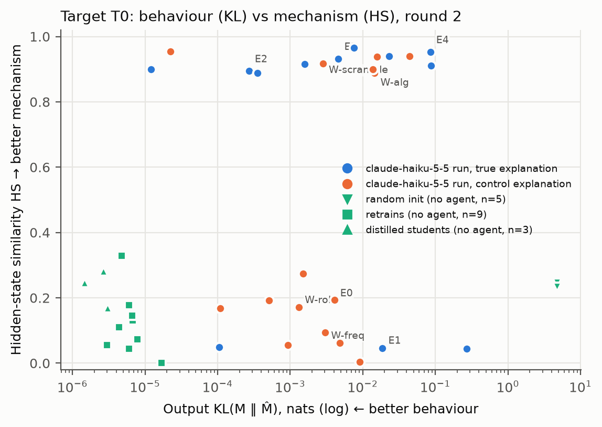
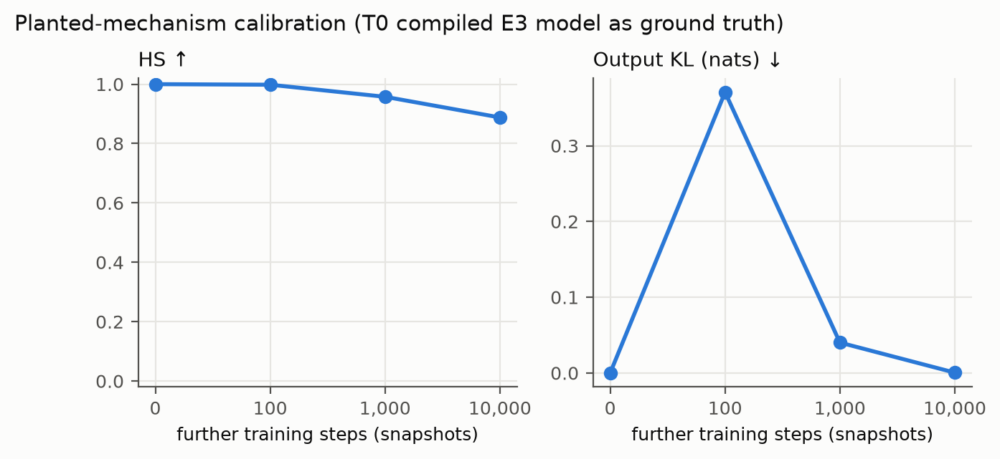
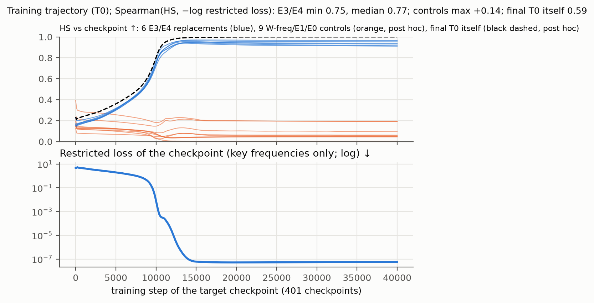
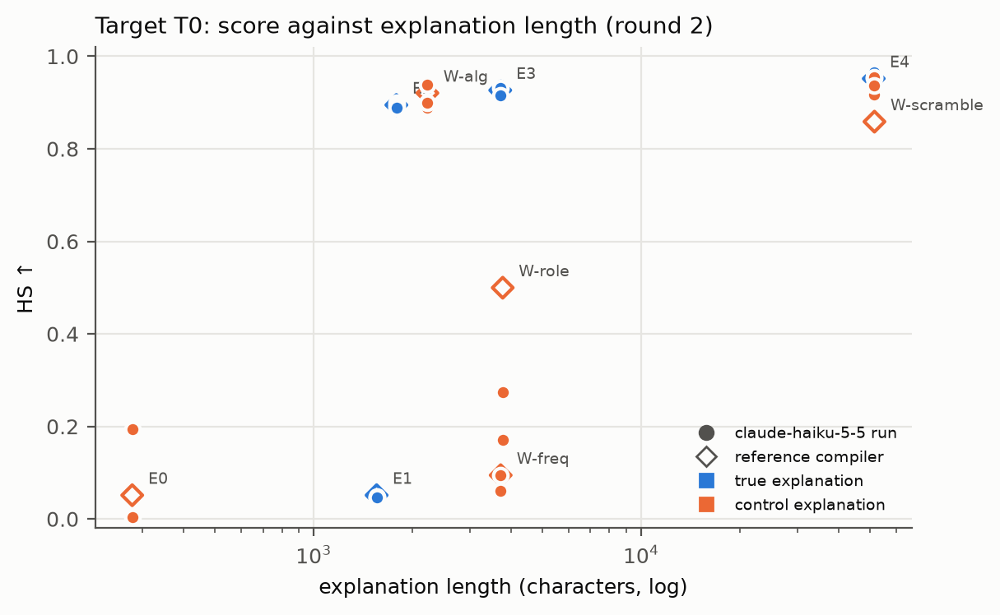

## Abstract

Interpretability agents can now produce mechanistic explanations faster than people can check them. We test one
automatic check: give the explanation, and nothing else, to an LLM agent that has never seen the network and has no
network access except its model endpoint, ask it to write every weight of a replacement network, and score the replacement against the
original by output KL divergence and by cross-validated hidden-state similarity (HS). The target is the one-layer
modular-addition transformer of Nanda et al. (2023). A script with weights access renders explanations at five levels
of true detail plus wrong explanations (length-matched except the Pizza one); Claude Haiku 5.5 in Claude Code, inside a
sandbox whose only connection is the model endpoint, builds the replacements; an agent-free reference compiler, independent retrains, logit-distilled students, random
initialisations, wrong targets and a planted-mechanism model calibrate the score. Hypotheses, metrics and analyses were
preregistered before any result (the main simulator was then fixed by a dated amendment after development runs on a
separate target, before any reported run). Results after two rounds (three runs per condition — not yet the preregistered ten):

<!-- BEGIN key-results -->
*Round 2, N = 3 run(s) per condition — not yet N=10*

- **Model-specific detail raises hidden-state similarity:** HS on T0 is 0.05 (E1, algorithm only), 0.89 (E2), 0.93 (E3) and 0.94 (E4); with no explanation (E0) it is 0.13. Monotone from E1 to E4; E0 lies above E1, against the preregistered prediction.
- **Correct behaviour from the wrong key frequencies is caught by HS, not by output KL:** the wrong-frequency replacement reaches KL 0.003 nats (true E3: 0.010) but HS 0.07.
- **Copying behaviour does not copy the mechanism:** independent retrains (HS 0.12) and logit-distilled students (HS 0.23, KL 2.38e-06) score no higher than randomly initialised networks (HS 0.24). HS's scale is therefore not anchored at 0 for unrelated networks: it measures overlap of internal features, and working networks built on other frequencies score below random ones.
- **Negative result:** at N = 3 the primary HS does not separate the Pizza explanation (W-alg, HS 0.91; E3 − W-alg +0.020, bootstrap CI [-0.008, +0.045]) or the scrambled neuron table (W-scramble, HS 0.94; E4 − W-scramble +0.007, CI [-0.025, +0.037]) from the true explanations (a failure to separate, not a demonstrated equivalence); the secondary matched-neuron correlation separates W-scramble (0.65) from E4 (0.91). The agent-free compiler's literal build of the scrambled table does score 0.09 below its E4 build on T0, mostly at resid_post: 0.69 vs 0.95; elsewhere the gap is within ±0.007 on T1, T-new, T-paper; on T2 the scrambled build scores 0.05 higher. Post hoc, by Zhong et al.'s distance irrelevance (≥ 0.4 Clock-like, < 0.4 Pizza-like) T0 is a Clock (0.75) and the literal Pizza build a Pizza (0.003), but the agents' replacements from the true E1–E3 are Pizza-like too (means 0.13–0.18; E4 0.41), and HS still rates the E2–E4 ones 0.89–0.94 against the Clock target, as high as the Pizza explanation's builds: at this N, HS did not separate Clock from Pizza mechanisms that share the key frequencies (no Clock-side build of an explanation exists to compare).
- **Memorisation (post hoc):** E0 and E1 contain nothing target-specific (identical text on every target, and the sandbox does not reveal the target), so their runs on T0 and on the published checkpoint are replicates of one condition. When the explanation gives no frequencies, the simulator often builds most of the published paper's frequencies {14, 35, 41, 42, 52} into its replacement (recall cued by the task description, which gives the paper's exact architecture and an outline of its training setup; no sandbox file names a frequency or the paper). E1 (6 runs on T0 and T-paper): 5 of 6 build scripts list at least four of the paper's five frequencies (3 of 6 replacements build at least four by the key-frequency rule, a lower bound); on average 68% of the replacements' W_L spectrum lies on those five frequencies (chance 9%); mean HS 0.08 against T0 but 0.70 against the published checkpoint (target swap: same weights, other target; range 0.24–0.95); E0 (3 runs on T0): 1 of 3 build scripts list at least four of the paper's five frequencies (1 of 3 replacements build at least four by the key-frequency rule, a lower bound); on average 36% of the replacements' W_L spectrum lies on those five frequencies (chance 9%); mean HS 0.13 against T0 but 0.28 against the published checkpoint (target swap: same weights, other target; range 0.03–0.63). On a published model, a high score can therefore come from the simulator's memory rather than the explanation (one published model and one simulator tested).
- **Cost:** the 96 reported Claude Haiku 5.5 runs cost $2.20 ($2.33 including development runs and plumbing checks).
<!-- END key-results -->

Output KL alone ranks a wrong-frequency explanation, independent retrains and distilled students as good as the true
explanations (the wrong-frequency one above E3 and E4); HS does not. At N = 3, HS did not separate the agents' builds of a
scrambled per-neuron table or of the Pizza algorithm from the true explanations' builds, both of which keep the key
frequencies (a literal, agent-free build of the scrambled table does lose <!-- v:a5-scr-t0 -->0.09<!-- /v --> HS on T0, but not on the other targets): by the output diagnostic of Zhong et al. (post hoc), T0 is a Clock but even the
replacements built from the true explanations are Pizza-like, and HS still rates them <!-- v:hs-e24 -->0.89–0.94<!-- /v -->. The "true" explanations are
true at the level of key frequencies and component roles, with one exception on T0: they say every component uses
frequency <!-- v:a5-weak-k -->2<!-- /v -->, which T0 has only in its neuron-to-logit map (post hoc, §3.2). When an explanation leaves the frequencies open, the simulator fills them in with
most of the published paper's frequencies from memory, cued by a task description that gives the paper's exact architecture and an outline of its training setup (a target swap shows the same weights fit the published
checkpoint), so targets whose mechanism is not in the simulator's training data are needed for interpretable scores.
The agent is not a literal compiler: it repairs explanations toward a working adder, guided by task accuracy (every run
checks it, through the provided self-test or its own code), so a score measures the explanation together with that repair.
At N = 3 the preregistered tests support the HS trend from E1 to E4 (H1's further prediction that E0 lies below E1 fails), the behaviour-mechanism dissociation,
the advantage over independent retrains, specificity to the explained network and (descriptively) a rise of HS against T0's training checkpoints during
circuit formation, which every network with T0's frequencies shows, T0's own final weights included (post hoc), so it
indicates shared frequency structure rather than a separate tracking of circuit formation; output KL's trend over the ladder is not supported, the true-versus-wrong comparisons cannot reach
significance with three runs per arm, and H4b is not supported because further training of the planted model first
disturbs and then restores its function (accuracy dips and recovers, and output KL follows it), so that control did not
test the grader as intended. On T0, the target of the preregistered H5 comparison, the agent stays within the agent-free
compiler's level; on the seed-sensitivity targets it exceeds it in <!-- v:h5-seed -->four of eleven target–explanation pairs on three targets<!-- /v --> (largest
<!-- v:h5-max -->+0.179 (T2 E3)<!-- /v -->), so the compiler is not a ceiling.

## 1 Introduction

Mechanistic interpretability explains a network by naming the algorithm its weights implement. In our view the evidence for
such an explanation forms a ladder: correlation, then steering, ablation and counterfactual swapping, and at the top
*simulation* — rebuilding the mechanism well enough to reproduce the model. As agents begin to generate explanations
at scale, grading them becomes the bottleneck, and the top rung is the one hardest to automate.

Existing automated scores simulate single features' activations with an LLM and correlate them with the real ones
([Bills et al. 2023](https://openaipublic.blob.core.windows.net/neuron-explainer/paper/index.html)), or replace
simulation with cheaper scorers such as detection and fuzzing ([Paulo et al. 2024](https://arxiv.org/abs/2410.13928)).
Even the most confident of Bills et al.'s GPT-2 XL neuron explanations have high error rates (F1 0.56 on 300 neurons
with score ≥ 0.8), and in interchange interventions even the top-scored explanations have causal effects similar to a
random baseline on most tasks ([Huang et al. 2023](https://arxiv.org/abs/2309.10312)); when LLM simulators predict a text
classifier's outputs from concept explanations (and, in an extension, attributions and rationales), the gains over
matched no-explanation baselines are statistically significant but small relative to their variability, which the
authors explain by a "shortcut hypothesis": the simulator's predictions rest mainly on task priors (with meaningful
class names it can solve the task directly), and explanations change them only slightly
([Poché et al. 2026](https://arxiv.org/abs/2609.08585)); and per-feature fuzzing scores of sparse-autoencoder latents
(detection in an appendix) are similar for trained and randomised transformers in many settings ([Heap et al. 2025](https://arxiv.org/abs/2501.17727)). [Gao (2026)](https://www.lesswrong.com/posts/Dkh7pXKjoNWkkxQDz/neural-networks-are-not-already-clean)
proposes substituting simulated activations and scoring downstream KL (cf. the ablation score of Bills et al., which
uses Jensen–Shannon divergence). We go one step further and let the simulator
write the *whole network's weights*, then ask the question that has to come first: **is the resulting score a valid
measure of explanation quality?** Concretely: does it rise with true detail, fall for wrong explanations, beat what
the training recipe or behavioural cloning give for free, and catch a wrong mechanism that still behaves correctly?

**Contributions.** (i) A weights-blind, sandboxed simulation grader for mechanistic explanations of an SGD-trained
transformer, with an output metric and a symmetry-aware hidden-state metric. (ii) A preregistered validation with a
scripted ladder of true explanations, wrong explanations, explanation-free baselines, wrong-target,
planted-mechanism and training-trajectory controls, and an agent-free reference compiler that separates what an
explanation contains from what the agent makes of it. (iii) Evidence (N = 3, one task family, one simulator) that output KL is
not a valid score on this task and that HS is, for frequency-level content, with two documented non-separations below
that level (scrambled per-neuron tables and Clock versus Pizza, as built by the agent). (iv)
Evidence (post hoc; the algorithm-only explanation is the same text on every target, and <!-- v:e1-mem -->five of six<!-- /v --> of its build
scripts list at least <!-- v:e1-k -->four<!-- /v --> of the paper's five frequencies) that a weights-blind simulator fills gaps in an explanation
with a memorised published mechanism, which can inflate scores on published models.

This project was developed in a mechanistic interpretability hackathon on automatically evaluating mechanistic
interpretability explanations, which the authors co-organized in their mechanistic interpretability community and
its Discord server, [mechinterp.com](https://mechinterp.com/).

## 2 Background and related work

**The target.** [Nanda et al. (2023)](https://arxiv.org/abs/2301.05217) reverse-engineered a one-layer transformer
(p = 113, d_model 128, four heads, 512 ReLU neurons, no LayerNorm) trained on (a + b) mod 113: it embeds a and b as
cos/sin(w_k a), cos/sin(w_k b) for a few key frequencies w_k = 2πk/113, forms cos/sin(w_k(a + b)) with attention and
the MLP, and reads out logit(c) ≈ Σ_k α_k cos(w_k(a + b − c)). The published explanation leaves per-neuron phases and
gains and most of the allocation of neurons to frequencies (only the k = 14 cluster's size is given) unspecified, and
gives the logit scale only as a plot of the fitted α_k over training (App. C.1.5, Fig. 14), not as numbers.
[Zhong et al. (2023)](https://arxiv.org/abs/2306.17844)
showed that a second algorithm ("Pizza") solves the same task with the same accuracy; its logits differ by a factor
|cos(w_k(a − b)/2)|, so full output distributions can still tell the two apart. [Gromov (2023)](https://arxiv.org/abs/2301.02679)
gives approximate closed-form weights for a two-layer MLP with quadratic activations that solves the same task, and [Yip et al. (2024)](https://arxiv.org/abs/2412.03773)
explain the MLPs of trained constant-attention (Pizza) models at p = 59 as numerical integration, with compact error
bounds; they also find these models' logits closer to the Clock form than to the Pizza form. Zhong et al. tell the two
algorithms apart by *distance irrelevance* (how little the correct-answer logit depends on a − b) and *gradient
symmetricity*; we apply both post hoc (§5).

**Explanations checked against weights.** Tracr ([Lindner et al. 2023](https://arxiv.org/abs/2301.05062)) compiles
programs to weights; causal abstraction ([Geiger et al. 2025, v1 2023](https://arxiv.org/abs/2301.04709)) and causal scrubbing
([Chan et al. 2022](https://www.alignmentforum.org/posts/JvZhhzycHu2Yd57RN/causal-scrubbing-a-method-for-rigorously-testing-interpretability-hypotheses))
test faithfulness by interventions, and [Sutter et al. (2025)](https://arxiv.org/abs/2507.08802) show that, under their
assumptions (countable inputs, input-injective and strictly output-surjective hidden layers, matchable partial
orderings of algorithm and network with at least one unused neuron per layer, and a network that solves the task; their conclusion calls injectivity and surjectivity
strong, their introduction "relatively weak"), unrestricted alignment maps make any algorithm an input-restricted distributed abstraction of any network,
so the alignment class must be justified case by case.
[Cammarata et al. (2021)](https://distill.pub/2020/circuits/curve-circuits/) hand-built one curve-detector circuit and
compared its activations with the natural one — our idea, done by hand for one circuit. Compact proofs
([Gross et al. 2024](https://arxiv.org/abs/2406.11779)) measure an explanation by the length of the proof it yields
(asymptotic cost and estimated FLOPs) against the tightness of the bound, with brute-force evaluation on every input as
the longest of their proof strategies.

**Agents that write weights.** The closest work, iWSP ([Mehta et al. 2026](https://arxiv.org/abs/2611.18114)), has
an LLM agent (Claude Code with Claude 5.5 models on its benchmark tasks; other agents for its brain-encoding models)
write small models' weights in code and rebuild them in fresh sessions from a ≤ 200-word description, with
a no-description control; it rebuilds only agent-written models, scores by accuracy and prediction correlation
(feature CKA for one model) and uses no output KL; it builds on [Takehi et al. (2026)](https://rikiyat.github.io/blog/weight-space-programming/),
where an LLM reads, edits and writes network weights. The LLM behind an interpretability agent (Claude Opus 4.1) listed
the published IOI circuit's components from memory when prompted ([Haklay et al. 2026](https://arxiv.org/abs/2603.20101)),
which is why our main targets are analysed in no paper.

**What is new here** is the combination: an SGD-trained target, a weights-blind agent that compiles a
mechanistic explanation into a full replacement, output KL plus a symmetry-aware hidden-state metric, explanation-length
accounting, and no-explanation, wrong-explanation, wrong-target and planted-mechanism controls. Each ingredient has
precedent (full review: `reports/literature-review.md`).

## 3 Method

### 3.1 Targets

All targets share the architecture and training recipe of Nanda et al. (full-batch AdamW, lr 10⁻³, weight decay 1,
30 % training split, 40,000 full-batch steps — the paper's 40,000 epochs) and reach 100 % test accuracy. T0 is the main
target (the first `wd1` seed whose key frequencies differ from the paper's; `wd1_s0` has exactly the paper's); among
the other published `wd1` seeds T2 has the most key frequencies (<!-- v:a5-t2 -->six<!-- /v -->) and T1 the fewest (<!-- v:a5-t1 -->3, tied with `wd1_s9`<!-- /v -->; the preregistered rule took the lower seed; published key frequencies of every seed and the rules applied: `results/targets_selection.json`); T-new was trained after the
protocol freeze, so no development choice could be tuned to it; T-paper is the paper's own checkpoint
(contamination-flagged: its explanation is published); the dev target was used for all development, and no dev-target
agent result is reported (it serves only as one of the wrong targets in H7). No paper analyses T0–T2, but their
weights and an automated analysis that lists their key frequencies (e.g. `wd1_s1/analysis/key_freqs.json`) were
uploaded to the public [BurnyCoder/grokking-modular-addition-runs](https://huggingface.co/BurnyCoder/grokking-modular-addition-runs)
(with dev) on 2026-10-21 (repository creation and first upload commit) — after Claude Haiku 5.5's June 2026 training-data cutoff
([models overview](https://platform.claude.com/docs/en/models/overview)) and after its release on 2026-10-07 ([model page](https://platform.claude.com/docs/en/models/haiku-5-5/overview)) — and the sandbox has no internet
access, so the simulator cannot have seen them. T-paper is the paper's checkpoint
([callummcdougall/grokking_full_run_data](https://huggingface.co/callummcdougall/grokking_full_run_data)); T-new
(`new_s11`) was trained by this project.

<!-- BEGIN targets -->
| Target | run | role | key frequencies | neurons per key frequency | unclustered neurons | logit fit FVE | loss (all 113² inputs) |
|---|---|---|---|---|---|---|---|
| T0 | `wd1_s1` | main target | 2, 3, 23, 37, 39 | 0, 197, 49, 42, 99 | 125 | 0.933 | 2.06e-07 |
| T1 | `wd1_s4` | seed sensitivity (fewest frequencies) | 11, 25, 49 | 154, 111, 156 | 91 | 0.984 | 1.36e-07 |
| T2 | `wd1_s8` | seed sensitivity (most frequencies) | 37, 44, 45, 46, 47, 51 | 58, 63, 81, 78, 88, 79 | 65 | 0.949 | 8.42e-07 |
| T-new | `new_s11` | held-out, trained after the protocol freeze | 22, 37, 41, 51 | 138, 77, 79, 130 | 88 | 0.954 | 2.41e-07 |
| T-paper | `paper` | published checkpoint (contamination-flagged) | 14, 35, 41, 42, 52 | 44, 93, 145, 87, 64 | 79 | 0.961 | 2.41e-07 |
| dev | `wd1_s10` | development only (never reported) | 19, 31, 45, 47 | 80, 81, 189, 79 | 83 | 0.970 | 1.77e-07 |
<!-- END targets -->

### 3.2 Explanations

A script reads each target's weights, runs the paper's Fourier analysis (via the paper-faithful
[grokviz](https://github.com/BurnyCoder/visualizing-grokking-modular-addition-in-transformer) package) and renders:
**E0** the task and architecture only; **E1** the Fourier-multiplication algorithm, including the precise neuron function (amendment 2.3), without
model-specific numbers; **E2** the key frequencies and each component's role; **E3** adds per-frequency amplitudes,
neurons per frequency, attention-pattern fits and the logit scale; **E4** adds a per-neuron table (frequency, phase,
gain). Wrong controls: **W-freq** is E3 with the key frequencies swapped for other valid ones (a working adder with a
different mechanism), **W-alg** describes the Pizza algorithm (preregistered as E3-length, it is about <!-- v:walg-shorter -->40<!-- /v --> % shorter than E3 on average over the targets, so the E3 > W-alg comparison is not length-controlled; deviation 8), **W-role** misattributes component roles,
**W-scramble** reassigns each E4 neuron's frequency at random among the key frequencies and redraws its phases. **E-paper** paraphrases the
published explanation with the paper's numbers (T-paper only). No number in an explanation is typed by hand; every
explanation's length is recorded.

*What "key frequency" means here (post hoc, audit 5).* The key frequencies are those whose Fourier norm in the
neuron-to-logit map W_L = W_U·W_out reaches 0.25 of its maximum (grokviz's rule; Nanda et al. find six frequencies with non-negligible norm in their main model's embedding W_E and
call the five that later parts use the key frequencies, §4.1, and take the frequencies with non-trivial W_L
coefficients for their other runs, App. C.2; on T0 the embedding and W_L give different sets, as shown next), and E2–E4 state that the embedding, attention, MLP and unembedding all use
this set. That is not exact on every target (`results/audit5/checks.json`). On T0, frequency <!-- v:a5-weak-k -->2<!-- /v --> passes the
threshold in W_L only (<!-- v:a5-weak-wl -->0.27<!-- /v --> of the maximum; next frequency <!-- v:a5-weak-next -->0.10<!-- /v -->), has no clustered neuron, reaches
<!-- v:a5-weak-we -->0.17<!-- /v --> in the embedding, and gets <!-- v:a5-weak-share -->99.7% of W_L's k = 2 energy from neurons of frequency 37<!-- /v --> (<!-- v:a5-weak-harm -->2 ≡ −3·37<!-- /v --> mod 113, consistent with a
ReLU harmonic; an inference, not tested further); the embedding's own above-threshold set is <!-- v:a5-t0-emb -->{3, 6, 23, 37, 39}<!-- /v -->.
Embeddings also carry above-threshold frequencies that the explanations do not mention, each a multiple of a key
frequency (<!-- v:a5-emb-extra -->T0 6 ≡ 2·3; T2 23 ≡ −2·45, 39 ≡ −2·37; T-new 31 ≡ −2·41; T-paper 31 ≡ −2·41<!-- /v -->). E3 does show frequency 2's weakness in its numbers (no neurons, a
small embedding norm, a poor read-out fit), but E2's text and the "all four steps" sentence describe it as a full
key frequency. So T0's E2–E4 are true at the level of frequencies and component roles except for this weak,
read-out-only frequency; the protocol froze the rendering, so it is reported, not changed (deviation 12).

### 3.3 Simulator and sandbox

The simulator is Claude Haiku 5.5 in Claude Code 2.1.330 (`--bare`, permissions bypassed inside the sandbox, web
tools disallowed, default sampling, effort `medium`). It runs in a bubblewrap sandbox in WSL2 in its own empty network
namespace (no interface but loopback), with a cleared environment, no Windows drives or home directory, and AF_VSOCK blocked by seccomp; it
reaches the model only through a unix socket to a proxy outside the sandbox that injects the API key, allows only the
Messages endpoint and the run's models, rejects server-side tools with internet access, and enforces per-run and total
budgets. The sandbox holds `TASK.md`, `EXPLANATION.md` (with `neurons.csv` for E4 and W-scramble), `ARCHITECTURE.md`, a numpy `forward.py`, a `selftest.py`
that checks shapes and accuracy against the task labels (never against M), and a starter `build_weights.py`. Training
loops and iterative optimisation are forbidden in the build script; build scripts are audited for gradient-descent and
optimiser patterns and flagged ones reviewed by hand (no reported run was flagged). That audit does not catch
derivative-free searches: reading every final build script (post hoc, audit 7) found <!-- v:a7-search -->7 of 96<!-- /v --> that
themselves try several values of one constant (or random frequency sets, or an 8-step calibration of an attention
score) and keep the best, judged by <!-- v:a7-search-kinds -->a least-squares fit to a quantity the explanation states (5), task accuracy (1) or an analytic formula (1)<!-- /v -->;
none is a T0 main or controls run, so no hypothesis test uses one; on the seed targets dropping them changes no
verdict, no H3 reading and no "beyond the CI" comparison with the compiler, only a sign-only count
(<!-- v:a7-search-sign -->agent above compiler by sign in 5 rather than 6 of 11 pairs<!-- /v -->; `scripts/audit7/build_script_searches.py`). Nor does the audit see what an agent tries in scratch copies: in <!-- v:tune-said -->44 of 96<!-- /v --> reported runs its
narration announces trying several values of a constant — mostly an MLP bias or gain, also the logit scale, an attention
gain or the frequency set — judged by self-test accuracy or a least-squares fit (post hoc; every candidate sentence read
in audit 6, because a pattern match flags <!-- v:tune-regex -->41, two of them false matches and three mentions of tuning without a search, and misses eight<!-- /v -->; Appendix D); <!-- v:own-check -->27 of 96<!-- /v --> runs also
scored accuracy with their own code (`forward.labels()` or (a + b) mod 113) rather than `selftest.py`. Both criteria
use only the task labels, so no target information enters, but the replacement is shaped by the task as well as by
the explanation. `TASK.md` describes the hidden-state comparison as allowing "any reordering/positive rescaling of
neurons"; the metric in fact allows any linear recombination of them (§3.4). Runs are capped at
60 minutes and $2 (Claude Code's `--max-budget-usd`, a client-side estimate, backed by the proxy's ledger-based per-run cap); no turn cap was set (Claude Code's `--max-turns` was not used), although
`TASK.md` tells every agent it has about 60 minutes and 60 steps, a step limit only the local harness enforces. Local Qwen models (Qwen3.6-35B-A3B, Qwen3.5-9B, Qwen3.5-4B) in a bash-only harness modelled on
[mini-SWE-agent](https://github.com/SWE-agent/mini-swe-agent) were planned as the simulator-capability ablation: in
development none of them exceeded 5 % task accuracy, which made Haiku the main simulator by a rule fixed before any
Claude run (preregistration amendment 2). In round 1 all <!-- v:n-local -->five<!-- /v --> local runs that finished (<!-- v:local-by-model -->Qwen3.5-4B × 4, Qwen3.5-9B × 1<!-- /v -->)
built constant-output networks, and the remaining local runs were stopped by the first author's decision after seeing
these results (preregistration deviation 5, a results-driven stop disclosed as such).

### 3.4 Grader

**Output KL:** mean KL(P_M ‖ P_M̂) over all 12,769 inputs and 113 classes, in nats, float64 (the direction used by
[Conmy et al. 2023](https://arxiv.org/abs/2304.14997)). **Hidden-state
similarity (HS):** at three final-position sites (residual stream after attention, MLP activations, final residual
stream), 5-fold cross-validated ridge-regression R² in both directions (M̂ → M and M → M̂), combined by harmonic mean
per site and averaged over sites. Linear maps are the alignment class because, without LayerNorm, the residual stream
is defined only up to an invertible linear map; unrestricted non-linear maps can make every network match every
algorithm under Sutter et al.'s assumptions ([Sutter et al. 2025](https://arxiv.org/abs/2507.08802)), so we restrict to linear maps, a restriction
Sutter et al. themselves suggest when representations are linear (their §1 and §8); here it is an assumption, not a result. This rationale holds for the two residual sites only: the MLP neurons' symmetry group is
permutation and positive per-neuron scaling, and a linear regression over `mlp_post` also allows any linear
recombination of neurons, a wider class than the symmetry group (erratum, deviation 10). The matched-neuron correlation
below is the metric matched to that group. Completeness R²(M̂ → M) is invariant to any invertible linear map of M̂'s basis (up to the small
ridge term); soundness
R²(M → M̂), pooled over M̂'s dimensions, only to orthogonal maps and uniform scaling of M̂'s basis (regression R² is
invariant only in its predictor; [Kornblith et al. 2019](https://arxiv.org/abs/1905.00414), Table 1), and HS = 1
(up to the ridge term) when each model's states are an affine function of the other's. A whitened soundness, invariant in both
directions, is reported as a post-hoc check (Appendix B). HS's scale is not anchored at 0 for unrelated networks. Secondary metrics include matched-neuron correlation (optimal one-to-one assignment on correlations, [Li et al. 2016](https://arxiv.org/abs/1511.07543)), linear CKA ([Kornblith et al. 2019](https://arxiv.org/abs/1905.00414)), orthogonal Procrustes distance ([Ding et al. 2021](https://arxiv.org/abs/2108.01661)), stitching KL (model stitching, [Bansal et al. 2021](https://arxiv.org/abs/2106.07682), here with an affine stitch fitted by least squares; invariances as surveyed by [Klabunde et al. 2025](https://arxiv.org/abs/2305.06329)), centred-logit FVU and temperature-calibrated KL. A run without valid weights is scored as a failure. An independent numpy/scikit-learn re-implementation of the forward pass and of both primary
metrics, written from the preregistration, reproduces every stored score that has its own weight file, plus a sample of
the H8 trajectory gradings (<!-- v:audit4-regrade -->261 stored scores, largest HS difference 1.3e-10; the Fourier-restricted baseline and a systematic sample of 165 H8 trajectory gradings, largest HS difference 1.9e-11<!-- /v -->; audit 4, `scripts/audit4/regrade.py`). A second re-implementation, written for audit 5 from `ARCHITECTURE.md` (the specification the agents receive) and §4 of the preregistration, re-grades every score the hypothesis tests use — all reported runs, compiler builds, retrains, students, random initialisations, planted snapshots, every H7 wrong-target grading and every 40th H8 checkpoint (<!-- v:a5-regrade -->306 gradings, largest differences 1.3e-10 in HS and 4.4e-12 in KL<!-- /v -->; `scripts/audit5/regrade_independent.py`); taking the R² denominator about the held-out fold's own mean instead of the training-fold mean, a choice §4 leaves open, changes any run's HS by at most <!-- v:a5-r2conv -->7.6e-04<!-- /v --> and leaves <!-- v:a5-r2conv-verdicts -->19 of 19<!-- /v --> run-based verdicts unchanged (H7's margins and H8's correlations are orders of magnitude larger than the change).

### 3.5 Controls, baselines and statistics

Controls: E0 and the W-* explanations through the agent; random initialisations; every T0 E3/E4 replacement graded against
the preregistered <!-- v:a5-nwrong -->twelve<!-- /v --> wrong targets — T1, T2, dev, T-paper and models trained without a clean mechanism
(`wd0_s0`–`s4`, weight decay 0; `rand_s0`–`s2`, random labels) — (H7; T-new is not among them); the reference-compiled E3 model trained
further and graded against its own snapshots (planted mechanism, H4b); every T0 E3/E4 replacement graded against each of T0's 401
training checkpoints next to the paper's restricted loss (H8; deviation 8 — rounds 1–2 had used one replacement and
every 10th checkpoint). Baselines: nine independent retrains (the `wd1` seeds other than T0 and the dev target:
<!-- v:a5-retrains -->wd1_s0, s2–s9<!-- /v -->, so they include T1 = `wd1_s4`, T2 = `wd1_s8` and `wd1_s0`, which has the paper's frequencies; the
preregistration's "9 other `wd1` seeds", and its "for T-paper also `wd1_s0`", leave the dev exclusion implicit), three students distilled on M's full logits, the reference compiler for every explanation, M with only its
key-frequency Fourier components kept in the embedding and unembedding, and the weights themselves. Every condition
is planned in three rounds (N = 1, 3, 10 replicate runs; local Qwen conditions ran only in round 1, and round 3 is
postponed; Claude's sampling cannot be seeded, so a run's seed index labels a replicate, while for the local models it is the sampling seed); every hypothesis is evaluated after every round with Jonckheere–Terpstra
(Terpstra 1952; Jonckheere 1954) and Spearman trend tests (H1), one-sided Mann–Whitney tests with Holm correction
(Holm 1979; effect size: rank-biserial r, Kerby 2014) (H2, H4), Kendall's W (Kendall & Babington Smith 1939) (H6) and
Wilcoxon signed-rank tests (H7), with percentile-bootstrap intervals (with three runs per arm the interval of a mean is
the range of the runs, which misses the median when all three fall on one side of it, so its coverage is about
<!-- v:a5-cov-mean -->75%<!-- /v -->, not 95 %, and about <!-- v:a5-cov-diff -->80%<!-- /v --> for a difference of two means — our calculation and a normal-data simulation,
`results/audit5/checks.json`; [Hesterberg 2015](https://arxiv.org/abs/1411.5279) on percentile intervals being too narrow in small samples); H5 compares the agent with the compiler on T0 (other targets are reported as an
extension). A test whose smallest attainable p-value at the current N is ≥ 0.05 returns "cannot tell at this N" (a rule added by
deviation 1, before any verdict but after some per-run scores had been seen, and applied at N = 3 by deviation 7 after
the N = 3 verdicts were first read; §5's falsification column read literally — "not significant after Holm" — makes the
four H2 comparisons "not supported" instead, and the predictions table in §4.7 shows both readings).
Trend-test p-values enumerate every assignment of runs to levels exactly (369,600 for H1's four levels × three runs;
earlier versions used a Monte-Carlo estimate above 50,000 assignments, which covered H1, deviation 10).
As preregistered, Holm correction is applied within H2 and within H4 only, with no correction across hypotheses. The preregistration, two dated amendments and every post-freeze deviation are in
`reports/preregistration.md`. All fourteen post-freeze deviations were made after some per-run scores had been seen
(deviation 1 says so; deviations 1–4, during round 1, brought the analysis code in line with amendment 2, reordered
stages, re-ran an infrastructure failure and repaired a secondary metric, changing no hypothesis, test or condition);
ten came after round-level results or because of them and are disclosed as such: the results-driven stop of
the local runs (deviation 5), the postponement of round 3 (deviation 6, scheduling only), two analysis-code corrections made when the N = 3 verdicts were first read (deviation
7; neither turned a verdict into "supported"), the audit's additions of missing preregistered statistics, the
preregistered form of H8 and an erratum on HS's invariance (deviation 8; no verdict changed), and a second audit's
errata and post-hoc checks (deviation 9: contamination wording, scope of H5, self-test tuning, turn cap, H8 negative
controls, pooled memorisation analysis, exact trend test; no verdict changed), and a third audit's corrections
(deviation 10: H1's E0 clause given its own verdict, the T-paper replication run over every ladder level it has, an
exact trend test for H1, the self-test ablation's scope, the alignment class at `mlp_post`, and post-hoc Clock/Pizza
diagnostics; no preregistered test result changed, H1's reported verdict now shows its failed E0 clause), and a fourth
audit's corrections (deviation 11: every stored score that has its own weight file re-graded and every test recomputed with independent code, all
reproduced; the readings of H4b and H8 corrected; the true coverage of three-run bootstrap intervals stated; citations
corrected and missing method references added; no verdict changed), and a fifth audit's corrections (deviation 12:
every verdict re-derived with exact methods from the raw records, <!-- v:a5-hyp -->88 of 88<!-- /v --> stored statistics, verdicts and published values of rounds 1 and 2 reproduced,
`scripts/audit5/hypotheses_check.py`; every score those tests use re-graded with an independent forward pass and ridge, all
reproduced; T0's read-out-only frequency 2 in the "true" explanations; the scrambled-table
blind spot narrowed to the agents' builds; this count of deviations made after results; citation and wording
precision; no verdict changed), and a sixth audit's corrections (deviation 13: every verdict re-derived again with new
code, <!-- v:a6-verdicts -->29 of 29<!-- /v --> checks agree, `scripts/audit6/verdicts.py`; the scores re-graded by a third, numpy-only
implementation, <!-- v:a6-regrade -->99 gradings, largest differences 1.3e-10 in HS and 5.4e-12 in KL<!-- /v -->, `scripts/audit6/regrade_numpy.py`; the agents' parameter searches
counted by reading instead of a pattern match; H2's literal §5 reading shown beside "cannot tell"; Zhong et al.'s
Fig. 7, Sutter et al.'s linear restriction, Nanda et al.'s key-frequency rule and the task description's "exact recipe"
stated as in the sources; no verdict changed), and a seventh audit's corrections (deviation 14: every verdict
re-derived by code that uses neither the project's analysis code nor scipy, <!-- v:a7-verdicts -->40 of 40<!-- /v --> checks agree,
`scripts/audit7/verdicts.py`; the T0 scores the tests use re-graded with numpy from `ARCHITECTURE.md`,
<!-- v:a7-regrade -->36 gradings, largest differences 1.2e-11 in HS and 1.3e-11 in KL<!-- /v -->, `scripts/audit7/regrade.py`; searches inside <!-- v:a7-search -->7 of 96<!-- /v --> final build scripts
that the static audit missed, disclosed in §3.3 with the seed-target results without them; Nanda et al.'s logit scale
and key-frequency reading, Gromov, Gross et al., Huang et al., Poché et al. and iWSP stated as in the sources; no
verdict changed).

## 4 Results (rounds 1–2, N = 3 per condition)

### 4.1 Explanation ladder and controls on T0

<!-- BEGIN scoreboard-T0 -->
| Explanation | role | chars | N | agent accuracy | agent KL_out ↓ | agent HS ↑ | agent matched-neuron corr ↑ | compiler KL_out ↓ | compiler HS ↑ |
|---|---|---|---|---|---|---|---|---|---|
| E0 | control: no mechanism | 279 | 3 | 1.000 ± 0.000 | 0.005 ± 0.004 | 0.130 ± 0.109 | 0.056 ± 0.031 | 1.64e-04 | 0.051 |
| E1 | method | 1556 | 3 | 1.000 ± 0.000 | 0.097 ± 0.152 | 0.046 ± 0.002 | 0.028 ± 1.59e-04 | 1.64e-04 | 0.051 |
| E2 | method | 1788 | 3 | 1.000 ± 0.000 | 2.12e-04 ± 1.78e-04 | 0.894 ± 0.005 | 0.669 ± 0.005 | 1.30e-05 | 0.895 |
| E3 | method | 3712 | 3 | 1.000 ± 4.70e-04 | 0.010 ± 0.012 | 0.929 ± 0.012 | 0.759 ± 0.060 | 4.25e-04 | 0.927 |
| E4 | method | 51329 | 3 | 0.986 ± 0.012 | 0.060 ± 0.045 | 0.943 ± 0.028 | 0.913 ± 0.044 | 0.010 | 0.952 |
| W-freq | control: wrong frequencies | 3724 | 3 | 1.000 ± 9.04e-05 | 0.003 ± 0.002 | 0.070 ± 0.021 | 0.030 ± 1.64e-04 | 0.001 | 0.095 |
| W-alg | control: wrong algorithm (Pizza) | 2224 | 3 | 1.000 ± 0.000 | 0.024 ± 0.017 | 0.909 ± 0.027 | 0.737 ± 0.061 | 0.040 | 0.921 |
| W-role | control: wrong component roles | 3777 | 3 | 1.000 ± 2.71e-04 | 9.80e-04 ± 7.60e-04 | 0.204 ± 0.060 | 0.013 ± 0.002 | 4.727 | 0.500 |
| W-scramble | control: scrambled neurons | 51590 | 3 | 0.998 ± 0.004 | 0.006 ± 0.008 | 0.936 ± 0.018 | 0.653 ± 0.027 | 2.02e-05 | 0.859 |
<!-- END scoreboard-T0 -->

E0 and E1 produce working adders (task accuracy <!-- v:e01-acc -->1.000<!-- /v -->) whose hidden states share almost nothing with T0: the
simulator's priors supply *an* algorithm, not *this model's* mechanism. Naming the key frequencies (E2) lifts HS close
to the reference compiler's value; E3 adds a few hundredths in every run (under the preregistered HS; E2 and E3 tie under the post-hoc whitened check, Appendix B) and E3 → E4 is mixed. Wrong frequencies
and wrong component roles give working adders with low HS. The agents' builds of the Pizza description and of the
scrambled neuron table score like true explanations on HS; the matched-neuron correlation separates the scrambled table
from E4, and so does HS for the compiler's literal builds on T0 (<!-- v:a5-scr-t0 -->0.09<!-- /v --> lower for the scrambled table; elsewhere the gap is <!-- v:a5-scr-other -->within ±0.007 on T1, T-new, T-paper; on T2 the scrambled build scores 0.05 higher<!-- /v -->; Appendix A). The compiler's E0 column is its own
default Clock build: E0 states no algorithm, and the compiler then builds the same network as for E1.

### 4.2 Behaviour is not mechanism

<!-- BEGIN baselines-T0 -->
| Reference point | what it has | n | task accuracy | KL_out ↓ | HS ↑ |
|---|---|---|---|---|---|
| Random initialisation | nothing (floor) | 5 | 0.009 ± 0.001 | 4.766 ± 0.006 | 0.236 ± 0.006 |
| Independent retrains | same recipe, other seeds | 9 | 1.000 ± 0.000 | 6.90e-06 ± 3.96e-06 | 0.119 ± 0.097 |
| Logit-distilled students | M's full output logits, no explanation | 3 | 1.000 ± 0.000 | 2.38e-06 ± 8.25e-07 | 0.233 ± 0.058 |
| Fourier-restricted M | M's weights, key frequencies only in W_E/W_U | 1 | 1.000 | 0.002 | 0.992 |
| Weights dump | all 226,816 weights | 1 | 1.000 | 0.000 | 1.000 |
<!-- END baselines-T0 -->

Independent retrains and logit-distilled students reproduce T0's outputs more closely than the explanation-built
replacements on average, yet their HS is at or below the random-initialisation floor. The W-freq replacement likewise has small
output KL and low HS. Output KL alone would rank all of these about as high as the true explanations; HS ranks them at the
bottom. Keeping only T0's key-frequency components in its embedding and unembedding leaves HS almost unchanged: the
key frequencies carry nearly all of what HS measures.

The output examples show what the scores summarise. The E3 replacement builds the target's frequencies; the E1
replacement builds most of the published checkpoint's frequencies (Section 4.6); W-freq builds other frequencies; the Pizza
replacement (W-alg) builds the same frequencies as the target, which is why HS did not separate it; an independent
retrain converges to a different frequency set; a random network has a flat spectrum.

### 4.3 Calibration, specificity and training dynamics

<!-- BEGIN controls-T0 -->
| Planted model trained further (steps) | HS ↑ | KL_out | snapshot task accuracy |
|---|---|---|---|
| 0 | 1.000 | 0.000 | 1.0000 |
| 100 | 0.998 | 0.371 | 0.9774 |
| 1000 | 0.957 | 0.040 | 0.9958 |
| 10000 | 0.888 | 4.25e-04 | 1.0000 |

| Replacement | HS vs T0 | best wrong target (HS) | d = HS(T0) − max HS(wrong) |
|---|---|---|---|
| E3 | 0.939 | T2 (0.274) | 0.665 |
| E3 | 0.932 | T2 (0.240) | 0.693 |
| E3 | 0.915 | T2 (0.290) | 0.626 |
| E4 | 0.912 | T2 (0.226) | 0.685 |
| E4 | 0.953 | T2 (0.227) | 0.726 |
| E4 | 0.965 | T2 (0.258) | 0.708 |
<!-- END controls-T0 -->

On the planted mechanism, HS is 1 at step 0 and falls monotonically as training moves the model away from the
planted construction; output KL first rises and then falls again: the planted model does not drift monotonically in
function (its accuracy dips most after 100 steps), KL tracks that, and HS barely moves there. The preregistered
monotone-drift assumption, not necessarily the grader, is what fails. T0's E3/E4 replacements fit T0 much better
than any other target. Against T0's checkpoints, HS of the E3/E4 replacements rises during circuit formation in step
with the fall of the restricted loss. Because a rank correlation along one training run is positive for many pairs of
quantities that trend with time, the same correlation was computed for replacements built without T0's mechanism
(W-freq, E1, E0; post hoc negative controls, orange in the figure): their ρ is at most <!-- v:h8-ctrl-max -->+0.14<!-- /v --> and
<!-- v:h8-ctrl-neg -->eight of nine<!-- /v --> are negative, so the rise is specific to replacements that carry T0's frequencies. *Reference networks (post hoc,
audit 4; `scripts/audit4/h8_positive_control.py`).* The same correlation for networks that are not agent replacements
shows what it can mean. During circuit formation (the <!-- v:h8-nform -->150<!-- /v --> checkpoints up to step <!-- v:h8-split -->14,900<!-- /v -->, after which the
restricted loss stays within 20 % of its minimum) every network that carries T0's frequencies — final T0 itself, T0
restricted to its key frequencies, the agent-free compiler's E3 build and all six replacements — rises in step with the
restricted loss (ρ ≥ <!-- v:h8-form -->0.996<!-- /v -->), and an independent retrain falls (<!-- v:h8-form-retrain -->-1.00<!-- /v -->). In the <!-- v:h8-nplat -->251<!-- /v --> checkpoints after
grokking the restricted loss creeps up (<!-- v:h8-rl-drift -->5.2e-08 to 5.7e-08<!-- /v -->), every replacement's HS drifts down (plateau ρ
<!-- v:h8-plat-rep -->0.69<!-- /v -->) while final T0's drifts up (<!-- v:h8-plat-final -->-0.69<!-- /v -->), and this plateau sets the size of the whole-trajectory ρ: final T0
itself gets <!-- v:h8-pos-final -->0.59<!-- /v -->, below every replacement, T0 restricted to its key frequencies <!-- v:h8-pos-fr -->0.99<!-- /v --> and the compiler's E3 build
<!-- v:h8-pos-comp -->0.88<!-- /v -->. So H8 shows that the replacements share T0's frequency structure and therefore resemble T0's checkpoints
once that structure has formed; it does not show a separate ability of HS to track circuit formation, and the size of
ρ does not order networks by faithfulness (the phase split is post hoc).

### 4.4 Explanation length

### 4.5 Ablations, sensitivity and other targets

Ablations and hyperparameter variants on T0, next to the unablated condition:

<!-- BEGIN ablations-T0 -->
| Change | Explanation | Simulator | N | task accuracy | KL_out ↓ | HS ↑ | matched-neuron corr ↑ |
|---|---|---|---|---|---|---|---|
| none (main condition) | E3 | claude-haiku-5-5 | 3 | 1.000 ± 4.70e-04 | 0.010 ± 0.012 | 0.929 ± 0.012 | 0.759 ± 0.060 |
| explanation as maths | E3 | claude-haiku-5-5 | 3 | 0.999 ± 0.002 | 0.003 ± 0.004 | 0.915 ± 0.003 | 0.771 ± 0.036 |
| explanation as code | E3 | claude-haiku-5-5 | 3 | 1.000 ± 9.04e-05 | 0.002 ± 3.96e-04 | 0.897 ± 0.030 | 0.805 ± 2.48e-04 |
| self-test removed | E3 | claude-haiku-5-5 | 3 | 1.000 ± 3.62e-04 | 0.004 ± 0.002 | 0.942 ± 0.025 | 0.765 ± 0.043 |
| effort low | E3 | claude-haiku-5-5 | 3 | 0.853 ± 0.252 | 0.661 ± 1.137 | 0.921 ± 0.003 | 0.751 ± 0.027 |
| effort high | E3 | claude-haiku-5-5 | 3 | 1.000 ± 0.000 | 0.001 ± 7.17e-04 | 0.936 ± 0.034 | 0.791 ± 0.025 |
| none (main condition) | W-freq | claude-haiku-5-5 | 3 | 1.000 ± 9.04e-05 | 0.003 ± 0.002 | 0.070 ± 0.021 | 0.030 ± 1.64e-04 |
| effort low | W-freq | claude-haiku-5-5 | 3 | 0.923 ± 0.133 | 0.344 ± 0.594 | 0.088 ± 0.025 | 0.061 ± 0.031 |
| effort high | W-freq | claude-haiku-5-5 | 3 | 1.000 ± 0.000 | 0.001 ± 6.05e-04 | 0.093 ± 0.005 | 0.032 ± 0.003 |
| simulator qwen3.5-4b | E2 | qwen3.5-4b | 1 | 0.009 | 4.727 | 0.000 | 0.000 |
| simulator qwen3.5-4b | E3 | qwen3.5-4b | 1 | 0.009 | 4.727 | 0.000 | 0.000 |
| simulator qwen3.5-4b | E4 | qwen3.5-4b | 1 | 0.009 | 4.727 | 0.000 | 0.000 |
| simulator qwen3.5-4b | W-freq | qwen3.5-4b | 1 | 0.009 | 6.066 | 0.000 | 1.41e-16 |
| simulator qwen3.5-9b | E2 | qwen3.5-9b | 1 | 0.009 | 7.628 | 0.000 | 0.000 |
<!-- END ablations-T0 -->

All agent runs of the round:

<!-- BEGIN runs -->
| Stage | Target | Explanation | Simulator | T | Variant | N | failed | accuracy | KL_out ↓ (mean ± sd) | HS ↑ (mean ± sd) |
|---|---|---|---|---|---|---|---|---|---|---|
| ablations | T0 | E2 | qwen3.5-4b | 0.6 | – | 1 | 0 | 0.009 | 4.73 | 0.000 |
| ablations | T0 | E2 | qwen3.5-9b | 0.6 | – | 1 | 0 | 0.009 | 7.63 | 0.000 |
| ablations | T0 | E3 | claude-haiku-5-5 | default | fmt-code | 3 | 0 | 1.000 | 0.00175 ± 0.000396 | 0.897 ± 0.0301 |
| ablations | T0 | E3 | claude-haiku-5-5 | default | fmt-math | 3 | 0 | 0.999 | 0.00322 ± 0.00379 | 0.915 ± 0.00311 |
| ablations | T0 | E3 | claude-haiku-5-5 | default | noselftest | 3 | 0 | 1.000 | 0.00376 ± 0.00218 | 0.942 ± 0.0253 |
| ablations | T0 | E3 | qwen3.5-4b | 0.6 | – | 1 | 0 | 0.009 | 4.73 | 0.000 |
| ablations | T0 | E4 | qwen3.5-4b | 0.6 | – | 1 | 0 | 0.009 | 4.73 | 0.000 |
| ablations | T0 | W-freq | qwen3.5-4b | 0.6 | – | 1 | 0 | 0.009 | 6.07 | 0.000 |
| controls | T0 | E0 | claude-haiku-5-5 | default | – | 3 | 0 | 1.000 | 0.00455 ± 0.00431 | 0.130 ± 0.109 |
| controls | T0 | W-freq | claude-haiku-5-5 | default | – | 3 | 0 | 1.000 | 0.00293 ± 0.00195 | 0.070 ± 0.0211 |
| controls | T0 | W-alg | claude-haiku-5-5 | default | – | 3 | 0 | 1.000 | 0.024 ± 0.0171 | 0.909 ± 0.0268 |
| controls | T0 | W-role | claude-haiku-5-5 | default | – | 3 | 0 | 1.000 | 0.00098 ± 0.00076 | 0.204 ± 0.06 |
| controls | T0 | W-scramble | claude-haiku-5-5 | default | – | 3 | 0 | 0.998 | 0.0062 ± 0.00838 | 0.936 ± 0.0183 |
| hyper | T0 | E3 | claude-haiku-5-5 | default | effort-high | 3 | 0 | 1.000 | 0.00102 ± 0.000717 | 0.936 ± 0.0344 |
| hyper | T0 | E3 | claude-haiku-5-5 | default | effort-low | 3 | 0 | 0.853 | 0.661 ± 1.14 | 0.921 ± 0.0033 |
| hyper | T0 | W-freq | claude-haiku-5-5 | default | effort-high | 3 | 0 | 1.000 | 0.00143 ± 0.000605 | 0.093 ± 0.00464 |
| hyper | T0 | W-freq | claude-haiku-5-5 | default | effort-low | 3 | 0 | 0.923 | 0.344 ± 0.594 | 0.088 ± 0.0252 |
| main | T0 | E1 | claude-haiku-5-5 | default | – | 3 | 0 | 1.000 | 0.0969 ± 0.152 | 0.046 ± 0.00177 |
| main | T0 | E2 | claude-haiku-5-5 | default | – | 3 | 0 | 1.000 | 0.000212 ± 0.000178 | 0.894 ± 0.00542 |
| main | T0 | E3 | claude-haiku-5-5 | default | – | 3 | 0 | 1.000 | 0.00972 ± 0.0115 | 0.929 ± 0.0124 |
| main | T0 | E4 | claude-haiku-5-5 | default | – | 3 | 0 | 0.986 | 0.06 ± 0.0455 | 0.943 ± 0.0282 |
| seed | T-new | E3 | claude-haiku-5-5 | default | – | 3 | 0 | 0.910 | 0.328 ± 0.237 | 0.910 ± 0.0613 |
| seed | T-new | E4 | claude-haiku-5-5 | default | – | 3 | 0 | 0.997 | 0.0124 ± 0.0214 | 0.984 ± 0.000181 |
| seed | T-new | W-freq | claude-haiku-5-5 | default | – | 3 | 0 | 0.907 | 0.432 ± 0.461 | 0.094 ± 0.0689 |
| seed | T-paper | E1 | claude-haiku-5-5 | default | – | 3 | 0 | 0.998 | 0.621 ± 0.725 | 0.590 ± 0.34 |
| seed | T-paper | E3 | claude-haiku-5-5 | default | – | 3 | 0 | 0.962 | 0.141 ± 0.207 | 0.940 ± 0.0251 |
| seed | T-paper | E4 | claude-haiku-5-5 | default | – | 3 | 0 | 0.894 | 0.413 ± 0.18 | 0.937 ± 0.00801 |
| seed | T-paper | W-freq | claude-haiku-5-5 | default | – | 3 | 0 | 0.998 | 0.00677 ± 0.0116 | 0.117 ± 0.0384 |
| seed | T-paper | E-paper | claude-haiku-5-5 | default | – | 3 | 0 | 1.000 | 0.00115 ± 0.00196 | 0.950 ± 0.041 |
| seed | T1 | E2 | claude-haiku-5-5 | default | – | 3 | 0 | 1.000 | 0.00127 ± 0.00161 | 0.957 ± 0.00305 |
| seed | T1 | E3 | claude-haiku-5-5 | default | – | 3 | 0 | 0.908 | 0.384 ± 0.143 | 0.936 ± 0.0167 |
| seed | T1 | E4 | claude-haiku-5-5 | default | – | 3 | 0 | 0.901 | 0.498 ± 0.245 | 0.960 ± 0.00558 |
| seed | T1 | W-freq | claude-haiku-5-5 | default | – | 3 | 0 | 0.854 | 0.537 ± 0.136 | 0.051 ± 0.0247 |
| seed | T2 | E2 | claude-haiku-5-5 | default | – | 3 | 0 | 1.000 | 3.41e-05 ± 1.17e-05 | 0.900 ± 0.0969 |
| seed | T2 | E3 | claude-haiku-5-5 | default | – | 3 | 0 | 1.000 | 5.84e-05 ± 1.37e-05 | 0.962 ± 0.015 |
| seed | T2 | E4 | claude-haiku-5-5 | default | – | 3 | 0 | 0.990 | 0.0487 ± 0.0548 | 0.951 ± 0.0146 |
| seed | T2 | W-freq | claude-haiku-5-5 | default | – | 3 | 0 | 0.999 | 0.00563 ± 0.00588 | 0.098 ± 0.0113 |
<!-- END runs -->

**Reading.** Presenting E3 as math or as code, or removing the self-test, moves the simulator's HS by a few
hundredths at most. The self-test ablation removed `selftest.py` and the instruction to raise accuracy, not the
feedback: the task's labels are the task itself ((a + b) mod 113, also returned by `forward.labels()`), and
<!-- v:noselftest-own -->all three<!-- /v --> runs without the self-test computed task accuracy with their own code
(<!-- v:own-check -->27 of 96<!-- /v --> reported runs did so; Appendix D). So this ablation does not show that label
feedback leaves the score unchanged. Low effort lowered task accuracy in <!-- v:lowfx-e3 -->one of three<!-- /v --> E3 runs while its HS stayed high: the replacement has
the right frequency structure, and the wrong answers come from a layout bug in the agent's own script (one head's
output written onto the readout dimensions); re-running the script with that one number changed restores full accuracy
at almost the same HS (`vmi diagnose`). Behaviour and mechanism dissociate in this direction too. On the
seed-sensitivity targets T1, T2 and T-new, W-freq again scores far below the true explanations, below the T0
random-initialisation floor (no-agent baselines exist only for T0). Against the reference compiler, the agent stays
within its level on T0 (<!-- v:h5-t0 -->none of the four explanations beyond the bootstrap CI<!-- /v -->; the preregistered H5 comparison) but exceeds it on
the seed targets in <!-- v:h5-seed -->four of eleven target–explanation pairs on three targets<!-- /v --> (largest <!-- v:h5-max -->+0.179 (T2 E3)<!-- /v -->: the rendered E3 misleads the literal
compiler on T2, the agent is not misled); on T-paper, memorisation-flagged and not counted, <!-- v:h5-tpaper -->E3 +0.073 beyond the CI, E4 -0.046, W-freq -0.004<!-- /v -->. With
three runs per arm the nominal 95 % bootstrap interval is the range of the runs (true coverage about 75 %), so "beyond the CI"
overstates certainty; the compiler is in any case
not a ceiling. Every finished local Qwen run (Qwen3.5-4B on E2, E3,
E4 and W-freq; Qwen3.5-9B on E2) built a network with constant output: task accuracy 1/113 and HS 0, whatever the
explanation. Each run used up its harness's 60 steps or 60 minutes without reaching a working build. The local runs were
then stopped (deviation 5), so H5's capability trend and H6's cross-simulator ranking cannot be tested; with the two local
simulators that ran on T0 at chance (the third, Qwen3.6-35B-A3B, never ran on T0 and stayed below the 5 % rule in
development) they would have had nothing to rank.

### 4.6 Memorisation on the published checkpoint (post hoc)

For each main-condition replacement built by the main simulator: the frequencies it builds by the same key-frequency
rule used for the targets (Fourier norm of W_L = W_U·W_out ≥ 0.25 of its maximum; frequencies with small amplitude
fall below the threshold, so these sets are lower bounds), the frequency list its own `build_weights.py` declares
("computed" when the script derives them, e.g. by a search; k and 113 − k are folded together), and the share of W_L's
squared Fourier norm on the target's and on the paper's frequencies (threshold-free). E0 and E1 contain nothing
target-specific — the text is identical on every target and the sandbox does not reveal the target — so their runs on
T0 and on T-paper are replicates of one condition; each of them is graded against both T0 and the published
checkpoint (last column).

<!-- BEGIN frequencies -->
| Target | Explanation | frequencies built (key-frequency rule) | frequencies the script lists | target's key frequencies | W_L norm share: target's / paper's frequencies | HS | E0/E1, same weights: HS vs T0 / vs published checkpoint |
|---|---|---|---|---|---|---|---|
| T0 | E0 | 14, 35, 41, 52 | 14, 35, 41, 52 | 2, 3, 23, 37, 39 | 0.00 / 1.00 | 0.004 | 0.004 / 0.626 |
| T0 | E0 | 9, 10, 11, 12, 13, 14, 15, 16 | computed | 2, 3, 23, 37, 39 | 0.01 / 0.07 | 0.191 | 0.191 / 0.189 |
| T0 | E0 | 1, 2, 3, 4, 5, 6, 7, 8 | computed | 2, 3, 23, 37, 39 | 0.25 / 0.00 | 0.194 | 0.194 / 0.027 |
| T0 | E1 | 14, 35, 41, 52 | 14, 35, 41, 42, 52 | 2, 3, 23, 37, 39 | 0.00 / 1.00 | 0.048 | 0.048 / 0.951 |
| T0 | E1 | 14, 35, 40, 41, 52 | 14, 35, 40, 41, 52 | 2, 3, 23, 37, 39 | 0.00 / 0.79 | 0.045 | 0.045 / 0.751 |
| T0 | E1 | 14, 35, 40, 41, 52 | 14, 35, 40, 41, 52 | 2, 3, 23, 37, 39 | 0.00 / 0.78 | 0.046 | 0.046 / 0.755 |
| T0 | E2 | 3, 23, 39 | 2, 3, 23, 37, 39 | 2, 3, 23, 37, 39 | 1.00 / 0.00 | 0.899 | – |
| T0 | E2 | 3, 23, 39 | 2, 3, 23, 37, 39 | 2, 3, 23, 37, 39 | 1.00 / 0.00 | 0.895 | – |
| T0 | E2 | 2, 3, 23, 37, 39 | 2, 3, 23, 37, 39 | 2, 3, 23, 37, 39 | 1.00 / 0.00 | 0.889 | – |
| T0 | E3 | 3, 23 | 2, 3, 23, 37, 39 | 2, 3, 23, 37, 39 | 1.00 / 0.00 | 0.939 | – |
| T0 | E3 | 3, 23, 39 | 2, 3, 23, 37, 39 | 2, 3, 23, 37, 39 | 1.00 / 0.00 | 0.932 | – |
| T0 | E3 | 3, 23 | 2, 3, 23, 37, 39 | 2, 3, 23, 37, 39 | 1.00 / 0.00 | 0.915 | – |
| T0 | E4 | 3, 23, 39 | computed | 2, 3, 23, 37, 39 | 1.00 / 0.00 | 0.912 | – |
| T0 | E4 | 3, 23, 39 | 2, 3, 23, 37, 39 | 2, 3, 23, 37, 39 | 1.00 / 0.00 | 0.953 | – |
| T0 | E4 | 3, 23, 37, 39 | 2, 3, 23, 37, 39 | 2, 3, 23, 37, 39 | 1.00 / 0.00 | 0.965 | – |
| T0 | W-freq | 31, 42, 52, 55 | 22, 31, 42, 52, 55 | 2, 3, 23, 37, 39 | 0.00 / 0.48 | 0.055 | – |
| T0 | W-freq | 31, 42, 55 | 22, 31, 42, 52, 55 | 2, 3, 23, 37, 39 | 0.00 / 0.58 | 0.061 | – |
| T0 | W-freq | 31, 42, 55 | 22, 31, 42, 52, 55 | 2, 3, 23, 37, 39 | 0.00 / 0.33 | 0.094 | – |
| T0 | W-alg | 3, 23, 37, 39 | 2, 3, 23, 37, 39 | 2, 3, 23, 37, 39 | 1.00 / 0.00 | 0.889 | – |
| T0 | W-alg | 3, 23, 37, 39 | 2, 3, 23, 37, 39 | 2, 3, 23, 37, 39 | 1.00 / 0.00 | 0.899 | – |
| T0 | W-alg | 3, 23, 37, 39 | 2, 3, 23, 37, 39 | 2, 3, 23, 37, 39 | 1.00 / 0.00 | 0.940 | – |
| T0 | W-role | 32, 34, 41, 54 | 2, 3, 23, 37, 39 | 2, 3, 23, 37, 39 | 0.00 / 0.13 | 0.168 | – |
| T0 | W-role | 32, 34, 41, 54 | computed | 2, 3, 23, 37, 39 | 0.00 / 0.08 | 0.171 | – |
| T0 | W-role | 32, 34, 41, 54 | 2, 3, 22, 23, 32, 34, 37, 39, 41, 54 | 2, 3, 23, 37, 39 | 0.00 / 0.03 | 0.273 | – |
| T0 | W-scramble | 3, 23, 39 | 2, 3, 23, 37, 39 | 2, 3, 23, 37, 39 | 1.00 / 0.00 | 0.918 | – |
| T0 | W-scramble | 3, 23, 39 | computed | 2, 3, 23, 37, 39 | 1.00 / 0.00 | 0.954 | – |
| T0 | W-scramble | 3, 23, 39 | computed | 2, 3, 23, 37, 39 | 1.00 / 0.00 | 0.938 | – |
| T1 | E2 | 11, 25, 49 | 11, 25, 49 | 11, 25, 49 | 1.00 / 0.00 | 0.955 | – |
| T1 | E2 | 11, 25, 49 | 11, 25, 49 | 11, 25, 49 | 1.00 / 0.00 | 0.961 | – |
| T1 | E2 | 25, 49 | 11, 25, 49 | 11, 25, 49 | 1.00 / 0.00 | 0.956 | – |
| T1 | E3 | 11, 49 | 11, 25, 49 | 11, 25, 49 | 1.00 / 0.00 | 0.917 | – |
| T1 | E3 | 11, 25, 49 | 11, 25, 49 | 11, 25, 49 | 1.00 / 0.00 | 0.943 | – |
| T1 | E3 | 11, 49 | 11, 25, 49 | 11, 25, 49 | 1.00 / 0.00 | 0.948 | – |
| T1 | E4 | 25, 49 | 11, 25, 49 | 11, 25, 49 | 1.00 / 0.00 | 0.955 | – |
| T1 | E4 | 25, 49 | 11, 25, 49 | 11, 25, 49 | 1.00 / 0.00 | 0.966 | – |
| T1 | E4 | 11, 49 | 11, 25, 49 | 11, 25, 49 | 1.00 / 0.00 | 0.960 | – |
| T1 | W-freq | 38, 52 | 15, 38, 52 | 11, 25, 49 | 0.00 / 0.66 | 0.034 | – |
| T1 | W-freq | 15, 52 | 15, 38, 52 | 11, 25, 49 | 0.00 / 0.18 | 0.079 | – |
| T1 | W-freq | 15, 38, 52 | 15, 38, 52 | 11, 25, 49 | 0.00 / 0.73 | 0.039 | – |
| T2 | E2 | 37, 44, 45, 46, 47, 51 | 37, 44, 45, 46, 47, 51 | 37, 44, 45, 46, 47, 51 | 1.00 / 0.00 | 0.949 | – |
| T2 | E2 | 37, 45, 46, 47, 51 | 37, 44, 45, 46, 47, 51 | 37, 44, 45, 46, 47, 51 | 1.00 / 0.00 | 0.789 | – |
| T2 | E2 | 37, 44, 45, 46, 47, 51 | 37, 44, 45, 46, 47, 51 | 37, 44, 45, 46, 47, 51 | 1.00 / 0.00 | 0.963 | – |
| T2 | E3 | 37, 45, 47, 51 | 37, 44, 45, 46, 47, 51 | 37, 44, 45, 46, 47, 51 | 1.00 / 0.00 | 0.944 | – |
| T2 | E3 | 45, 47, 51 | 37, 44, 45, 46, 47, 51 | 37, 44, 45, 46, 47, 51 | 1.00 / 0.00 | 0.970 | – |
| T2 | E3 | 45, 47, 51 | 37, 44, 45, 46, 47, 51 | 37, 44, 45, 46, 47, 51 | 1.00 / 0.00 | 0.970 | – |
| T2 | E4 | 37, 44, 45, 46, 47, 51 | 37, 44, 45, 46, 47, 51 | 37, 44, 45, 46, 47, 51 | 1.00 / 0.00 | 0.934 | – |
| T2 | E4 | 46, 47 | computed | 37, 44, 45, 46, 47, 51 | 1.00 / 0.00 | 0.955 | – |
| T2 | E4 | 46 | 37, 44, 45, 46, 47, 51 | 37, 44, 45, 46, 47, 51 | 1.00 / 0.00 | 0.962 | – |
| T2 | W-freq | 32 | computed | 37, 44, 45, 46, 47, 51 | 0.00 / 0.00 | 0.089 | – |
| T2 | W-freq | 9, 34 | computed | 37, 44, 45, 46, 47, 51 | 0.00 / 0.00 | 0.093 | – |
| T2 | W-freq | 9, 34 | 4, 8, 9, 11, 32, 34 | 37, 44, 45, 46, 47, 51 | 0.00 / 0.00 | 0.111 | – |
| T-new | E3 | 22, 41 | 22, 37, 41, 51 | 22, 37, 41, 51 | 1.00 / 0.85 | 0.846 | – |
| T-new | E3 | 22, 37, 41, 51 | 22, 37, 41, 51 | 22, 37, 41, 51 | 1.00 / 0.24 | 0.916 | – |
| T-new | E3 | 22, 37, 41, 51 | 22, 37, 41, 51 | 22, 37, 41, 51 | 1.00 / 0.29 | 0.968 | – |
| T-new | E4 | 37, 41 | 22, 37, 41, 51 | 22, 37, 41, 51 | 1.00 / 0.83 | 0.984 | – |
| T-new | E4 | 22, 37, 41, 51 | computed | 22, 37, 41, 51 | 1.00 / 0.34 | 0.984 | – |
| T-new | E4 | 37, 41 | computed | 22, 37, 41, 51 | 1.00 / 0.71 | 0.984 | – |
| T-new | W-freq | 10 | 10, 25, 33, 39 | 22, 37, 41, 51 | 0.00 / 0.00 | 0.087 | – |
| T-new | W-freq | 10, 25, 33 | 10, 25, 33, 39 | 22, 37, 41, 51 | 0.00 / 0.00 | 0.029 | – |
| T-new | W-freq | 10, 25, 33 | 10, 25, 33, 39 | 22, 37, 41, 51 | 0.00 / 0.00 | 0.166 | – |
| T-paper | E1 | 42, 52 | 14, 35, 41, 42, 52 | 14, 35, 41, 42, 52 | 1.00 / 1.00 | 0.925 | 0.006 / 0.925 |
| T-paper | E1 | 3, 14, 17, 25, 41, 46, 52 | 3, 14, 17, 25, 35, 41, 46, 52 | 14, 35, 41, 42, 52 | 0.53 / 0.53 | 0.600 | 0.276 / 0.600 |
| T-paper | E1 | 30, 34, 44, 46 | computed | 14, 35, 41, 42, 52 | 0.01 / 0.01 | 0.244 | 0.047 / 0.244 |
| T-paper | E3 | 14, 35, 41, 42, 52 | 14, 35, 41, 42, 52 | 14, 35, 41, 42, 52 | 1.00 / 1.00 | 0.944 | – |
| T-paper | E3 | 14, 35, 41, 42, 52 | 14, 35, 41, 42, 52 | 14, 35, 41, 42, 52 | 1.00 / 1.00 | 0.963 | – |
| T-paper | E3 | 14, 35, 41, 42, 52 | 14, 35, 41, 42, 52 | 14, 35, 41, 42, 52 | 1.00 / 1.00 | 0.913 | – |
| T-paper | E4 | 14, 35, 41, 42, 52 | 14, 35, 41, 42, 52 | 14, 35, 41, 42, 52 | 1.00 / 1.00 | 0.929 | – |
| T-paper | E4 | 14, 35, 41, 42, 52 | 14, 35, 41, 42, 52 | 14, 35, 41, 42, 52 | 1.00 / 1.00 | 0.945 | – |
| T-paper | E4 | 35, 41 | 14, 35, 41, 42, 52 | 14, 35, 41, 42, 52 | 1.00 / 1.00 | 0.938 | – |
| T-paper | W-freq | 8, 21, 39, 44, 49 | computed | 14, 35, 41, 42, 52 | 0.00 / 0.00 | 0.091 | – |
| T-paper | W-freq | 8, 21, 39, 44, 49 | computed | 14, 35, 41, 42, 52 | 0.00 / 0.00 | 0.099 | – |
| T-paper | W-freq | 8, 21, 39, 44, 49 | computed | 14, 35, 41, 42, 52 | 0.00 / 0.00 | 0.161 | – |
| T-paper | E-paper | 14, 35, 41, 42, 52 | 14, 35, 41, 42, 52 | 14, 35, 41, 42, 52 | 1.00 / 1.00 | 0.984 | – |
| T-paper | E-paper | 14, 35, 41, 42, 52 | computed | 14, 35, 41, 42, 52 | 1.00 / 1.00 | 0.904 | – |
| T-paper | E-paper | 14, 35, 41, 42, 52 | computed | 14, 35, 41, 42, 52 | 1.00 / 1.00 | 0.961 | – |
<!-- END frequencies -->

**Reading.** With the algorithm but no frequencies in the explanation (E1), <!-- v:e1-mem -->five of six<!-- /v --> build scripts (<!-- v:e1-mem-t0 -->all three<!-- /v --> on T0)
list at least <!-- v:e1-k -->four<!-- /v --> of the published paper's five frequencies (<!-- v:e1-common -->14, 35, 41, 52<!-- /v --> in every one) — one hard-codes all five
(`KEY_FREQS = [14, 35, 41, 42, 52]  # key frequencies (choice: not specified by EXPLANATION.md)`), others
`[14, 35, 41, 52, 73]` (73 ≡ −40 mod 113) — and the remaining one picks frequencies by a random search. The
threshold rule detects at least four of them in <!-- v:e1-built -->three of six<!-- /v --> replacements, a lower bound; on average <!-- v:e1-share -->68 %<!-- /v --> of the
replacements' W_L spectrum lies on the paper's five frequencies (chance <!-- v:chance-share -->9 %<!-- /v -->). With no explanation at all (E0, run
on T0 only) this happened in <!-- v:e0-mem-in -->one run in three<!-- /v -->; the others built blocks of consecutive frequencies. Against T0 the memorised
choice yields a working adder with the wrong mechanism and near-zero HS. The last column is a target swap, the most
direct test (a counterfactual on the target, not a comparison between runs): the *same* E1 weights score
<!-- v:e1-hs-t0 -->0.08<!-- /v --> against T0 on average but <!-- v:e1-hs-paper -->0.70<!-- /v --> against the published checkpoint: apart from the run that chose its frequencies by a random search, the simulator
built most of the published mechanism rather than an explained one. Scores of underspecified explanations on a published model therefore measure what the
simulator remembers, not what the explanation says; targets whose mechanism the simulator cannot have seen (T0–T2,
T-new: no paper, analyses public only after its training cutoff, no internet in the sandbox), which the preregistration
introduced for exactly this risk, are what make the score interpretable. This is post hoc evidence from
<!-- v:e1-n -->six<!-- /v --> algorithm-only runs and <!-- v:e0-n -->three<!-- /v --> no-explanation runs of one simulator, consistent with [Haklay et al. 2026](https://arxiv.org/abs/2603.20101) (an LLM
behind an interpretability agent, Claude Opus 4.1, listed the published IOI circuit's components from memory when
prompted).

### 4.7 Hypotheses: predicted vs. observed (N = 3)

<!-- BEGIN predictions -->
| Hypothesis | Predicted (preregistration §5) | Measured with the main simulator (T0) | Direction matches? | Formal verdict |
|---|-------|---------|-----|------|
| H1 | HS rises and output KL falls from E1 to E4 on T0; E0 lies below E1 | HS E0 0.130, E1 0.046, E2 0.894, E3 0.929, E4 0.943; KL E1 0.097, E2 2.12e-04, E3 0.010, E4 0.060 | partly (KL does not fall E1→E4; E0 not below E1) | HS trend E1→E4: supported; E0 below E1: not observed (E0 above E1; direction only, no test preregistered); KL_out: not supported · at N=3 — not yet N=10 |
| H2 | true explanations beat length-matched false ones on HS: E3 > W-freq, W-alg, W-role; E4 > W-scramble | HS difference E3>W-freq +0.859 [+0.835, +0.880]; E3>W-alg +0.020 [-0.008, +0.045]; E3>W-role +0.725 [+0.661, +0.768]; E4>W-scramble +0.007 [-0.025, +0.037] | partly (E3>W-alg tie (CI includes 0); E4>W-scramble tie (CI includes 0)) | E3>W-freq: cannot tell at this N; E3>W-alg: cannot tell at this N; E3>W-role: cannot tell at this N; E4>W-scramble: cannot tell at this N (by §5's falsification column read literally — not significant after Holm — all four read "not supported"; the "cannot tell" rule is deviation 1's, applied at this N by deviation 7) · at N=3 — not yet N=10 |
| H3 | W-freq: argmax agreement ≥ 0.99, KL not above the true E2–E4 range, HS below each of E2–E4 | W-freq: agreement 1.000, KL 0.003 (true 2.12e-04–0.060), HS 0.070 (true 0.894–0.943); HS − E2 -0.824 [-0.840, -0.801], E3 -0.859 [-0.880, -0.835], E4 -0.873 [-0.904, -0.841] | yes | supported · at N=3 — not yet N=10 |
| H4 | E3 and E4 beat independent retrains on HS (vs. distilled students: open question, no direction) | E3 0.929, E4 0.943; 9 retrains mean 0.119 (max 0.329); 3 students mean 0.233 (max 0.282); vs students, two-sided: E3 cannot tell at this N, E4 cannot tell at this N | yes | E3: supported; E4: supported · at N=3 — not yet N=10 |
| H4b | planted model: HS = 1 and KL = 0 at step 0, then HS strictly falls and KL strictly rises | HS 1.000 → 0.998 → 0.957 → 0.888; KL 0.000 → 0.371 → 0.040 → 4.25e-04 | partly (KL not strictly rising) | not supported · deterministic |
| H5 | agent ≤ reference compiler on every explanation; the gap shrinks with simulator capability | T0 (preregistered): agent − compiler E2 -0.001, E3 +0.002, E4 -0.009, W-freq -0.024, none of the four explanations beyond the bootstrap CI; seed targets T1, T2, T-new (extension, post hoc): agent above compiler in six of eleven pairs by sign, four of eleven target–explanation pairs on three targets beyond the bootstrap CI (T1 E2, T2 E3, T2 E4, T-new E4; largest +0.179 (T2 E3)); T-paper (memorisation-flagged, not counted): E3 +0.073 beyond the CI, E4 -0.046, W-freq -0.004; 5 local runs, 0 above chance | partly (seed targets: agent above compiler beyond its CI; capability trend not testable) | not evaluable (local simulators stopped at chance, deviation 5) · 5 local runs, qwen3.5-4b: 0/4 above chance, qwen3.5-9b: 0/1 above chance |
| H6 | the local simulators rank E2, E3, E4, W-freq the same way | 5 local runs, 0 above chance: nothing to rank | not testable | not evaluable (local simulators stopped at chance, deviation 5) · 5 local runs, qwen3.5-4b: 0/4 above chance, qwen3.5-9b: 0/1 above chance |
| H7 | a T0 replacement fits T0 better than any other trained or no-mechanism model (HS) | E3: HS 0.939 vs best other 0.274 (T2); E3: HS 0.932 vs best other 0.240 (T2); E3: HS 0.915 vs best other 0.290 (T2); E4: HS 0.912 vs best other 0.226 (T2); E4: HS 0.953 vs best other 0.227 (T2); E4: HS 0.965 vs best other 0.258 (T2) | yes | supported · 6 E3/E4 replacements (at N=3 — not yet N=10) |
| H8 | HS against T0's checkpoints rises as restricted loss falls (circuit formation) | Spearman ρ(HS, −log restricted loss) per replacement: median 0.774, min 0.751 (6 E3/E4 replacements × 401 checkpoints); negative controls (post hoc), ρ per replacement: E0 -0.83, -0.45, +0.14; W-freq -0.40, -0.24, -0.38; E1 -0.58, -0.58, -0.57; reference networks (post hoc, audit 4): final T0 itself +0.59, Fourier-restricted T0 +0.99, compiler E3 +0.88, a retrain -0.53; during circuit formation (steps ≤ 14,900) every network with T0's frequencies has ρ ≥ 0.996 | yes | supported · 6 E3/E4 replacements × 401 checkpoints |
<!-- END predictions -->

Replications on the seed-sensitivity targets (preregistration §5: H1–H3 re-tested per target with the preregistered
tests, which earlier versions only checked by direction; deviation 8):

<!-- BEGIN replications -->
| Target | HS per true explanation | H1: HS rises with detail? (trend test) | H2: HS(E3) − HS(W-freq); Mann–Whitney | H3 observed (W-freq) | H3 holds? |
|-----|------|---|---|-------|-----|
| T0 (E2–E4 only; post hoc, for comparison) | E2 0.894, E3 0.929, E4 0.943 | means rise E2→E3→E4; supported (JT p 0.011, ρ 0.79) | +0.859; cannot tell at this N (p 0.050) | agreement 1.000, KL 0.003 (true max 0.060), HS 0.070 | yes |
| T1 | E2 0.957, E3 0.936, E4 0.960 | means do not rise E2→E3→E4; not supported (JT p 0.500, ρ 0.05) | +0.885; cannot tell at this N (p 0.050) | agreement 0.854, KL 0.537 (true max 0.498), HS 0.051 | partly (agreement < 0.99; KL above the true range) |
| T2 | E2 0.900, E3 0.962, E4 0.951 | means do not rise E2→E3→E4; not supported (JT p 0.500, ρ 0.05) | +0.864; cannot tell at this N (p 0.050) | agreement 0.999, KL 0.006 (true max 0.049), HS 0.098 | yes |
| T-new | E3 0.910, E4 0.984 | means rise E3→E4; cannot tell at this N (JT p 0.050, ρ 0.88) | +0.816; cannot tell at this N (p 0.050) | agreement 0.907, KL 0.432 (true max 0.328), HS 0.094 | partly (agreement < 0.99; KL above the true range) |
| T-paper (flagged: memorisation) | E1 0.590, E3 0.940, E4 0.937 | means do not rise E1→E3→E4; not supported (JT p 0.061, ρ 0.63) | +0.823; cannot tell at this N (p 0.050) | agreement 0.998, KL 0.007 (true max 0.413), HS 0.117 | yes |
<!-- END replications -->

**Reading.** At N = 3 the preregistered tests support H1's HS trend from E1 to E4, H3, H4, H7 and H8 (H1's further prediction that E0 lies below E1 fails, <!-- v:e0-vs-e1 -->E0 0.130 vs E1 0.046<!-- /v -->; no test was preregistered for it): HS rises with true detail (the big step is E1 → E2; <!-- v:e3-vs-e2 -->every E3 run is above every E2 run<!-- /v --> under the preregistered HS, though E2 and E3 tie under the post-hoc whitened check; E3 → E4 is mixed), a wrong-frequency explanation keeps correct answers while its HS falls below every true explanation that names the frequencies (E2–E4), E3 and E4 replacements beat independent retrains and fit T0 better than any other model, and HS against T0's training checkpoints rises during circuit formation (descriptively; replacements without T0's frequencies do not, but final T0 itself and every other network with T0's frequencies do too, and the size of the correlation is set by drift after grokking, so H8 shows shared frequency structure, not a separate ability to track circuit formation; post hoc, audit 4, §4.3). The predictions fail where they assumed that output KL improves with detail (H1's KL part: it is lowest at E2 and rises at E3 and E4), that HS sees below the frequency level (H2: W-alg and W-scramble tie with the true explanations, their bootstrap CIs include 0; post hoc, the true explanations' own replacements are Pizza-like while T0 is a Clock, §5), that the reference compiler is a ceiling (H5: the agent stays within its level on T0, the preregistered comparison, but exceeds it on the seed targets in <!-- v:h5-seed -->four of eleven target–explanation pairs on three targets<!-- /v -->), or that further training moves a planted model's function away monotonically (H4b: its accuracy dips and recovers, and output KL follows it, so this control did not test the grader as intended). "Direction matches" compares directions and preregistered thresholds only (a difference whose bootstrap CI includes 0 counts as a tie; with three runs per group the nominal 95 % percentile-bootstrap interval of a mean is the range of the three runs, whose true coverage is about 75 % (about 80 % for a difference of two such means; our calculation and simulation, `results/audit5/checks.json`; Hesterberg 2015 on percentile intervals being too narrow in small samples), so a tie is the safe reading and an "ahead" is not significance); the formal verdict adds the preregistered test, and 3 vs 3 runs cannot reach significance for H2 (smallest attainable p = 0.05; "cannot tell" under deviation 1's rule, "not supported" under §5's falsification column read literally). An independent re-derivation of every verdict with exact methods (full enumeration for the rank tests, the exact bootstrap distribution for the intervals; audit 5, `scripts/audit5/hypotheses_check.py`) reproduces <!-- v:a5-hyp -->88 of 88<!-- /v --> stored statistics, verdicts and published values: rounds 1 and 2, every replication row, H5 on the seed targets and T-paper, and H8's negative controls; a second re-derivation with new code (audit 6) agrees on <!-- v:a6-verdicts -->29 of 29<!-- /v --> checks. On the seed-sensitivity targets the gap between E3 and the wrong-frequency explanation replicates on every target (its rank test cannot decide at N = 3), while the fine E2 → E4 rise does not replicate (its trend test is not supported on T1 and T2, although on T0 the same E2–E4 test gives <!-- v:t0-e24 -->supported (JT p 0.011, ρ 0.79)<!-- /v -->; on T-new, with only E3 and E4, the means rise but the test cannot decide at N = 3; T1, T2 and T-new ran no E1, so the large E1 → E2 step was not tested there, and on T-paper, the one seed target that ran E1, the trend test over E1 < E3 < E4 gives <!-- v:tpaper-trend -->not supported (JT p 0.061, ρ 0.63)<!-- /v -->, where E1's memorised published frequencies raise E1's HS and flatten the trend); where H3 fails there, argmax agreement is below the preregistered 0.99 for the wrong-frequency replacement and also for the true E3 and E4 replacements, so the explanation is not shown to be the cause (not diagnosed).

## 5 Discussion

**What the score measures.** On this task HS measures whether the replacement uses the target's key frequencies in the
same places. That is the level at which the paper's explanation is stated, and HS separates it sharply from correct
behaviour obtained with other frequencies (independent retrains, distilled students, W-freq, E0/E1). At N = 3 it did
not separate the agents' builds of the scrambled per-neuron table (W-scramble) or of the Pizza algorithm (W-alg) from
the true explanations' builds: both keep every key-frequency subspace. For the per-neuron case the alignment class is a
likely cause: at `mlp_post` a linear regression may recombine neurons freely, while the MLP's own symmetry allows only
permutation and positive scaling, and the metric restricted to that group (matched-neuron correlation) does separate
W-scramble from E4. The non-separation is not a property of HS alone: the compiler's literal build of the scrambled
table scores <!-- v:a5-scr-t0 -->0.09<!-- /v --> below its E4 build on T0, mostly at the final residual stream, while on the other targets the gap is
<!-- v:a5-scr-other -->within ±0.007 on T1, T-new, T-paper; on T2 the scrambled build scores 0.05 higher<!-- /v --> (post hoc, audit 5) — whether HS registers a scrambled table depends on how the build
turns it into a read-out. *A weights-only comparison (post hoc reading of a preregistered secondary metric).* The
cosine between the target's and the replacement's embedding Fourier spectra, which needs no forward pass, orders the
T0 builds almost as HS does: E2–E4 <!-- v:a6-spec-true -->0.89–0.92<!-- /v -->, W-alg and W-scramble <!-- v:a6-spec-near -->0.92–0.94<!-- /v -->, W-freq
<!-- v:a6-spec-wfreq -->0.02<!-- /v -->, E1 <!-- v:a6-spec-e1 -->0.05<!-- /v -->. At this level HS adds discrimination mainly where an explanation
misplaces frequencies across components (W-role: spectrum cosine <!-- v:a6-spec-wrole -->0.53, HS 0.20<!-- /v -->), which is what a
forward-pass metric should add (audit 6). Clock and Pizza,
as our explanations render them, prescribe the same MLP neuron function, ReLU(cos(w_k a + φ) + cos(w_k b + φ)); the
texts differ in the attention (input-dependent fits versus constant ½–½) and in the predicted factor
|cos(w_k(a − b)/2)| on the logits. *Clock or Pizza, measured (post hoc).* Zhong et al.'s distance irrelevance q (typically 0.4–1 for
Clock, 0–0.4 for Pizza, §4.1.2) puts every target on the Clock side (<!-- v:cp-targets -->0.59–0.81<!-- /v -->; T0 <!-- v:cp-t0 -->0.75<!-- /v -->; T2's 0.59 is just under
0.6, the distance-irrelevance label to which Zhong et al. fit the phase-transition lines of their Fig. 7, drawn in
attention-rate × width space, with a second fit to the label gradient symmetricity > 0.98, which T2 is far below) and the
literal Pizza build on the Pizza side (<!-- v:cp-walg -->0.003<!-- /v -->), so W-alg is a wrong explanation of T0, as the
design assumed (reading rule taken from Zhong et al.'s §4.1.2 ranges, `src/vmi/analysis/clock_pizza.py`; the code
and its first results were committed together, so git cannot show which came first). But the replacements built
from the *true* explanations are Pizza-like as well: the compiler's literal E1–E4 builds give
<!-- v:cp-comp -->0.18–0.30<!-- /v -->, the agents' E1–E3 replacements <!-- v:cp-e13 -->0.13–0.18<!-- /v --> and E4
<!-- v:cp-e4 -->0.41<!-- /v -->. HS nonetheless rates the E2–E4 replacements <!-- v:hs-e24 -->0.89–0.94<!-- /v --> against a Clock target. So
the rendered explanations do not convey what makes T0 a Clock, and HS does not flag it; the E3 > W-alg comparison
(H2) compares two Pizza-like builds, and the high HS of Pizza-like E3 replacements against a Clock target shows the
same limitation directly (no Clock-side build of an explanation exists, so how much higher a Clock-like replacement
would score is not measured). The gradient-symmetricity column needs care: our hand-built replacements compute their
near-constant attention from their embeddings, so the full gradient points off the data manifold and is strongly
negative; with the attention pattern held fixed it agrees with q.

<!-- BEGIN clock-pizza-T0 -->
| Network | distance irrelevance q (Clock-typical 0.4–1, Pizza-typical 0–0.4) | gradient symmetricity | same, attention held fixed (variant) | task accuracy |
|---|---|---|---|---|
| target T0 | 0.75 | +0.47 | +0.75 | 1.0000 |
| target T1 | 0.81 | +0.20 | +0.58 | 1.0000 |
| target T2 | 0.59 | +0.57 | +0.81 | 1.0000 |
| target T-new | 0.73 | +0.50 | +0.79 | 1.0000 |
| target T-paper | 0.74 | +0.30 | +0.64 | 1.0000 |
| T0 E0, reference compiler | 0.22 | -0.92 | +1.00 | 1.0000 |
| T0 E0, agent (n = 3) | 0.71 (0.28 to 0.93) | 0.32 (-0.05 to 1.00) | 0.32 (-0.05 to 1.00) | 1.0000 |
| T0 E1, reference compiler | 0.22 | -0.92 | +1.00 | 1.0000 |
| T0 E1, agent (n = 3) | 0.18 (0.17 to 0.20) | -0.20 (-0.81 to 1.00) | 1.00 (1.00 to 1.00) | 1.0000 |
| T0 E2, reference compiler | 0.20 | -0.88 | +1.00 | 1.0000 |
| T0 E2, agent (n = 3) | 0.13 (0.00 to 0.20) | -0.80 (-0.92 to -0.64) | 1.00 (1.00 to 1.00) | 1.0000 |
| T0 E3, reference compiler | 0.18 | -0.92 | +0.99 | 1.0000 |
| T0 E3, agent (n = 3) | 0.13 (0.05 to 0.18) | -0.49 (-0.89 to -0.10) | 1.00 (1.00 to 1.00) | 0.9995 |
| T0 E4, reference compiler | 0.30 | -0.98 | +0.81 | 0.9998 |
| T0 E4, agent (n = 3) | 0.41 (0.32 to 0.46) | -0.58 (-0.88 to -0.42) | 0.94 (0.83 to 1.00) | 0.9860 |
| T0 W-freq, reference compiler | 0.10 | -0.92 | +0.99 | 1.0000 |
| T0 W-freq, agent (n = 3) | 0.29 (0.12 to 0.44) | -0.36 (-0.84 to -0.11) | 1.00 (1.00 to 1.00) | 0.9999 |
| T0 W-alg, reference compiler | 0.00 | -0.87 | +1.00 | 1.0000 |
| T0 W-alg, agent (n = 3) | 0.00 (0.00 to 0.00) | -0.81 (-0.89 to -0.67) | 1.00 (1.00 to 1.00) | 1.0000 |
| T0 W-role, reference compiler | 0.87 | -0.98 | -0.18 | 0.0278 |
| T0 W-role, agent (n = 3) | 0.27 (0.15 to 0.45) | -0.61 (-0.85 to -0.42) | 1.00 (1.00 to 1.00) | 0.9998 |
| T0 W-scramble, reference compiler | 0.61 | -0.97 | +0.82 | 1.0000 |
| T0 W-scramble, agent (n = 3) | 0.57 (0.50 to 0.66) | -0.38 (-0.77 to 0.04) | 0.95 (0.86 to 1.00) | 0.9977 |

*Zhong et al. (2023): distance irrelevance q (Def. 4.2) compares the spread of the correct-answer logit within one difference a − b with its spread over all inputs (§4.1.2: 0–0.4 typical of Pizza, 0.4–1 of Clock; the decisive diagnostic, §4.1.3); gradient symmetricity (Def. 4.1) is the mean cosine of the logit's gradients with respect to the input embeddings of a and b (their Pizza Model A: 0.994). Their Fig. 7 draws phase-transition lines in attention-rate × width space, fitted by logistic regression to two labels per run: gradient symmetricity > 98 % and q < 0.6; T2 (0.59; gradient symmetricity +0.57) is Clock-typical by §4.1.2 but just under the q < 0.6 label, and far below the gradient-symmetricity label, so not Pizza-like by both of Fig. 7's labels either. The variant holds the attention pattern fixed: the hand-built replacements compute near-constant attention from their embeddings, and the full gradient then points off the data manifold. A build that answers almost nothing correctly (compiler W-role) has no meaningful q. Post hoc (audit 3, caption corrected in audits 5 and 6); `src/vmi/analysis/clock_pizza.py`, `results/controls/clock_pizza.json`.*
<!-- END clock-pizza-T0 -->

A complete grader needs a second, neuron-level or causal metric; the matched-neuron
correlation is a candidate for the per-neuron blind spot only (it separates W-scramble from E4 but not W-alg from E3;
descriptive, post hoc). The secondary stitching test (map M̂'s residual state after attention linearly into M's,
fitted on training folds, then run M's MLP and unembedding and take the KL to M on held-out inputs; `stitching_kl` in
`results/runs/`) is not: a linear map's predictions depend only on the subspace M̂'s state spans, so replacements that
span the same subspace get the same stitching KL. In the table below, replacements of different explanations
(including W-alg and W-scramble) share one value, and the agent's and the compiler's builds of an explanation often
share it too. Like HS, stitching separates replacements built on the target's frequencies from those built on wrong
or no frequencies, but it misses the wrong-role replacements that HS catches; it adds no discrimination below the
frequency level (post hoc).

<!-- BEGIN stitching-T0 -->
| Explanation | HS (agent) | stitching KL (agent) | HS (compiler) | stitching KL (compiler) |
|---|---|---|---|---|
| E0 | 0.130 ± 0.109 | 11.4848 ± 1.8938 | 0.051 | 12.1970 |
| E1 | 0.046 ± 0.002 | 13.6609 ± 0.0039 | 0.051 | 12.1970 |
| E2 | 0.894 ± 0.005 | 1.4185 ± 2.46e-15 | 0.895 | 1.4185 |
| E3 | 0.929 ± 0.012 | 0.4872 ± 0.8063 | 0.927 | 0.0219 |
| E4 | 0.943 ± 0.028 | 0.9522 ± 0.8061 | 0.952 | 0.0219 |
| W-freq | 0.070 ± 0.021 | 12.1344 ± 0.1036 | 0.095 | 12.1164 |
| W-alg | 0.909 ± 0.027 | 1.4185 ± 2.68e-08 | 0.921 | 1.4185 |
| W-role | 0.204 ± 0.060 | 1.4860 ± 1.08e-04 | 0.500 | 0.0219 |
| W-scramble | 0.936 ± 0.018 | 0.9526 ± 0.8061 | 0.859 | 0.0219 |
<!-- END stitching-T0 -->

**Why output KL fails.** A grokked model's outputs are nearly one-hot, so output KL mostly measures the replacement's
logit scale and its few wrong answers. The secondary temperature-calibrated KL shows this directly: rescaling each
replacement's logits by the one temperature that minimises its KL lowers KL by about one to three orders of
magnitude for most explanations (W-role by less than one), but barely for E4 and W-scramble, whose runs include wrong
answers (table below; post hoc reading of a preregistered secondary metric). Many different mechanisms reach the same near-zero KL — the training recipe alone
does — while a faithful replacement with a slightly wrong logit scale gets a larger one.

<!-- BEGIN kl-calibration-T0 -->
| Explanation | N | task accuracy | KL_out ↓ | KL after temperature calibration ↓ | KL / calibrated KL (median over runs) |
|---|---|---|---|---|---|
| E0 | 3 | 1.000 ± 0.000 | 0.005 ± 0.004 | 3.53e-05 ± 3.61e-05 | 53.2 |
| E1 | 3 | 1.000 ± 0.000 | 0.097 ± 0.152 | 1.33e-05 ± 1.55e-06 | 1.37e+03 |
| E2 | 3 | 1.000 ± 0.000 | 2.12e-04 ± 1.78e-04 | 1.39e-05 ± 6.46e-06 | 16.6 |
| E3 | 3 | 1.000 ± 4.70e-04 | 0.010 ± 0.012 | 0.001 ± 9.15e-04 | 16 |
| E4 | 3 | 0.986 ± 0.012 | 0.060 ± 0.045 | 0.052 ± 0.045 | 1.1 |
| W-freq | 3 | 1.000 ± 9.04e-05 | 0.003 ± 0.002 | 1.30e-04 ± 1.53e-04 | 24.3 |
| W-alg | 3 | 1.000 ± 0.000 | 0.024 ± 0.017 | 1.83e-05 ± 6.05e-07 | 829 |
| W-role | 3 | 1.000 ± 2.71e-04 | 9.80e-04 ± 7.60e-04 | 2.62e-04 ± 4.22e-04 | 8.32 |
| W-scramble | 3 | 0.998 ± 0.004 | 0.006 ± 0.008 | 0.005 ± 0.008 | 2.42 |
<!-- END kl-calibration-T0 -->

**The agent versus the compiler.** On T0, Haiku's replacements reach HS close to the reference compiler's for E2–E4,
consistent with the explanation rather than the agent limiting the score at this level of detail. The compiler is a
literal construction, not a ceiling: the agent exceeds it on the seed targets (Section 4.5), and it repairs
explanations. The W-role explanation is self-inconsistent — the compiler's literal build answers almost nothing
correctly (accuracy <!-- v:wrole-comp-acc -->0.007<!-- /v -->) — yet every agent build from it is a working adder (accuracy <!-- v:wrole-agent-acc -->1.000<!-- /v -->), and agents
tune constants against task accuracy (Section 3.3, Appendix D). A score therefore measures the explanation
together with what the agent does with it. The self-test ablation cannot separate the two, because the agents
measured accuracy with their own code when the script was gone (Section 4.5), and no variant of this task can hide the
labels. The agent-free compiler is the reference without feedback: on T0 the agent's HS stays within the compiler's
level for E2–E4, so there the repair did not move HS beyond the bootstrap CI, while on T2's E3 it lifted HS by
<!-- v:h5-max -->+0.179 (T2 E3)<!-- /v -->. With the local Qwen models (4B and 9B parameters, 4-bit weights,
our bash-only harness, 60 steps) the method did not work at all: they never built a working replacement, even from
the per-neuron table. Model size, quantisation and harness are confounded here, and the capability threshold between
them and Haiku is not located.

## 6 Limitations

- **Sample size.** Three runs per condition. H1 (HS part), H3, H4, H7 and H8 pass their preregistered tests at
  N = 3; H2's 3-vs-3 comparisons cannot reach significance and read "cannot tell at this N". Round 3 (N = 10) is
  postponed (deviation 6).
- **One task, one architecture.** All targets are one-layer modular-addition transformers. Whether HS stays informative
  for deeper networks, where linear maps across layers are less constrained, is untested.
- **One simulator family in the main arm, and it knows the paper.** Claude Haiku 5.5 often builds most of the paper's
  frequencies into replacements when an explanation leaves them open (<!-- v:e1-mem -->five of six<!-- /v --> E1 and <!-- v:e0-mem -->one of three<!-- /v --> E0 build scripts;
  Section 4.6). No sandbox file names a frequency or the paper, but `ARCHITECTURE.md` and E0 give the paper's exact
  architecture and an outline of its training recipe (30 % training split, AdamW, weight decay; not the learning rate,
  decay value or step count), so this is recall of the published mechanism cued by the task description (whether from the
  paper itself or from material built on its checkpoint cannot be told). So T-paper scores of underspecified explanations are not evidence about the explanation. T0–T2 and
  T-new are not analysed in any paper; T0–T2's key frequencies are on Hugging Face, uploaded only after the
  simulator's training-data cutoff, and the sandbox has no internet access. E0/E1 measure what the simulator brings by
  itself.
- **The agent repairs and tunes.** Agents adjust constants against task accuracy, and they turn a
  self-inconsistent explanation (W-role) into a working adder (Section 5); the static audit sees only the final build
  script and flags only gradient-descent and optimiser patterns, so it passed the <!-- v:a7-search -->7 of 96<!-- /v --> final scripts that
  themselves search over a constant (§3.3; none in a hypothesis test). No target information is involved, but scores reflect the explanation plus the agent's repair. Every run
  checks accuracy (<!-- v:any-label -->all 96<!-- /v --> reported runs, through `selftest.py` or their own code), so
  the self-test ablation did not remove this feedback (Section 4.5); only the agent-free compiler measures an
  explanation without it.
- **Multiplicity.** As preregistered, there is no correction across the eight hypotheses (Holm only within H2 and H4).
  Under a post-hoc Bonferroni correction over the eight (threshold 0.05/8): <!-- v:bonferroni -->H1's HS trend p = 9.47e-05 survives; H4 (E3, Holm-adjusted) p = 0.009 would not survive; H4 (E4, Holm-adjusted) p = 0.009 would not survive; H7 p = 0.016 would not survive<!-- /v -->. H7's p is
  the smallest attainable with six replacements. H8 is descriptive (§5 of the preregistration).
- **Scripted explanations.** The explanations are rendered by our script, so they share its style and its errors; the
  compiler's non-monotonicity on T2 and T-paper (Appendix) shows that E3 as rendered can mislead a literal build.
- **HS blind spots and scale.** HS did not separate the agents' builds of a scrambled per-neuron table or of the Pizza
  algorithm from the true builds (Section 5; a literal build of the scrambled table loses HS on T0 only, so the first
  depends partly on the build); HS is not anchored at 0 for
  unrelated networks, and its soundness direction depends on the replacement's basis (whitened check in Appendix B).
  At `mlp_post` its linear alignment is wider than the MLP's symmetry group (permutation and positive scaling), against
  the preregistration's "no wider" rationale (deviation 10).
- **The true explanations are not complete about Clock versus Pizza.** By Zhong et al.'s distance irrelevance (post
  hoc) the replacements built from E1–E3 are Pizza-like while T0 is a Clock (Section 5): our "true" explanations, as
  rendered, omit what makes T0 a Clock, so "true" means true at the level of frequencies and component roles. Even at
  that level T0's E2–E4 contain one inexact statement: they say every component uses frequency <!-- v:a5-weak-k -->2<!-- /v -->, which T0 has only in
  its neuron-to-logit map (no clustered neuron, below threshold in the embedding; §3.2), and like the other targets'
  explanations they omit embedding frequencies that are multiples of key frequencies (post hoc, audit 5).
- **Preregistered analyses not run** (deviation 8): redrawn W-freq and W-scramble explanations (3 seeds) and the
  T-paper retrain baselines; W-alg is not length-matched.
- **No capability axis.** The planned local-simulator ablation was stopped after <!-- v:n-local -->five<!-- /v --> runs at chance (deviation 5), so
  whether the agent–compiler gap shrinks with capability (H5) and whether simulators agree on rankings (H6) is untested.

## 7 Conclusion

Giving a weights-blind agent an explanation and grading the network it writes is feasible today at a cost of cents per
run. On the modular-addition transformer, with one simulator and three runs per condition, output KL is not a valid
score for explanations, while hidden-state similarity is valid for frequency-level content and, with the agent's builds, did not separate explanations below it. The method's main requirement is a hidden-state
metric whose invariances match the explanation's level of detail.

## Acknowledgements

We thank the participants of the mechanistic interpretability hackathon on automatically evaluating explanations held
in the [mechinterp.com](https://mechinterp.com/) community, where this project started.

## References

- Bansal, Nakkiran and Barak 2021. Revisiting model stitching to compare neural representations. NeurIPS. [arXiv:2106.07682](https://arxiv.org/abs/2106.07682)
- Bills et al. 2023. Language models can explain neurons in language models. [link](https://openaipublic.blob.core.windows.net/neuron-explainer/paper/index.html)
- Cammarata et al. 2021. Curve Circuits. Distill. [link](https://distill.pub/2020/circuits/curve-circuits/)
- Chan et al. 2022. Causal scrubbing: a method for rigorously testing interpretability hypotheses. Alignment Forum. [link](https://www.alignmentforum.org/posts/JvZhhzycHu2Yd57RN/causal-scrubbing-a-method-for-rigorously-testing-interpretability-hypotheses)
- Conmy et al. 2023. Towards automated circuit discovery for mechanistic interpretability. NeurIPS. [arXiv:2304.14997](https://arxiv.org/abs/2304.14997)
- Ding, Denain and Steinhardt 2021. Grounding representation similarity with statistical testing. NeurIPS. [arXiv:2108.01661](https://arxiv.org/abs/2108.01661)
- Gao 2026. Neural networks are not already clean. LessWrong. [link](https://www.lesswrong.com/posts/Dkh7pXKjoNWkkxQDz/neural-networks-are-not-already-clean)
- Geiger et al. 2025. Causal abstraction: a theoretical foundation for mechanistic interpretability. JMLR 26(83) (v1 2023, under another title). [arXiv:2301.04709](https://arxiv.org/abs/2301.04709)
- Gromov 2023. Grokking modular arithmetic. [arXiv:2301.02679](https://arxiv.org/abs/2301.02679)
- Gross et al. 2024. Compact proofs of model performance via mechanistic interpretability. [arXiv:2406.11779](https://arxiv.org/abs/2406.11779)
- Haklay et al. 2026. Pitfalls in evaluating interpretability agents. [arXiv:2603.20101](https://arxiv.org/abs/2603.20101)
- Heap et al. 2025. Automated interpretability metrics do not distinguish trained and random transformers (title of v2, 2026; v1, 2025: Sparse autoencoders can interpret randomly initialized transformers). [arXiv:2501.17727](https://arxiv.org/abs/2501.17727)
- Hesterberg 2015. What teachers should know about the bootstrap: resampling in the undergraduate statistics curriculum. The American Statistician 69:371–386. [arXiv:1411.5279](https://arxiv.org/abs/1411.5279)
- Holm 1979. A simple sequentially rejective multiple test procedure. Scandinavian Journal of Statistics 6:65–70.
- Huang et al. 2023. Rigorously assessing natural language explanations of neurons. [arXiv:2309.10312](https://arxiv.org/abs/2309.10312)
- Jonckheere 1954. A distribution-free k-sample test against ordered alternatives. Biometrika 41:133–145.
- Kendall and Babington Smith 1939. The problem of m rankings. Annals of Mathematical Statistics 10:275–287.
- Kerby 2014. The simple difference formula: an approach to teaching nonparametric correlation. Comprehensive Psychology 3. doi:10.2466/11.IT.3.1
- Klabunde et al. 2025. Similarity of neural network models: a survey of functional and representational measures. ACM Computing Surveys 57(9). [arXiv:2305.06329](https://arxiv.org/abs/2305.06329)
- Kornblith et al. 2019. Similarity of neural network representations revisited. ICML. [arXiv:1905.00414](https://arxiv.org/abs/1905.00414)
- Li et al. 2016. Convergent learning: do different neural networks learn the same representations? ICLR. [arXiv:1511.07543](https://arxiv.org/abs/1511.07543)
- Lindner et al. 2023. Tracr: compiled transformers as a laboratory for interpretability. [arXiv:2301.05062](https://arxiv.org/abs/2301.05062)
- Mehta et al. 2026. Interpretable weight-space programming builds transparent transformers and brain encoding models. [arXiv:2611.18114](https://arxiv.org/abs/2611.18114)
- Nanda et al. 2023. Progress measures for grokking via mechanistic interpretability. ICLR. [arXiv:2301.05217](https://arxiv.org/abs/2301.05217)
- Paulo et al. 2024. Automatically interpreting millions of features in large language models. [arXiv:2410.13928](https://arxiv.org/abs/2410.13928)
- Poché et al. 2026. Limitations of automated simulatability: LLM simulators can bypass explanations. [arXiv:2609.08585](https://arxiv.org/abs/2609.08585)
- Sutter et al. 2025. The non-linear representation dilemma: is causal abstraction enough for mechanistic interpretability? [arXiv:2507.08802](https://arxiv.org/abs/2507.08802)
- Takehi, Teoh, Zhang and Khattab 2026. Sparks of weight-space programming: LLMs can natively read & write neural network weights. Blog, 2026-11-02. [link](https://rikiyat.github.io/blog/weight-space-programming/)
- Terpstra 1952. The asymptotic normality and consistency of Kendall's test against trend, when ties are present in one ranking. Indagationes Mathematicae 14:327–333. [CWI](https://ir.cwi.nl/pub/8258/)
- Yip et al. 2024. Modular addition without black-boxes: compressing explanations of MLPs that compute numerical integration. [arXiv:2412.03773](https://arxiv.org/abs/2412.03773)
- Zhong et al. 2023. The Clock and the Pizza: two stories in mechanistic explanation of neural networks. [arXiv:2306.17844](https://arxiv.org/abs/2306.17844)

## Appendix A — Reference compiler on every target

E0 states no algorithm, and the compiler then builds its default Clock network at fixed default frequencies, the same
network as for E1; the E0 and E1 rows are therefore identical and the E0 row is not a reading of the E0 text.

T0:

<!-- BEGIN compiler-T0 -->
| Explanation | chars | task accuracy | KL_out ↓ | HS ↑ | resid_mid | mlp_post | resid_post | matched neuron corr |
|---|---|---|---|---|---|---|---|---|
| E0 | 279 | 1.0000 | 1.64e-04 | 0.051 | 0.000 | 0.154 | 0.000 | 0.015 |
| E1 | 1556 | 1.0000 | 1.64e-04 | 0.051 | 0.000 | 0.154 | 0.000 | 0.015 |
| E2 | 1788 | 1.0000 | 1.30e-05 | 0.895 | 0.884 | 0.945 | 0.856 | 0.675 |
| E3 | 3712 | 1.0000 | 4.25e-04 | 0.927 | 0.913 | 0.973 | 0.895 | 0.715 |
| E4 | 51329 | 0.9998 | 0.010 | 0.952 | 0.913 | 0.992 | 0.951 | 0.962 |
| W-freq | 3724 | 1.0000 | 0.001 | 0.095 | 0.074 | 0.200 | 0.009 | 0.024 |
| W-alg | 2224 | 1.0000 | 0.040 | 0.921 | 0.884 | 0.973 | 0.906 | 0.715 |
| W-role | 3777 | 0.0065 | 4.727 | 0.500 | 0.913 | 0.000 | 0.587 | 0.000 |
| W-scramble | 51590 | 1.0000 | 2.02e-05 | 0.859 | 0.913 | 0.972 | 0.691 | 0.670 |
<!-- END compiler-T0 -->

T1:

<!-- BEGIN compiler-T1 -->
| Explanation | chars | task accuracy | KL_out ↓ | HS ↑ | resid_mid | mlp_post | resid_post | matched neuron corr |
|---|---|---|---|---|---|---|---|---|
| E0 | 279 | 1.0000 | 1.17e-04 | 0.059 | 0.009 | 0.169 | 0.000 | 0.054 |
| E1 | 1556 | 1.0000 | 1.17e-04 | 0.059 | 0.009 | 0.169 | 0.000 | 0.054 |
| E2 | 1782 | 1.0000 | 6.18e-06 | 0.950 | 0.939 | 0.976 | 0.935 | 0.834 |
| E3 | 3536 | 1.0000 | 1.25e-06 | 0.984 | 0.987 | 0.976 | 0.989 | 0.749 |
| E4 | 49805 | 1.0000 | 2.19e-07 | 0.992 | 0.987 | 0.997 | 0.993 | 0.958 |
| W-freq | 3536 | 1.0000 | 0.025 | 0.069 | 0.005 | 0.203 | 0.000 | 0.059 |
| W-alg | 2152 | 1.0000 | 0.061 | 0.936 | 0.939 | 0.976 | 0.893 | 0.749 |
| W-role | 3585 | 0.0131 | 4.727 | 0.571 | 0.987 | 0.000 | 0.725 | 0.000 |
| W-scramble | 50456 | 1.0000 | 2.51e-07 | 0.992 | 0.987 | 0.996 | 0.993 | 0.782 |
<!-- END compiler-T1 -->

T2:

<!-- BEGIN compiler-T2 -->
| Explanation | chars | task accuracy | KL_out ↓ | HS ↑ | resid_mid | mlp_post | resid_post | matched neuron corr |
|---|---|---|---|---|---|---|---|---|
| E0 | 279 | 1.0000 | 5.33e-04 | 0.304 | 0.290 | 0.396 | 0.228 | 0.173 |
| E1 | 1556 | 1.0000 | 5.33e-04 | 0.304 | 0.290 | 0.396 | 0.228 | 0.173 |
| E2 | 1794 | 1.0000 | 1.62e-05 | 0.833 | 0.959 | 0.978 | 0.563 | 0.869 |
| E3 | 3826 | 1.0000 | 4.57e-06 | 0.783 | 0.986 | 0.977 | 0.387 | 0.830 |
| E4 | 51812 | 1.0000 | 6.98e-05 | 0.910 | 0.986 | 0.988 | 0.757 | 0.965 |
| W-freq | 3808 | 1.0000 | 1.52e-04 | 0.158 | 0.173 | 0.272 | 0.028 | 0.054 |
| W-alg | 2270 | 1.0000 | 0.009 | 0.948 | 0.959 | 0.977 | 0.909 | 0.830 |
| W-role | 3887 | 0.0063 | 4.727 | 0.541 | 0.986 | 0.000 | 0.638 | 0.000 |
| W-scramble | 52289 | 1.0000 | 2.83e-05 | 0.963 | 0.986 | 0.987 | 0.916 | 0.820 |
<!-- END compiler-T2 -->

T-new:

<!-- BEGIN compiler-T-new -->
| Explanation | chars | task accuracy | KL_out ↓ | HS ↑ | resid_mid | mlp_post | resid_post | matched neuron corr |
|---|---|---|---|---|---|---|---|---|
| E0 | 279 | 1.0000 | 1.60e-04 | 0.032 | 0.000 | 0.096 | 0.000 | 0.010 |
| E1 | 1556 | 1.0000 | 1.60e-04 | 0.032 | 0.000 | 0.096 | 0.000 | 0.010 |
| E2 | 1786 | 1.0000 | 7.69e-06 | 0.955 | 0.953 | 0.980 | 0.930 | 0.774 |
| E3 | 3635 | 1.0000 | 8.34e-06 | 0.970 | 0.987 | 0.980 | 0.941 | 0.751 |
| E4 | 51778 | 1.0000 | 2.54e-05 | 0.983 | 0.987 | 0.992 | 0.968 | 0.963 |
| W-freq | 3635 | 1.0000 | 1.87e-04 | 0.089 | 0.107 | 0.158 | 0.002 | 0.061 |
| W-alg | 2191 | 1.0000 | 0.040 | 0.946 | 0.953 | 0.980 | 0.904 | 0.751 |
| W-role | 3683 | 0.0242 | 4.728 | 0.538 | 0.987 | 0.000 | 0.628 | 0.000 |
| W-scramble | 52030 | 1.0000 | 5.54e-05 | 0.976 | 0.987 | 0.993 | 0.946 | 0.737 |
<!-- END compiler-T-new -->

T-paper:

<!-- BEGIN compiler-T-paper -->
| Explanation | chars | task accuracy | KL_out ↓ | HS ↑ | resid_mid | mlp_post | resid_post | matched neuron corr |
|---|---|---|---|---|---|---|---|---|
| E0 | 279 | 1.0000 | 2.01e-04 | 0.045 | 0.003 | 0.133 | 0.000 | 0.012 |
| E1 | 1556 | 1.0000 | 2.01e-04 | 0.045 | 0.003 | 0.133 | 0.000 | 0.012 |
| E2 | 1790 | 1.0000 | 8.00e-06 | 0.944 | 0.949 | 0.971 | 0.911 | 0.751 |
| E3 | 3731 | 1.0000 | 6.19e-06 | 0.867 | 0.990 | 0.973 | 0.637 | 0.774 |
| E4 | 51728 | 1.0000 | 7.58e-05 | 0.983 | 0.990 | 0.986 | 0.973 | 0.966 |
| W-freq | 3725 | 1.0000 | 6.67e-05 | 0.121 | 0.129 | 0.212 | 0.022 | 0.040 |
| W-alg | 2229 | 1.0000 | 0.033 | 0.926 | 0.949 | 0.974 | 0.855 | 0.774 |
| W-role | 3783 | 0.0085 | 4.727 | 0.550 | 0.990 | 0.000 | 0.658 | 0.000 |
| W-scramble | 52150 | 1.0000 | 3.11e-05 | 0.986 | 0.990 | 0.989 | 0.980 | 0.747 |
| E-paper | 3102 | 1.0000 | 1.60e-06 | 0.969 | 0.990 | 0.974 | 0.943 | 0.727 |
<!-- END compiler-T-paper -->

## Appendix B — Hyperparameter sensitivity without new runs (grader and explainer settings, preregistration §8)

Mean HS per explanation of the main simulator's T0 runs, re-scored under each preregistered grader setting; Kendall τ
compares the ordering of explanations with the preregistered settings (1 = same order).

<!-- BEGIN grader-sensitivity-T0 -->
| Grader setting | E0 | E1 | E2 | E3 | E4 | W-freq | W-alg | W-role | W-scramble | retrain | random init | Kendall τ vs. preregistered |
|--------------------------|-------|-------|-------|-------|-------|-------|-------|-------|-----------|-------|-----------|-----------|
| preregistered (λ 1e-6, 5 folds, seed 0, 3 sites, general linear) | 0.13 | 0.05 | 0.89 | 0.93 | 0.94 | 0.07 | 0.91 | 0.20 | 0.94 | 0.12 | 0.24 | 1.00 |
| ridge λ × 100 | 0.11 | 0.03 | 0.87 | 0.90 | 0.93 | 0.06 | 0.89 | 0.19 | 0.92 | 0.09 | 0.21 | 1.00 |
| ridge λ / 100 | 0.14 | 0.05 | 0.91 | 0.94 | 0.95 | 0.08 | 0.92 | 0.22 | 0.94 | 0.14 | 0.26 | 1.00 |
| 3 folds | 0.13 | 0.04 | 0.89 | 0.93 | 0.94 | 0.07 | 0.91 | 0.20 | 0.94 | 0.12 | 0.23 | 1.00 |
| 10 folds | 0.13 | 0.05 | 0.89 | 0.93 | 0.94 | 0.07 | 0.91 | 0.21 | 0.94 | 0.12 | 0.24 | 1.00 |
| fold seed 1 | 0.13 | 0.05 | 0.89 | 0.93 | 0.94 | 0.07 | 0.91 | 0.20 | 0.94 | 0.12 | 0.24 | 1.00 |
| fold seed 2 | 0.13 | 0.05 | 0.89 | 0.93 | 0.94 | 0.07 | 0.91 | 0.20 | 0.94 | 0.12 | 0.24 | 1.00 |
| resid_mid only | 0.10 | 0.01 | 0.88 | 0.92 | 0.92 | 0.03 | 0.90 | 0.41 | 0.91 | 0.09 | 0.26 | 0.89 |
| mlp_post only | 0.17 | 0.13 | 0.94 | 0.97 | 0.99 | 0.18 | 0.96 | 0.11 | 0.97 | 0.21 | 0.39 | 0.78 |
| resid_post only | 0.11 | 0.00 | 0.85 | 0.90 | 0.92 | 0.00 | 0.86 | 0.09 | 0.93 | 0.06 | 0.06 | 0.89 |
| orthogonal alignment (with scale) | 0.01 | 0.00 | 0.64 | 0.74 | 0.81 | 0.00 | 0.66 | 0.08 | 0.78 | 0.00 | 0.04 | 0.99 |
| whitened soundness, eig > 1e-6·max (post hoc) | 0.10 | 0.04 | 0.76 | 0.76 | 0.81 | 0.07 | 0.80 | 0.26 | 0.75 | 0.10 | 0.14 | 0.72 |
| whitened soundness, eig > 1e-3·max (post hoc) | 0.12 | 0.04 | 0.88 | 0.88 | 0.90 | 0.07 | 0.90 | 0.25 | 0.88 | 0.13 | 0.18 | 0.78 |

*H7 margin d = HS(T0) − max HS over the 12 wrong targets, per E3/E4 replacement (smallest / median):* preregistered (λ 1e-6, 5 folds, seed 0, 3 sites, general linear): 0.63 / 0.69; whitened soundness, eig > 1e-6·max (post hoc): 0.52 / 0.60; whitened soundness, eig > 1e-3·max (post hoc): 0.60 / 0.67
<!-- END grader-sensitivity-T0 -->

The same for the reference compiler's builds:

<!-- BEGIN grader-sensitivity-compiler-T0 -->
| Grader setting | E0 | E1 | E2 | E3 | E4 | W-freq | W-alg | W-role | W-scramble | Kendall τ vs. preregistered |
|--------------------------|-------|-------|-------|-------|-------|-------|-------|-------|-----------|-----------|
| preregistered (λ 1e-6, 5 folds, seed 0, 3 sites, general linear) | 0.05 | 0.05 | 0.89 | 0.93 | 0.95 | 0.09 | 0.92 | 0.50 | 0.86 | 1.00 |
| ridge λ × 100 | 0.04 | 0.04 | 0.87 | 0.79 | 0.87 | 0.08 | 0.90 | 0.46 | 0.75 | 0.77 |
| ridge λ / 100 | 0.05 | 0.05 | 0.91 | 0.96 | 0.96 | 0.10 | 0.92 | 0.51 | 0.93 | 0.89 |
| 3 folds | 0.05 | 0.05 | 0.89 | 0.93 | 0.95 | 0.09 | 0.92 | 0.50 | 0.86 | 1.00 |
| 10 folds | 0.05 | 0.05 | 0.89 | 0.93 | 0.95 | 0.10 | 0.92 | 0.50 | 0.86 | 1.00 |
| fold seed 1 | 0.05 | 0.05 | 0.89 | 0.93 | 0.95 | 0.09 | 0.92 | 0.50 | 0.86 | 1.00 |
| fold seed 2 | 0.05 | 0.05 | 0.89 | 0.93 | 0.95 | 0.09 | 0.92 | 0.50 | 0.86 | 1.00 |
| resid_mid only | 0.00 | 0.00 | 0.88 | 0.91 | 0.91 | 0.07 | 0.88 | 0.91 | 0.91 | 0.64 |
| mlp_post only | 0.15 | 0.15 | 0.94 | 0.97 | 0.99 | 0.20 | 0.97 | 0.00 | 0.97 | 0.71 |
| resid_post only | 0.00 | 0.00 | 0.86 | 0.89 | 0.95 | 0.01 | 0.91 | 0.59 | 0.69 | 0.94 |
| orthogonal alignment (with scale) | 0.00 | 0.00 | 0.71 | 0.52 | 0.57 | 0.00 | 0.77 | 0.26 | 0.49 | 0.74 |
| whitened soundness, eig > 1e-6·max (post hoc) | 0.06 | 0.06 | 0.77 | 0.79 | 0.83 | 0.11 | 0.81 | 0.46 | 0.74 | 0.94 |
| whitened soundness, eig > 1e-3·max (post hoc) | 0.06 | 0.06 | 0.89 | 0.90 | 0.93 | 0.11 | 0.91 | 0.47 | 0.88 | 0.94 |
<!-- END grader-sensitivity-compiler-T0 -->

Explainer thresholds varied (E2–E4 re-rendered and re-compiled, no agent):

<!-- BEGIN explainer-sensitivity-T0 -->
| key-frequency τ | neuron FVE threshold | key frequencies found | compiler HS E2 | E3 | E4 |
|---|---|---|---|---|---|
| 0.25 | 0.85 | 2, 3, 23, 37, 39 | 0.895 | 0.927 | 0.952 |
| 0.15 | 0.85 | 2, 3, 23, 37, 39 | 0.895 | 0.927 | 0.952 |
| 0.35 | 0.85 | 3, 23, 37, 39 | 0.949 | 0.948 | 0.974 |
| 0.25 | 0.75 | 2, 3, 23, 37, 39 | 0.895 | 0.900 | 0.952 |
| 0.25 | 0.9 | 2, 3, 23, 37, 39 | 0.895 | 0.898 | 0.952 |
<!-- END explainer-sensitivity-T0 -->

**Reading.** The ordering of explanations by the agent runs' HS is unchanged by the number of folds, the fold seed and a hundredfold stronger or weaker ridge (Kendall τ = 1); the conclusions do not hinge on these settings. Single sites reorder some neighbours: the MLP site alone gives E1 and W-freq a small floor and drops W-role to last, and the residual sites alone swap the order within the top group. Orthogonal alignment lowers every value while keeping the pattern: the wrong-frequency, no-explanation and wrong-role replacements stay at the bottom, and the Pizza and scrambled-neuron replacements stay among the true ones, so neither blind spot is an artefact of allowing general rather than orthogonal linear maps (orthogonal maps still mix neurons; the permutation-only comparison is the matched-neuron correlation, which does separate W-scramble). *Whitened soundness (post hoc, audit 2026-11-22).* Making soundness invariant to any invertible map of the replacement's basis keeps the coarse pattern: W-freq, E0, E1 and W-role stay at the bottom and E2–E4 high, W-freq stays below every E2–E4 mean (H3), every E3/E4 run stays above every retrain (H4), every E3/E4 replacement keeps a positive margin over every wrong target (H7, line under the table), and H1's trend test still passes. It does reorder the high group (τ below 1): E2 and E3 tie, and the Pizza explanation moves above E3. So the coarse conclusions do not depend on how soundness weights the replacement's directions, while distinctions among explanations that name the right frequencies do; random networks stay above the retrains under every variant. The compiler's builds are more sensitive to the ridge strength. In the explainer, the stricter key-frequency threshold (τ = 0.35) drops frequency 2 — a frequency with no neurons in T0, present only in its neuron-to-logit map and likely a harmonic of 37 (§3.2) — and the compiler's HS rises for E2–E4: the preregistered threshold admits a weak read-out-only frequency that a literal construction then builds into every component. *Post hoc observation; the preregistered threshold stays the analysis default.*

## Appendix C — Claude API cost

<!-- BEGIN cost -->
| Kind of run | model | runs | requests | spend (USD) |
|---|---|---|---|---|
| reported runs | claude-haiku-5-5 | 96 | 881 | 2.200 |
| development runs (stage 0, dev target) | claude-haiku-5-5 | 6 | 68 | 0.128 |
| plumbing checks | claude-haiku-5-5 | 2 | 4 | 0.000 |
| **total** | | 104 | 953 | **2.328** |
<!-- END cost -->

## Appendix D — How the agents worked (post hoc)

Self-test runs and announced parameter sweeps per run of the main simulator, counted from the transcripts
(`src/vmi/analysis/agent_behaviour.py`, `results/agent_behaviour.json`). Software versions of the analysis and of the
agent runs are recorded in `results/environment.json`.

<!-- BEGIN agent-behaviour -->
| Explanation | runs | self-test runs per run (median, range) | runs whose narration matches the sweep pattern | runs announcing a search over values (read, audit 6) | runs with ≥ 2 self-test runs | runs with own label checks (no selftest.py) |
|---|---|---|---|---|---|---|
| E0 | 3 | 3 (2–3) | 1 | 2 | 3 | 2 |
| E1 | 6 | 3 (2–5) | 6 | 5 | 6 | 1 |
| E2 | 9 | 3 (2–6) | 3 | 2 | 9 | 0 |
| E3 | 30 | 3 (0–8) | 13 | 18 | 22 | 12 |
| E4 | 15 | 4 (1–8) | 6 | 3 | 13 | 5 |
| W-freq | 21 | 3 (1–9) | 12 | 13 | 18 | 5 |
| W-alg | 3 | 1 (1–2) | 0 | 0 | 1 | 1 |
| W-role | 3 | 2 (1–3) | 0 | 1 | 2 | 0 |
| W-scramble | 3 | 3 (2–5) | 0 | 0 | 3 | 1 |
| E-paper | 3 | 3 (2–5) | 0 | 0 | 3 | 0 |
| **all** | 96 | 3 (0–9) | 41 | 44 | 80 | 27 |

*Self-test runs: commands that run selftest.py with python. Own label checks: commands that score the network against the task labels without selftest.py (they call forward.py's labels() or compare an argmax with (a + b) % 113). Announced sweep or tuning: the agent's narration before its closing message mentions sweeping, tuning, a grid search, scanning over, or trying several values of a constant (pattern SWEEP in src/vmi/analysis/agent_behaviour.py); this is stated intent, and Claude's thinking is not returned by the API. Post hoc, audits 2026-11-22. Read (audit 6): every sentence the pattern matched, and every candidate sentence of the other runs found by a broader pattern, was read; 44 of 96 runs announce trying several values of a constant or report such a search; the pattern's 41 include 2 false matches and 3 mentions of tuning without a search, and it misses 8 (labels and sentences: `results/audit6/sweep_labels.json`).*
<!-- END agent-behaviour -->

## AI statement

Claude Code (Anthropic) wrote this codebase and this paper; human cleanup and rewriting are in progress. A human
provided the exact specification that Claude Code executed.
